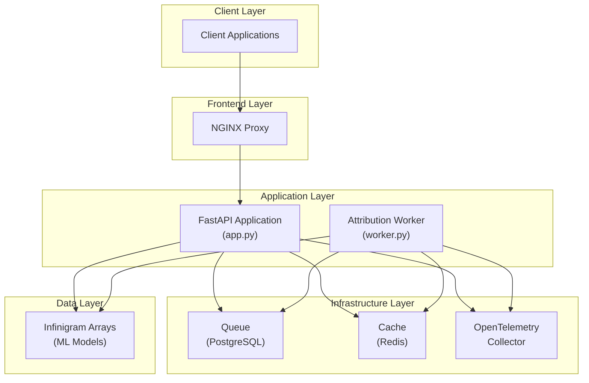
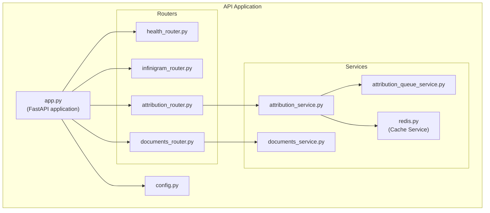
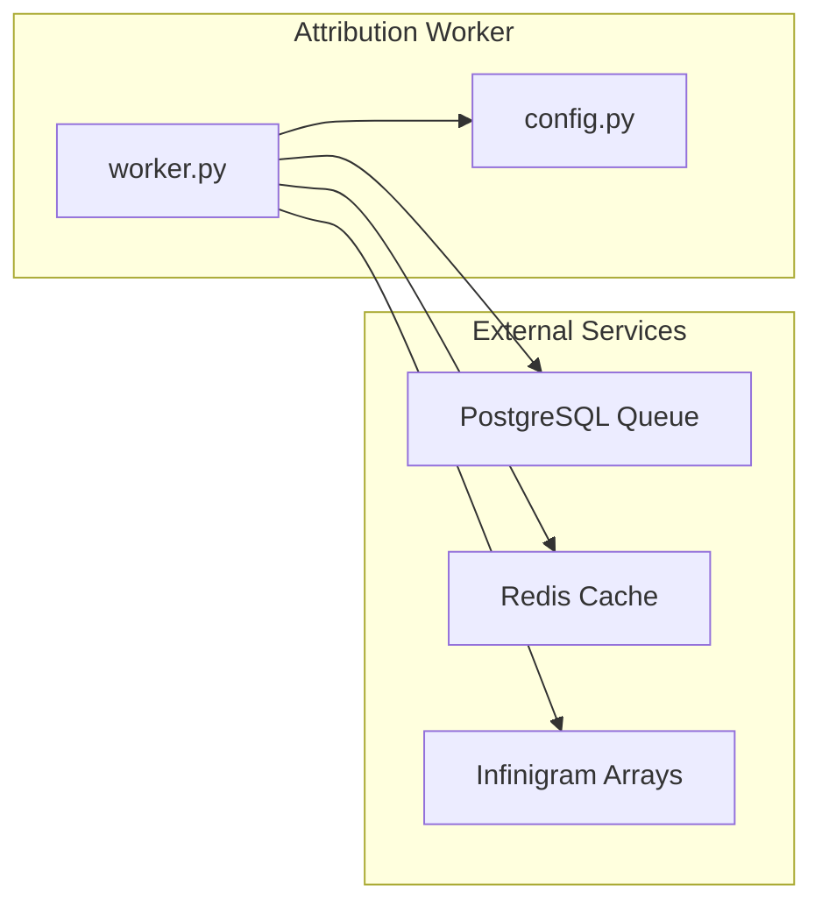
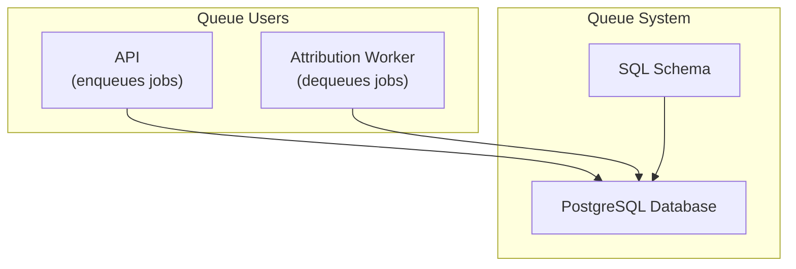
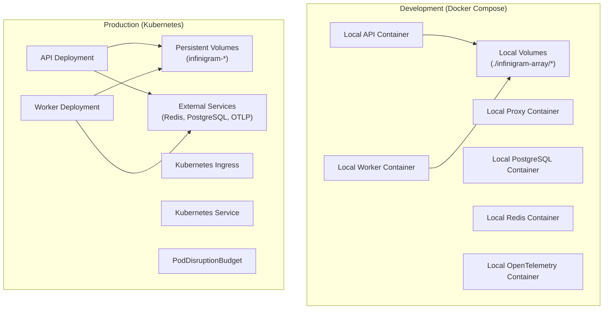

<!-- source: DeepWiki mcp.deepwiki.com · repo allenai/infinigram-api · page 2.1 Components · fetched 2026-10-26 -->

# Components

Relevant source files

The following files were used as context for generating this wiki page:

- [api/README.md](api/README.md)
- [api/app.py](api/app.py)
- [attribution_worker/README.md](attribution_worker/README.md)
- [docker-compose.yaml](docker-compose.yaml)
- [docs/CONTRIBUTING.md](docs/CONTRIBUTING.md)
- [docs/indexes.md](docs/indexes.md)
- [packages/infini-gram-processor/README.md](packages/infini-gram-processor/README.md)

This page details the main components of the Infinigram API system and their responsibilities. It provides an overview of how these components fit together to deliver attribution services and other functionality. For information about data flow between these components, see [Data Flow](#2.2).

## Core Components Overview

The Infinigram API system consists of several distinct components that work together to provide attribution and document services. Each component has specific responsibilities and interfaces with other components in well-defined ways.

Sources: [docker-compose.yaml:7-82](), [api/app.py:46-69]()

## FastAPI Application

The FastAPI application serves as the primary entry point for client requests. It handles direct requests for infinigram indices and document information, and manages the queuing of longer-running attribution requests.

### API Components

Sources: [api/app.py:1-55](), [api/README.md:1-3]()

### API Responsibilities

| Component | Responsibility |
|-----------|----------------|
| `app.py` | Main FastAPI application entry point that configures routers, middleware, and telemetry |
| `health_router.py` | Handles health check endpoints for monitoring system status |
| `infinigram_router.py` | Manages endpoints for querying available infinigram indices |
| `attribution_router.py` | Processes attribution requests, checking cache and queueing long-running tasks |
| `documents_router.py` | Handles document retrieval requests |
| `attribution_service.py` | Core business logic for attribution operations |
| `attribution_queue_service.py` | Manages interaction with the PostgreSQL queue |
| `redis.py` | Handles caching of attribution results |
| `config.py` | Manages application configuration from environment variables |

Sources: [api/app.py:16-25](), [api/README.md:1-3]()

## Attribution Worker

The Attribution Worker is a separate service that processes long-running attribution tasks asynchronously. It polls the PostgreSQL queue for jobs, processes them using the Infinigram arrays, and stores results in the Redis cache for later retrieval by the API.

Sources: [attribution_worker/README.md:1-3](), [docker-compose.yaml:29-46]()

## Proxy (NGINX)

The NGINX proxy sits in front of the API service and handles routing of client requests. It provides a unified entry point for all API calls and can handle SSL termination, load balancing, and other frontend responsibilities.

Sources: [docker-compose.yaml:48-53]()

## Queue (PostgreSQL)

The PostgreSQL database serves as a queue for storing attribution jobs. It provides persistent, reliable storage for jobs that need to be processed by the Attribution Worker, ensuring no work is lost even if services are restarted.

Sources: [docker-compose.yaml:67-76]()

## Cache (Redis)

Redis is used as a caching mechanism for storing the results of attribution operations. This reduces the need to recompute expensive attribution results for repeated requests and improves response times for clients.

Sources: [docker-compose.yaml:78-81](), [api/app.py:38]()

## OpenTelemetry Collector

The OpenTelemetry collector receives telemetry data (traces, metrics, logs) from the API and Attribution Worker. It processes this data and forwards it to appropriate monitoring and observability systems, allowing for detailed performance analysis and troubleshooting.

Sources: [docker-compose.yaml:55-65](), [api/app.py:11-14](), [api/app.py:56-67]()

## Infinigram Arrays (ML Models)

The Infinigram arrays are the core ML models that power the attribution functionality. They are mounted as volumes into both the API and Attribution Worker containers. Each array corresponds to a specific model with its own characteristics.

### Available Arrays

| Array Name | Path | Description |
|------------|------|-------------|
| v4_pileval_llama | `/mnt/infinigram-array/v4_pileval_llama` | Pileval Llama model |
| olmoe-mix-0924-dclm | `/mnt/infinigram-array/olmoe-mix-0924-dclm` | OLMoE Mix model with DCLM |
| olmoe-mix-0924-nodclm | `/mnt/infinigram-array/olmoe-mix-0924-nodclm` | OLMoE Mix model without DCLM |
| v4-olmoe-0125-1b-7b-anneal-adapt | `/mnt/infinigram-array/v4-olmoe-0125-1b-7b-anneal-adapt` | OLMoE 1B-7B model |
| v4-olmo-2-1124-13b-anneal-adapt | `/mnt/infinigram-array/v4-olmo-2-1124-13b-anneal-adapt` | OLMo-2 13B model |
| v4-olmo-2-0325-32b-anneal-adapt | `/mnt/infinigram-array/v4-olmo-2-0325-32b-anneal-adapt` | OLMo-2 32B model |

Sources: [docker-compose.yaml:16-22](), [docker-compose.yaml:39-45](), [docs/indexes.md:1-103]()

## Shared Libraries

### Infini-Gram Processor

Despite its name, this is a package containing code shared between different components of the Infinigram API system, including both the API and the Attribution Worker. It provides common functionality for working with Infinigram arrays and processing attribution requests.

Sources: [packages/infini-gram-processor/README.md:1-3](), [api/app.py:8]()

## Environment Setup

The Infinigram API system requires several environment variables to function properly. These include:

| Environment Variable | Purpose |
|----------------------|---------|
| `PYTHONUNBUFFERED` | Controls Python output buffering |
| `INDEX_BASE_PATH` | Path to the mounted Infinigram arrays |
| `ATTRIBUTION_QUEUE_URL` | Connection string for the PostgreSQL queue |
| `PYTHON_ENV` | Deployment environment (development/production) |
| `LOG_LEVEL` | Controls logging verbosity |
| `OTEL_EXPORTER_OTLP_ENDPOINT` | Endpoint for the OpenTelemetry collector |
| `CACHE_URL` | Connection string for the Redis cache |

Sources: [docker-compose.yaml:1-27]()

## Development vs. Production Environment

Sources: [docker-compose.yaml:1-82](), [docs/CONTRIBUTING.md:38-50](), [docs/indexes.md:77-95]()

---

