<!-- source: DeepWiki mcp.deepwiki.com · repo allenai/infinigram-api · page 2.2 Data Flow · fetched 2026-10-26 -->

# Data Flow

Relevant source files

The following files were used as context for generating this wiki page:

- [api/src/attribution/attribution_queue_service.py](api/src/attribution/attribution_queue_service.py)
- [api/src/attribution/attribution_service.py](api/src/attribution/attribution_service.py)
- [attribution_worker/config.py](attribution_worker/config.py)
- [attribution_worker/worker.py](attribution_worker/worker.py)

This document details how data flows through the infinigram-api system, with primary focus on attribution request processing. It explains the path that requests take from initial API call through to response delivery, including the asynchronous processing architecture. For information about the system components themselves, see [Components](#2.1).

## Overview

The infinigram-api system utilizes an asynchronous processing model for handling attribution requests, which can be computationally intensive. This architecture allows the system to remain responsive while performing complex operations like span attribution and document retrieval.

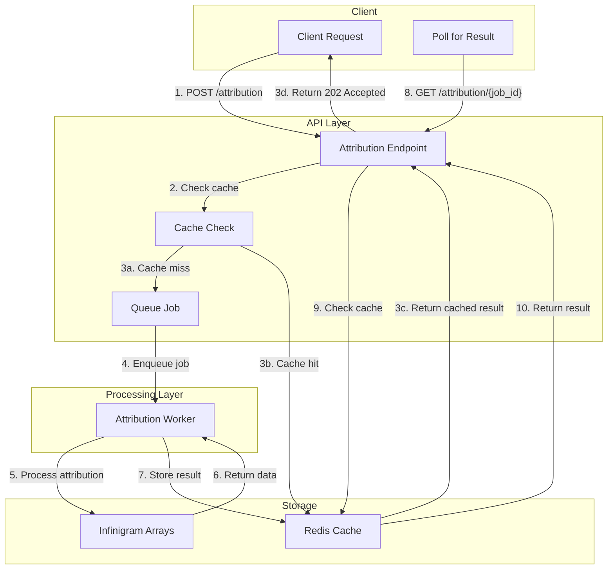

Sources: [api/src/attribution/attribution_service.py:161-228](), [attribution_worker/worker.py:58-142]()

## Attribution Request Flow

The attribution request flow follows a pattern of cache checking, asynchronous processing, and result retrieval.

### Initial Request Processing

When a client submits an attribution request, the API first attempts to retrieve a cached result to avoid redundant computation.

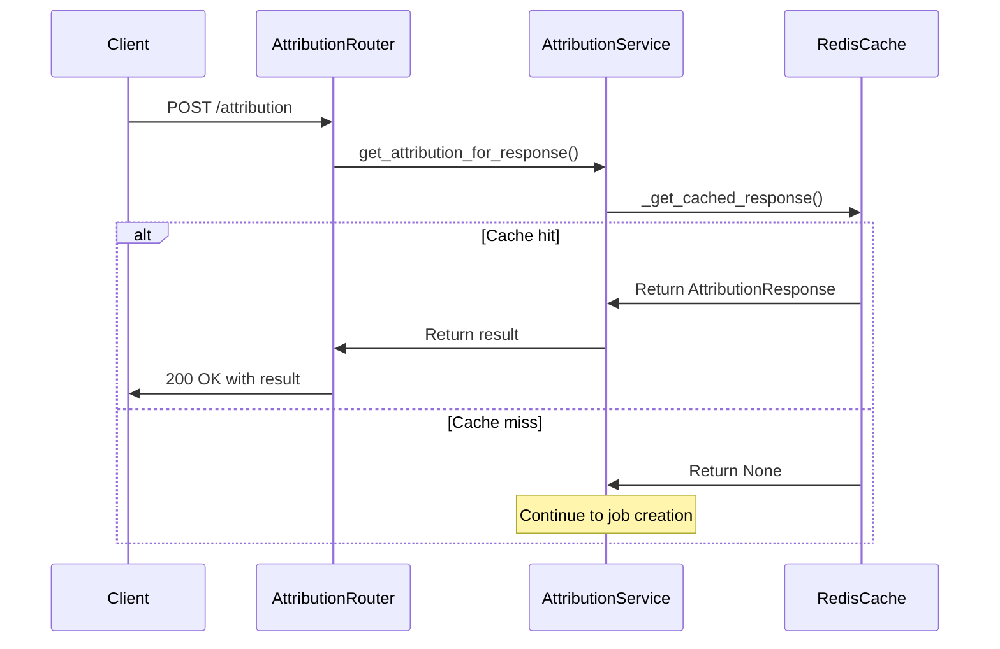

Sources: [api/src/attribution/attribution_service.py:101-137]()

### Job Creation and Queuing

If no cached result exists, the system generates a unique job ID and queues the attribution task for asynchronous processing.

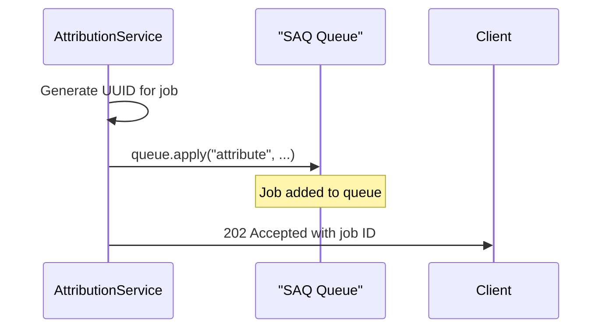

Sources: [api/src/attribution/attribution_service.py:161-228](), [api/src/attribution/attribution_queue_service.py:1-25]()

### Asynchronous Processing

The attribution worker processes the queued job, performing the computationally intensive attribution operations.

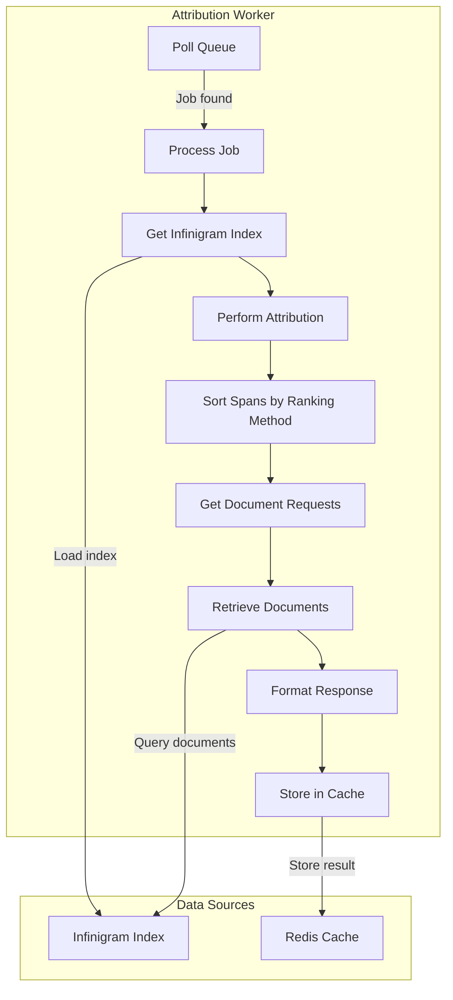

Sources: [attribution_worker/worker.py:58-142]()

### Result Retrieval

The client polls for the result, which is retrieved from the cache once processing is complete.

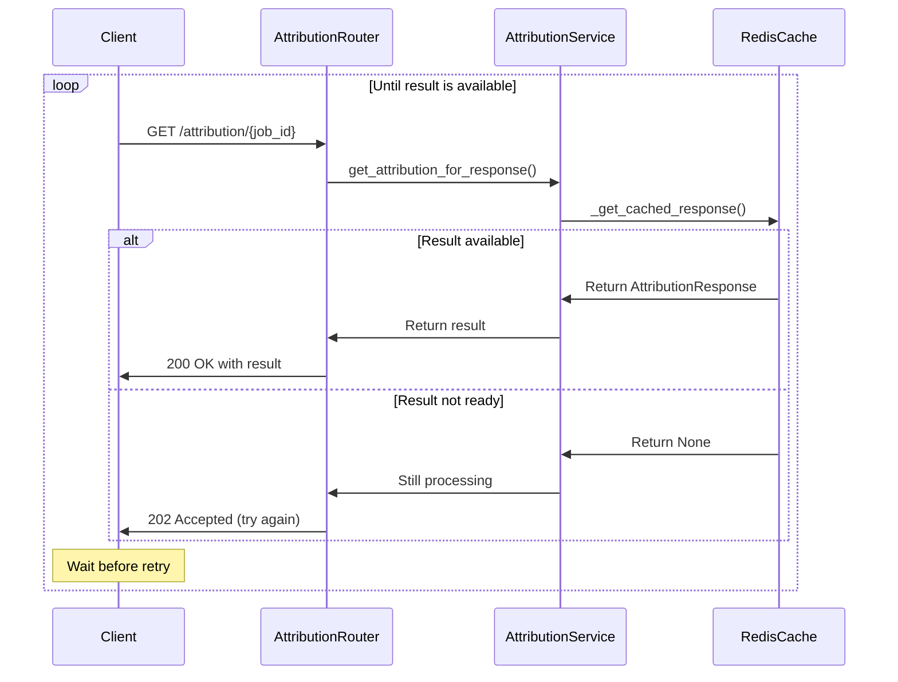

Sources: [api/src/attribution/attribution_service.py:101-137]()

## Cache System

The caching mechanism is central to the system's performance and user experience.

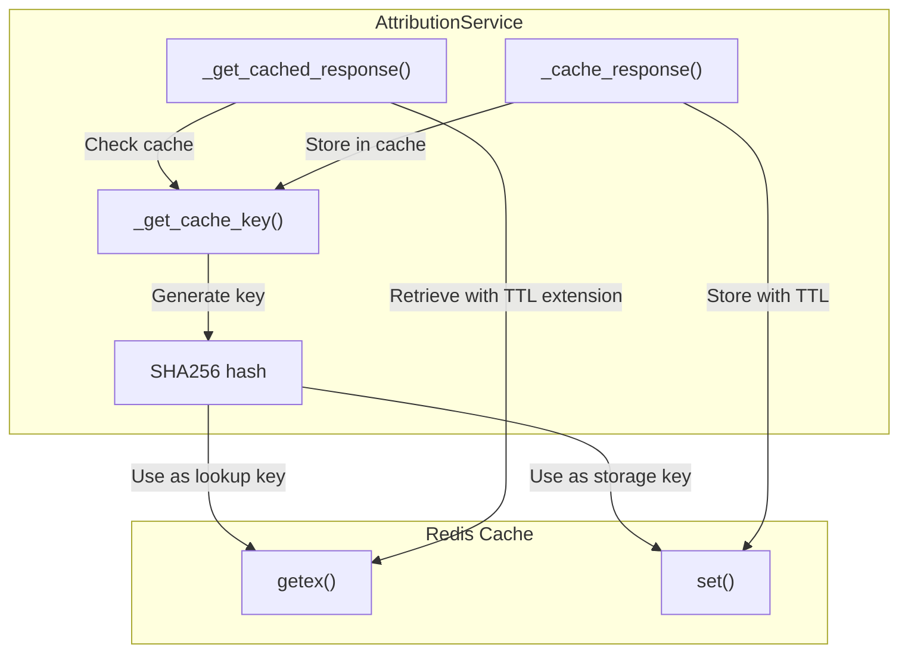

Sources: [api/src/attribution/attribution_service.py:91-159]()

### Cache Key Generation

Cache keys are generated by combining the request type, index, and serialized request data, then hashing with SHA256:

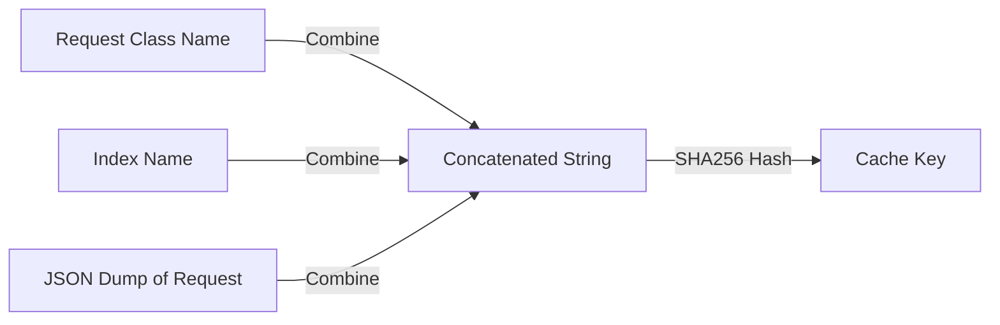

Sources: [api/src/attribution/attribution_service.py:91-99]()

### Cache TTL Management

The system uses different expiration times for cache entries:
- Newly cached results: 1 hour (3,600 seconds)
- Accessed cached results: Extended to 12 hours (43,200 seconds)

This approach keeps frequently accessed results available longer while allowing less popular results to expire sooner.

Sources: [api/src/attribution/attribution_service.py:101-137](), [api/src/attribution/attribution_service.py:139-159]()

## Attribution Worker Details

The attribution worker is responsible for the actual processing of attribution requests.

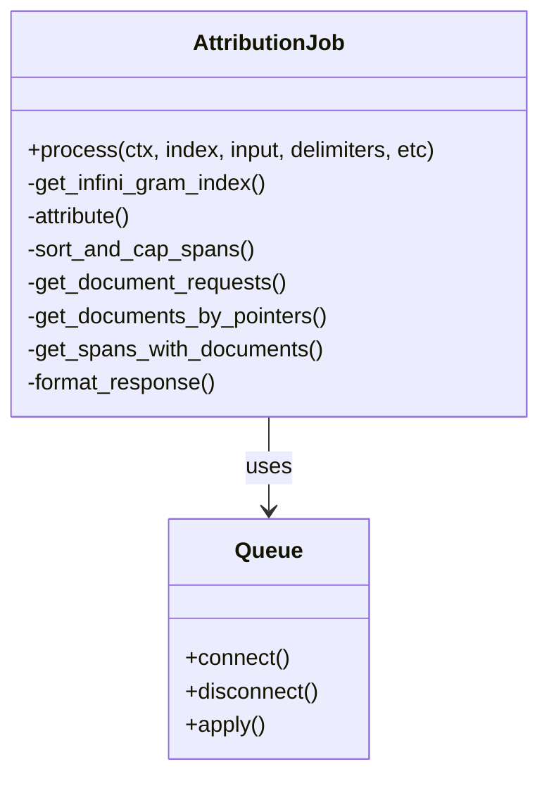

Sources: [attribution_worker/worker.py:58-142]()

### Worker Process Flow

The worker performs several key steps when processing an attribution job:

1. Extract OpenTelemetry context for distributed tracing
2. Retrieve the appropriate Infinigram index
3. Perform attribution on the input text
4. Sort and filter spans based on ranking method and density
5. Generate document requests for the selected spans
6. Retrieve documents from the Infinigram index
7. Format the response with spans and their associated documents
8. Store the result in Redis cache

Sources: [attribution_worker/worker.py:58-142]()

## Error Handling and Timeouts

The system includes mechanisms to handle errors and timeouts in the attribution process.

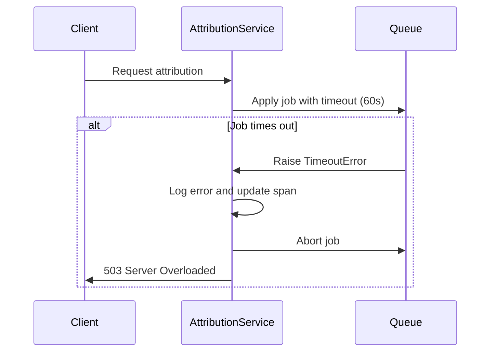

Sources: [api/src/attribution/attribution_service.py:212-228]()

## Data Models and Structures

The system uses several key data structures to represent attribution data:

| Model | Purpose | Key Fields |
|-------|---------|------------|
| `AttributionRequest` | Input parameters for attribution | `response`, `delimiters`, `minimum_span_length`, etc. |
| `AttributionResponse` | Complete attribution results | `spans`, `input_tokens`, `index` |
| `AttributionSpan` | Information about an attributed text span | `left`, `right`, `length`, `documents` |
| `AttributionDocument` | Document that contains a span | `text_long`, `text_snippet`, offsets |

Sources: [api/src/attribution/attribution_service.py:40-65]()

## Queue Configuration

The queue system is configured based on the application environment:

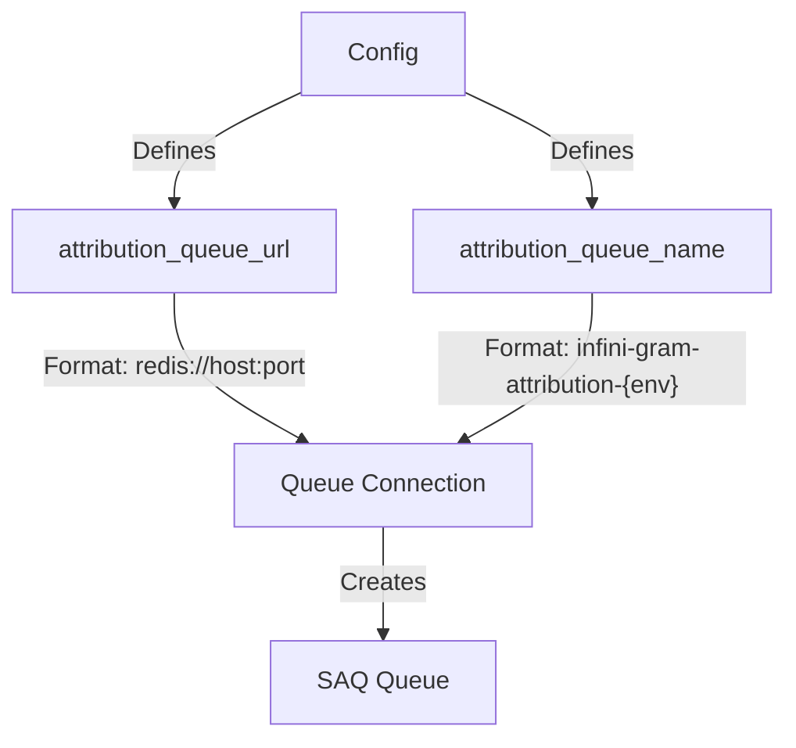

Sources: [attribution_worker/config.py:1-25](), [api/src/attribution/attribution_queue_service.py:1-25]()

## End-to-End Attribution Flow

This diagram illustrates the complete flow of an attribution request through the system, connecting code entities with their roles:

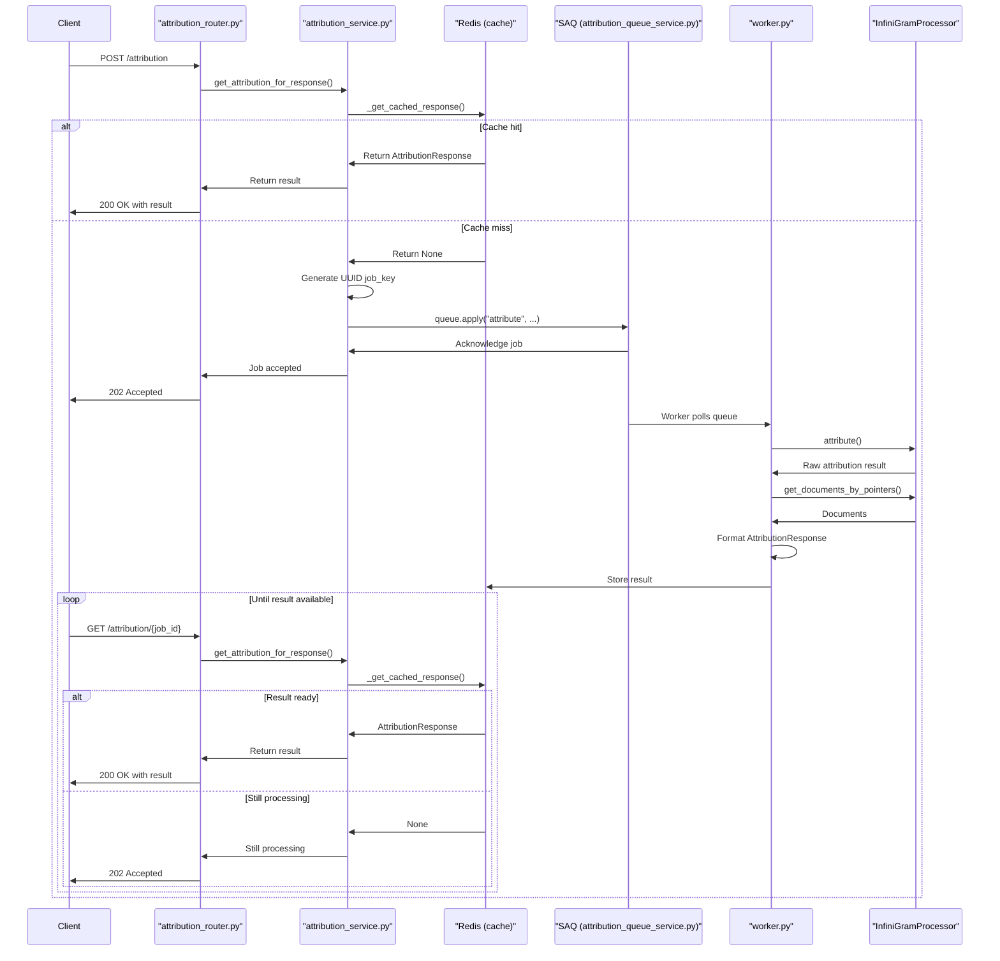

Sources: [api/src/attribution/attribution_service.py:161-228](), [attribution_worker/worker.py:58-142](), [api/src/attribution/attribution_queue_service.py:1-25]()

---

