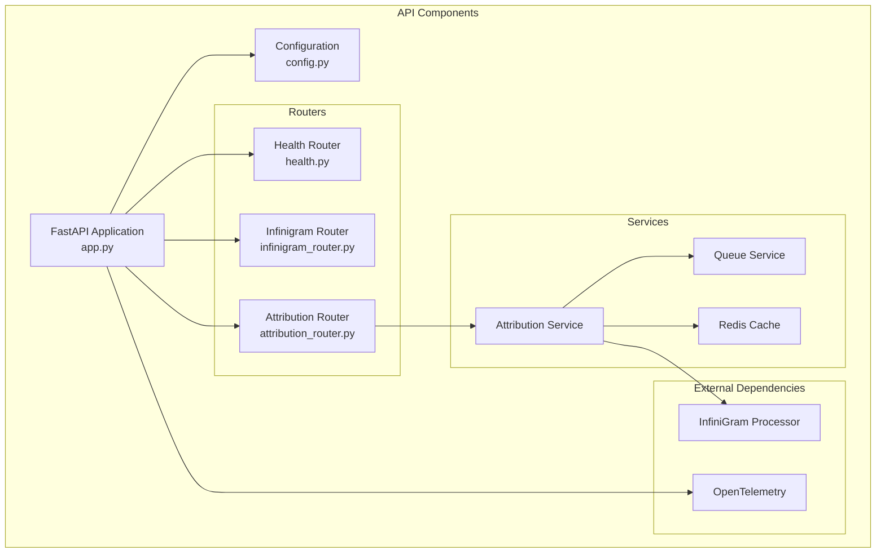
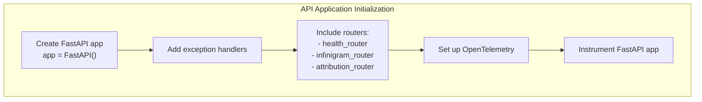
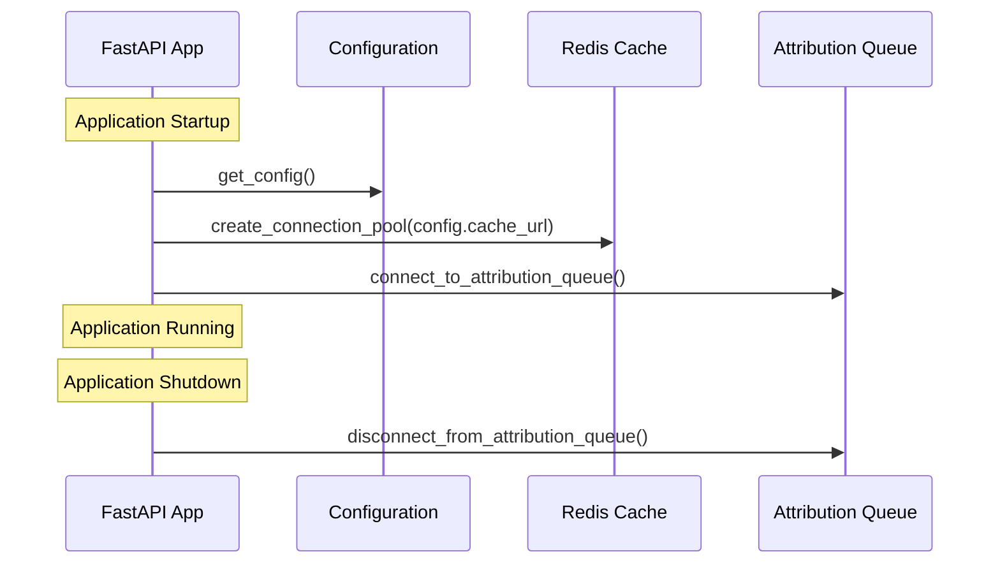
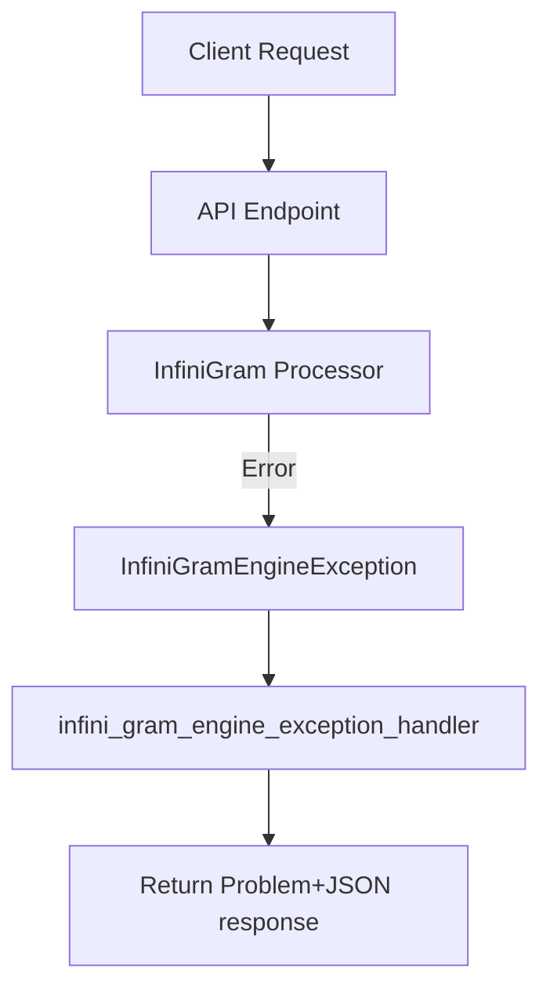
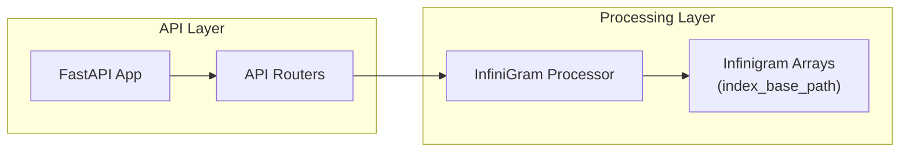
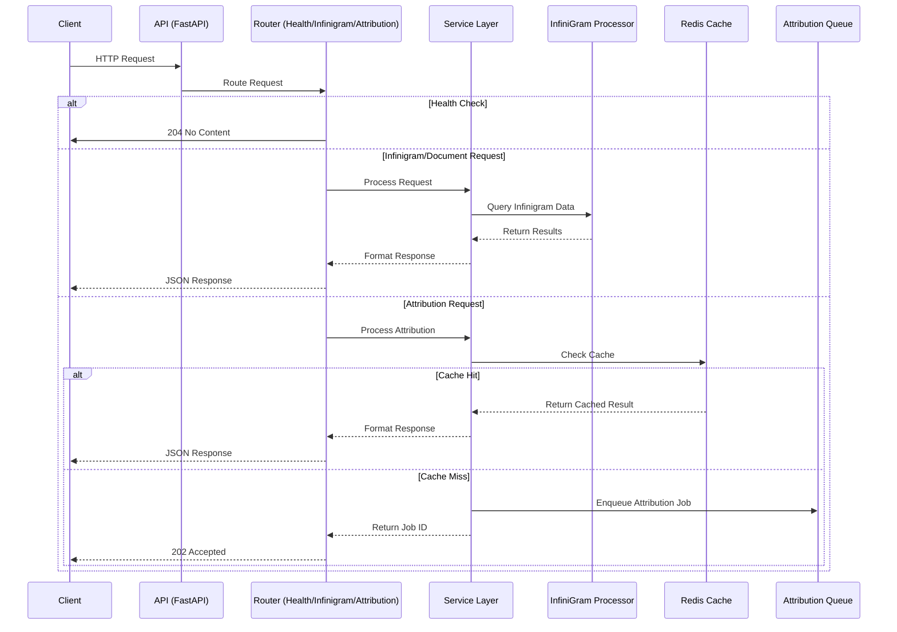

<!-- source: DeepWiki mcp.deepwiki.com · repo allenai/infinigram-api · page 3 API · fetched 2026-10-26 -->

# API

<details>
<summary>Relevant source files</summary>

The following files were used as context for generating this wiki page:

- [.vscode/extensions.json](.vscode/extensions.json)
- [api/app.py](api/app.py)
- [api/src/config.py](api/src/config.py)
- [api/src/health.py](api/src/health.py)
- [api/src/infinigram/__init__.py](api/src/infinigram/__init__.py)
- [packages/infini-gram-processor/src/infini_gram_processor/processor_config.py](packages/infini-gram-processor/src/infini_gram_processor/processor_config.py)

</details>


This page documents the API service of the infinigram-api system, which serves as the primary interface for client applications to interact with Infinigram's functionality. The API provides endpoints for retrieving infinigram indices, requesting text attribution, and accessing document information. For information about the Attribution Worker component, see [Attribution Worker](#4).

## Overview

The Infinigram API is built using FastAPI and serves as the central component that handles client requests. It exposes several endpoints grouped into logical routers and provides async processing for longer-running attribution tasks.



Sources: [api/app.py:1-70](), [api/src/config.py:1-32](), [api/src/health.py:1-12](), [api/src/infinigram/__init__.py:1-2]()

## API Configuration

The API configuration is managed through the `Config` class defined in `config.py`, which uses Pydantic's `BaseSettings` for environment-based configuration. This allows for flexible runtime configuration through environment variables or `.env` files.

| Configuration Parameter | Description | Default Value |
|-------------------------|-------------|---------------|
| `index_base_path` | Base path for infinigram array files | "/mnt/infinigram-array" |
| `profiling_enabled` | Toggle for profiling features | False |
| `application_name` | Name of the application | "infini-gram-api" |
| `attribution_queue_url` | URL for the attribution job queue | "redis://localhost:6379" |
| `python_env` | Deployment environment | "prod" |
| `cache_url` | URL for the Redis cache | "redis://localhost:6379" |
| `attribution_queue_name` | Computed queue name based on environment | "infini-gram-attribution-{env}" |

Sources: [api/src/config.py:1-32]()

## API Application Structure

The FastAPI application is defined in `app.py` and serves as the entrypoint for the API service. It includes several components:

### Main Application



Sources: [api/app.py:46-69]()

### Application Lifecycle

The API uses FastAPI's lifespan feature to manage connections and resources during startup and shutdown:



Sources: [api/app.py:34-43]()

## Routers

The API organizes endpoints into logical routers, each handling a specific domain of functionality:

### Health Router

The health router provides a simple health check endpoint that returns a 204 No Content response. This endpoint is used by Kubernetes to determine if the service is ready to receive traffic.

```
GET /health/ → 204 No Content
```

Sources: [api/src/health.py:1-12]()

### Infinigram Router

The infinigram router exposes endpoints for querying infinigram indices and related functionality. This router is imported from the `infinigram` package.

Sources: [api/src/infinigram/__init__.py:1-2]()

### Attribution Router

The attribution router handles text attribution requests, which may be processed asynchronously via a queue. This is one of the primary functionalities of the API.

Sources: [api/app.py:54]()

## Error Handling

The API implements custom exception handling for `InfiniGramEngineException`, which ensures that client applications receive proper error responses when issues occur with the underlying infinigram processor.



Sources: [api/app.py:46-50]()

## Telemetry

The API integrates with OpenTelemetry for observability. The implementation automatically creates spans for HTTP requests and responses, providing insights into API usage and performance.

Different telemetry configurations are used based on the environment:
- In development: Uses a Simple Span Processor with OTLP exporter
- In production: Uses a Batch Span Processor with Cloud Trace exporter for Google Cloud

The health endpoint is excluded from instrumentation to prevent excessive telemetry data from health checks.

Sources: [api/app.py:56-69]()

## Integration with Infinigram Processor

The API interfaces with the Infinigram Processor library, which provides the core functionality for working with infinigram arrays. The processor is configured to use the same `index_base_path` as the API, ensuring that both components can access the same infinigram data.



Sources: [api/src/config.py:12](), [packages/infini-gram-processor/src/infini_gram_processor/processor_config.py:1-15]()

## Request Processing Flow

The following diagram illustrates how the API processes different types of requests:



This diagram shows how different types of requests are handled by the API, including the use of caching and asynchronous processing for attribution requests.

Sources: [api/app.py:1-70](), [api/src/health.py:1-12]()

## Conclusion

The Infinigram API provides a well-structured interface to the Infinigram functionality, with separate routers for different domains and asynchronous processing for longer-running tasks. It integrates with various components such as Redis for caching, a job queue for attribution requests, and the Infinigram Processor library for the core functionality.

The API is designed with observability in mind, using OpenTelemetry for tracing and monitoring, and includes proper error handling to provide meaningful responses to client applications.

---

