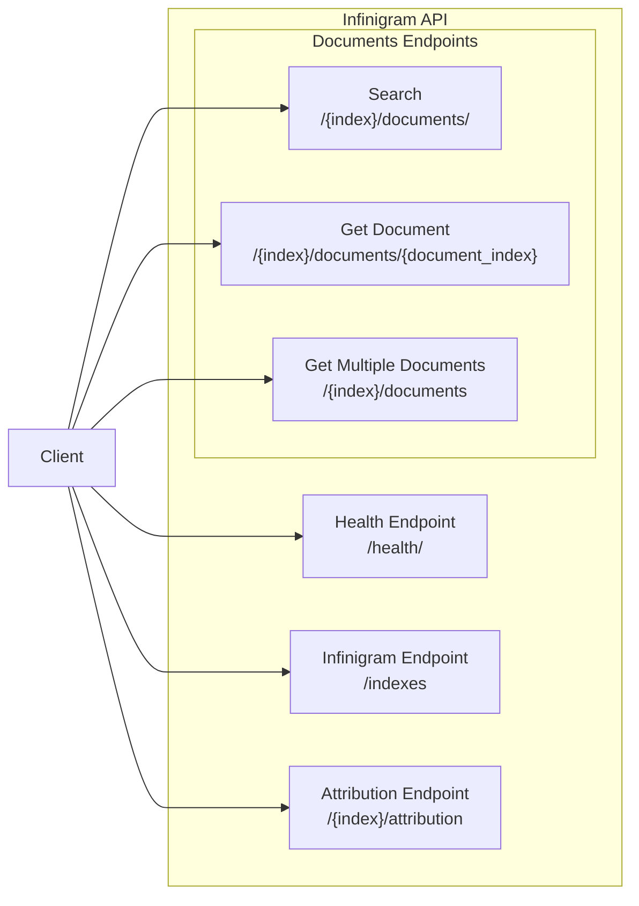
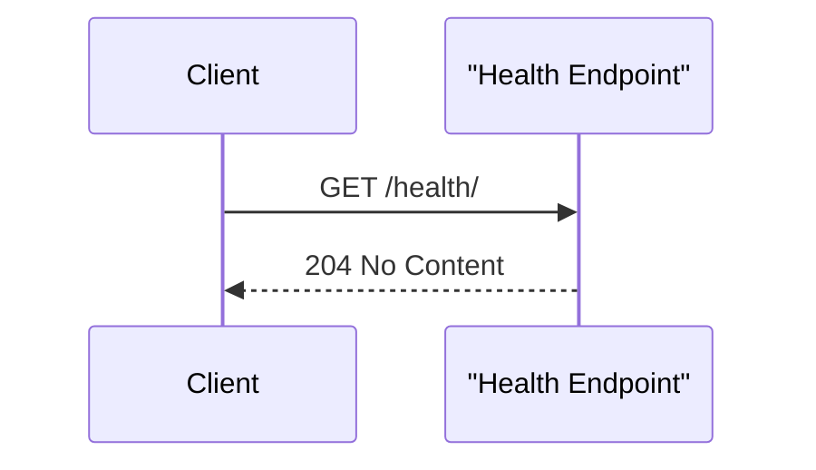
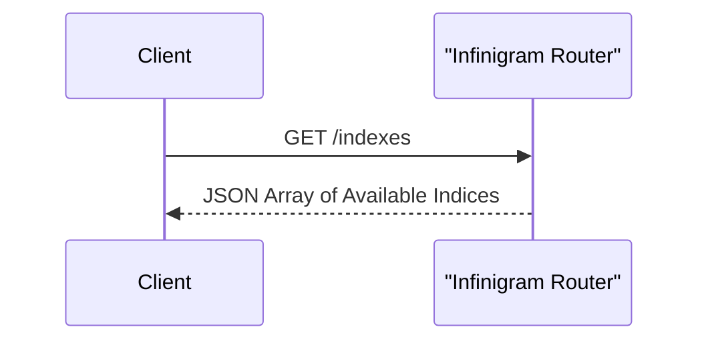
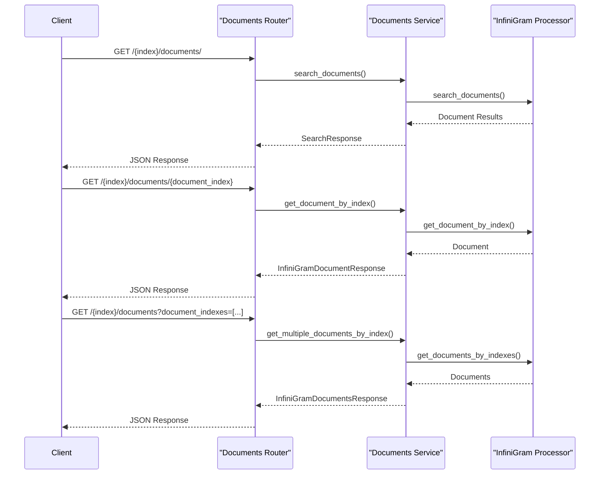
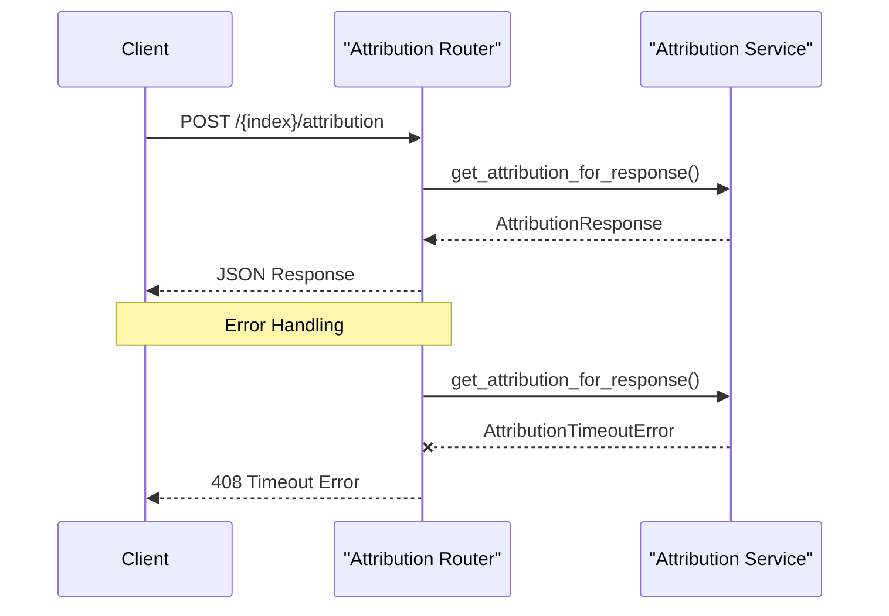
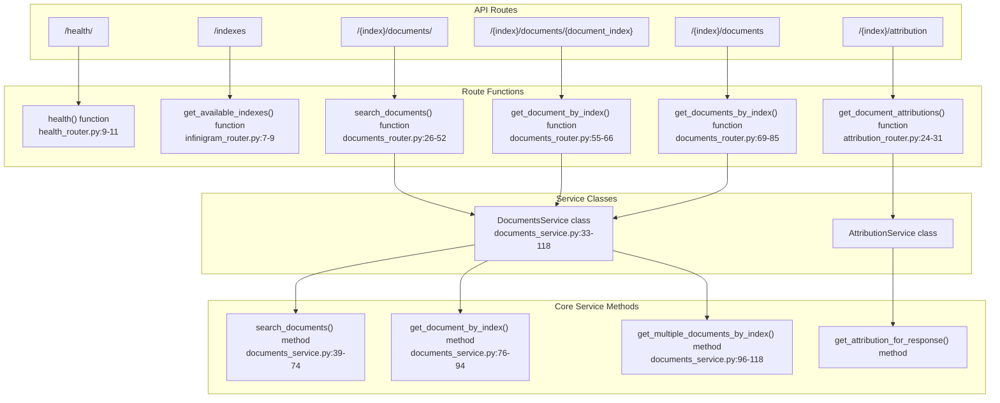

<!-- source: DeepWiki mcp.deepwiki.com · repo allenai/infinigram-api · page 3.1 Endpoints · fetched 2026-10-26 -->

# Endpoints

<details>
<summary>Relevant source files</summary>

The following files were used as context for generating this wiki page:

- [.vscode/extensions.json](.vscode/extensions.json)
- [.vscode/settings.json](.vscode/settings.json)
- [api/src/attribution/attribution_router.py](api/src/attribution/attribution_router.py)
- [api/src/documents/documents_router.py](api/src/documents/documents_router.py)
- [api/src/documents/documents_service.py](api/src/documents/documents_service.py)
- [api/src/health.py](api/src/health.py)
- [api/src/infinigram/__init__.py](api/src/infinigram/__init__.py)
- [api/src/infinigram/infinigram_router.py](api/src/infinigram/infinigram_router.py)

</details>


## Purpose

This document details the API endpoints provided by the Infinigram API system, their parameters, expected request/response formats, and usage patterns. For information about the overall API architecture, see [API](#3).

## Endpoint Overview

The Infinigram API provides four categories of endpoints:

1. Health Endpoint - For system health monitoring
2. Infinigram Endpoints - For retrieving index information
3. Documents Endpoints - For document retrieval and search
4. Attribution Endpoints - For text attribution analysis

### Endpoint Structure



Sources: [api/src/health.py](), [api/src/infinigram/infinigram_router.py](), [api/src/documents/documents_router.py](), [api/src/attribution/attribution_router.py]()

## Health Endpoint

The health endpoint is used by Kubernetes to determine if the application is ready to receive traffic.

### Endpoint Details

| Method | Path     | Description      | Response Code |
|--------|----------|------------------|---------------|
| GET    | /health/ | System health check | 204 No Content |

This endpoint returns a 204 No Content response when the system is healthy and is primarily used by Kubernetes (Skiff) to verify application readiness.



Sources: [api/src/health.py:9-11]()

## Infinigram Endpoints

### Get Available Indexes

Retrieves a list of all available infinigram indices that can be used with other endpoints.

#### Endpoint Details

| Method | Path     | Description      | Response |
|--------|----------|------------------|----------|
| GET    | /indexes | Get available indices | Array of index IDs |

#### Response Format

```json
[
  "pileval-gpt2",
  "olmoe-mix-0924",
  "olmoe-mix-0924-nodclm",
  "v4-olmoe-0125-1b-7b-anneal-adapt",
  "v4-olmo-2-1124-13b-anneal-adapt",
  "v4-olmo-2-0325-32b-anneal-adapt"
]
```



Sources: [api/src/infinigram/infinigram_router.py:7-9]()

## Documents Endpoints

The Documents API provides three endpoints for searching and retrieving documents.

### Search Documents

Searches for documents using a query string.

#### Endpoint Details

| Method | Path | Description | Parameters |
|--------|------|-------------|------------|
| GET | /{index}/documents/ | Search documents | See below |

#### Query Parameters

| Parameter | Type | Required | Default | Description |
|-----------|------|----------|---------|-------------|
| search | string | Yes | - | The search query string |
| maximum_document_display_length | int | No | 10 | Maximum length in tokens of the returned document text |
| page | int | No | 0 | The page of documents to retrieve |
| page_size | int | No | 10 | Number of documents to return per page |

#### Response

Returns a `SearchResponse` object with the following structure:

```json
{
  "index": "string",
  "documents": [
    {
      "text": "string",
      "document_index": 0,
      "document_length": 0,
      "display_length": 0,
      "needle_offset": 0,
      "metadata": {},
      "token_ids": []
    }
  ],
  "page": 0,
  "page_size": 10,
  "page_count": 0,
  "total_documents": 0
}
```

### Get Document by Index

Retrieves a specific document by its index.

#### Endpoint Details

| Method | Path | Description | Parameters |
|--------|------|-------------|------------|
| GET | /{index}/documents/{document_index} | Get document by index | See below |

#### Path Parameters

| Parameter | Type | Required | Description |
|-----------|------|----------|-------------|
| index | string | Yes | The infinigram index |
| document_index | int | Yes | The index of the document to retrieve |

#### Query Parameters

| Parameter | Type | Required | Default | Description |
|-----------|------|----------|---------|-------------|
| maximum_document_display_length | int | No | 10 | Maximum length in tokens of the returned document text |

#### Response

Returns an `InfiniGramDocumentResponse` object with the following structure:

```json
{
  "index": "string",
  "document_index": 0,
  "document_length": 0,
  "display_length": 0,
  "needle_offset": 0,
  "metadata": {},
  "token_ids": [],
  "text": "string"
}
```

### Get Multiple Documents by Index

Retrieves multiple documents by their indices.

#### Endpoint Details

| Method | Path | Description | Parameters |
|--------|------|-------------|------------|
| GET | /{index}/documents | Get multiple documents by index | See below |

#### Query Parameters

| Parameter | Type | Required | Default | Description |
|-----------|------|----------|---------|-------------|
| document_indexes | array[int] | Yes | - | A list of document indices to retrieve |
| maximum_document_display_length | int | No | 10 | Maximum length in tokens of the returned document text |

#### Response

Returns an `InfiniGramDocumentsResponse` object with the following structure:

```json
{
  "index": "string",
  "documents": [
    {
      "document_index": 0,
      "document_length": 0,
      "display_length": 0,
      "needle_offset": 0,
      "metadata": {},
      "token_ids": [],
      "text": "string"
    }
  ]
}
```

### Documents Request Flow



Sources: [api/src/documents/documents_router.py:26-85](), [api/src/documents/documents_service.py:33-118]()

## Attribution Endpoints

### Get Document Attributions

Performs attribution analysis on text.

#### Endpoint Details

| Method | Path | Description | Parameters |
|--------|------|-------------|------------|
| POST | /{index}/attribution | Get document attributions | See below |

#### Path Parameters

| Parameter | Type | Required | Description |
|-----------|------|----------|-------------|
| index | string | Yes | The infinigram index to use for attribution |

#### Request Body

The request body should be an `AttributionRequest` object with the following structure:

```json
{
  "query": "string",
  "top_k": 10
}
```

| Field | Type | Required | Default | Description |
|-------|------|----------|---------|-------------|
| query | string | Yes | - | The text to analyze for attribution |
| top_k | int | No | 10 | The maximum number of attribution results to return |

#### Response

Returns an `AttributionResponse` object containing the attribution results.

#### Error Responses

| Status Code | Description |
|-------------|-------------|
| 408 | Attribution Timeout Error |



Sources: [api/src/attribution/attribution_router.py:16-31]()

## Implementation Mapping

The following diagram shows how API endpoints map to specific code implementations:



Sources: [api/src/health.py](), [api/src/infinigram/infinigram_router.py](), [api/src/documents/documents_router.py](), [api/src/documents/documents_service.py](), [api/src/attribution/attribution_router.py]()

---

