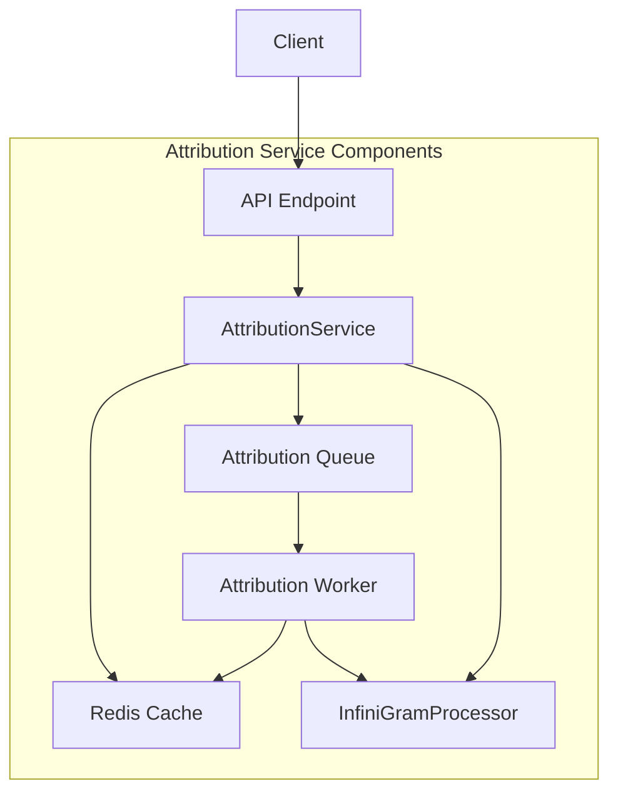
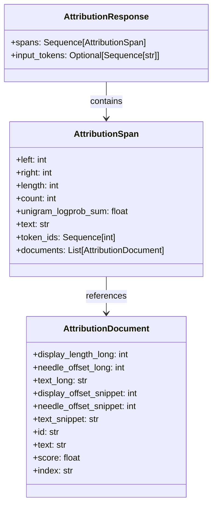
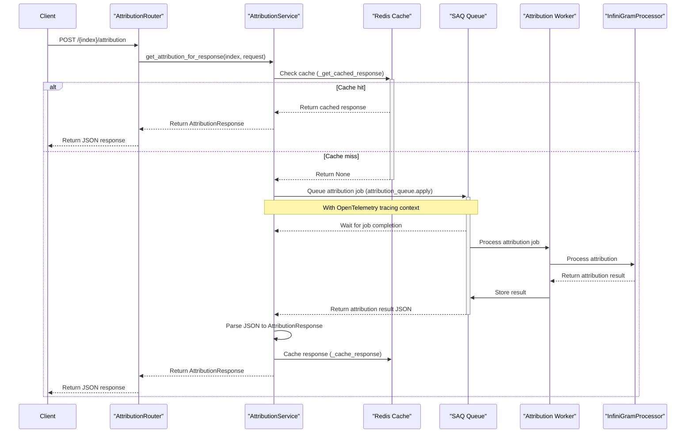
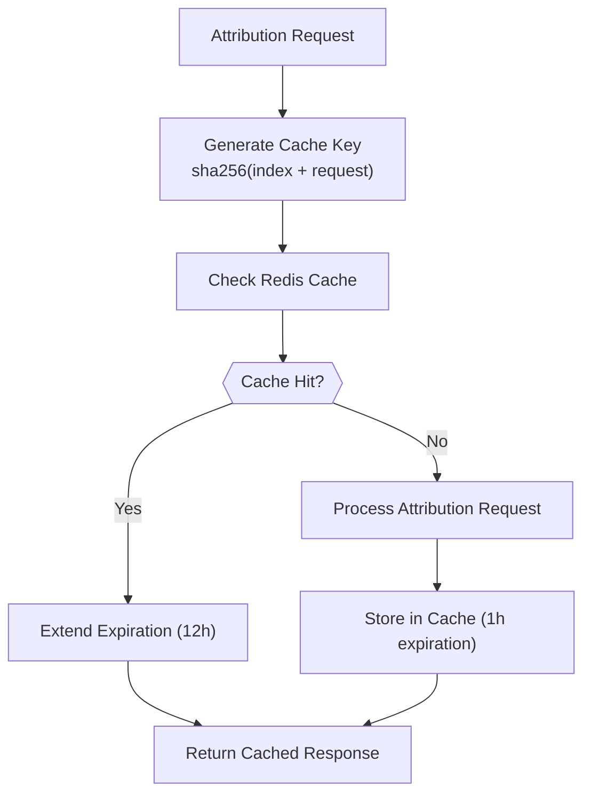
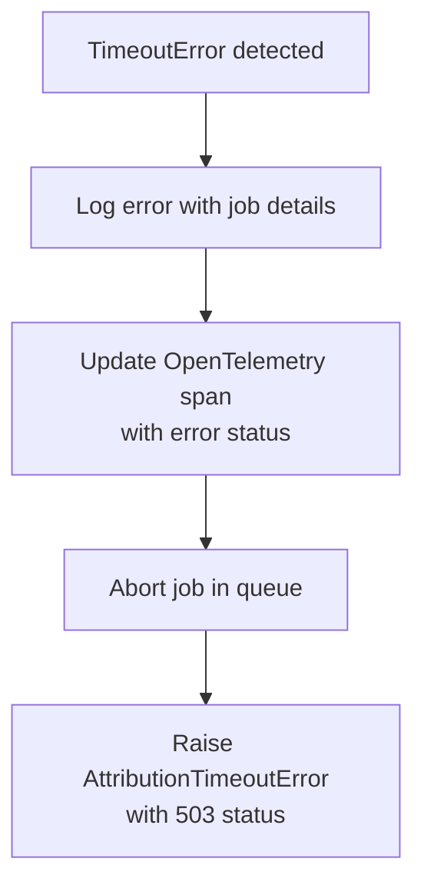

<!-- source: DeepWiki mcp.deepwiki.com · repo allenai/infinigram-api · page 3.2 Attribution Service · fetched 2026-10-26 -->

# Attribution Service

<details>
<summary>Relevant source files</summary>

The following files were used as context for generating this wiki page:

- [api/src/attribution/attribution_router.py](api/src/attribution/attribution_router.py)
- [api/src/attribution/attribution_service.py](api/src/attribution/attribution_service.py)

</details>


The Attribution Service is a core component of the Infinigram API that processes attribution requests to identify the origins of generated text. It handles the computation-intensive task of attributing spans of text to source documents, implementing efficient caching and asynchronous processing to manage resource utilization effectively. This page documents the service's architecture, components, data flow, and implementation details.

For information about the API endpoints that interface with this service, see [Endpoints](#3.1). For details on the worker that processes attribution jobs, see [Attribution Worker](#4).

## Overview

The Attribution Service acts as a bridge between client requests for attribution and the actual processing of those requests. It manages:

1. Processing incoming attribution requests
2. Checking/storing results in the Redis cache
3. Queueing attribution jobs for asynchronous processing
4. Returning attribution results to clients



Sources: [api/src/attribution/attribution_service.py:72-90](api/src/attribution/attribution_service.py:72-90), [api/src/attribution/attribution_router.py:16-31]()

## Data Models

The Attribution Service uses several key data models:

### AttributionRequest

The `AttributionRequest` model represents incoming attribution requests from clients. It contains parameters such as:
- `response`: The text to be attributed
- `delimiters`: Delimiters for tokenization
- `minimum_span_length`: Minimum length for attributable spans
- `maximum_documents_per_span`: Maximum number of documents to return per span
- Other configuration parameters for controlling attribution behavior

### AttributionResponse

The `AttributionResponse` extends `BaseInfiniGramResponse` and represents the result of an attribution operation:



Sources: [api/src/attribution/attribution_service.py:40-65]()

## Service Implementation

The `AttributionService` class is the central implementation of the attribution service functionality.

### Constructor and Dependencies

The service uses dependency injection to receive its required components:

```python
def __init__(
    self,
    infini_gram_processor: InfiniGramProcessorDependency,
    documents_service: DocumentsServiceDependency,
    attribution_queue: AttributionQueueDependency,
    cache: CacheDependency,
):
    self.infini_gram_processor = infini_gram_processor
    self.documents_service = documents_service
    self.attribution_queue = attribution_queue
    self.cache = cache
```

Sources: [api/src/attribution/attribution_service.py:79-89]()

## Request Processing Flow

The following diagram illustrates how attribution requests flow through the system:



Sources: [api/src/attribution/attribution_service.py:161-228](), [api/src/attribution/attribution_router.py:24-31]()

## Caching Implementation

The Attribution Service implements efficient caching to avoid redundant processing of identical requests:

1. **Cache Key Generation**: A unique cache key is created by hashing a combination of the index and request data
2. **Cache Retrieval**: Cached responses are retrieved with an extended expiration time
3. **Cache Storage**: New attribution results are stored with a 1-hour expiration time



Sources: [api/src/attribution/attribution_service.py:91-159]()

### Cache Key Generation

The service generates cache keys by:
1. Combining the request class name, index, and serialized request data
2. Hashing the combined string using SHA-256

```python
def _get_cache_key(self, index: str, request: AttributionRequest) -> bytes:
    combined_index_and_request = (
        f"{request.__class__.__qualname__}::{index}{request.model_dump_json()}"
    )
    key = sha256(
        combined_index_and_request.encode("utf-8", errors="ignore")
    ).digest()

    return key
```

Sources: [api/src/attribution/attribution_service.py:91-99]()

### Cache Retrieval

When retrieving cached responses, the service:
1. Gets the cache key for the request
2. Retrieves the cached JSON from Redis
3. Extends the expiration time to 12 hours
4. Deserializes the JSON into an `AttributionResponse` object

Source: [api/src/attribution/attribution_service.py:101-137]()

### Cache Storage

When storing new attribution results, the service:
1. Gets the cache key for the request
2. Stores the raw JSON response
3. Sets an expiration time of 1 hour

Source: [api/src/attribution/attribution_service.py:139-159]()

## Asynchronous Processing

Attribution requests are processed asynchronously through a queue system:

1. If a response is not in the cache, an attribution job is queued with a unique ID
2. The job includes the request parameters and OpenTelemetry tracing context
3. The service awaits the job's completion
4. Upon completion, the result is cached and returned to the client

Source: [api/src/attribution/attribution_service.py:174-211]()

## Error Handling

The Attribution Service has robust error handling, particularly for timeouts:

1. If job processing exceeds the timeout (60 seconds), a `TimeoutError` is raised
2. The error is logged and traced with OpenTelemetry
3. The job is aborted in the queue
4. An `AttributionTimeoutError` is returned to the client with a 503 status code



Source: [api/src/attribution/attribution_service.py:212-228](), [api/src/attribution/attribution_service.py:67-72]()

## API Integration

The Attribution Service is exposed via a FastAPI router that defines a POST endpoint for attribution requests:

```python
@attribution_router.post(
    path="/{index}/attribution",
    responses={
        AttributionTimeoutError.status: generate_swagger_response(
            AttributionTimeoutError
        )
    },
)
async def get_document_attributions(
    index: str,
    body: AttributionRequest,
    attribution_service: Annotated[AttributionService, Depends()],
) -> AttributionResponse:
    result = await attribution_service.get_attribution_for_response(index, body)
    return result
```

Source: [api/src/attribution/attribution_router.py:16-31]()

## Observability

The Attribution Service integrates with OpenTelemetry for tracing and monitoring:

1. Every key method is wrapped with a span for detailed tracing
2. Events are added to spans for important operations (cache hits, etc.)
3. Error states are properly recorded in spans
4. Tracing context is propagated to the worker for end-to-end visibility

Source: [api/src/attribution/attribution_service.py:101-101](), [api/src/attribution/attribution_service.py:139-139](), [api/src/attribution/attribution_service.py:161-161](), [api/src/attribution/attribution_service.py:174-186]()

## Summary

The Attribution Service is a critical component that enables the attribution of text spans to source documents. Its design emphasizes:

1. **Efficiency**: Through caching and asynchronous processing
2. **Resilience**: With robust error handling and timeouts
3. **Observability**: Via comprehensive tracing
4. **Scalability**: By offloading computation to a dedicated worker

This design allows the service to handle potentially resource-intensive attribution tasks while maintaining API responsiveness.

---

