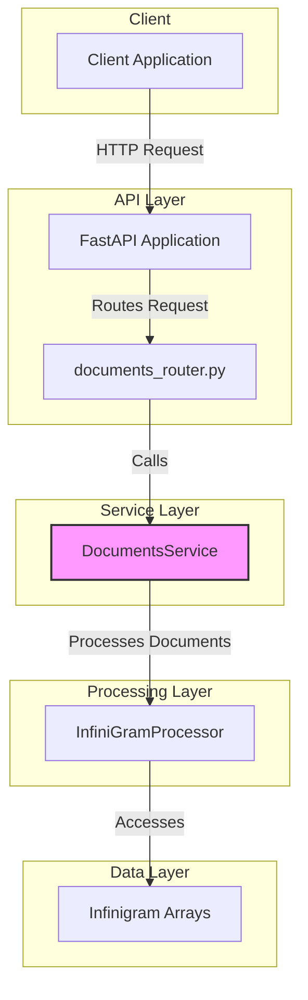
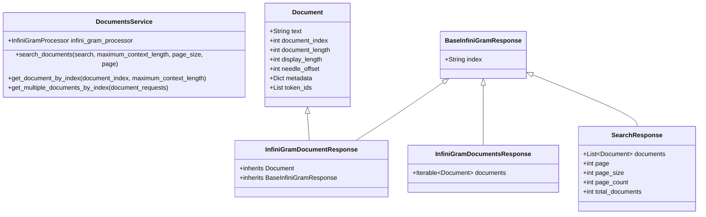
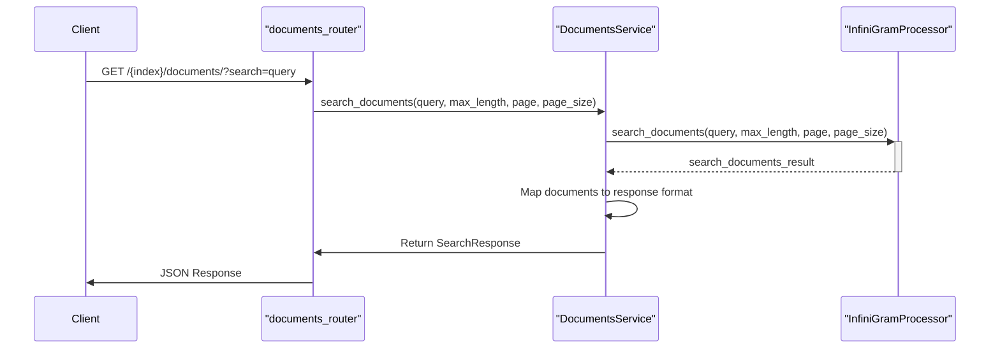
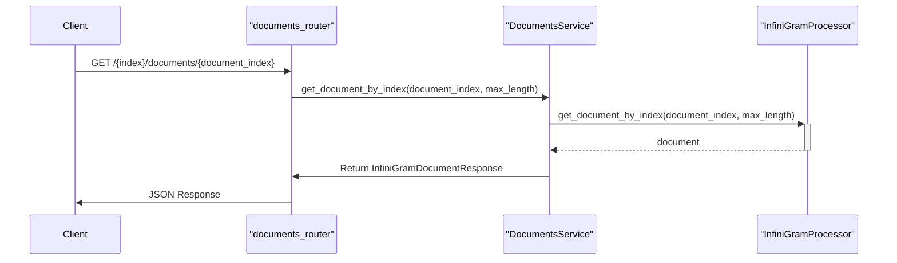

<!-- source: DeepWiki mcp.deepwiki.com · repo allenai/infinigram-api · page 3.3 Documents Service · fetched 2026-10-26 -->

# Documents Service

<details>
<summary>Relevant source files</summary>

The following files were used as context for generating this wiki page:

- [api/src/documents/documents_router.py](api/src/documents/documents_router.py)
- [api/src/documents/documents_service.py](api/src/documents/documents_service.py)

</details>


## Purpose and Scope

The Documents Service is responsible for retrieving and handling document data within the Infinigram API system. It provides functionality for searching documents, retrieving individual documents by their index, and fetching multiple documents in a single request. This service is a core component of the API layer that interacts with the underlying Infinigram arrays (ML models) to access document content.

For information about the Attribution Service which may use document data for attribution analysis, see [Attribution Service](#3.2).

Sources: [api/src/documents/documents_service.py:33-118](), [api/src/documents/documents_router.py:1-86]()

## Architecture

The Documents Service fits into the Infinigram API system as follows:



The Documents Service acts as an intermediary between the API endpoints and the InfiniGramProcessor, which interacts directly with the Infinigram arrays. It provides a structured interface for accessing document data and handles the transformation of raw document data into standardized response objects.

Sources: [api/src/documents/documents_service.py:33-39](), [api/src/documents/documents_router.py:13-24]()

## Components and Data Models

### Class Structure



### Key Components

1. **DocumentsService**: The main service class that processes document requests
2. **Response Models**:
   - `InfiniGramDocumentResponse`: Represents a single document response
   - `InfiniGramDocumentsResponse`: Contains multiple documents
   - `SearchResponse`: Used for search results with pagination information

Sources: [api/src/documents/documents_service.py:18-32](), [api/src/documents/documents_service.py:33-118]()

## API Endpoints

The Documents Service exposes three main API endpoints:

| Endpoint | Method | Description | Parameters | Response |
|----------|--------|-------------|------------|----------|
| `/{index}/documents/` | GET | Search for documents | `search`, `maximum_document_display_length`, `page`, `page_size` | `SearchResponse` |
| `/{index}/documents/{document_index}` | GET | Get a specific document | `document_index`, `maximum_document_display_length` | `InfiniGramDocumentResponse` |
| `/{index}/documents` | GET | Get multiple documents | `document_indexes`, `maximum_document_display_length` | `InfiniGramDocumentsResponse` |

### Common Parameters

- `index`: The Infinigram index to query
- `maximum_document_display_length`: The maximum length in tokens of the returned document text (default: 10)

Sources: [api/src/documents/documents_router.py:26-85]()

## Request Flow

### Document Search Flow



### Document Retrieval Flow



Sources: [api/src/documents/documents_service.py:39-74](), [api/src/documents/documents_service.py:76-94](), [api/src/documents/documents_router.py:26-52](), [api/src/documents/documents_router.py:55-66]()

## Implementation Details

### Search Documents

The `search_documents` method queries the InfiniGramProcessor to find documents matching a search query. It handles pagination and converts the raw document data into the standardized `SearchResponse` format.

```
search_documents(
    search: str,               # The search query
    maximum_context_length: int, # Max document display length
    page_size: int,            # Number of documents per page
    page: int                  # Page number (0-indexed)
) -> SearchResponse
```

Key operations:
1. Query the InfiniGramProcessor with the search parameters
2. Map the returned documents to the standard Document format
3. Calculate pagination details (total pages, etc.)
4. Return a structured SearchResponse

Sources: [api/src/documents/documents_service.py:39-74]()

### Get Document by Index

The `get_document_by_index` method retrieves a single document using its index identifier.

```
get_document_by_index(
    document_index: int,         # The index of the document to retrieve
    maximum_context_length: int  # Max document display length
) -> InfiniGramDocumentResponse
```

Key operations:
1. Request a specific document from the InfiniGramProcessor
2. Map the returned document to the InfiniGramDocumentResponse format
3. Return the formatted response

Sources: [api/src/documents/documents_service.py:76-94]()

### Get Multiple Documents by Index

The `get_multiple_documents_by_index` method retrieves multiple documents in a single operation.

```
get_multiple_documents_by_index(
    document_requests: Iterable[GetDocumentByIndexRequest]  # List of document requests
) -> InfiniGramDocumentsResponse
```

Key operations:
1. Request multiple documents from the InfiniGramProcessor
2. Map each returned document to the standard Document format
3. Return all documents in an InfiniGramDocumentsResponse

Sources: [api/src/documents/documents_service.py:96-118]()

## Observability

The Documents Service uses OpenTelemetry for tracing request handling. Each public method in the DocumentsService class is decorated with `@tracer.start_as_current_span` to create spans for monitoring service performance and debugging issues.

Example traces:
- `documents_service/search_documents`
- `documents_service/get_document_by_index`
- `documents_service/get_multiple_documents_by_index`

Sources: [api/src/documents/documents_service.py:39](), [api/src/documents/documents_service.py:76](), [api/src/documents/documents_service.py:96]()

## Integration with Other Services

The Documents Service primarily interacts with the InfiniGramProcessor, which serves as the interface to the underlying Infinigram arrays. It may also be used by the Attribution Service when performing attribution analysis that requires document context.

The service follows a clean architectural pattern where:
1. The router handles HTTP request parsing and validation
2. The service contains the business logic
3. The InfiniGramProcessor provides access to the data layer

Sources: [api/src/documents/documents_service.py:33-39](), [api/src/documents/documents_router.py:13-24]()

---

