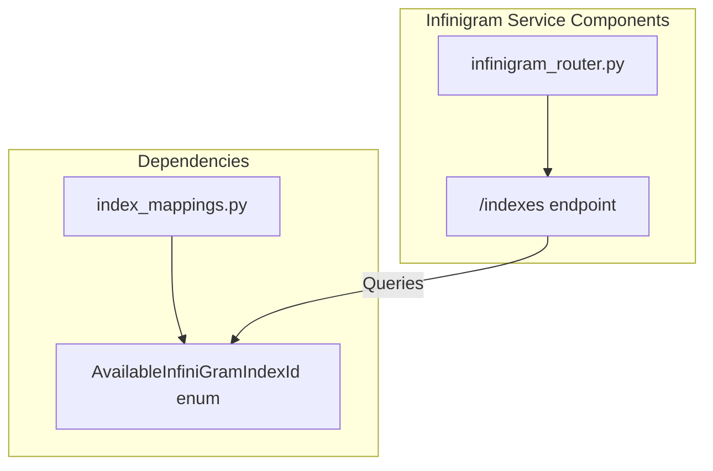
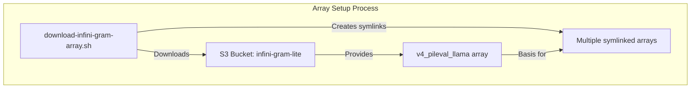
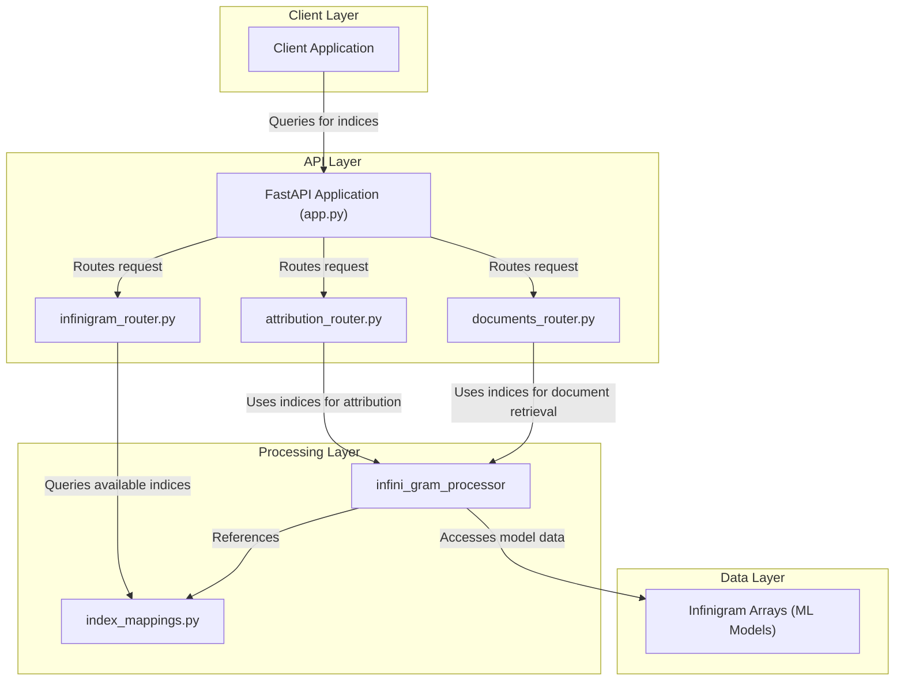
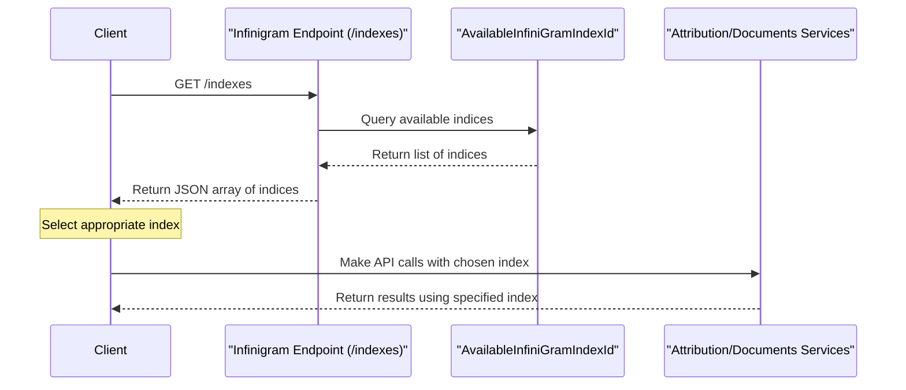

<!-- source: DeepWiki mcp.deepwiki.com · repo allenai/infinigram-api · page 3.4 Infinigram Service · fetched 2026-10-26 -->

# Infinigram Service

<details>
<summary>Relevant source files</summary>

The following files were used as context for generating this wiki page:

- [.vscode/settings.json](.vscode/settings.json)
- [api/src/infinigram/infinigram_router.py](api/src/infinigram/infinigram_router.py)
- [bin/download-infini-gram-array.sh](bin/download-infini-gram-array.sh)

</details>


## Purpose

The Infinigram Service is a component of the infinigram-api system that provides information about available Infinigram indices. These indices represent different machine learning models that power the attribution and document retrieval functionalities. The service acts as an interface for clients to discover which models are available for use with the API.

For information about how these indices are used for attribution, see [Attribution Service](#3.2). For information about document retrieval using these indices, see [Documents Service](#3.3).

## Service Structure

The Infinigram Service is implemented as a FastAPI router that exposes a single endpoint to retrieve available indices. The service is intentionally lightweight, serving primarily as a discovery mechanism for available Infinigram indices.



Sources: [api/src/infinigram/infinigram_router.py:1-10]()

## API Endpoint

The Infinigram Service provides a single GET endpoint that returns all available Infinigram indices:

### `GET /indexes`

This endpoint retrieves a list of all available Infinigram indices based on the `AvailableInfiniGramIndexId` enum from the `infini_gram_processor.index_mappings` module.

**Response:** A JSON array containing all available Infinigram index IDs.

The implementation is straightforward:

```python
@infinigram_router.get(path="/indexes")
def get_available_indexes() -> list[AvailableInfiniGramIndexId]:
    return [index for index in AvailableInfiniGramIndexId]
```

Sources: [api/src/infinigram/infinigram_router.py:7-9]()

## Supported Infinigram Indices

The Infinigram Service provides access to several indices, each representing a different machine learning model. Based on the download script configuration, the following indices are supported:

| Index Name | Model Type | Storage |
|------------|------------|---------|
| v4_pileval_llama | Base Infinigram array | Downloaded from S3 |
| olmoe-mix-0924-dclm | OLMo-E mix model | Symlink to base array |
| olmoe-mix-0924-nodclm | OLMo-E mix model (no DCLM) | Symlink to base array |
| v4-olmoe-0125-1b-7b-anneal-adapt | OLMo-E 1B-7B model | Symlink to base array |
| v4-olmo-2-1124-13b-anneal-adapt | OLMo-2 13B model | Symlink to base array |
| v4-olmo-2-0325-32b-anneal-adapt | OLMo-2 32B model | Symlink to base array |

In the development environment, these arrays are set up using a script that downloads the base array and creates symbolic links for the other indices.

Sources: [bin/download-infini-gram-array.sh:1-36]()

## Array Setup and Management

The Infinigram arrays, which contain the actual machine learning models, are stored in the `infinigram-array` directory. During development, these arrays are downloaded or symlinked using the `download-infini-gram-array.sh` script:



The script checks if the base array is already downloaded, and if not, downloads it from S3. Then it creates symbolic links for the other indices, all pointing to the base array.

Sources: [bin/download-infini-gram-array.sh:8-36]()

## System Integration

The Infinigram Service integrates with the broader system architecture as shown below:



The Infinigram Service primarily interacts with the `index_mappings.py` module from the `infini_gram_processor` package to retrieve information about available indices. The actual processing using these indices is handled by the Attribution and Documents services.

Sources: [api/src/infinigram/infinigram_router.py:1-10]()

## Usage Workflow

A typical workflow involving the Infinigram Service is as follows:



This workflow enables clients to discover what indices (models) are available in the system and select the appropriate one for their attribution or document retrieval tasks.

Sources: [api/src/infinigram/infinigram_router.py:7-9]()

## Summary

The Infinigram Service is a simple but essential component that provides discovery functionality for the available machine learning models in the system. While the service itself has minimal functionality, it plays an important role in the overall system by allowing clients to query which models are available for use with the more complex Attribution and Documents services.

---

