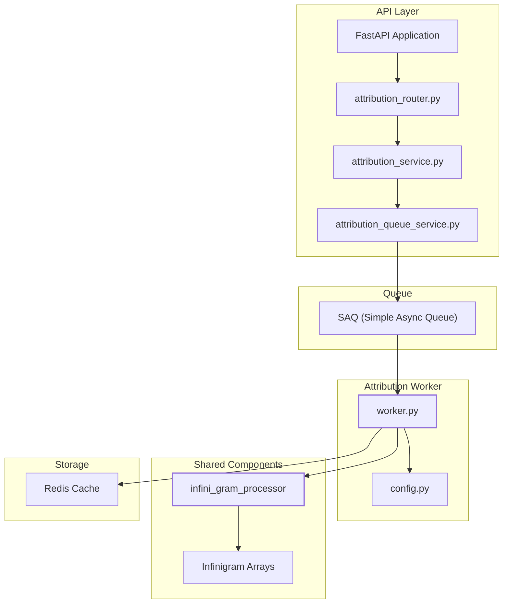
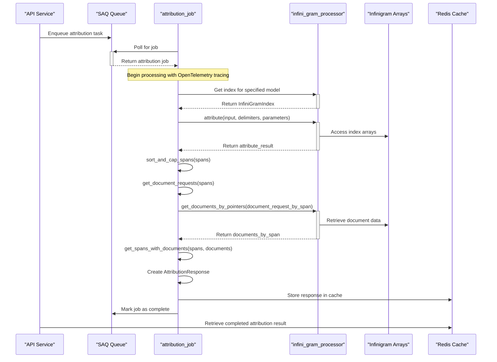

<!-- source: DeepWiki mcp.deepwiki.com · repo allenai/infinigram-api · page 4 Attribution Worker · fetched 2026-10-26 -->

# Attribution Worker

<details>
<summary>Relevant source files</summary>

The following files were used as context for generating this wiki page:

- [api/README.md](api/README.md)
- [api/src/attribution/attribution_queue_service.py](api/src/attribution/attribution_queue_service.py)
- [attribution_worker/Dockerfile](attribution_worker/Dockerfile)
- [attribution_worker/README.md](attribution_worker/README.md)
- [attribution_worker/config.py](attribution_worker/config.py)
- [attribution_worker/pyproject.toml](attribution_worker/pyproject.toml)
- [attribution_worker/worker.py](attribution_worker/worker.py)
- [docs/CONTRIBUTING.md](docs/CONTRIBUTING.md)
- [docs/indexes.md](docs/indexes.md)
- [packages/infini-gram-processor/README.md](packages/infini-gram-processor/README.md)

</details>


The Attribution Worker is a dedicated asynchronous processing service within the infinigram-api system responsible for handling computationally intensive attribution tasks. By offloading these tasks from the main API service, the system remains responsive while processing potentially long-running attribution requests. This page describes the worker's architecture, configuration, and operation within the system.

For information about the API components that interact with the worker, see [Attribution Service](#3.2).

## Architecture Overview

The Attribution Worker operates separately from the main API service, retrieving jobs from a shared queue, processing them using the Infinigram processor library, and storing results. It's designed to scale independently from the API layer.

### Component Diagram



Sources: [attribution_worker/worker.py](), [attribution_worker/config.py](), [api/src/attribution/attribution_queue_service.py]()

## Configuration

The worker is configured through environment variables, with defaults defined in the `Config` class. Key configuration settings include:

| Configuration Parameter | Default Value | Description |
|------------------------|---------------|-------------|
| `index_base_path` | `/mnt/infinigram-array` | Base path to the Infinigram index arrays |
| `application_name` | `infini-gram-api-worker` | Name used for logging and telemetry |
| `attribution_queue_url` | `redis://localhost:6379` | URL for the attribution queue |
| `python_env` | `prod` | Environment (prod/dev) |
| `attribution_queue_name` | Computed as `infini-gram-attribution-{env}` | Name of the queue to process |

Sources: [attribution_worker/config.py:5-21]()

## Job Processing Flow

The Attribution Worker processes jobs from the queue through the `attribution_job` function. Here's the flow of how attribution tasks are processed:



Sources: [attribution_worker/worker.py:58-142]()

## Attribution Job Function

The core of the worker is the `attribution_job` function that processes attribution requests:

1. **Initialization and Tracing**:
   - Extracts the OpenTelemetry context and starts a span for tracing
   - Sets up messaging attributes for observability

2. **Index Retrieval**:
   - Gets the appropriate `InfiniGramIndex` for the specified model

3. **Attribution Processing**:
   - Calls the index's `attribute` method asynchronously on a separate thread
   - Passes parameters including:
     - `input`: The text to analyze
     - `delimiters`: List of delimiters to use
     - `allow_spans_with_partial_words`: Whether to allow partial word matches
     - `minimum_span_length`: Minimum span length to consider
     - `maximum_frequency`: Maximum frequency threshold

4. **Span Sorting and Limiting**:
   - Limits the density of spans based on `maximum_span_density`
   - Sorts spans according to the specified `span_ranking_method`

5. **Document Retrieval**:
   - Generates document requests for each span
   - Retrieves documents asynchronously using `get_documents_by_pointers`
   - Builds spans with document contexts

6. **Response Creation**:
   - Assembles the final `AttributionResponse`
   - Returns the result as JSON

Sources: [attribution_worker/worker.py:58-142]()

## Technical Implementation Details

### Queue Integration

The worker uses the Simple Async Queue (SAQ) library to process jobs. The queue is configured with:

```python
queue = Queue.from_url(config.attribution_queue_url, name=config.attribution_queue_name)

settings = SettingsDict(
    queue=queue, functions=[("attribute", attribution_job)], concurrency=1
)
```

This configuration registers the `attribution_job` function to handle tasks with the name "attribute" and sets the concurrency to 1, meaning only one attribution job will be processed at a time.

Sources: [attribution_worker/worker.py:37-147]()

### OpenTelemetry Integration

The worker includes comprehensive OpenTelemetry instrumentation to enable distributed tracing:

- Creates a `TracerProvider` and configures span processors
- Uses different exporters based on the environment:
  - `SimpleSpanProcessor` with `OTLPSpanExporter` for development
  - `BatchSpanProcessor` with `CloudTraceSpanExporter` for production
- Propagates trace context from the API to maintain continuous traces

This allows tracking the performance and behavior of attribution jobs across the system.

Sources: [attribution_worker/worker.py:39-52](), [attribution_worker/worker.py:75-93]()

## Deployment

The Attribution Worker is containerized using Docker with a multi-stage build process:

1. **Builder Stage**:
   - Uses `uv` for Python dependency management
   - Installs dependencies according to the lock file
   - Copies the application code

2. **Final Stage**:
   - Starts from a clean Python image
   - Copies only the necessary files from the builder stage
   - Sets environment variables for OpenTelemetry
   - Runs the worker using the SAQ command

Two deployment variants are provided:
- `dev`: For development with verbose logging
- `prod`: For production deployment

Sources: [attribution_worker/Dockerfile:1-62]()

## Integration with API

The API service interacts with the worker through a shared queue. The API:

1. Enqueues attribution jobs with parameters
2. Provides a tracking ID to the client
3. Allows the client to poll for results
4. Retrieves results from the cache once the worker completes the job

Both the API and worker access the same queue, enabling asynchronous processing of attribution tasks.

Sources: [api/src/attribution/attribution_queue_service.py:1-25]()

---

