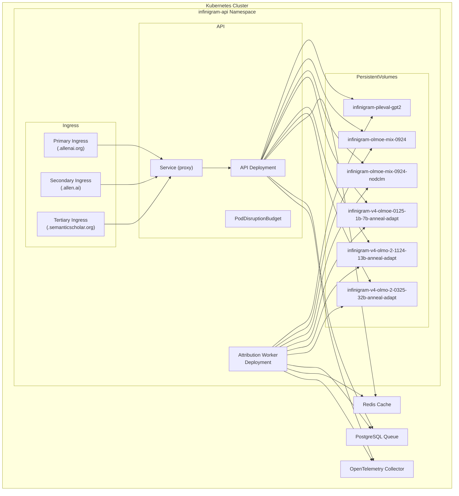
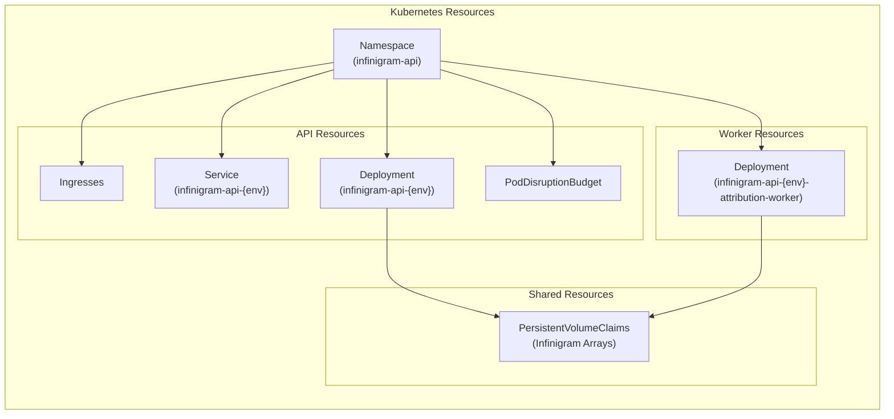
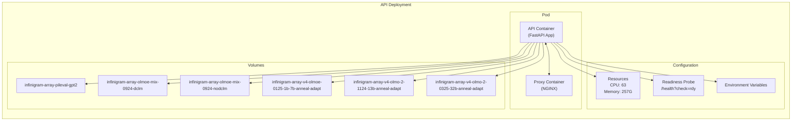
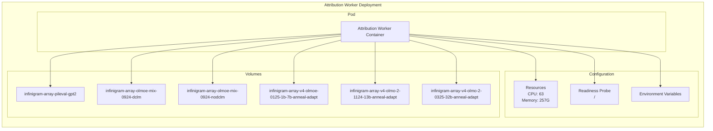
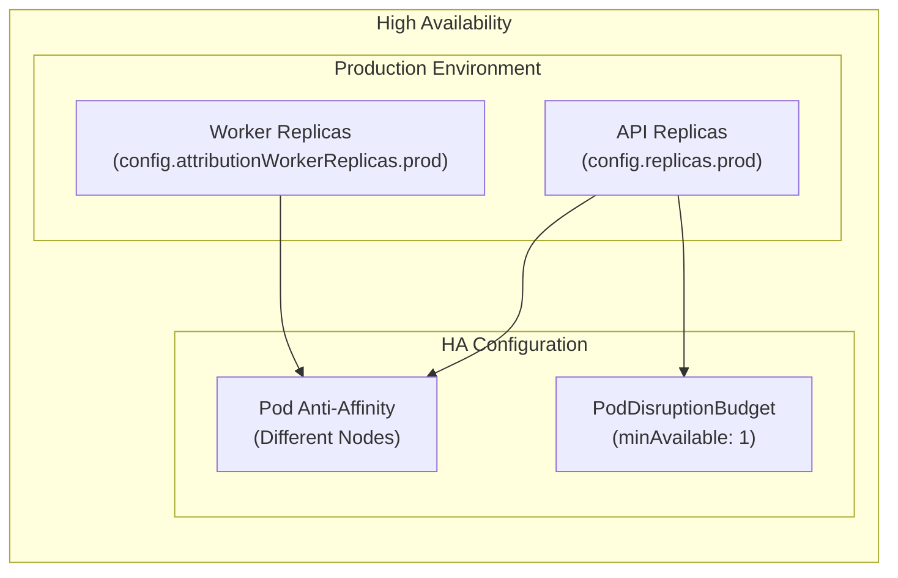

<!-- source: DeepWiki mcp.deepwiki.com · repo allenai/infinigram-api · page 5.2 Kubernetes Deployment · fetched 2026-10-26 -->

# Kubernetes Deployment

Relevant source files

The following files were used as context for generating this wiki page:

- [.skiff/webapp.jsonnet](.skiff/webapp.jsonnet)

This document details how the Infinigram API system is deployed to Kubernetes using Skiff, an internal Allen AI deployment platform. It covers the Kubernetes resources, deployment configurations, and infrastructure components required for running the system in production and staging environments. For local development setup, see [Local Development](#5.1).

## Overview

The Infinigram API system is deployed to Kubernetes as a set of interrelated resources within a dedicated namespace. The deployment consists of two main components:

1. **API Deployment** - Runs the FastAPI application with an NGINX proxy
2. **Attribution Worker Deployment** - Processes asynchronous attribution jobs

Both components share access to the same set of persistent volumes containing Infinigram arrays (ML models) needed for processing requests.

Sources: [.skiff/webapp.jsonnet:17-44](), [.skiff/webapp.jsonnet:702-715]()

## Deployment Components

The Kubernetes deployment consists of the following resources:

1. **Namespace** - A dedicated namespace for all Infinigram API resources
2. **Ingresses** - Three ingress resources for different TLDs
3. **Service** - Exposes the NGINX proxy to the ingresses
4. **Deployments** - Two deployments: API and Attribution Worker
5. **PodDisruptionBudget** - Ensures availability during cluster maintenance
6. **PersistentVolumeClaims** - Used to mount Infinigram arrays (ML models)

Sources: [.skiff/webapp.jsonnet:145-152](), [.skiff/webapp.jsonnet:160-235](), [.skiff/webapp.jsonnet:372-524](), [.skiff/webapp.jsonnet:526-544](), [.skiff/webapp.jsonnet:546-560](), [.skiff/webapp.jsonnet:576-700]()

## API Deployment

The API deployment runs two containers:

1. **API Container** - The FastAPI application that handles API requests
2. **Proxy Container** - An NGINX proxy that sits in front of the API

The deployment is configured with:

- Anti-affinity rules to ensure high availability
- Resource requests for CPU and memory
- Readiness probes to ensure healthy operation
- Volume mounts for Infinigram arrays

Sources: [.skiff/webapp.jsonnet:372-524]()

## Attribution Worker Deployment

The Attribution Worker deployment runs a single container that processes attribution jobs from the queue. It has similar configuration to the API deployment:

- Anti-affinity rules for high availability
- Resource requests for CPU and memory
- Readiness probe
- The same volume mounts as the API deployment

Sources: [.skiff/webapp.jsonnet:576-700]()

## Ingress Configuration

The deployment includes up to three ingress resources for different top-level domains:

1. **Primary Ingress** (.allenai.org) - The main ingress for the application
2. **Allen.ai Ingress** (.allen.ai) - Secondary ingress with the same configuration
3. **Semantic Scholar Ingress** (.semanticscholar.org) - Optional tertiary ingress

All ingresses are configured with TLS, rate limiting, authentication, and other security features.

| Ingress | TLD | Rate Limit | Auth |
|---------|-----|------------|------|
| Primary | .allenai.org | 5 rps | Yes |
| Allen.ai | .allen.ai | 5 rps | Yes |
| Scholar | .semanticscholar.org | 5 rps | Yes |

Sources: [.skiff/webapp.jsonnet:160-196](), [.skiff/webapp.jsonnet:198-235](), [.skiff/webapp.jsonnet:237-274]()

## Persistent Volumes

The system uses six persistent volume claims to mount Infinigram arrays (ML models):

| PVC Name | Mount Path | Purpose |
|----------|------------|---------|
| infinigram-pileval-gpt2 | /mnt/infinigram-array/v4_pileval_llama | GPT-2 model arrays |
| infinigram-olmoe-mix-0924 | /mnt/infinigram-array/olmoe-mix-0924-dclm | OLMoE mix model arrays (DCLM) |
| infinigram-olmoe-mix-0924-nodclm | /mnt/infinigram-array/olmoe-mix-0924-nodclm | OLMoE mix model arrays (no DCLM) |
| infinigram-v4-olmoe-0125-1b-7b-anneal-adapt | /mnt/infinigram-array/v4-olmoe-0125-1b-7b-anneal-adapt | OLMoE 1B-7B model arrays |
| infinigram-v4-olmo-2-1124-13b-anneal-adapt | /mnt/infinigram-array/v4-olmo-2-1124-13b-anneal-adapt | OLMo 2 13B model arrays |
| infinigram-v4-olmo-2-0325-32b-anneal-adapt | /mnt/infinigram-array/v4-olmo-2-0325-32b-anneal-adapt | OLMo 2 32B model arrays |

Sources: [.skiff/webapp.jsonnet:293-337](), [.skiff/webapp.jsonnet:339-370]()

## Environment Configuration

The system is configured using environment variables. Some key environment variables include:

| Variable | Purpose | Source |
|----------|---------|--------|
| PYTHON_ENV | Current environment (staging/prod) | Set during deployment |
| ATTRIBUTION_QUEUE_URL | URL for the attribution job queue | Secret |
| CACHE_URL | URL for the Redis cache | Secret |
| OTEL_SERVICE_NAME | Service name for OpenTelemetry | Set during deployment |
| LOG_FORMAT | Format for logging (google:json) | Set during deployment |

Sources: [.skiff/webapp.jsonnet:277-291](), [.skiff/webapp.jsonnet:485-502](), [.skiff/webapp.jsonnet:689-694]()

## Resource Requirements

Both the API and Attribution Worker deployments have significant resource requirements:

| Component | CPU | Memory | Node Pool |
|-----------|-----|--------|-----------|
| API | 63 | 257G | cpu64-256g |
| Attribution Worker | 63 | 257G | cpu64-256g |
| Proxy | 0.1 | 100M | cpu64-256g |

This indicates that the application requires large CPU and memory resources due to the nature of the ML models it's working with.

Sources: [.skiff/webapp.jsonnet:477-484](), [.skiff/webapp.jsonnet:513-518](), [.skiff/webapp.jsonnet:682-687]()

## High Availability Configuration

The system is configured for high availability in production:

1. **Multiple Replicas** - In production, both the API and Attribution Worker are deployed with multiple replicas (configured in skiff.json)
2. **Pod Anti-Affinity** - Ensures pods are scheduled on different nodes
3. **PodDisruptionBudget** - Ensures at least one pod remains available during voluntary disruptions

Sources: [.skiff/webapp.jsonnet:52](), [.skiff/webapp.jsonnet:407-424](), [.skiff/webapp.jsonnet:546-560](), [.skiff/webapp.jsonnet:562]()

## Deployment Process

The Infinigram API is deployed to Kubernetes using Skiff, which uses the Jsonnet template to generate the Kubernetes manifests. The deployment process involves:

1. Building container images for API, Proxy, and Attribution Worker
2. Applying the generated Kubernetes manifests to the cluster
3. Rollout of new deployments with rolling updates

The template takes several parameters:

| Parameter | Description |
|-----------|-------------|
| apiImage | Docker image for the API container |
| proxyImage | Docker image for the NGINX proxy container |
| workerImage | Docker image for the Attribution Worker container |
| cause | Deployment cause for annotation |
| sha | Git SHA of the deployed code |
| env | Deployment environment (staging/prod) |
| branch | Git branch being deployed |
| repo | Git repository name |
| buildId | Build identifier |

Sources: [.skiff/webapp.jsonnet:14-17]()

## Conclusion

The Kubernetes deployment of the Infinigram API system is designed to be scalable, highly available, and resource-efficient. It leverages Kubernetes features such as rolling updates, resource requests, probes, and PodDisruptionBudgets to ensure reliable operation. The deployment is configured to handle the specific requirements of the Infinigram API, including large ML models mounted as persistent volumes and significant CPU and memory resources.

For adding new Infinigram indices to the system, see [Adding New Indices](#5.3). For information about observability and monitoring, see [Observability](#6.2).

---

