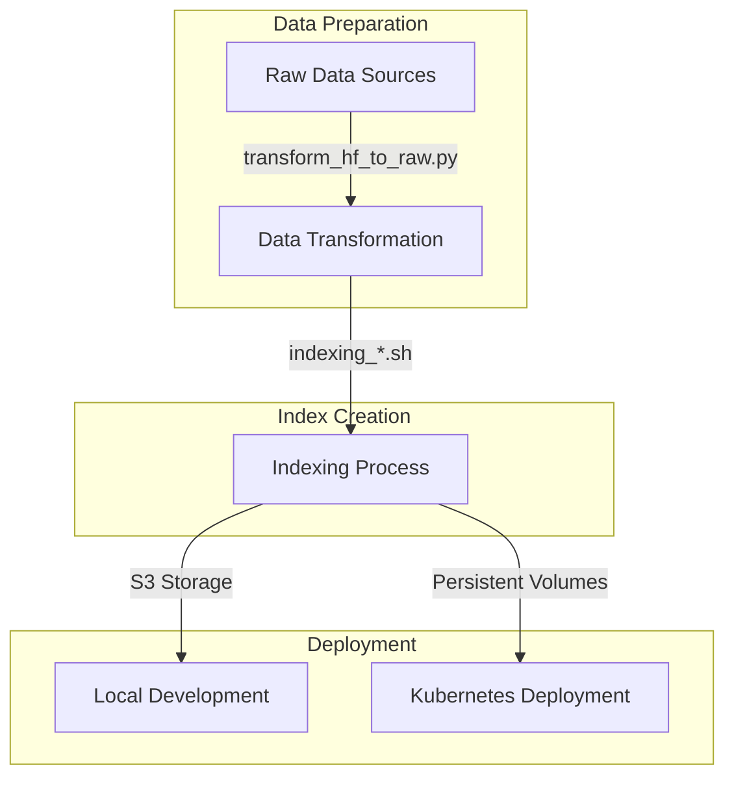
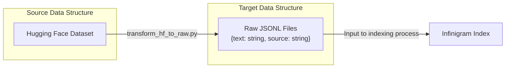
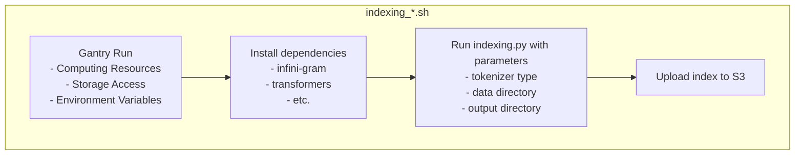
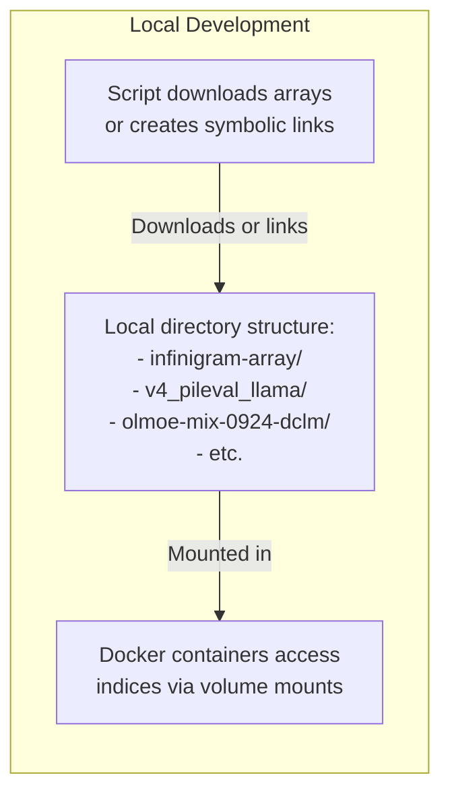
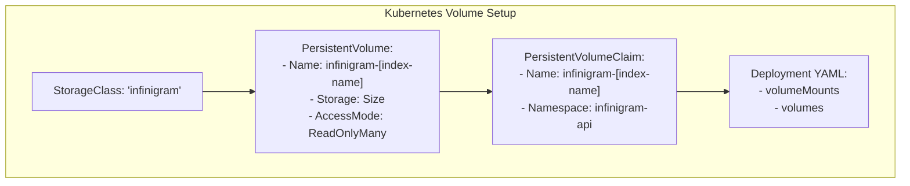
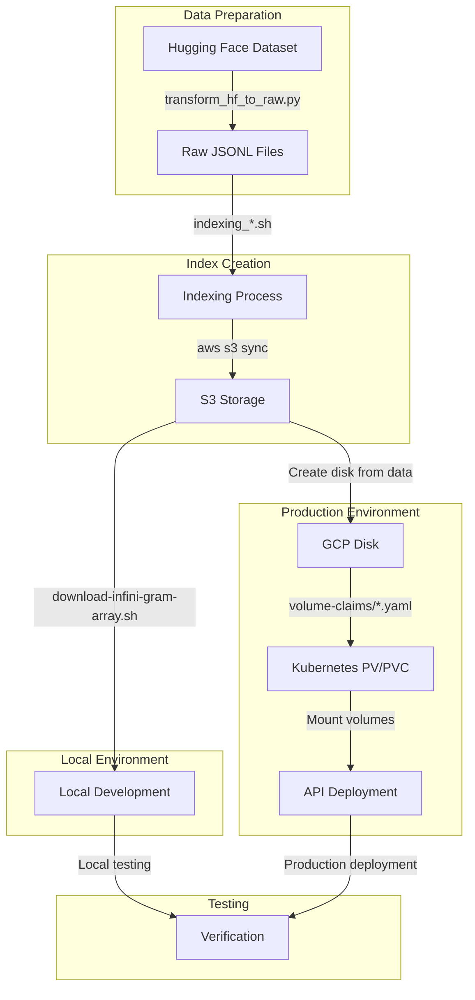

<!-- source: DeepWiki mcp.deepwiki.com · repo allenai/infinigram-api · page 5.3 Adding New Indices · fetched 2026-10-26 -->

# Adding New Indices

<details>
<summary>Relevant source files</summary>

The following files were used as context for generating this wiki page:

- [bin/download-infini-gram-array.sh](bin/download-infini-gram-array.sh)
- [indexing/indexing_olmo2-13b-anneal-adapt.sh](indexing/indexing_olmo2-13b-anneal-adapt.sh)
- [indexing/indexing_olmo2-32b-anneal-adapt.sh](indexing/indexing_olmo2-32b-anneal-adapt.sh)
- [indexing/indexing_olmoe-1b-7b-anneal-adapt.sh](indexing/indexing_olmoe-1b-7b-anneal-adapt.sh)
- [indexing/transform_hf_to_raw.py](indexing/transform_hf_to_raw.py)
- [indexing/transform_hf_to_raw_olmo2.py](indexing/transform_hf_to_raw_olmo2.py)
- [volume-claims/pileval-gpt2.yaml](volume-claims/pileval-gpt2.yaml)

</details>


This guide explains the process of adding new infinigram indices to the infinigram-api system. It covers the full workflow from preparing data to deploying the indices in both local development and production environments.

For information about using existing indices in the API, see [Infinigram Service](#3.4).

## Overview of the Indexing Process

Adding a new index to the infinigram-api system involves several distinct steps:

1. Preparing the source data
2. Running the indexing process
3. Making the index available in the development environment
4. Deploying the index to production



Sources: [indexing/transform_hf_to_raw.py](), [indexing/indexing_olmo2-32b-anneal-adapt.sh](), [bin/download-infini-gram-array.sh](), [volume-claims/pileval-gpt2.yaml]()

## Preparing Data for Indexing

### Data Format Requirements

The infinigram indexing process expects data in a specific JSON Lines format, with each line containing a JSON object with at least a `text` field. The source data is typically stored in Hugging Face datasets and needs to be transformed.



Sources: [indexing/transform_hf_to_raw.py](), [indexing/transform_hf_to_raw_olmo2.py]()

### Transforming Hugging Face Datasets

The repository includes scripts for transforming Hugging Face datasets into the required format. These scripts handle different dataset structures:

1. **SFT (Supervised Fine-Tuning) datasets**: Messages are transformed into a conversation format
2. **DPO (Direct Preference Optimization) datasets**: Both chosen and rejected responses are included
3. **RLVR (Reinforcement Learning) datasets**: User messages are extracted

Example of the transformation process for SFT datasets:

```
HF Dataset Entry → {
  messages: [
    {role: "user", content: "..."},
    {role: "assistant", content: "..."}
  ]
}

Transformed Entry → {
  text: "<|user|>\n...<|assistant|>\n...",
  source: "dataset_name"
}
```

Sources: [indexing/transform_hf_to_raw.py:8-20](), [indexing/transform_hf_to_raw_olmo2.py:7-21]()

## Running the Indexing Process

The indexing process uses the `infini-gram` package to create index files from the prepared data. This is typically run on high-performance compute clusters using Gantry.

### Indexing Script Structure



Sources: [indexing/indexing_olmo2-32b-anneal-adapt.sh](), [indexing/indexing_olmoe-1b-7b-anneal-adapt.sh](), [indexing/indexing_olmo2-13b-anneal-adapt.sh]()

### Indexing Parameters

The indexing process accepts several key parameters:

| Parameter | Description | Example Value |
|-----------|-------------|---------------|
| `--tokenizer` | Tokenizer type to use | `llama` |
| `--cpus` | Number of CPU cores to use | `64` |
| `--mem` | Memory limit in GB | `900` |
| `--shards` | Number of shards to create | `1` |
| `--add_metadata` | Flag to add metadata to the index | `--add_metadata` |
| `--ulimit` | Maximum memory map size | `524288` |
| `--data_dir` | Input data directory | `/path/to/raw/data` |
| `--save_dir` | Output directory for the index | `/path/to/index` |

Sources: [indexing/indexing_olmo2-32b-anneal-adapt.sh:30-34](), [indexing/indexing_olmoe-1b-7b-anneal-adapt.sh:30-34]()

## Adding the Index to Local Development

For local development, the infinigram arrays are stored in the `infinigram-array` directory. The `download-infini-gram-array.sh` script is used to download the necessary files.

### Modifying the Download Script

To add a new index to the local development environment:

1. Add a new conditional block to `bin/download-infini-gram-array.sh`
2. Either download the index from S3 or create a symbolic link to an existing index



Example of adding a new index (from the script):

```
if [ ! -d $INFINIGRAM_ARRAY_DIR/new_index_name ]; then
    echo "Downloading new_index_name array"
    aws s3 cp --no-sign-request --recursive s3://infini-gram/index/new_index_name $INFINIGRAM_ARRAY_DIR/new_index_name
fi
```

Sources: [bin/download-infini-gram-array.sh:8-10]()

### Updating Docker Compose

After modifying the download script, you also need to update the Docker Compose configuration to mount the new index volume. This ensures the API service can access the new index.

> Note: The comment in the download script reminds developers to add any new array to the `docker-compose.yaml` file as well.

Sources: [bin/download-infini-gram-array.sh:5]()

## Deploying the Index to Kubernetes

For production deployment, the indices are stored as persistent volumes in Kubernetes.

### Creating a Persistent Volume

To add a new index to the Kubernetes deployment:

1. Create a new PersistentVolume and PersistentVolumeClaim YAML file
2. Apply the configuration to the Kubernetes cluster



Example structure based on existing volume claims:

```yaml
apiVersion: v1
kind: PersistentVolume
metadata:
  name: infinigram-new-index-name
spec:
  storageClassName: "infinigram"
  capacity:
    storage: 10Gi  # Adjust size as needed
  accessModes:
    - ReadOnlyMany
  claimRef:
    namespace: infinigram-api
    name: infinigram-new-index-name
  csi:
    driver: pd.csi.storage.gke.io
    volumeHandle: projects/ai2-reviz/zones/us-west1-b/disks/infinigram-new-index
    fsType: ext4
    readOnly: true
---
apiVersion: v1
kind: PersistentVolumeClaim
metadata:
  namespace: infinigram-api
  name: infinigram-new-index-name
spec:
  storageClassName: "infinigram"
  volumeName: infinigram-new-index-name
  accessModes:
    - ReadOnlyMany
  resources:
    requests:
      storage: 10Gi  # Adjust size as needed
```

Sources: [volume-claims/pileval-gpt2.yaml]()

## Complete Workflow: From Data to Deployment

The complete workflow for adding a new index involves multiple steps across different environments:



Sources: [indexing/transform_hf_to_raw.py](), [indexing/indexing_olmo2-32b-anneal-adapt.sh](), [bin/download-infini-gram-array.sh](), [volume-claims/pileval-gpt2.yaml]()

## Summary

Adding a new index to the infinigram-api system requires several steps:

1. **Data Preparation**: Transform source data into the required format using the transformation scripts.
2. **Index Creation**: Run the indexing process using the `infini-gram` package and upload the results to S3.
3. **Local Development**: Update the download script and Docker Compose configuration to make the index available locally.
4. **Production Deployment**: Create persistent volumes in Kubernetes and update the deployment to mount these volumes.

Following this process ensures that new indices are properly integrated into both development and production environments, making them available for use by the infinigram-api system.

---

