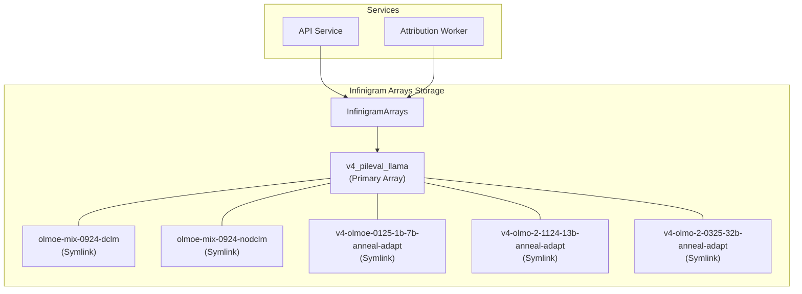
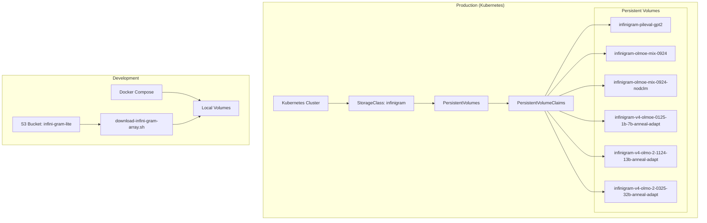
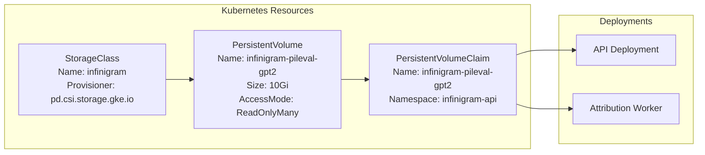
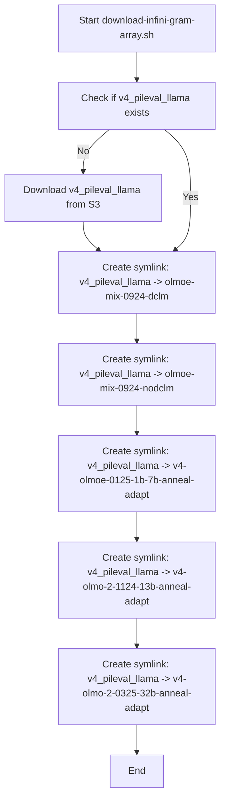
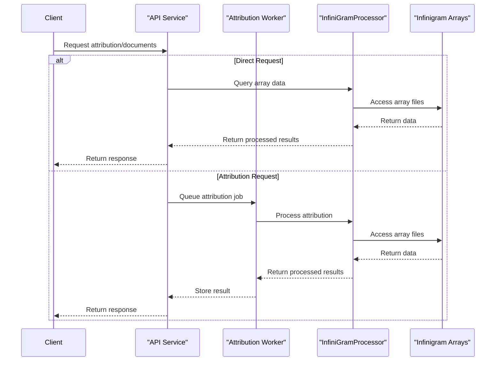

<!-- source: DeepWiki mcp.deepwiki.com · repo allenai/infinigram-api · page 6.1 Storage · fetched 2026-10-26 -->

# Storage

Relevant source files

The following files were used as context for generating this wiki page:

- [bin/download-infini-gram-array.sh](bin/download-infini-gram-array.sh)
- [volume-claims/pileval-gpt2.yaml](volume-claims/pileval-gpt2.yaml)

## Purpose and Scope

This document details the storage system used in the infinigram-api, focusing on how infinigram arrays (ML models) are stored, accessed, and managed both in local development environments and in Kubernetes deployments. The storage system is designed to provide efficient, read-only access to large model index files that power the attribution and document retrieval features of the API.

For information about observability components, see [Observability](#6.2).

## Infinigram Arrays Overview

Infinigram arrays are pre-computed index files that contain vector representations of text documents, enabling fast attribution and retrieval operations. These arrays form the core data assets of the infinigram-api system and are accessed by both the API service and the Attribution Worker.

**Diagram: Infinigram Arrays Structure and Service Access**

Sources: [bin/download-infini-gram-array.sh:1-37]()

## Storage Architecture

The storage architecture differs between development and production environments but maintains consistent access patterns through volume mounting.

**Diagram: Storage Infrastructure in Production and Development Environments**

Sources: [volume-claims/pileval-gpt2.yaml:1-43](), [bin/download-infini-gram-array.sh:1-37]()

## Storage Implementation

### Kubernetes Storage Configuration

In the production environment, infinigram arrays are stored on Google Kubernetes Engine (GKE) persistent disks and mounted as read-only volumes to the API and worker pods. This configuration ensures data consistency and allows multiple pods to access the same data concurrently.

**Diagram: Kubernetes Storage Resources**

Sources: [volume-claims/pileval-gpt2.yaml:1-43]()

Each array is configured with:

- A StorageClass named `infinigram` using the GKE persistent disk CSI driver
- A PersistentVolume that references a specific disk
- A PersistentVolumeClaim in the `infinigram-api` namespace

The key characteristics of the storage configuration:

| Attribute | Value | Purpose |
|-----------|-------|---------|
| AccessMode | ReadOnlyMany | Allows multiple pods to concurrently read from the volume |
| StorageClass | infinigram | Custom storage class for Infinigram arrays |
| Size | 10Gi (example) | Allocated storage for the array data |
| FsType | ext4 | File system type used for the volume |
| ReadOnly | true | Prevents accidental writes to the array data |

Sources: [volume-claims/pileval-gpt2.yaml:1-43]()

### Local Development Storage

For local development, a script is provided to download the required arrays from an S3 bucket and set up symbolic links to optimize disk space usage.

**Diagram: Local Array Download and Setup Process**

Sources: [bin/download-infini-gram-array.sh:1-37]()

The script performs the following operations:

1. Sets `INFINIGRAM_ARRAY_DIR` to point to the `../infinigram-array` directory
2. Checks if the primary array (`v4_pileval_llama`) exists
3. If not, downloads it from the S3 bucket `infini-gram-lite`
4. Creates symbolic links from the primary array to other required array directories

## Storage Access Pattern

The infinigram arrays stored in these volumes are accessed by both the API service and the Attribution Worker through the InfiniGramProcessor component. This component provides a consistent interface for interacting with the arrays, hiding the underlying storage details from the application code.

**Diagram: Data Access Flow for Infinigram Arrays**

Sources: [bin/download-infini-gram-array.sh:1-37](), [volume-claims/pileval-gpt2.yaml:1-43]()

## Adding New Arrays

To add a new infinigram array to the system, the following steps are required:

1. **For local development:**
   - Update the `download-infini-gram-array.sh` script to download or symlink the new array
   - Add volume mapping in the `docker-compose.yaml` file

2. **For production deployment:**
   - Create a new persistent disk in GKE
   - Define a new YAML configuration with StorageClass, PersistentVolume, and PersistentVolumeClaim
   - Update deployment configurations to mount the new volume

Sources: [bin/download-infini-gram-array.sh:5-6]()

## Performance Considerations

The storage system is optimized for read performance, as the arrays are only read, never written to during normal operation. Key performance considerations include:

- Arrays are mounted as read-only to prevent accidental writes
- In local development, symbolic links are used to avoid duplicating large arrays
- In production, the GKE persistent disk type is set to `pd-balanced` for a good balance of performance and cost
- The volumes use `WaitForFirstConsumer` binding mode to ensure they're created in the same zone as the consuming pods

Sources: [volume-claims/pileval-gpt2.yaml:1-43]()

---

