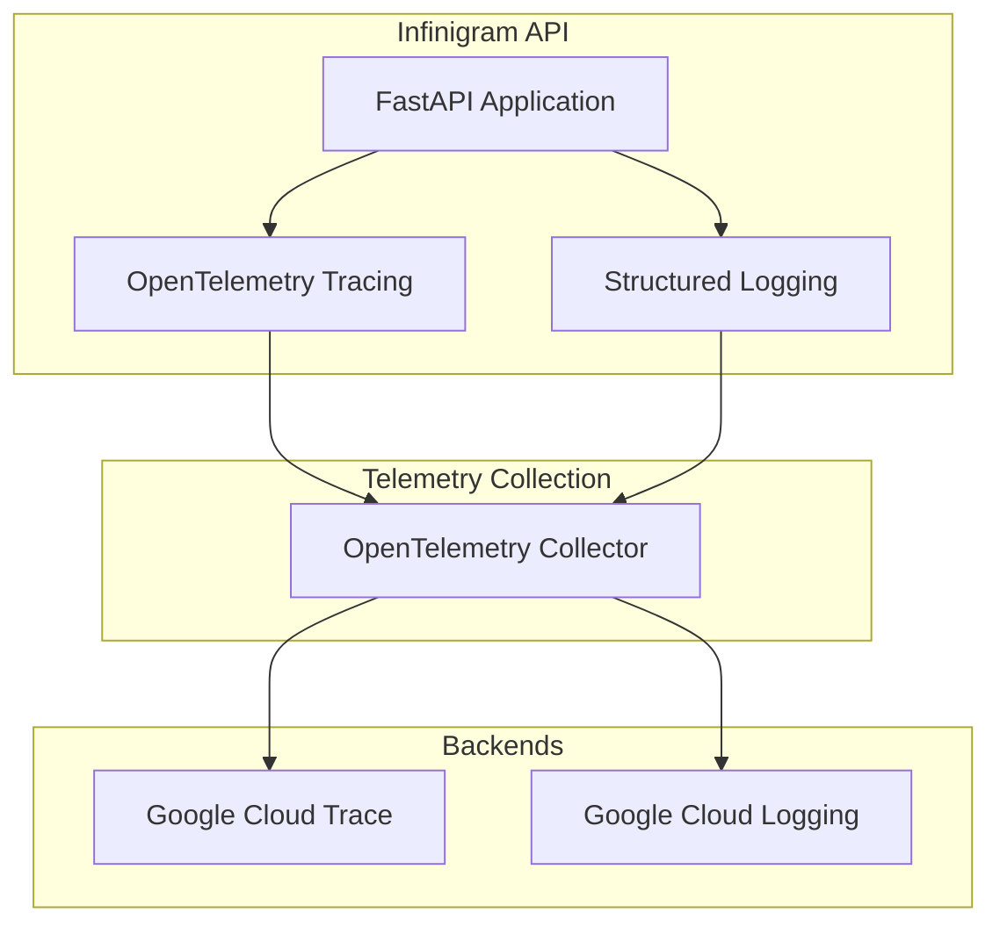
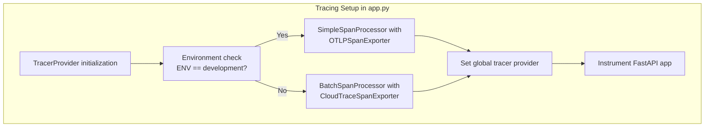
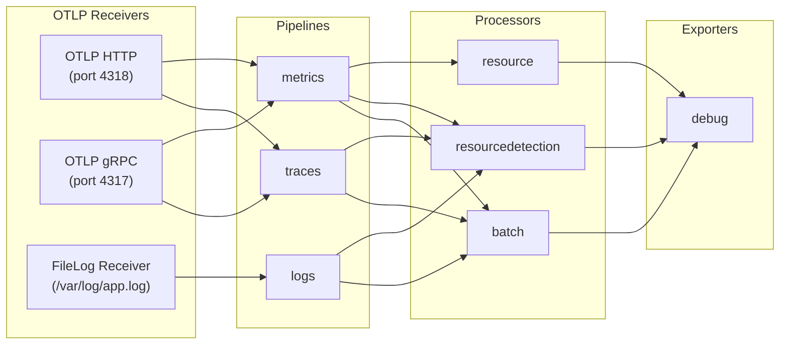
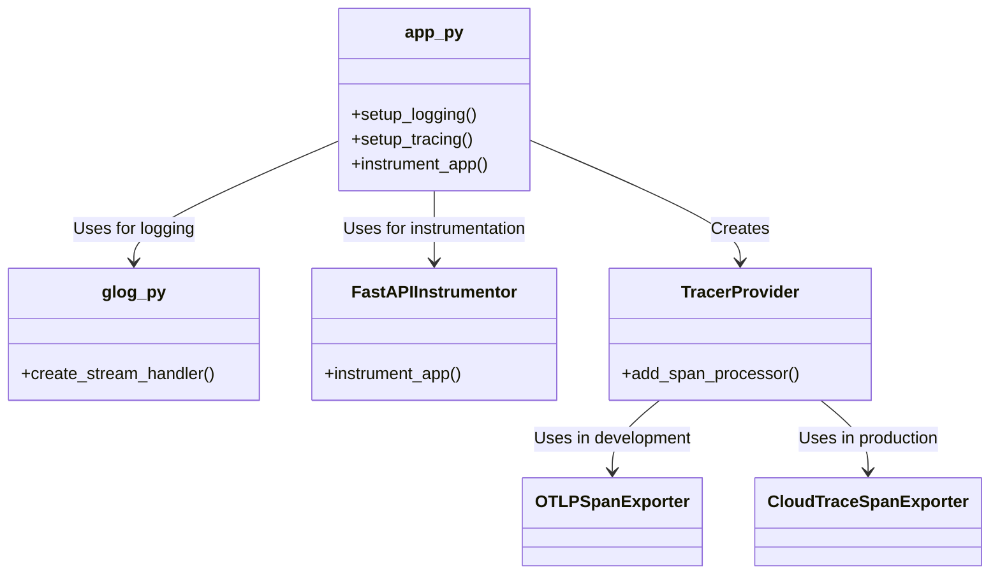
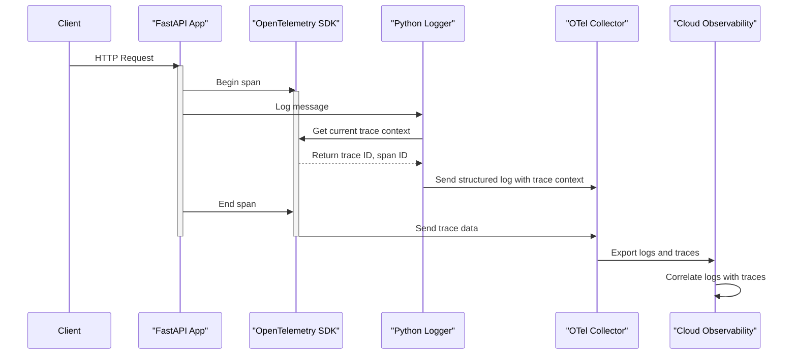

<!-- source: DeepWiki mcp.deepwiki.com · repo allenai/infinigram-api · page 6.2 Observability · fetched 2026-10-26 -->

# Observability

Relevant source files

The following files were used as context for generating this wiki page:

- [api/Dockerfile](api/Dockerfile)
- [api/app.py](api/app.py)
- [api/src/glog.py](api/src/glog.py)
- [otel-collector/otel-collector-config.yaml](otel-collector/otel-collector-config.yaml)

This page documents the observability infrastructure in the infinigram-api system, including logging, tracing, and monitoring. The page focuses on how telemetry data is collected, processed, and exported to facilitate debugging, performance monitoring, and operational insights.

For information about the overall system architecture, see [System Architecture](#2).

## Overview

The infinigram-api implements comprehensive observability using OpenTelemetry for distributed tracing and structured logging. The system is configured to work in both development and production environments, with appropriate exporters for each.

Sources: [api/app.py:9-69](api/app.py:9-69), [api/Dockerfile:51-62](api/Dockerfile:51-62), [otel-collector/otel-collector-config.yaml:15-136](otel-collector/otel-collector-config.yaml:15-136)

## Tracing Configuration

The system uses OpenTelemetry to instrument code and generate distributed traces. Tracing is set up differently based on the environment:

- **Development**: Uses a `SimpleSpanProcessor` with `OTLPSpanExporter` to send traces to a local OpenTelemetry Collector
- **Production**: Uses a `BatchSpanProcessor` with `CloudTraceSpanExporter` to send traces directly to Google Cloud Trace

The API automatically captures incoming HTTP requests thanks to the `FastAPIInstrumentor` that instruments the application. Health endpoints are excluded from tracing to avoid excessive telemetry data.

Sources: [api/app.py:56-69](api/app.py:56-69), [api/Dockerfile:51-62](api/Dockerfile:51-62)

## Logging Configuration

The system supports structured JSON logging in a format compatible with Google Cloud Logging. This is enabled by setting the `LOG_FORMAT` environment variable to `google:json`.

### Structured Logging

The `glog.py` module provides a custom JSON formatter that:

1. Maps standard Python logging fields to Google Cloud Logging fields
2. Includes OpenTelemetry trace context in logs for correlation
3. Uses timestamps in ISO 8601 format

Key field mappings:

| Python Logging Field | Google Cloud Logging Field |
|----------------------|----------------------------|
| levelname            | severity                   |
| asctime              | timestamp                  |
| otelTraceID          | logging.googleapis.com/trace |
| otelSpanID           | logging.googleapis.com/spanId |
| otelTraceSampled     | logging.googleapis.com/trace_sampled |

Sources: [api/src/glog.py:1-27](api/src/glog.py:1-27), [api/app.py:27-31](api/app.py:27-31)

## OpenTelemetry Collector

The system includes an OpenTelemetry Collector that receives, processes, and exports telemetry data. This collector is primarily used in development environments, but a similar configuration can be deployed in production.

The collector is configured to handle:

- **Traces and Metrics**: Received via OTLP HTTP and gRPC protocols
- **Logs**: Collected from the application log file, parsed, and processed to extract trace context

Sources: [otel-collector/otel-collector-config.yaml:15-136](otel-collector/otel-collector-config.yaml:15-136)

## Observability in Code

In the infinigram-api codebase, observability is set up in the main application entrypoint. The key components include:

1. **Logging Setup**: Configuring Python's logging system to use structured JSON logs if requested
2. **OpenTelemetry Setup**: Initializing the trace provider and exporters
3. **FastAPI Instrumentation**: Automatically capturing traces for all FastAPI endpoints

### Code Structure

Sources: [api/app.py:9-69](api/app.py:9-69), [api/src/glog.py:1-27](api/src/glog.py:1-27)

## Environment Variables

The system uses environment variables to configure observability. These are set in the Dockerfile or can be overridden at runtime:

| Environment Variable | Purpose | Default Value |
|----------------------|---------|--------------|
| `LOG_FORMAT` | Format for logging output | Standard Python logging (or `google:json` for structured logs) |
| `LOG_LEVEL` | Logging verbosity | `INFO` |
| `OTEL_SERVICE_NAME` | Service name for telemetry | `infinigram-api` (prod) or `infinigram-api-dev` (dev) |
| `OTEL_TRACES_EXPORTER` | Trace exporter type | `otlp` |
| `OTEL_METRICS_EXPORTER` | Metrics exporter type | `otlp` |
| `OTEL_EXPORTER_OTLP_ENDPOINT` | Endpoint for OTLP exporter | Development: `http://otelcol:4318` |

Sources: [api/Dockerfile:51-62](api/Dockerfile:51-62), [api/app.py:27-31](api/app.py:27-31)

## Correlation Between Traces and Logs

One key feature of the observability setup is the correlation between distributed traces and logs. When a log entry is emitted during a traced operation, the trace context is automatically included in the log entry, allowing for easier debugging and analysis.

Sources: [api/src/glog.py:13-24](api/src/glog.py:13-24), [otel-collector/otel-collector-config.yaml:52-83](otel-collector/otel-collector-config.yaml:52-83)

## Best Practices

When developing for the infinigram-api system, follow these observability best practices:

1. **Use structured logging**: Always use the logger rather than print statements
2. **Include contextual information**: Add relevant context to log messages to make debugging easier
3. **Create spans for significant operations**: Use the OpenTelemetry API to create spans for important operations, especially those that are time-consuming or cross service boundaries
4. **Set appropriate log levels**: Use the right log level for each message (DEBUG, INFO, WARNING, ERROR)
5. **Add attributes to spans**: Include relevant attributes in spans to provide more context for distributed traces

---

