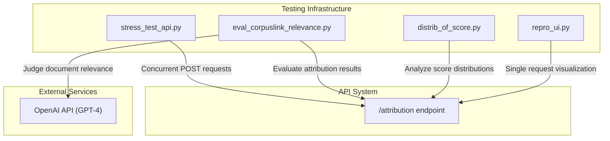
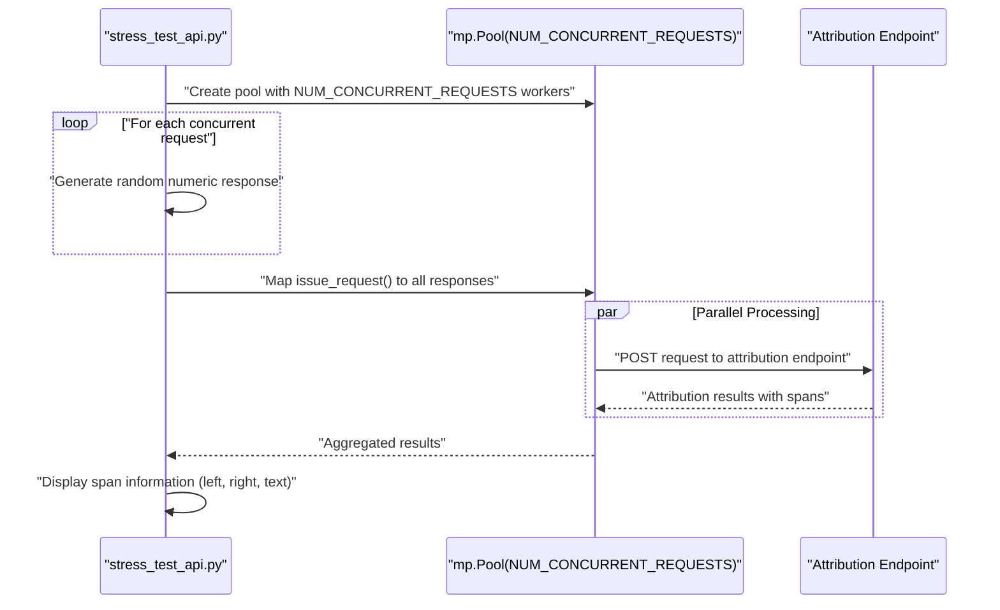
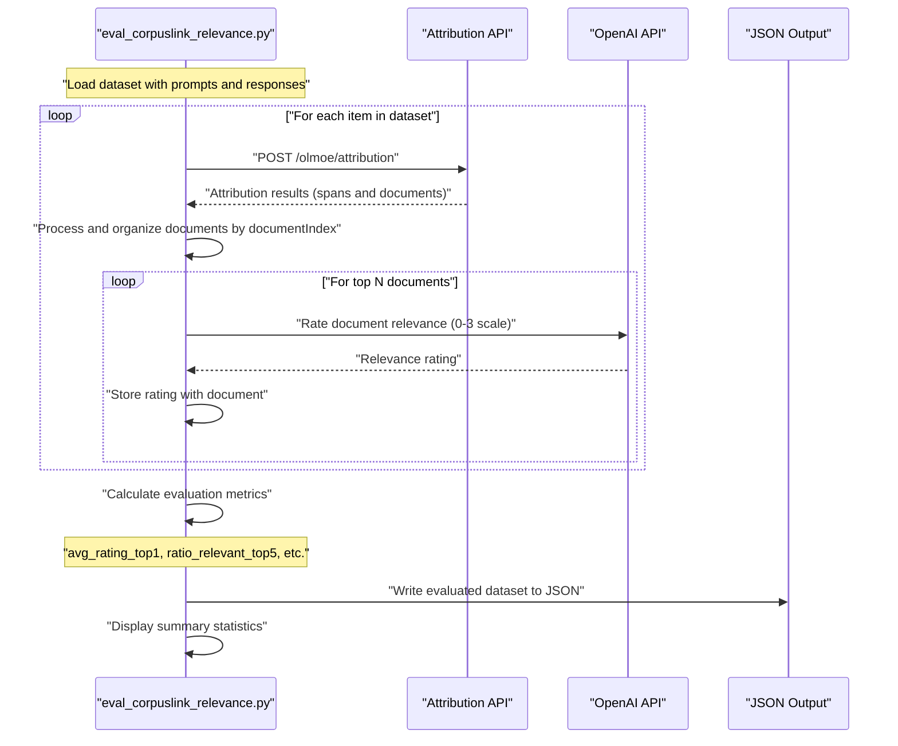
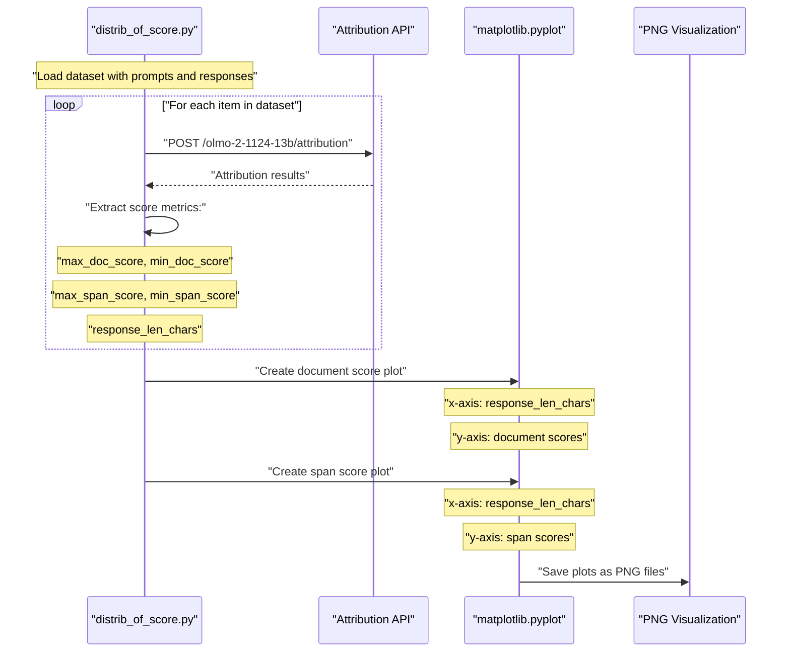

<!-- source: DeepWiki mcp.deepwiki.com · repo allenai/infinigram-api · page 7 Testing and Evaluation · fetched 2026-10-26 -->

# Testing and Evaluation

<details>
<summary>Relevant source files</summary>

The following files were used as context for generating this wiki page:

- [scripts/distrib_of_score.py](scripts/distrib_of_score.py)
- [scripts/eval_corpuslink_relevance.py](scripts/eval_corpuslink_relevance.py)
- [scripts/repro_ui.py](scripts/repro_ui.py)
- [scripts/stress_test_api.py](scripts/stress_test_api.py)

</details>


This document covers the testing and evaluation tools available for the infinigram-api system. These tools help assess system performance, reliability, and attribution quality. The focus is on scripts that enable stress testing, relevance evaluation, and analysis of attribution results.

## Overview of Testing Ecosystem

The infinigram-api project provides several specialized scripts for testing different aspects of the system:



Sources: [scripts/stress_test_api.py](), [scripts/eval_corpuslink_relevance.py](), [scripts/distrib_of_score.py](), [scripts/repro_ui.py]()

## Stress Testing

The `stress_test_api.py` script enables evaluating API performance under concurrent load. It sends multiple attribution requests in parallel and processes the results, helping identify performance bottlenecks or reliability issues.



### Key Components

- **Concurrent Requests**: Configurable via `NUM_CONCURRENT_REQUESTS` (default: 32)
- **Test Data Generation**: Creates random numeric responses of length `NUM_TOKENS` (default: 500)
- **Parallelization**: Utilizes Python's multiprocessing to handle multiple simultaneous requests
- **Attribution Parameters**: Uses a standard set of attribution parameters including delimiters, minimum span length, and ranking method

### Example Configuration

```python
PAYLOAD = {
    'prompt': '',
    'response': '',
    'delimiters': ['\n', '.'],
    'allowSpansWithPartialWords': False,
    'minimumSpanLength': 1,
    'maximumFrequency': 1000000,
    'maximumSpanDensity': 0.05,
    'spanRankingMethod': 'unigram_logprob_sum',
    'maximumDocumentsPerSpan': 10,
    'maximumContextLength': 250,
    'maximumContextLengthLong': 250,
    'maximumContextLengthSnippet': 40,
}
```

Sources: [scripts/stress_test_api.py:1-47]()

## Document Relevance Evaluation

The `eval_corpuslink_relevance.py` script assesses the quality of documents retrieved during attribution. It provides a structured way to evaluate whether the documents retrieved by the system are relevant to the user's prompt and the model's response.



### Evaluation Process

1. **Data Processing**: Loads a dataset of prompts and responses
2. **Attribution**: Sends each prompt-response pair to the attribution API
3. **Document Organization**: Extracts and organizes retrieved documents
4. **Relevance Rating**: Uses OpenAI's GPT-4 model to rate document relevance on a 0-3 scale:
   - 0: Document is about a different topic
   - 1: Document is about a broader topic or has insufficient information
   - 2: Document is on the right topic but in a slightly different context
   - 3: Document is a direct match for user intent
5. **Metrics Calculation**: Computes metrics like average rating and percentage of relevant documents

### Key Metrics

The script calculates and reports:

- Average rating for top-1 and top-5 documents
- Percentage of relevant documents (rating ≥ 2) in top-1 and top-5 positions

Sources: [scripts/eval_corpuslink_relevance.py:1-155]()

## Score Distribution Analysis

The `distrib_of_score.py` script analyzes how attribution scores are distributed across responses of different lengths. This helps understand patterns in attribution quality and how it varies with response characteristics.



### Key Features

- **Score Extraction**: Processes attribution results to extract document and span scores
- **Correlation Analysis**: Relates scores to response length (in characters)
- **Visualization**: Generates scatter plots showing the distribution of scores
- **Separate View**: Creates separate visualizations for document scores and span scores

### Visualization Output

The script produces two visualization files:
- `*_doc.png`: Shows the distribution of document scores vs. response length
- `*_span.png`: Shows the distribution of span scores vs. response length

Sources: [scripts/distrib_of_score.py:1-107]()

## UI Reproduction

The `repro_ui.py` script helps reproduce and test the user interface for attribution results. It sends a single attribution request and formats the results in a way that resembles how they would appear in the UI.

### Process Flow

1. **Input Definition**: Define a prompt and response to test
2. **Attribution Request**: Send the prompt and response to the attribution API
3. **Result Processing**: Process the attribution results, organizing documents by index
4. **Result Display**: Format and display the most relevant documents and their associated spans

### Example Configuration

```python
payload = {
    'prompt': prompt,
    'response': response,
    'delimiters': ['\n', '.'],
    'allowSpansWithPartialWords': False,
    'minimumSpanLength': 1,
    'maximumFrequency': 10,
    'maximumSpanDensity': 0.05,
    'spanRankingMethod': 'length',
    'includeDocuments': True,
    'maximumDocumentsPerSpan': 10,
    'maximumDocumentDisplayLength': 100,
    'filterMethod': 'bm25',
    'filterBm25FieldsConsidered': 'response',
    'filterBm25RatioToKeep': 1.0,
    'includeInputAsTokens': True,
}
```

This script is particularly useful for:
- Debugging attribution results
- Testing with specific prompt-response pairs
- Visualizing how results will appear to end-users
- Understanding the relationship between spans and documents

Sources: [scripts/repro_ui.py:1-191]()

## Common Attribution Parameters

All testing scripts use similar parameters when making attribution requests. The table below summarizes the key parameters:

| Parameter | Description | Typical Value |
|-----------|-------------|---------------|
| `delimiters` | Characters that define span boundaries | `['\n', '.']` |
| `allowSpansWithPartialWords` | Whether spans can include partial words | `False` |
| `minimumSpanLength` | Minimum length of spans to consider | `1` |
| `maximumFrequency` | Maximum frequency threshold for n-grams | `1000000` or `10` |
| `maximumSpanDensity` | Maximum density of spans in response | `0.05` |
| `spanRankingMethod` | Method to rank spans | `unigram_logprob_sum` or `length` |
| `includeDocuments` | Whether to include documents in results | `True` |
| `maximumDocumentsPerSpan` | Maximum documents to return per span | `10` |
| `filterMethod` | Method to filter candidate documents | `bm25` |
| `filterBm25FieldsConsidered` | Fields for BM25 filtering | `prompt\|response` or `response` |
| `filterBm25RatioToKeep` | Fraction of documents to keep after filtering | `1.0` |

These parameters can be adjusted to test different configurations and observe how they affect attribution quality and performance.

Sources: [scripts/stress_test_api.py:8-21](), [scripts/distrib_of_score.py:20-35](), [scripts/eval_corpuslink_relevance.py:22-36](), [scripts/repro_ui.py:141-157]()

---

