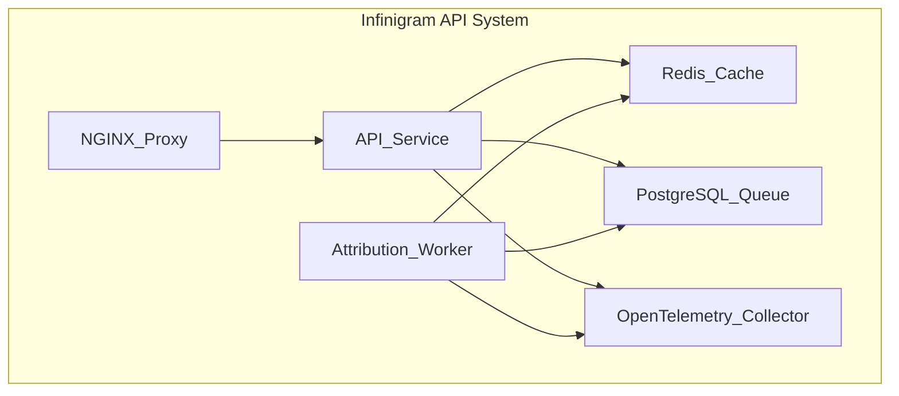
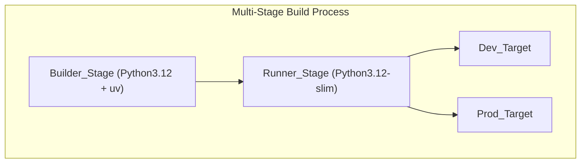
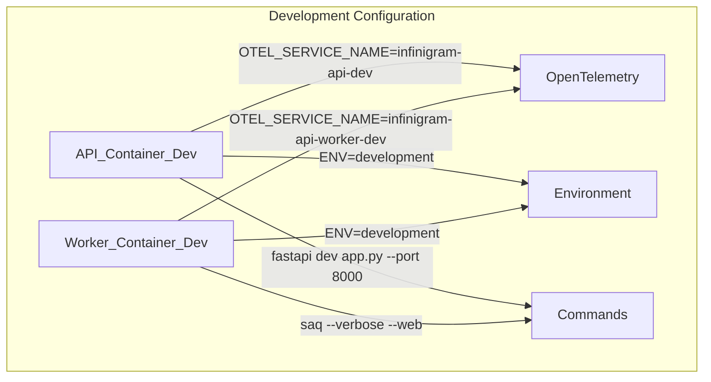
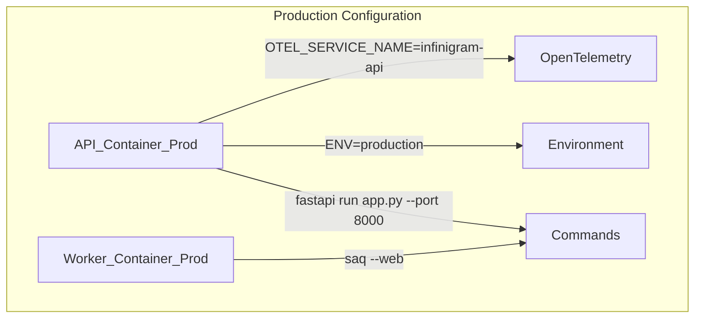
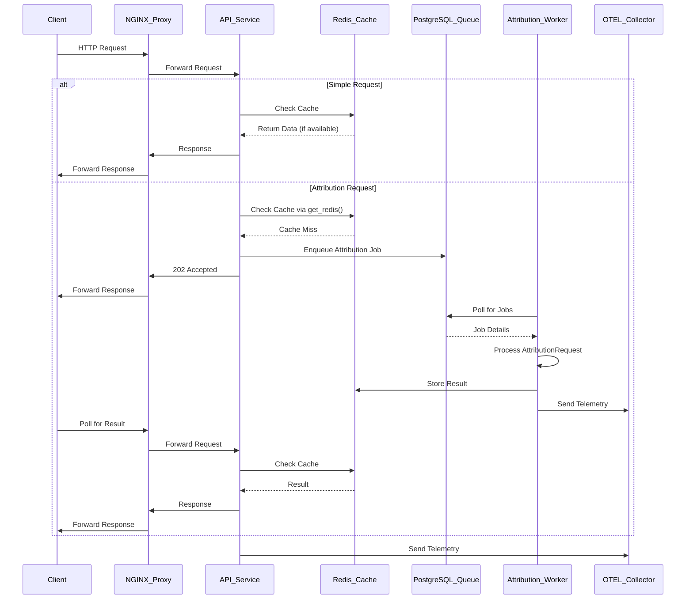
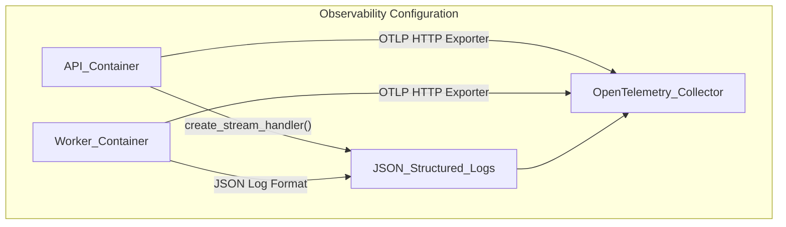
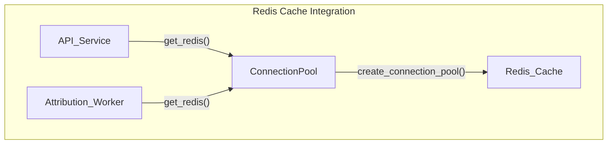

<!-- source: DeepWiki mcp.deepwiki.com · repo allenai/infinigram-api · page 8 Containerization · fetched 2026-10-26 -->

# Containerization

<details>
<summary>Relevant source files</summary>

The following files were used as context for generating this wiki page:

- [api/Dockerfile](api/Dockerfile)
- [api/src/attribution/attribution_request.py](api/src/attribution/attribution_request.py)
- [api/src/cache/__init__.py](api/src/cache/__init__.py)
- [api/src/cache/redis.py](api/src/cache/redis.py)
- [api/src/glog.py](api/src/glog.py)
- [attribution_worker/Dockerfile](attribution_worker/Dockerfile)
- [attribution_worker/pyproject.toml](attribution_worker/pyproject.toml)
- [otel-collector/otel-collector-config.yaml](otel-collector/otel-collector-config.yaml)
- [proxy/Dockerfile](proxy/Dockerfile)

</details>


This document details how the infinigram-api system components are containerized using Docker, including the build process, environment configurations, and container interactions. For information about deploying these containers to Kubernetes, see [Kubernetes Deployment](#5.2).

## Container Architecture

The infinigram-api system uses a containerized microservices architecture with several key components:

1. **API Container**: Handles HTTP requests using FastAPI
2. **Attribution Worker**: Processes attribution jobs asynchronously
3. **NGINX Proxy**: Routes client requests to the API
4. **Supporting Services**: Redis (caching), PostgreSQL (job queue), and OpenTelemetry (observability)

### System Container Architecture



Sources: [api/Dockerfile](), [attribution_worker/Dockerfile](), [proxy/Dockerfile](), [otel-collector/otel-collector-config.yaml]()

## Multi-Stage Build Process

Both the API and Attribution Worker containers use multi-stage builds to optimize image size and security:



Sources: [api/Dockerfile:4-64](), [attribution_worker/Dockerfile:4-61]()

The multi-stage build approach provides several benefits:
- Smaller final image size by excluding build tools
- Improved security by reducing attack surface
- Separation of development and production configurations

## API Container

The API container uses a four-stage build process defined in [api/Dockerfile]():

1. **Builder Stage** [api/Dockerfile:4-29]():
   - Uses Python 3.12-slim base image
   - Copies `uv` package manager from a separate image
   - Installs dependencies using `uv sync` with lockfile for reproducibility
   - Mounts dependencies as caches for faster builds

2. **Runner Stage** [api/Dockerfile:33-48]():
   - Uses Python 3.12-slim-bookworm base image
   - Copies only the application and installed dependencies from builder
   - Includes model files needed for operation

3. **Development Target** [api/Dockerfile:51-58]():
   - Sets OpenTelemetry configuration for local development
   - Uses FastAPI development server with hot reloading

4. **Production Target** [api/Dockerfile:60-64]():
   - Minimal configuration for production
   - Uses FastAPI production server

Sources: [api/Dockerfile:4-64]()

## Attribution Worker Container

The Attribution Worker container follows a similar pattern in [attribution_worker/Dockerfile]():

1. **Builder Stage** [attribution_worker/Dockerfile:4-28]():
   - Uses Python 3.12-slim base image with `uv`
   - Dependencies specified in [attribution_worker/pyproject.toml]() including:
     - `saq[postgres,web]` for job processing
     - `infini-gram-processor` for attribution calculations
     - OpenTelemetry libraries for monitoring

2. **Base Stage** [attribution_worker/Dockerfile:32-47]():
   - Uses Python 3.12-slim-bookworm
   - Copies application code and dependencies from builder

3. **Development Target** [attribution_worker/Dockerfile:49-57]():
   - OpenTelemetry configuration for local development
   - Runs SAQ (Simple Async Queue) with verbose logging

4. **Production Target** [attribution_worker/Dockerfile:59-61]():
   - Runs SAQ without verbose logging for production

Sources: [attribution_worker/Dockerfile:4-61](), [attribution_worker/pyproject.toml:1-17]()

## NGINX Proxy Container

The NGINX proxy container uses a simpler single-stage build:

```
FROM nginx:1.27.4-alpine
COPY nginx.conf /etc/nginx/nginx.conf
ARG CONF_FILE=local.conf
COPY $CONF_FILE /etc/nginx/conf.d/default.conf
```

The container uses the lightweight Alpine variant of NGINX and accepts a configuration file argument to support different environments.

Sources: [proxy/Dockerfile:1-7]()

## Environment-Specific Configurations

The containers have different configurations for development and production environments:

### Development Environment



Sources: [api/Dockerfile:51-58](), [attribution_worker/Dockerfile:49-57]()

### Production Environment



Sources: [api/Dockerfile:60-64](), [attribution_worker/Dockerfile:59-61]()

## Container Data Flow

The containers interact to process attribution requests as follows:



Sources: [api/Dockerfile](), [attribution_worker/Dockerfile](), [api/src/cache/redis.py:1-18](), [api/src/attribution/attribution_request.py:1-63]()

## Observability Integration

The containers are configured with structured logging and OpenTelemetry integration:



Key observability features:
- JSON-structured logging using `jsonlogger.JsonFormatter`
- Trace context propagation for distributed tracing
- OpenTelemetry integration configured via environment variables
- Log severity mapping for Google Cloud compatibility

Sources: [api/src/glog.py:1-27](), [otel-collector/otel-collector-config.yaml:15-84](), [api/Dockerfile:52-55](), [attribution_worker/Dockerfile:51-54]()

## Redis Caching Implementation

The Redis cache is used by both the API and Attribution Worker for storing attribution results:



The Redis connection is established through a dependency injection pattern:
- `create_connection_pool()` creates a connection pool (with `@lru_cache` for efficiency)
- `get_redis()` returns a Redis client using the pool
- `CacheDependency` provides the Redis client to FastAPI endpoints

Sources: [api/src/cache/redis.py:1-18](), [api/src/cache/__init__.py:1-9]()

## Conclusion

The infinigram-api system uses a well-structured containerization approach that enables:
- Efficient development workflow with hot reloading
- Optimized production images using multi-stage builds
- Consistent environments with reproducible builds using `uv`
- Comprehensive observability with OpenTelemetry
- Separation of API and Worker components for scalability

The containerization strategy creates a foundation for deployment to Kubernetes while maintaining developer productivity in local environments.

Sources: [api/Dockerfile](), [attribution_worker/Dockerfile](), [proxy/Dockerfile]()

---

