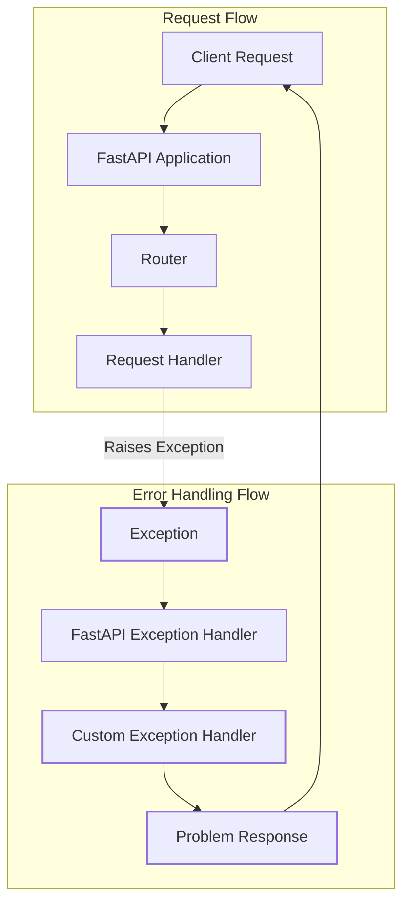
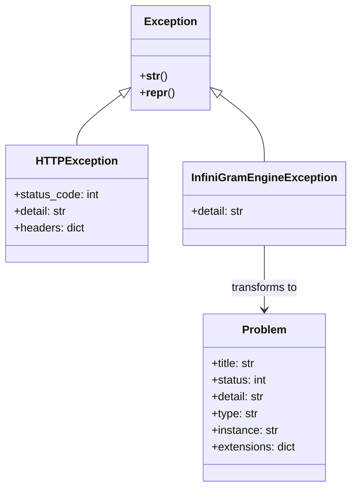
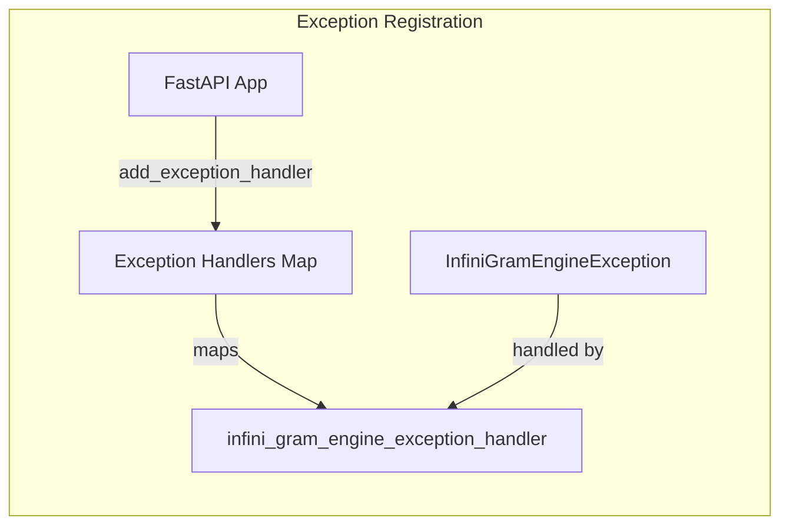
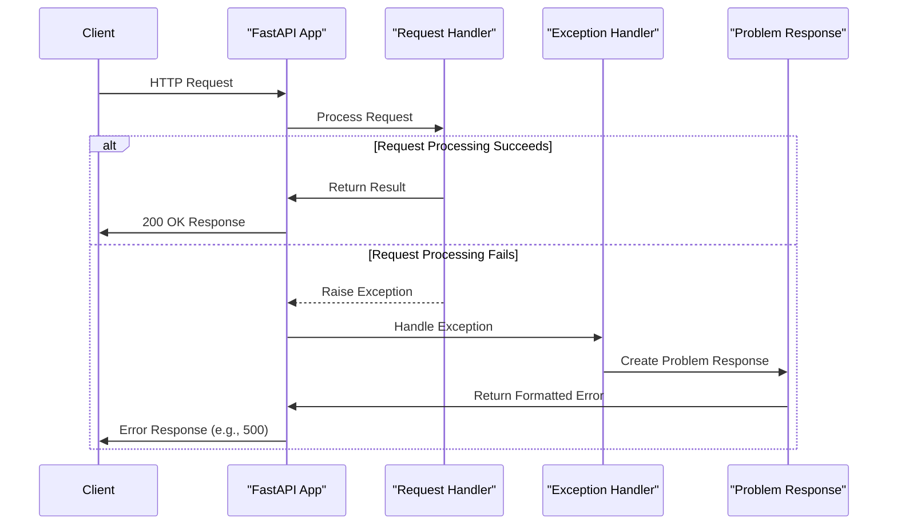

<!-- source: DeepWiki mcp.deepwiki.com · repo allenai/infinigram-api · page 9 Error Handling · fetched 2026-10-26 -->

# Error Handling

<details>
<summary>Relevant source files</summary>

The following files were used as context for generating this wiki page:

- [api/app.py](api/app.py)
- [api/src/camel_case_model.py](api/src/camel_case_model.py)
- [api/src/infini_gram_exception_handler.py](api/src/infini_gram_exception_handler.py)

</details>


This document outlines the error handling mechanisms implemented in the Infinigram API system. It covers how exceptions are processed, the structure of error responses, and the custom exception handlers used throughout the application.

## Error Handling Architecture

The Infinigram API implements a structured approach to error handling using FastAPI's exception handling system combined with the RFC 9457 Problem Details standard for HTTP APIs. This provides consistent, machine-readable error responses across the application.



**Diagram: Error Handling Flow**

Sources: [api/app.py:46-50](), [api/src/infini_gram_exception_handler.py:8-16]()

The error handling system:
1. Catches exceptions raised during request processing
2. Routes them through the appropriate exception handler
3. Transforms exceptions into structured Problem Details responses
4. Returns the formatted error to the client

## Exception Types and Handlers

The Infinigram API uses both built-in FastAPI exception types and custom exceptions specific to the Infinigram engine.



**Diagram: Exception Hierarchy and Transformation**

Sources: [api/app.py:7-8](), [api/src/infini_gram_exception_handler.py:1-4]()

### Custom Exception Handler

The system implements a custom exception handler specifically for `InfiniGramEngineException`, which handles errors from the Infinigram engine. When these exceptions occur, they are converted to RFC 9457 Problem Details objects.

The exception handler is registered in the FastAPI application:



**Diagram: Exception Handler Registration**

Sources: [api/app.py:46-50]()

## Error Response Format

The Infinigram API follows the RFC 9457 Problem Details standard for HTTP APIs, which provides a consistent way to return error details to clients.

The structure of error responses follows this format:

| Field | Type | Description |
|-------|------|-------------|
| title | string | Short, human-readable summary of the problem |
| status | number | HTTP status code |
| detail | string | Human-readable explanation specific to this problem |
| type | string | URI reference that identifies the problem type |
| instance | string (optional) | URI reference that identifies the specific occurrence of the problem |
| extensions | object (optional) | Additional information about the error |

Example of an error response from the Infinigram API:

```json
{
  "title": "infini-gram error",
  "status": 500,
  "detail": "Model failed to process the input text",
  "type": "https://errors.infinigram.ai/engine-failure"
}
```

Sources: [api/src/infini_gram_exception_handler.py:11-16]()

## Implementation Details

### Custom Handler Implementation

The custom exception handler for `InfiniGramEngineException` is defined in [api/src/infini_gram_exception_handler.py]() and transforms engine exceptions into structured Problem responses:

```python
def infini_gram_engine_exception_handler(
    handler: ExceptionHandler, request: Request, exception: InfiniGramEngineException
) -> Problem:
    return Problem(
        title="infini-gram error",
        status=500,
        detail=exception.detail,
        type=error_class_to_type(exception),
    )
```

This handler:
1. Takes the exception handler, HTTP request, and the exception instance
2. Creates a new Problem object with appropriate error details
3. Uses the `error_class_to_type` function to determine the type URI from the exception class
4. Returns a 500 status code (Internal Server Error) for engine exceptions

Sources: [api/src/infini_gram_exception_handler.py:8-16]()

### Registration in FastAPI Application

The exception handler is registered in the main FastAPI application during startup:

```python
app = FastAPI(title="infini-gram API", version="0.0.1", lifespan=lifespan)
add_exception_handler(
    app,
    handlers={InfiniGramEngineException: infini_gram_engine_exception_handler},
)
```

This connects the custom exception type with its corresponding handler in the FastAPI framework.

Sources: [api/app.py:46-50]()

## Error Handling Flow

The complete error handling flow in the Infinigram API is illustrated below:



**Diagram: Error Handling Sequence**

Sources: [api/app.py:46-50](), [api/src/infini_gram_exception_handler.py:8-16]()

## Best Practices for Error Handling

When working with or extending the Infinigram API, consider these error handling best practices:

1. **Use Specific Exceptions**: When adding new functionality, create specific exception types that provide clear context about what went wrong.

2. **Provide Detailed Messages**: Include specific details in exception messages to help with debugging and client understanding.

3. **Map Exceptions to Appropriate Status Codes**: Different types of errors should map to the most appropriate HTTP status codes.

4. **Follow the Problem Details Standard**: Maintain consistency with the RFC 9457 format for all error responses.

5. **Handle Both Expected and Unexpected Errors**: While custom handlers address known error cases, ensure the system has appropriate fallbacks for unexpected errors.

Sources: [api/app.py:7-8](), [api/src/infini_gram_exception_handler.py:1-16]()