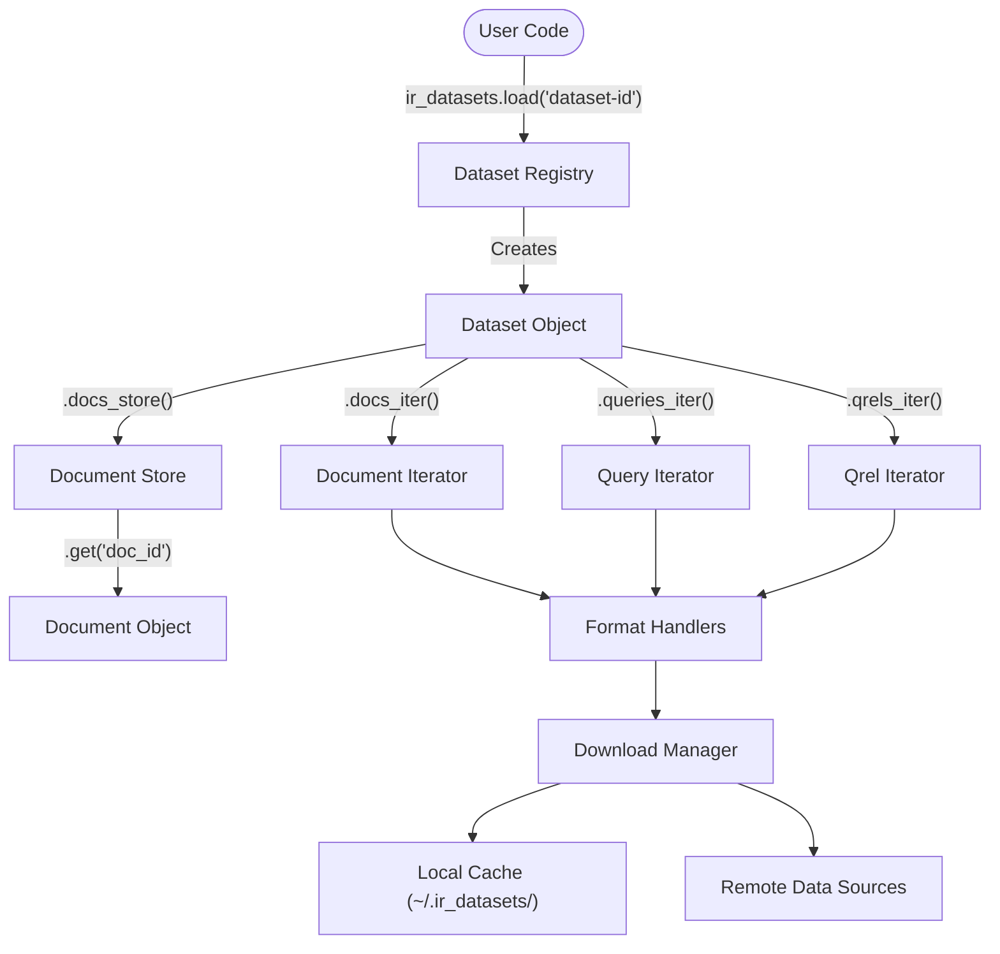
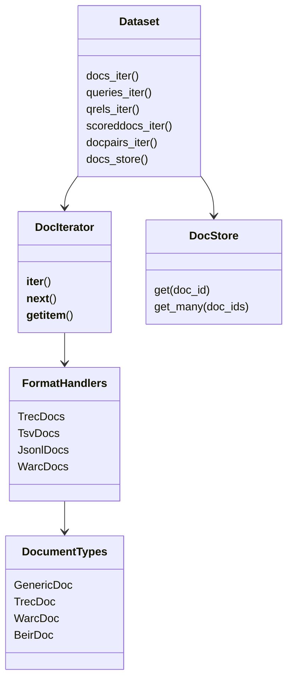
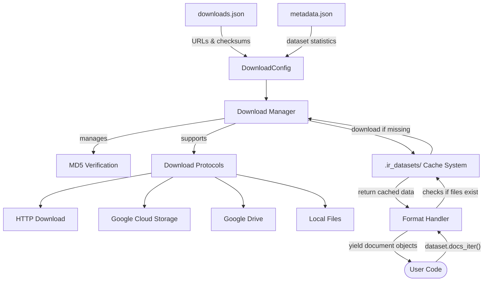

<!-- source: DeepWiki mcp.deepwiki.com · repo allenai/ir_datasets · page 1 Introduction to IR Datasets · fetched 2026-10-26 -->

# Introduction to IR Datasets

<details>
<summary>Relevant source files</summary>

The following files were used as context for generating this wiki page:

- [README.md](README.md)
- [ir_datasets/datasets/__init__.py](ir_datasets/datasets/__init__.py)
- [ir_datasets/docs/bibliography.bib](ir_datasets/docs/bibliography.bib)
- [ir_datasets/etc/downloads.json](ir_datasets/etc/downloads.json)
- [ir_datasets/etc/metadata.json](ir_datasets/etc/metadata.json)
- [ir_datasets/formats/__init__.py](ir_datasets/formats/__init__.py)

</details>


This document provides an overview of the `ir_datasets` library, a Python package designed to simplify access to information retrieval (IR) datasets for research and evaluation. It explains the core concepts, architecture, and usage patterns of the system. For detailed API documentation, see [Python API](#3.3), and for information on extending the library with new datasets, see [Extending IR Datasets](#5).

## Purpose and Scope

`ir_datasets` addresses a common challenge in information retrieval research: accessing and managing diverse datasets in a consistent way. The library provides:

1. A unified interface for accessing documents, queries, and relevance judgments
2. Automatic downloading and verification of publicly available datasets
3. Instructions for obtaining datasets that require licenses
4. Standardized data formats across different collection types
5. Efficient document lookup capabilities
6. Support for both small and large-scale collections

Sources: [README.md:3-13]()

## System Architecture Overview



**High-Level System Architecture**

The architecture revolves around a central registry that maps dataset identifiers to dataset implementation objects. Users access datasets through a common interface regardless of the underlying data format or source. The system handles downloading, caching, and format conversion automatically.

Sources: [README.md:50-68](), [ir_datasets/datasets/__init__.py:1-58]()

## Data Model and Components



**Core Data Model Components**

`ir_datasets` uses a consistent data model across all datasets. The key components include:

1. **Documents**: Text items to be retrieved, with a unique `doc_id` and content
2. **Queries**: Search expressions with a unique `query_id` and text
3. **Relevance Judgments (qrels)**: Annotations indicating relevance between queries and documents
4. **Scored Documents**: Documents with relevance scores from a retrieval system
5. **Document Pairs**: Pairs of documents with a specific relationship

Each component is represented by standardized data classes regardless of the original format.

Sources: [ir_datasets/formats/__init__.py:1-14]()

## Getting Started with IR Datasets

The primary way to access datasets is through the `load()` function:

```python
import ir_datasets
dataset = ir_datasets.load('msmarco-passage')

# Iterate through documents
for doc in dataset.docs_iter():
    print(doc.doc_id, doc.text)

# Get a specific document
docstore = dataset.docs_store()
document = docstore.get('1')
```

The same datasets can also be accessed through the command-line interface:

```bash
ir_datasets export msmarco-passage docs | head -n2
```

Sources: [README.md:26-68]()

## Dataset Access and Download System



**Dataset Download and Cache System**

When you request a dataset component, `ir_datasets`:

1. Checks if the required files exist in the local cache (`~/.ir_datasets/`)
2. If not, downloads them from the source defined in `downloads.json`
3. Verifies the integrity using MD5 checksums
4. For non-public datasets, provides instructions on how to obtain them

The system is designed to handle this process automatically, so users don't need to manually download or manage dataset files.

Sources: [ir_datasets/etc/downloads.json:1-924](), [README.md:70-76]()

## Available Datasets

`ir_datasets` provides access to a diverse collection of datasets:

| Category | Examples |
|----------|----------|
| Web Collections | ClueWeb09, ClueWeb12, GOV2 |
| Passage Collections | MS MARCO Passage, BEIR, DPR-W100 |
| Document Collections | MS MARCO Document, TREC Robust04, Washington Post |
| Specialized Collections | CORD-19, TripClick, TREC-CAST, NeuCLIR |

Datasets are organized hierarchically. For example, `clueweb12/b13/trec-misinfo-2019` provides the queries and judgments from the 2019 TREC misinformation track based on the ClueWeb12 Category B13 document collection.

Sources: [README.md:154-193](), [ir_datasets/datasets/__init__.py:1-58]()

## Key Features

1. **Format Standardization**: Normalizes different data formats into consistent Python objects
2. **Efficient Document Access**: Implements specialized document stores for fast lookup
3. **Dataset Slicing**: Supports advanced slicing operations for parallel processing
4. **Issue Correction**: Automatically fixes known issues in datasets (e.g., encoding problems)
5. **Lazy Loading**: Only loads and processes data when actually needed
6. **Download Management**: Handles file acquisition, verification, and caching

The combination of these features makes `ir_datasets` a valuable tool for information retrieval research, enabling researchers to focus on their experiments rather than data wrangling.

Sources: [README.md:48-152]()

## Conclusion

`ir_datasets` simplifies working with information retrieval datasets by providing a unified interface, handling data acquisition, and standardizing formats. Whether you're working with web collections, passage ranking, or specialized datasets, the library offers a consistent way to access and utilize the data for research and evaluation.

For more detailed information on specific aspects of the system, refer to the other sections of this documentation.

---

