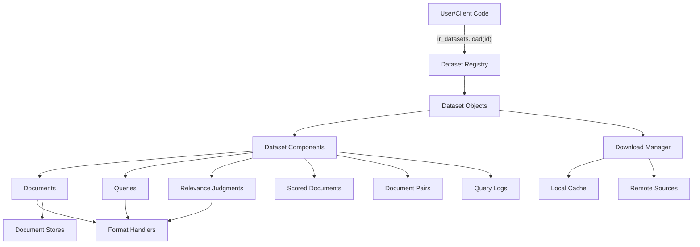
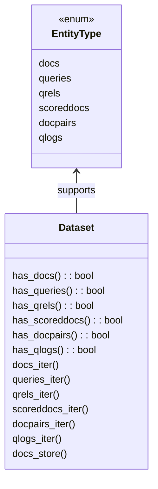
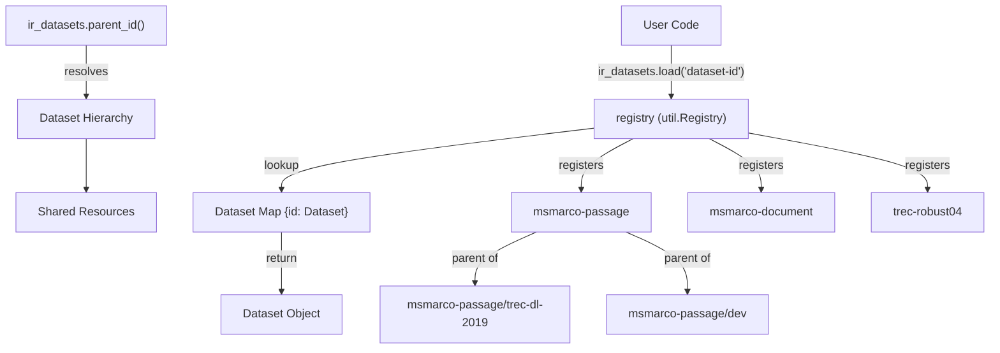
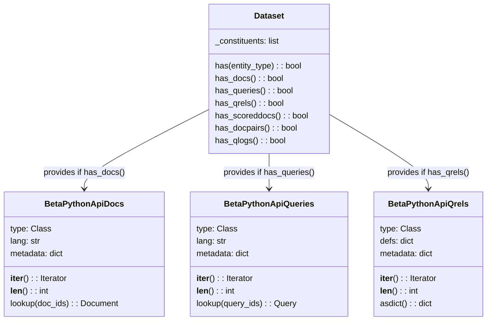
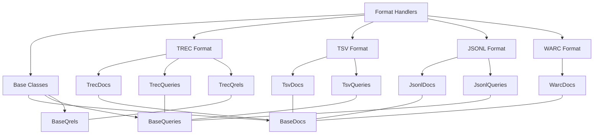
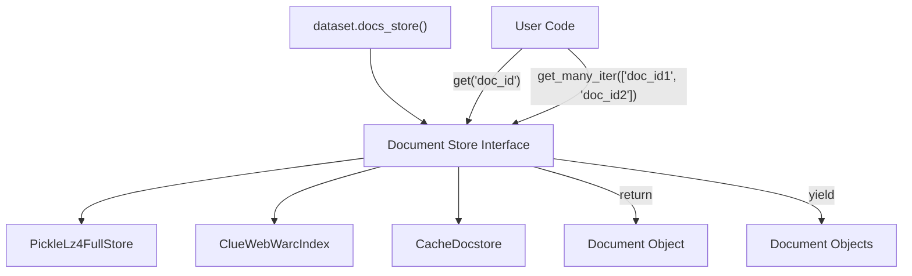
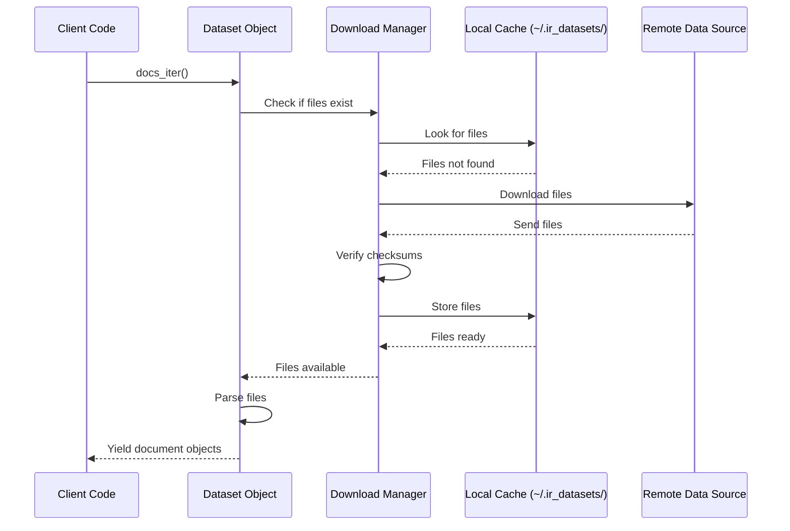
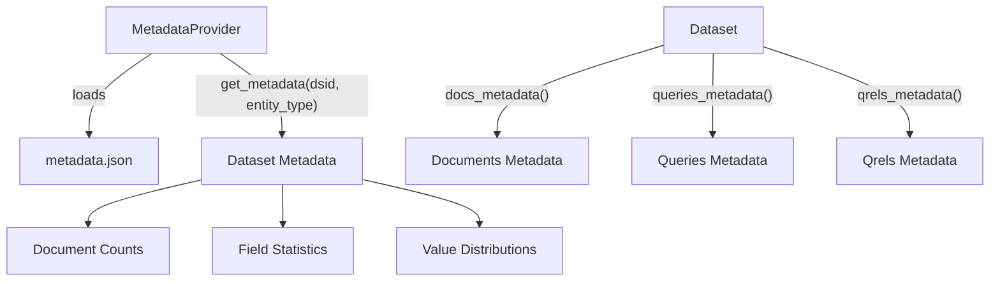
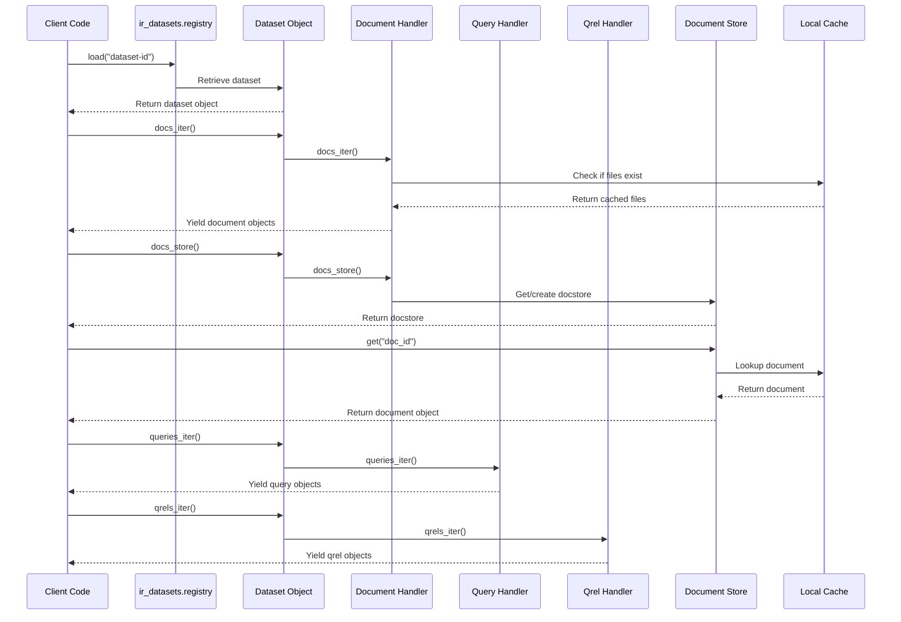
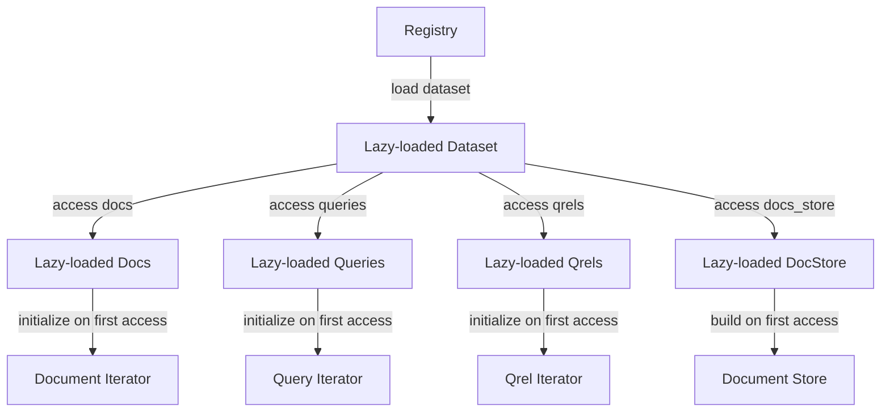

<!-- source: DeepWiki mcp.deepwiki.com · repo allenai/ir_datasets · page 2 Core Architecture · fetched 2026-10-26 -->

# Core Architecture

<details>
<summary>Relevant source files</summary>

The following files were used as context for generating this wiki page:

- [.github/workflows/deploy.yml](.github/workflows/deploy.yml)
- [.github/workflows/test.yml](.github/workflows/test.yml)
- [ir_datasets/__init__.py](ir_datasets/__init__.py)
- [ir_datasets/datasets/__init__.py](ir_datasets/datasets/__init__.py)
- [ir_datasets/datasets/base.py](ir_datasets/datasets/base.py)
- [ir_datasets/docs/bibliography.bib](ir_datasets/docs/bibliography.bib)
- [ir_datasets/docs/trec-cast.yaml](ir_datasets/docs/trec-cast.yaml)
- [ir_datasets/etc/downloads.json](ir_datasets/etc/downloads.json)
- [ir_datasets/etc/metadata.json](ir_datasets/etc/metadata.json)
- [ir_datasets/formats/__init__.py](ir_datasets/formats/__init__.py)
- [ir_datasets/util/metadata.py](ir_datasets/util/metadata.py)
- [test/integration/trec_cast.py](test/integration/trec_cast.py)
- [test/util.py](test/util.py)

</details>


This document explains the fundamental design principles and architecture of the ir_datasets system, which provides a standardized interface for accessing and working with information retrieval datasets. For detailed information about installing and using the system, see [Installation and Configuration](#3.1) and [Python API](#3.3).

## System Overview

IR Datasets is designed around core principles of standardization, efficient data access, and transparent resource management. The system provides a unified interface to access a diverse collection of IR datasets through a consistent API, regardless of their original format or storage mechanism.



Sources: [ir_datasets/__init__.py](https://github.com/allenai/ir_datasets/blob/master/ir_datasets/__init__.py), [ir_datasets/datasets/base.py](https://github.com/allenai/ir_datasets/blob/master/ir_datasets/datasets/base.py)

## Entity Types

The system defines several fundamental entity types that represent different kinds of data within information retrieval datasets:



These entity types are defined in the `EntityType` enum in [ir_datasets/__init__.py:2-8](https://github.com/allenai/ir_datasets/blob/master/ir_datasets/__init__.py#L2-L8) and represent:

- **docs**: The corpus documents to be retrieved
- **queries**: Information needs expressed as text
- **qrels**: Relevance judgments connecting queries to documents
- **scoreddocs**: Documents with their retrieval scores
- **docpairs**: Pairs of documents (e.g., for learning-to-rank)
- **qlogs**: Query logs (e.g., from search engines)

Sources: [ir_datasets/__init__.py:2-8](https://github.com/allenai/ir_datasets/blob/master/ir_datasets/__init__.py#L2-L8)

## Dataset Registry

The dataset registry is the central entry point for accessing datasets. It maps dataset identifiers (strings) to dataset objects and is initialized and populated at startup.



The registry is created using `util.Registry()` in [ir_datasets/__init__.py:13](https://github.com/allenai/ir_datasets/blob/master/ir_datasets/__init__.py#L13) and datasets are loaded with:

```python
def load(name):
    return registry[name]
```

Dataset identifiers use a hierarchical structure (e.g., "msmarco-passage/trec-dl-2019/judged"), where:
- The first component often identifies the document collection ("msmarco-passage")
- Subsequent components identify specific subsets or tasks ("trec-dl-2019/judged")

The `parent_id` function [ir_datasets/__init__.py:25-48](https://github.com/allenai/ir_datasets/blob/master/ir_datasets/__init__.py#L25-L48) resolves the relationship between datasets and their parent collections, which is useful for sharing resources like document stores or indices.

Sources: [ir_datasets/__init__.py:13](https://github.com/allenai/ir_datasets/blob/master/ir_datasets/__init__.py#L13), [ir_datasets/__init__.py:21-22](https://github.com/allenai/ir_datasets/blob/master/ir_datasets/__init__.py#L21-22), [ir_datasets/__init__.py:25-48](https://github.com/allenai/ir_datasets/blob/master/ir_datasets/__init__.py#L25-48)

## Dataset Class

The `Dataset` class is the core class that provides access to the various entity types:



Datasets are composed of various "constituents" that provide the implementation for accessing different entity types. When a dataset attribute like `docs`, `queries`, or `qrels` is accessed, the system returns a Python API object that provides convenient methods for working with that entity type.

Sources: [ir_datasets/datasets/base.py:12-97](https://github.com/allenai/ir_datasets/blob/master/ir_datasets/datasets/base.py#L12-L97)

## Format Handlers

IR Datasets supports a variety of dataset formats through specialized format handlers defined in the formats module:



These format handlers parse the raw dataset files and convert them into standardized objects that conform to the IR Datasets data model. Common formats include:

- **TREC Format**: Standard formats used in TREC competitions (TrecDocs, TrecQueries, TrecQrels)
- **TSV Format**: Tab-separated value files (TsvDocs, TsvQueries)
- **JSONL Format**: Line-delimited JSON files (JsonlDocs, JsonlQueries)
- **WARC Format**: Web ARChive format for web pages (WarcDocs)

Each format handler implements methods for iterating through the entities in the dataset files.

Sources: [ir_datasets/formats/__init__.py](https://github.com/allenai/ir_datasets/blob/master/ir_datasets/formats/__init__.py)

## Document Storage and Retrieval

IR Datasets provides efficient document storage and retrieval through a variety of document store implementations:



The document stores provide fast random access to documents by ID, which is essential for tasks like reranking or evaluation. This avoids the need to scan through the entire collection when only specific documents are needed.

The `docs_store()` method builds or loads an appropriate document store based on the dataset type, with implementations optimized for different collection sizes and formats.

## Download and Caching System

IR Datasets manages dataset files through a download and caching system:



The download system uses configuration from [ir_datasets/etc/downloads.json](https://github.com/allenai/ir_datasets/blob/master/ir_datasets/etc/downloads.json), which specifies:

- URLs for dataset files
- Expected file sizes and MD5 checksums
- Local cache paths

Files are downloaded only when needed, verified for integrity using MD5 checksums, and stored in a local cache (typically `~/.ir_datasets/`). This ensures that users don't need to manually download and manage large datasets.

Sources: [ir_datasets/etc/downloads.json](https://github.com/allenai/ir_datasets/blob/master/ir_datasets/etc/downloads.json)

## Metadata System

IR Datasets includes metadata about each dataset to provide useful information without requiring full dataset processing:



The metadata system is implemented in [ir_datasets/util/metadata.py](https://github.com/allenai/ir_datasets/blob/master/ir_datasets/util/metadata.py) and provides access to dataset statistics like document counts, field lengths, and value distributions without requiring processing of the entire dataset.

Sources: [ir_datasets/etc/metadata.json](https://github.com/allenai/ir_datasets/blob/master/ir_datasets/etc/metadata.json), [ir_datasets/util/metadata.py](https://github.com/allenai/ir_datasets/blob/master/ir_datasets/util/metadata.py)

## Typical Usage Flow

The typical interaction with IR Datasets follows this pattern:



This architecture provides a seamless experience for users, handling all the complexities of dataset management behind a simple and consistent interface.

## Lazy Loading Design

IR Datasets uses a lazy loading approach for many components:



Resources are only loaded when actually needed, which helps with memory efficiency and startup time. This design is particularly important for handling large datasets, as it ensures that users only pay the cost for the specific resources they're using.

## Summary

The core architecture of IR Datasets provides:

1. **Standardized Access**: A consistent API across diverse datasets
2. **Efficient Storage**: Optimized document stores for fast access
3. **Transparent Resource Management**: Automatic downloading and caching
4. **Format Abstraction**: Support for various dataset formats
5. **Hierarchical Organization**: Parent-child relationships between datasets

This architecture enables researchers and practitioners to focus on their information retrieval tasks rather than data management challenges.

Sources: [ir_datasets/__init__.py](https://github.com/allenai/ir_datasets/blob/master/ir_datasets/__init__.py), [ir_datasets/datasets/base.py](https://github.com/allenai/ir_datasets/blob/master/ir_datasets/datasets/base.py), [ir_datasets/formats/__init__.py](https://github.com/allenai/ir_datasets/blob/master/ir_datasets/formats/__init__.py)

---

