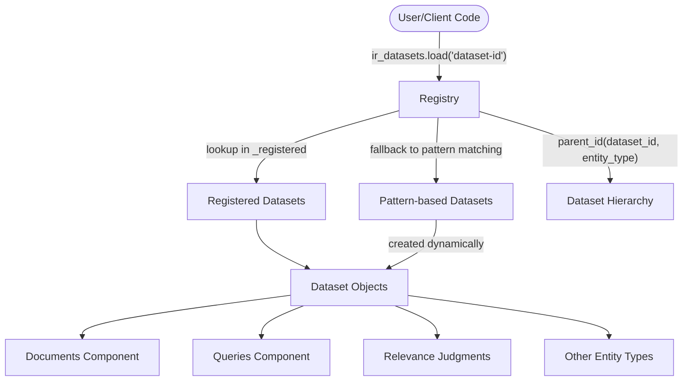
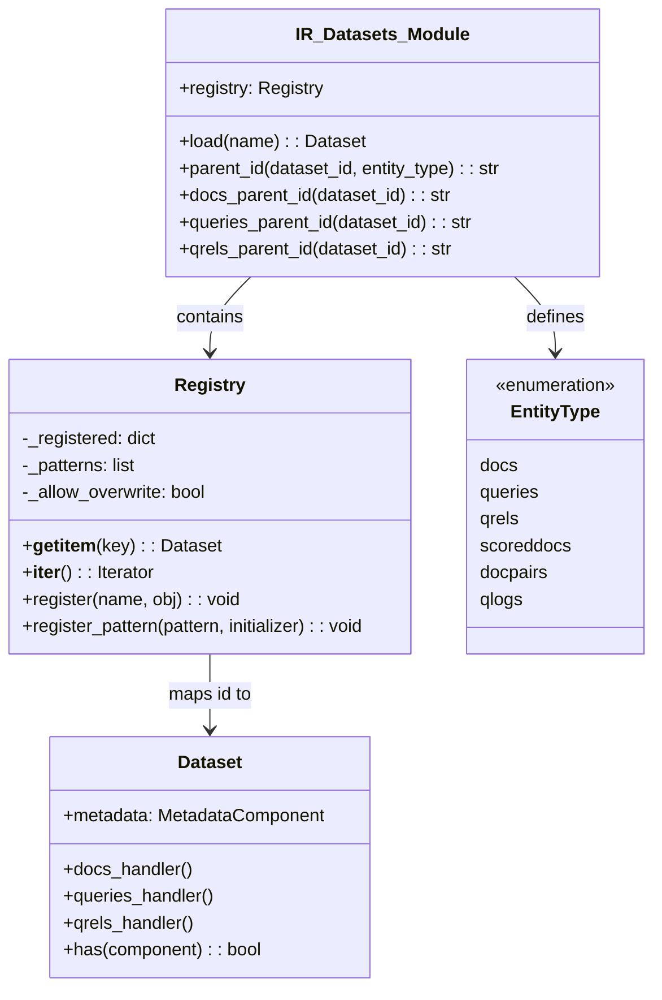
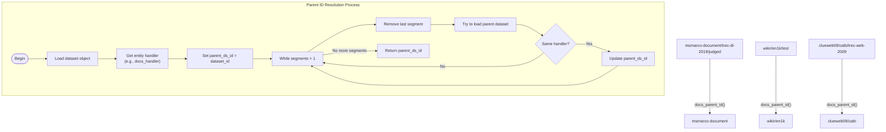
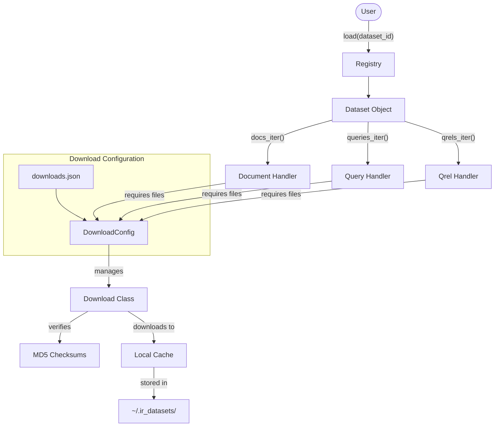

<!-- source: DeepWiki mcp.deepwiki.com · repo allenai/ir_datasets · page 2.1 Dataset Registry System · fetched 2026-10-26 -->

# Dataset Registry System

<details>
<summary>Relevant source files</summary>

The following files were used as context for generating this wiki page:

- [.github/workflows/deploy.yml](.github/workflows/deploy.yml)
- [.github/workflows/test.yml](.github/workflows/test.yml)
- [ir_datasets/__init__.py](ir_datasets/__init__.py)
- [ir_datasets/util/__init__.py](ir_datasets/util/__init__.py)
- [ir_datasets/util/download.py](ir_datasets/util/download.py)
- [ir_datasets/util/fileio.py](ir_datasets/util/fileio.py)
- [ir_datasets/util/registry.py](ir_datasets/util/registry.py)
- [test/downloads.py](test/downloads.py)
- [test/util.py](test/util.py)

</details>


The Dataset Registry System is the central component of ir_datasets that manages access to all available datasets. This system provides a lookup mechanism for dataset identifiers, handles hierarchical dataset relationships, and enables dynamic dataset creation through pattern matching. This document explains how the registry works, its API, and how it interacts with other components of ir_datasets.

For information about the structure of dataset objects themselves, see [Data Model](#2.2). For details on how datasets are downloaded and cached, see [Download and Caching System](#2.3).

## Overview

The registry system provides a unified interface for accessing various information retrieval datasets through standardized identifiers. It allows users to load datasets using simple string identifiers, while abstracting away the complexities of dataset location, format, and loading.



Sources: [ir_datasets/util/registry.py:11-47](), [ir_datasets/__init__.py:13-24]()

## Registry Implementation

The Registry class is a dictionary-like container that maps dataset identifiers to their corresponding dataset objects. The registry also supports pattern-based dataset creation for dynamic datasets.

### Core Components

The registry implementation consists of:

1. `Registry` class - A dictionary-like container for datasets
2. The global `registry` instance - Created at module load time
3. `load(name)` function - A convenient wrapper for accessing the registry
4. `EntityType` enum - Defines the types of data components a dataset can have



Sources: [ir_datasets/util/registry.py:11-47](), [ir_datasets/__init__.py:2-73]()

### Registry Initialization

The registry is initialized as a global variable in the ir_datasets module:

```python
registry = util.Registry()
```

This single registry instance is used throughout the library to register and look up datasets.

Sources: [ir_datasets/__init__.py:13]()

## Dataset Loading Process

When a user calls `ir_datasets.load("dataset-id")`, the following sequence of operations occurs:

```mermaid
sequenceDiagram
    participant User as Client Code
    participant Load as ir_datasets.load
    participant Registry as ir_datasets.registry
    participant Patterns as Pattern Matching
    participant Dataset as Dataset Object
    
    User->>Load: load("dataset-id")
    Load->>Registry: registry["dataset-id"]
    
    alt Dataset directly registered
        Registry-->>Load: return registered dataset
    else Dataset not directly registered
        Registry->>Patterns: Check patterns
        loop Through each pattern
            Patterns->>Patterns: pattern.match(key)
            alt Pattern matches
                Patterns->>Patterns: initializer(key, match.groups())
                Patterns->>Registry: register(key, dataset)
                Patterns-->>Registry: Dataset object
                break
            end
        end
        Registry-->>Load: return dataset or KeyError
    end
    
    Load-->>User: return dataset
    
    Note over Registry,Patterns: If dataset has a "deprecated" attribute,<br>a warning will be displayed
```

Sources: [ir_datasets/__init__.py:21-22](), [ir_datasets/util/registry.py:17-29]()

## Dataset Hierarchy and Parent IDs

IR Datasets supports hierarchical dataset identifiers (e.g., "msmarco-document/trec-dl-2019/judged"). The registry includes functionality to navigate this hierarchy using parent ID functions.

### Parent ID Functions

The system provides several functions to find parent dataset IDs that share the same entity handlers:

- `parent_id(dataset_id, entity_type)` - Generic function to find parent ID for any entity type
- `docs_parent_id(dataset_id)` - Find parent ID for documents
- `queries_parent_id(dataset_id)` - Find parent ID for queries
- `qrels_parent_id(dataset_id)` - Find parent ID for relevance judgments



Example results:
- `docs_parent_id("msmarco-document/trec-dl-2019/judged")` → `"msmarco-document"`
- `docs_parent_id("clueweb09/catb/trec-web-2009")` → `"clueweb09/catb"`

Sources: [ir_datasets/__init__.py:25-73]()

## Registry API

The Registry class provides a simple dictionary-like interface with additional functionality for pattern matching.

### Key Methods

| Method | Description |
|--------|-------------|
| `__getitem__(key)` | Retrieves a dataset by ID, using pattern matching if needed |
| `__iter__()` | Iterates through registered dataset IDs |
| `register(name, obj)` | Registers a dataset object with the given name |
| `register_pattern(pattern, initializer)` | Registers a pattern for dynamic dataset creation |

### Pattern Registration

Patterns allow for dynamic dataset creation when a dataset ID matches a particular regular expression:

```python
registry.register_pattern(r'pattern-(\w+)', lambda key, match: create_dataset(match[0]))
```

When a user attempts to load a dataset with an ID that matches the pattern (e.g., "pattern-xyz"), the initializer function is called to create the dataset on demand.

Sources: [ir_datasets/util/registry.py:11-47]()

## Integration with Download System

The Registry System works closely with the Download and Caching System to manage dataset files.



When a dataset component needs to access data files, it uses the Download system to:
1. Check if the files are available in the local cache
2. Download files from remote sources if needed
3. Verify file integrity using MD5 checksums
4. Extract and process the files as needed

Sources: [ir_datasets/util/download.py:222-371]()

## Using the Registry System

### Loading Datasets

To load a dataset:

```python
import ir_datasets
dataset = ir_datasets.load("msmarco-passage")
```

### Finding Parent Datasets

To find the parent dataset for documents:

```python
import ir_datasets
parent_id = ir_datasets.docs_parent_id("msmarco-document/trec-dl-2019/judged")
# Returns "msmarco-document"
```

### Creating Custom Datasets

The registry also provides a utility function to create simple custom datasets:

```python
import ir_datasets
custom_dataset = ir_datasets.create_dataset(
    docs_tsv="path/to/docs.tsv",
    queries_tsv="path/to/queries.tsv",
    qrels_trec="path/to/qrels.txt"
)
```

Sources: [ir_datasets/__init__.py:76-88]()

## System Limitations and Design Considerations

1. The registry does not support removing datasets once registered (unless allow_overwrite=True is set when creating the registry).
2. Parent ID relationships are determined by convention, finding the lowest dataset_id in the hierarchy with the same entity handler.
3. When a deprecated dataset is loaded, a warning message is displayed (unless IR_DATASETS_SKIP_DEPRECATED_WARNING is set).

Sources: [ir_datasets/util/registry.py:11-47](), [ir_datasets/__init__.py:25-34]()

---

