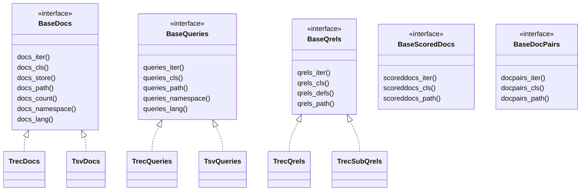
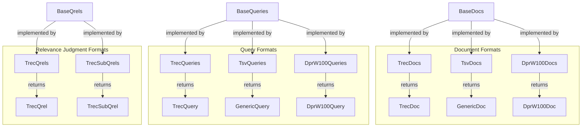
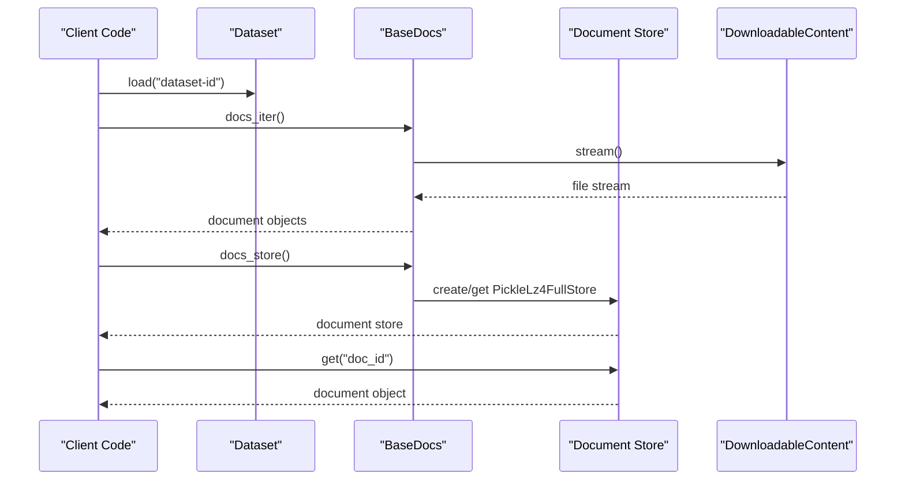
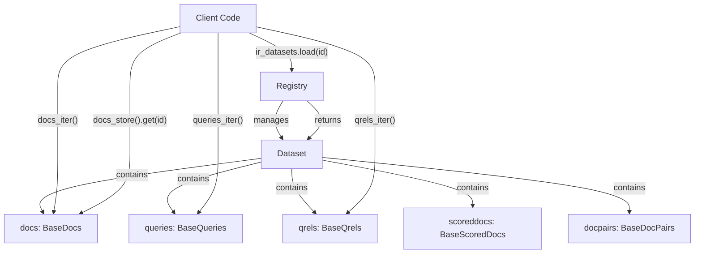

<!-- source: DeepWiki mcp.deepwiki.com · repo allenai/ir_datasets · page 2.2 Data Model · fetched 2026-10-26 -->

# Data Model

Relevant source files

The following files were used as context for generating this wiki page:

- [examples/adding_datasets.ipynb](examples/adding_datasets.ipynb)
- [ir_datasets/commands/build_download_cache.py](ir_datasets/commands/build_download_cache.py)
- [ir_datasets/datasets/dpr_w100.py](ir_datasets/datasets/dpr_w100.py)
- [ir_datasets/formats/trec.py](ir_datasets/formats/trec.py)
- [ir_datasets/formats/tsv.py](ir_datasets/formats/tsv.py)
- [test/integration/dpr_w100.py](test/integration/dpr_w100.py)

## Purpose and Scope

This document describes the core data model of IR Datasets, explaining how documents, queries, relevance judgments, and other information retrieval components are represented within the system. The data model provides a standardized representation and interface for accessing diverse datasets in a consistent manner.

For information on the dataset registry system that manages dataset identifiers, see [Dataset Registry System](#2.1). For details on the download and caching system, see [Download and Caching System](#2.3).

## Core Entity Types

IR Datasets represents data using strongly-typed immutable data structures implemented as Python `NamedTuple` classes. These entities form the foundation of the data model, providing consistent representations for the primary components of information retrieval datasets.

```mermaid
classDiagram
    class GenericDoc {
        doc_id: str
        text: str
        default_text()
    }
    
    class TrecDoc {
        doc_id: str
        text: str
        marked_up_doc: str
        default_text()
    }
    
    class TitleUrlTextDoc {
        doc_id: str
        title: str
        url: str
        text: str
        default_text()
    }
    
    class TrecParsedDoc {
        doc_id: str
        title: str
        body: str
        marked_up_doc: bytes
        default_text()
    }
    
    class DprW100Doc {
        doc_id: str
        text: str
        title: str
        default_text()
    }
    
    class GenericQuery {
        query_id: str
        text: str
        default_text()
    }
    
    class TrecQuery {
        query_id: str
        title: str
        description: str
        narrative: str
        default_text()
    }
    
    class DprW100Query {
        query_id: str
        text: str
        answers: Tuple[str, ]
        default_text()
    }
    
    class GenericScoredDoc {
        query_id: str
        doc_id: str
        score: float
    }
    
    class TrecQrel {
        query_id: str
        doc_id: str
        relevance: int
        iteration: str
    }
    
    class TrecSubQrel {
        query_id: str
        doc_id: str
        relevance: int
        subtopic_id: str
    }
```

Sources: [ir_datasets/formats/trec.py:16-84](), [ir_datasets/datasets/dpr_w100.py:23-42]()

### Document Representations

Documents are the primary content units in information retrieval. The system supports multiple document representations:

- **GenericDoc**: Simple document with ID and text fields
- **TrecDoc**: TREC-style document with ID, text, and original markup
- **TitleUrlTextDoc**: Document with title, URL, and text fields (commonly used for web pages)
- **TrecParsedDoc**: Document with separate title and body fields, plus original markup
- **DprW100Doc**: Specialized document format for DPR-W100 dataset with title and text

All document types implement a `default_text()` method that provides the standard text representation for the document, which is used for indexing and retrieval purposes.

### Query Representations

Queries represent the information needs that retrieval systems aim to satisfy:

- **GenericQuery**: Simple query with ID and text fields
- **TrecQuery**: TREC-style query with title, description, and narrative fields
- **DprW100Query**: Specialized query format with answers field for question-answering tasks

Like documents, all query types implement a `default_text()` method that provides the standard text representation.

### Relevance Judgments

Relevance judgments (qrels) represent assessments of how relevant a document is to a query:

- **TrecQrel**: Standard TREC-style relevance judgment with query ID, document ID, relevance score, and iteration field
- **TrecSubQrel**: Extended relevance judgment that includes subtopic information
- **TrecPrel**: Partially relevant judgment with additional metadata

## Component Interfaces

The data model defines a set of interfaces that standardize access to collections of entities. These interfaces follow a consistent pattern for accessing data.

Sources: [ir_datasets/formats/trec.py:86-135](), [ir_datasets/formats/trec.py:286-335](), [ir_datasets/formats/trec.py:419-457]()

### Common Interface Patterns

All component interfaces follow a consistent pattern:

1. `*_iter()` methods that return iterators over the entities
2. `*_cls()` methods that return the class type of the entities
3. `*_path()` methods that return the path to the source data
4. Additional metadata methods like `*_namespace()` and `*_lang()`

This consistent interface allows client code to work with different dataset types in a uniform way.

## Format Implementations

The IR Datasets library provides format-specific implementations of the component interfaces to handle different data formats:

Sources: [ir_datasets/formats/trec.py:86-284](), [ir_datasets/formats/tsv.py:133-174](), [ir_datasets/formats/tsv.py:176-195]()

### TREC Format Implementations

TREC format handlers parse standard TREC-style collections:

- **TrecDocs**: Handles TREC document collections, supporting different content extraction methods (BeautifulSoup, text, SAX)
- **TrecQueries**: Processes TREC topic files with title, description, and narrative fields
- **TrecQrels**: Processes standard TREC relevance judgments files

### TSV Format Implementations

TSV format handlers parse tab-separated value files:

- **TsvDocs**: Parses tab-separated document collections
- **TsvQueries**: Parses tab-separated query collections
- **TsvDocPairs**: Handles document pairs in TSV format

### Dataset-Specific Implementations

For specialized datasets with unique formats, IR Datasets provides custom implementations:

- **DprW100Queries**: Handles the specialized query format for DPR-W100 dataset
- **MsMarcoDocStore**: Specialized document store for MS MARCO documents
- **ClueWebWarcDocstore**: Specialized document store for ClueWeb WARC files

## Data Access Patterns

The IR Datasets data model provides a consistent pattern for accessing and working with dataset components:

Sources: [ir_datasets/formats/trec.py:112-130](), [ir_datasets/formats/tsv.py:145-148](), [ir_datasets/formats/trec.py:260-272]()

### Iteration Access Pattern

The primary access pattern is iteration through dataset components:

- `docs_iter()`: Returns an iterator over document objects
- `queries_iter()`: Returns an iterator over query objects
- `qrels_iter()`: Returns an iterator over relevance judgment objects

These methods provide memory-efficient access to potentially large collections.

### Random Access via Document Stores

For more efficient random access to documents, the data model provides document stores:

- `docs_store()`: Returns a document store that provides efficient random access by document ID
- The primary implementation is `PickleLz4FullStore`, which compresses documents for efficient storage

### Component Metadata

The data model includes methods for accessing metadata about components:

- `docs_namespace()` / `queries_namespace()`: Returns the namespace of the collection (typically the dataset ID)
- `docs_lang()` / `queries_lang()`: Returns the language of the collection
- `qrels_defs()`: Returns definitions of relevance judgment scores

## Dataset Composition

The Dataset class combines multiple components to create a complete dataset:

Sources: [ir_datasets/datasets/dpr_w100.py:132-143](), [examples/adding_datasets.ipynb:34-82]()

This composable design allows datasets to include only the components they support. For example, a dataset might include documents and queries but no relevance judgments, or it might include multiple subsets with different query sets.

## Data Model Extensibility

The IR Datasets data model is designed to be extensible:

1. **New Entity Types**: Create new `NamedTuple` classes to represent specialized document or query formats
2. **Format Handlers**: Implement base interfaces (`BaseDocs`, `BaseQueries`, etc.) for new formats
3. **Dataset Registration**: Register new datasets composed of the appropriate components

This extensibility allows IR Datasets to support a wide range of information retrieval datasets with different formats and structures.

---

