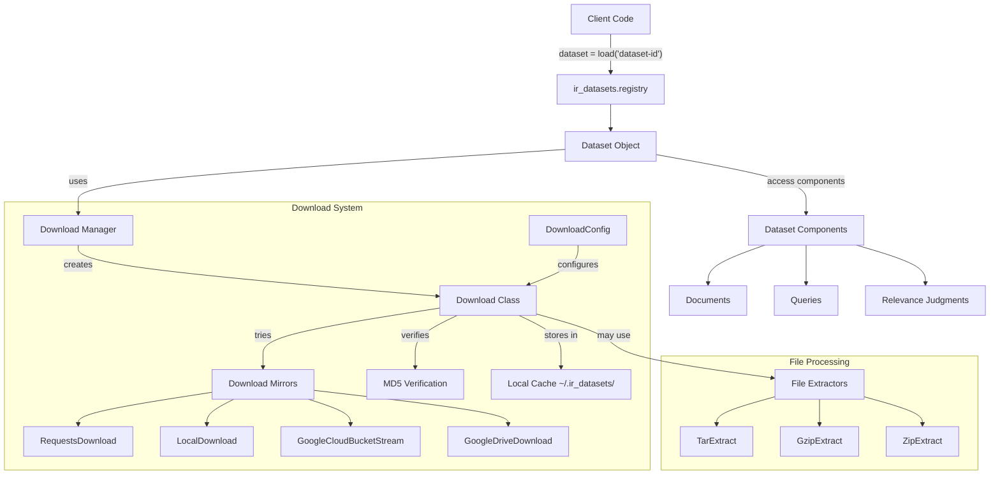
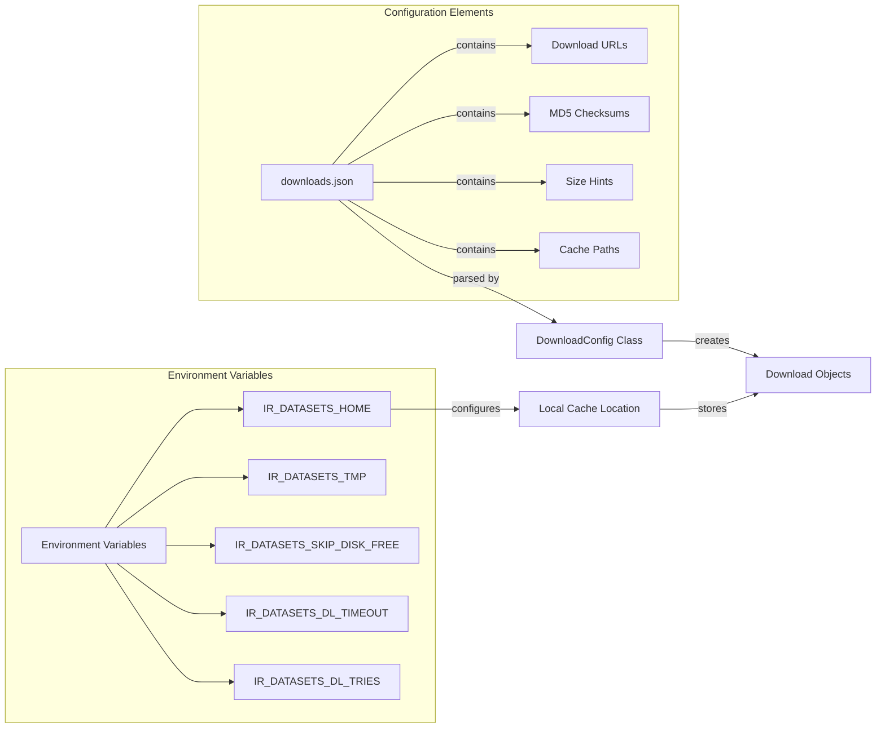
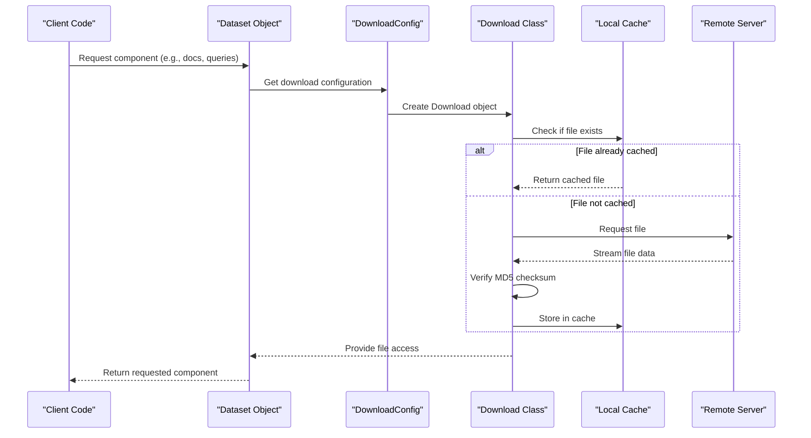
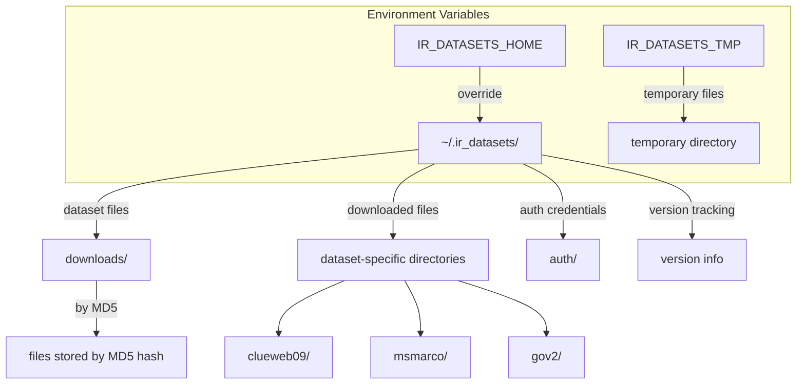
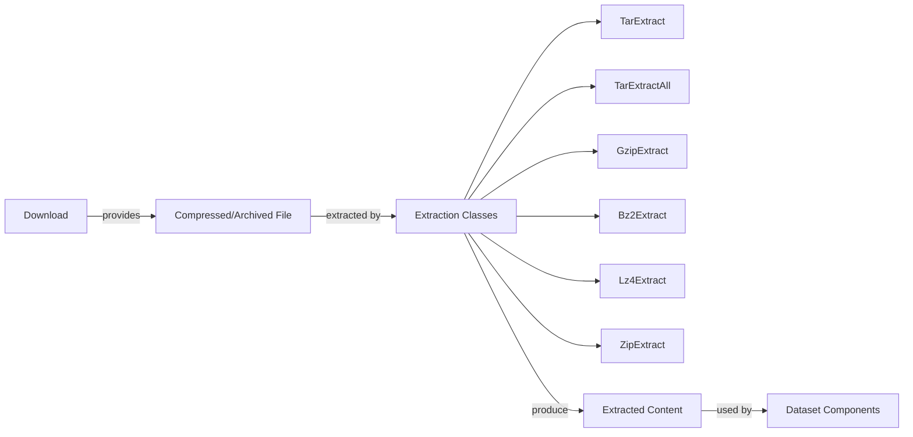
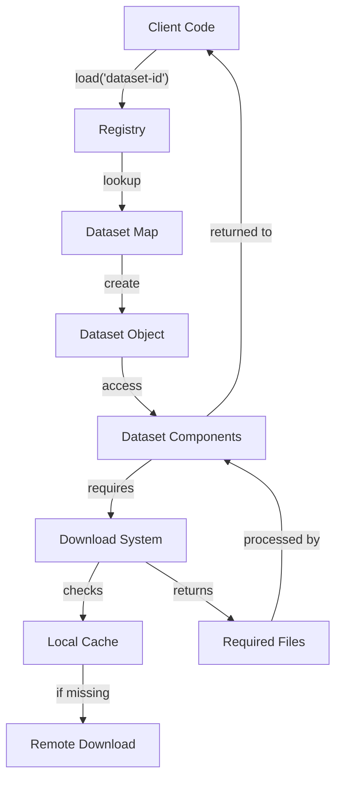

<!-- source: DeepWiki mcp.deepwiki.com · repo allenai/ir_datasets · page 2.3 Download and Caching System · fetched 2026-10-26 -->

# Download and Caching System

<details>
<summary>Relevant source files</summary>

The following files were used as context for generating this wiki page:

- [ir_datasets/datasets/__init__.py](ir_datasets/datasets/__init__.py)
- [ir_datasets/datasets/gov2.py](ir_datasets/datasets/gov2.py)
- [ir_datasets/docs/bibliography.bib](ir_datasets/docs/bibliography.bib)
- [ir_datasets/docs/clueweb09.yaml](ir_datasets/docs/clueweb09.yaml)
- [ir_datasets/docs/clueweb12.yaml](ir_datasets/docs/clueweb12.yaml)
- [ir_datasets/docs/gov2.yaml](ir_datasets/docs/gov2.yaml)
- [ir_datasets/etc/downloads.json](ir_datasets/etc/downloads.json)
- [ir_datasets/etc/metadata.json](ir_datasets/etc/metadata.json)
- [ir_datasets/formats/__init__.py](ir_datasets/formats/__init__.py)
- [ir_datasets/indices/lz4_pickle.py](ir_datasets/indices/lz4_pickle.py)
- [ir_datasets/util/__init__.py](ir_datasets/util/__init__.py)
- [ir_datasets/util/download.py](ir_datasets/util/download.py)
- [ir_datasets/util/fileio.py](ir_datasets/util/fileio.py)
- [ir_datasets/util/registry.py](ir_datasets/util/registry.py)
- [test/downloads.py](test/downloads.py)
- [test/integration/gov2.py](test/integration/gov2.py)

</details>


The download and caching system in ir_datasets provides mechanisms to efficiently acquire, verify, store, and access dataset files. This system automatically downloads files when needed, verifies their integrity, and caches them locally to avoid redundant downloads. For information about the overall architecture, see [Core Architecture](#2).

## Overview

The download and caching system is responsible for:

1. Downloading dataset files from remote sources
2. Verifying file integrity using MD5 checksums
3. Caching files in a local directory structure
4. Providing access to these files for dataset components



Sources: [ir_datasets/util/download.py:222-298](), [ir_datasets/util/fileio.py:1-16]()

## Configuration System

The download and caching system is configured through a centralized JSON file (`downloads.json`) that defines download URLs, MD5 checksums, file sizes, and caching paths for dataset files.



Sources: [ir_datasets/util/download.py:301-371](), [ir_datasets/etc/downloads.json:1-120]()

### Downloads.json Structure

The `downloads.json` file contains a hierarchical structure of dataset IDs and their associated download information:

```
{
  "dataset-id": {
    "component-id": {
      "url": "https://example.com/file.zip",
      "expected_md5": "md5checksum",
      "size_hint": 1234567,
      "cache_path": "path/to/store/file"
    }
  }
}
```

Each download entry can contain the following fields:

| Field | Purpose | Required |
|-------|---------|----------|
| `url` | Remote URL to download the file | Yes (or `instructions`) |
| `expected_md5` | MD5 checksum for verification | Yes |
| `size_hint` | Approximate file size in bytes | No |
| `cache_path` | Where to store the file in the cache | No |
| `irds_mirror` | Whether file is mirrored on ir-datasets server | No |
| `instructions` | Instructions when file needs manual download | Yes (or `url`) |
| `skip_test` | Skip file in download tests | No |
| `auth` | Authentication requirement info | No |
| `download_args` | Extra arguments for download | No |

Sources: [ir_datasets/etc/downloads.json:1-30](), [ir_datasets/util/download.py:343-367]()

## Download Process

When a dataset component is requested, the system follows a multi-step process to locate or download the required files.



Sources: [ir_datasets/util/download.py:222-298](), [test/downloads.py:38-125]()

### Download Class

The `Download` class ([ir_datasets/util/download.py:222-298]()) manages the complete download process:

1. Tries multiple mirror sources if available
2. Streams data from the source
3. Verifies the file using MD5 checksum
4. Stores the file in the local cache
5. Provides access to the file

### Download Sources

The system supports multiple types of download sources, implemented as subclasses of `BaseDownload`:

| Source Type | Class | Purpose |
|-------------|-------|---------|
| HTTP/HTTPS | `RequestsDownload` | Downloads from web servers using requests library |
| Google Cloud | `GoogleCloudBucketStream` | Downloads from Google Cloud Storage buckets |
| Google Drive | `GoogleDriveDownload` | Downloads from Google Drive |
| Local Files | `LocalDownload` | Accesses or prompts for locally available files |

Sources: [ir_datasets/util/download.py:20-190]()

## Caching System

Downloaded files are stored in a local cache to avoid redundant downloads. The cache location and structure are designed for efficient storage and access.



Sources: [ir_datasets/util/download.py:245-281](), [ir_datasets/util/__init__.py:23-34]()

### Cache Location

The default cache location is `~/.ir_datasets/`, which can be overridden by setting the `IR_DATASETS_HOME` environment variable.

### Cache Structure

The cache is organized as follows:

- `~/.ir_datasets/downloads/`: Files downloaded by MD5 hash (for deduplication)
- `~/.ir_datasets/{dataset-id}/`: Dataset-specific files and directories
- `~/.ir_datasets/auth/`: Authentication credentials for protected resources

### Cache Management

Files in the cache are organized based on the `cache_path` specified in the download configuration. The system performs disk space checks before large downloads (unless disabled using the `IR_DATASETS_SKIP_DISK_FREE` environment variable).

Sources: [ir_datasets/util/__init__.py:214-242](), [ir_datasets/util/download.py:259-261]()

## File Extraction and Processing

Many dataset files are compressed or packaged in various formats. The system provides utilities to handle extraction and processing of these files.



Sources: [ir_datasets/util/fileio.py:88-205]()

### Extraction Utilities

The following extraction utilities are available:

| Utility | Purpose |
|---------|---------|
| `TarExtract` | Extracts a specific file from a tar archive |
| `TarExtractAll` | Extracts all files from a tar archive |
| `GzipExtract` | Decompresses gzip files |
| `Bz2Extract` | Decompresses bzip2 files |
| `Lz4Extract` | Decompresses lz4 files |
| `ZipExtract` | Extracts files from zip archives |
| `ZipExtractCache` | Extracts and caches files from zip archives |

Sources: [ir_datasets/util/fileio.py:88-290]()

## Advanced Features

### Resumable Downloads

The download system supports resumable downloads when the remote server supports range requests. If a download is interrupted, the system will attempt to resume from where it left off.

```python
# Logic for resumable downloads (simplified)
if response.headers.get('accept-ranges') == 'bytes':
    _logger.info(f'Retrying range "{pbar.n}-" [{remaining_tries} attempts left]')
    http_args['headers']['Range'] = f'bytes={pbar.n}-'
```

Sources: [ir_datasets/util/download.py:118-127]()

### Download Verification

Files are verified using MD5 checksums to ensure integrity. The verification is done using a streaming approach, so the entire file doesn't need to be loaded into memory.

Sources: [ir_datasets/util/download.py:265-267]()

### Environment Variable Configuration

The download system can be configured using several environment variables:

| Environment Variable | Purpose | Default |
|----------------------|---------|---------|
| `IR_DATASETS_HOME` | Base directory for cached files | `~/.ir_datasets` |
| `IR_DATASETS_TMP` | Directory for temporary files | `$TMPDIR/ir_datasets` |
| `IR_DATASETS_DL_TIMEOUT` | Download socket timeout in seconds | 15 |
| `IR_DATASETS_DL_TRIES` | Number of download retry attempts | 3 |
| `IR_DATASETS_DL_SKIP_SSL` | Skip SSL verification if "true" | false |
| `IR_DATASETS_SKIP_DISK_FREE` | Skip disk space check if "true" | false |
| `IR_DATASETS_DL_DISABLE_PBAR` | Disable progress bar if "true" | false |

Sources: [ir_datasets/util/download.py:78-96](), [ir_datasets/util/__init__.py:214-222]()

## Integration with Dataset Registry

The download and caching system is integrated with the dataset registry to provide seamless access to dataset components.



Sources: [ir_datasets/util/registry.py:11-46](), [test/downloads.py:38-125]()

When a dataset is loaded using `ir_datasets.load('dataset-id')`, the registry looks up the dataset configuration, which may include download requirements. The download system is then used to ensure all necessary files are available locally before processing and returning the requested dataset components.

---

