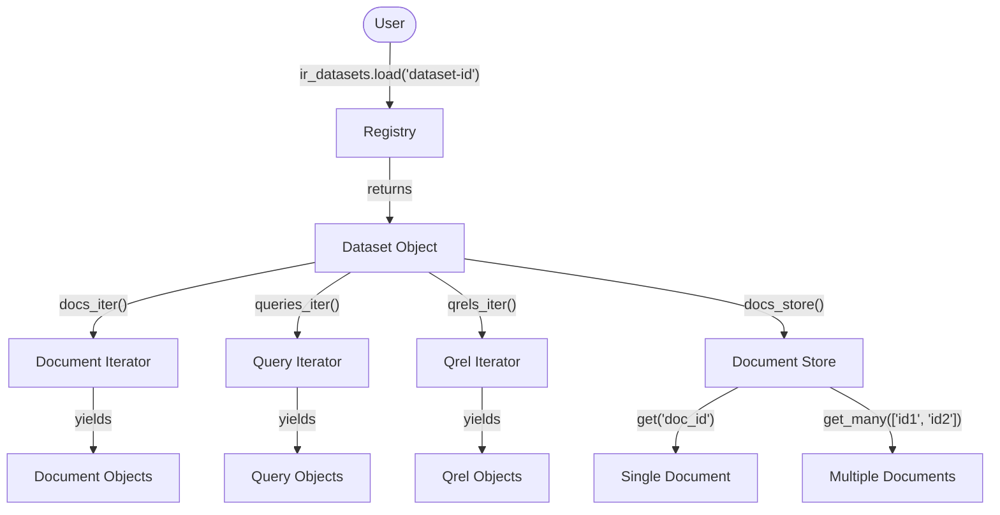
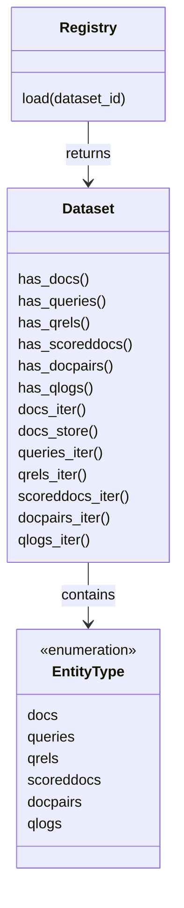
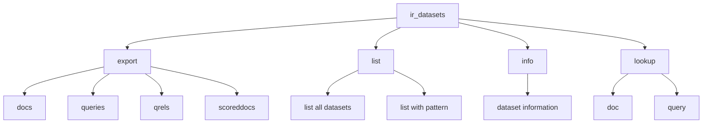

<!-- source: DeepWiki mcp.deepwiki.com · repo allenai/ir_datasets · page 3 Using IR Datasets · fetched 2026-10-26 -->

# Using IR Datasets

<details>
<summary>Relevant source files</summary>

The following files were used as context for generating this wiki page:

- [.github/workflows/deploy.yml](.github/workflows/deploy.yml)
- [.github/workflows/test.yml](.github/workflows/test.yml)
- [README.md](README.md)
- [ir_datasets/__init__.py](ir_datasets/__init__.py)
- [test/util.py](test/util.py)

</details>


This page provides a comprehensive guide on using the IR Datasets library in your research and applications. The document covers installation, configuration, and practical usage through both the Python API and command-line interface. For information about the underlying architecture of IR Datasets, see [Core Architecture](#2). For details about specific dataset collections, see [Dataset Collections](#4).

## Installation

IR Datasets can be installed via pip:

```bash
pip install ir_datasets
```

For the latest development version from the main branch:

```bash
pip install git+https://github.com/allenai/ir_datasets.git
```

If you need to run an editable version locally for development:

```bash
git clone https://github.com/allenai/ir_datasets
cd ir_datasets
pip install -e .
```

IR Datasets supports Python versions 3.7, 3.8, 3.9, and 3.10.

Sources: [README.md:26-46]()

## Configuration

The behavior of IR Datasets can be customized using the following environment variables:

| Environment Variable | Description | Default Value |
|---------------------|-------------|---------------|
| `IR_DATASETS_HOME` | Home directory for dataset storage | `~/.ir_datasets/` |
| `IR_DATASETS_TMP` | Temporary working directory | `/tmp/ir_datasets/` |
| `IR_DATASETS_DL_TIMEOUT` | Download stream read timeout (seconds) | `15` |
| `IR_DATASETS_DL_TRIES` | Number of download attempts | `3` |
| `IR_DATASETS_DL_DISABLE_PBAR` | Disable the progress bar for downloads | `false` |
| `IR_DATASETS_DL_SKIP_SSL` | Skip SSL certificate verification | `false` |
| `IR_DATASETS_SKIP_DISK_FREE` | Skip checking for free disk space | `false` |
| `IR_DATASETS_SMALL_FILE_SIZE` | Size threshold for "small" files (bytes) | `5000000` (5MB) |

Sources: [README.md:199-216]()

## Basic Usage Patterns

### Dataset Loading and Access Flow

The following diagram illustrates the typical flow of using IR Datasets:



Sources: [README.md:50-68](), [ir_datasets/__init__.py:21-22]()

### Python Example

```python
import ir_datasets

# Load a dataset
dataset = ir_datasets.load('msmarco-passage/train')

# Access documents
for doc in dataset.docs_iter():
    print(doc)
    # GenericDoc(doc_id='0', text='The presence of communication amid scientific minds was equa...')
    break

# Access queries
for query in dataset.queries_iter():
    print(query)
    # GenericQuery(query_id='121352', text='define extreme')
    break

# Access relevance judgments
for qrel in dataset.qrels_iter():
    print(qrel)
    # TrecQrel(query_id='121352', doc_id='7187158', relevance=1, iteration='0')
    break
```

Sources: [README.md:53-68]()

### Command Line Example

```bash
# Export documents from a dataset
ir_datasets export msmarco-passage/train docs | head -n2
# 0 The presence of communication amid scientific minds was equally important to the success of the Manh...
# 1 The Manhattan Project and its atomic bomb helped bring an end to World War II. Its legacy of peacefu...
```

Sources: [README.md:64-68]()

## Python API Details

### Dataset Object Structure



Sources: [ir_datasets/__init__.py:1-9, 19-22]()

### Loading Datasets

Datasets are loaded using the `ir_datasets.load()` function, which accepts a dataset identifier:

```python
import ir_datasets
dataset = ir_datasets.load('msmarco-passage/train')
```

Dataset identifiers are hierarchical, with components separated by slashes. For example:
- `msmarco-passage` - The base MS MARCO passage dataset
- `msmarco-passage/train` - The training subset of MS MARCO passage
- `clueweb12/b13/trec-misinfo-2019` - The TREC 2019 misinformation track using ClueWeb12 Category B13

Sources: [ir_datasets/__init__.py:21-22](), [README.md:191-197]()

### Working with Documents

Documents can be accessed through iterators or random access:

```python
# Iterate through documents
for doc in dataset.docs_iter():
    print(doc.doc_id, doc.text[:50])

# Random access to documents
docstore = dataset.docs_store()
doc = docstore.get('1')
print(doc.text)

# Access multiple documents efficiently
docs = docstore.get_many(['1', '2', '3'])
```

IR Datasets automatically handles document format differences, encoding issues, and efficient access for large collections.

Sources: [README.md:110-122]()

### Iterator Slicing

IR Datasets supports powerful slicing operations on iterators:

```python
# First 10 documents
for doc in dataset.docs_iter()[:10]:
    process_doc(doc)

# Documents from index 100 to 200
for doc in dataset.docs_iter()[100:200]:
    process_doc(doc)

# Every 100th document
for doc in dataset.docs_iter()[::100]:
    process_doc(doc)

# Middle third of the collection
for doc in dataset.docs_iter()[1/3:2/3]:
    process_doc(doc)
```

Sources: [README.md:136-151](), [test/util.py:6-21]()

### Entity Type Hierarchies

IR Datasets understands hierarchical relationships between dataset components using the `parent_id` function:

```python
# Find the parent dataset ID that provides documents for a given dataset
parent_ds_id = ir_datasets.docs_parent_id('msmarco-document/trec-dl-2019/judged')
# Returns 'msmarco-document'

# Can also be used for other entity types
query_parent_id = ir_datasets.queries_parent_id('wikir/en1k/test')
# Returns 'wikir/en1k'
```

This is useful when creating shared resources among multiple dataset subsets.

Sources: [ir_datasets/__init__.py:25-73]()

### Creating Custom Datasets

You can create custom datasets from local files:

```python
import ir_datasets
custom_dataset = ir_datasets.create_dataset(
    docs_tsv='/path/to/docs.tsv',
    queries_tsv='/path/to/queries.tsv',
    qrels_trec='/path/to/qrels.txt'
)
```

Sources: [ir_datasets/__init__.py:76-88]()

## Command Line Interface

IR Datasets provides a command-line interface for common operations.

### CLI Structure



Sources: [ir_datasets/__init__.py:91-102]()

### Common CLI Commands

```bash
# List all available datasets
ir_datasets list

# List datasets matching a pattern
ir_datasets list msmarco

# Show information about a dataset
ir_datasets info msmarco-passage

# Export documents (to stdout)
ir_datasets export msmarco-passage docs

# Export queries (to stdout)
ir_datasets export msmarco-passage queries

# Export relevance judgments (to stdout)
ir_datasets export msmarco-passage/train qrels

# Look up a specific document
ir_datasets lookup msmarco-passage doc 1

# Look up a specific query
ir_datasets lookup msmarco-passage query 1
```

Sources: [README.md:64-68]()

## Automatic Dataset Management

IR Datasets handles several aspects of dataset management automatically:

### Automatic Downloading

When accessing a dataset, IR Datasets automatically downloads and verifies the necessary files:

```python
import ir_datasets
dataset = ir_datasets.load('msmarco-passage')
for doc in dataset.docs_iter():  # Downloads collection.tar.gz on first access
    print(doc.doc_id)
    break
```

Sources: [README.md:70-84]()

### Documentation for Non-Public Datasets

For datasets requiring data usage agreements, IR Datasets provides clear instructions:

```python
import ir_datasets
dataset = ir_datasets.load('trec-arabic')
# When trying to access docs, you'll get instructions for obtaining the data
```

Sources: [README.md:86-98]()

### Handling Large Datasets

IR Datasets efficiently processes large datasets that may not fit in memory:

```python
import ir_datasets
dataset = ir_datasets.load('clueweb09')
# Efficiently iterates through ~1B documents without loading all into memory
for doc in dataset.docs_iter():
    process_document(doc)
```

For large collections like ClueWeb, IR Datasets uses specialized techniques like checkpoint files to load documents 40x faster than normal.

Sources: [README.md:100-108](), [README.md:123-134]()

### Automatic Fixes for Known Dataset Issues

IR Datasets automatically handles known issues in datasets, such as encoding problems:

```python
import ir_datasets
dataset = ir_datasets.load('msmarco-passage')
docstore = dataset.docs_store()
doc = docstore.get('243')
# Text is properly encoded with correct UTF-8 handling
# Without fixes, would have artifacts like "â\x80\x93" instead of "–"
```

Sources: [README.md:110-122]()

## Common Use Cases

### Training Data for IR Models

```python
import ir_datasets
dataset = ir_datasets.load('msmarco-passage/train')

# Get queries and relevant passages for training
queries = {}
for query in dataset.queries_iter():
    queries[query.query_id] = query.text

relevance = {}
for qrel in dataset.qrels_iter():
    if qrel.query_id not in relevance:
        relevance[qrel.query_id] = []
    relevance[qrel.query_id].append(qrel.doc_id)

# Get the text for relevant documents
docstore = dataset.docs_store()
for query_id, rel_doc_ids in relevance.items():
    query_text = queries[query_id]
    rel_docs = docstore.get_many(rel_doc_ids)
    # Use for training...
```

### Evaluating IR Systems

```python
import ir_datasets
dataset = ir_datasets.load('msmarco-passage/dev')

# Get queries and relevance judgments for evaluation
test_queries = {q.query_id: q.text for q in dataset.queries_iter()}
test_qrels = {}
for qrel in dataset.qrels_iter():
    if qrel.query_id not in test_qrels:
        test_qrels[qrel.query_id] = {}
    test_qrels[qrel.query_id][qrel.doc_id] = qrel.relevance

# Evaluate your IR system
for query_id, query_text in test_queries.items():
    results = your_search_system(query_text)  # Your system's results
    relevant_docs = test_qrels.get(query_id, {})
    # Calculate metrics...
```

Sources: [README.md:45-134]()

This wiki page provides an overview of how to use IR Datasets in your work. For information on extending IR Datasets with new datasets, see [Extending IR Datasets](#5).

Sources: [README.md:1-216](), [ir_datasets/__init__.py:1-104]()

---

