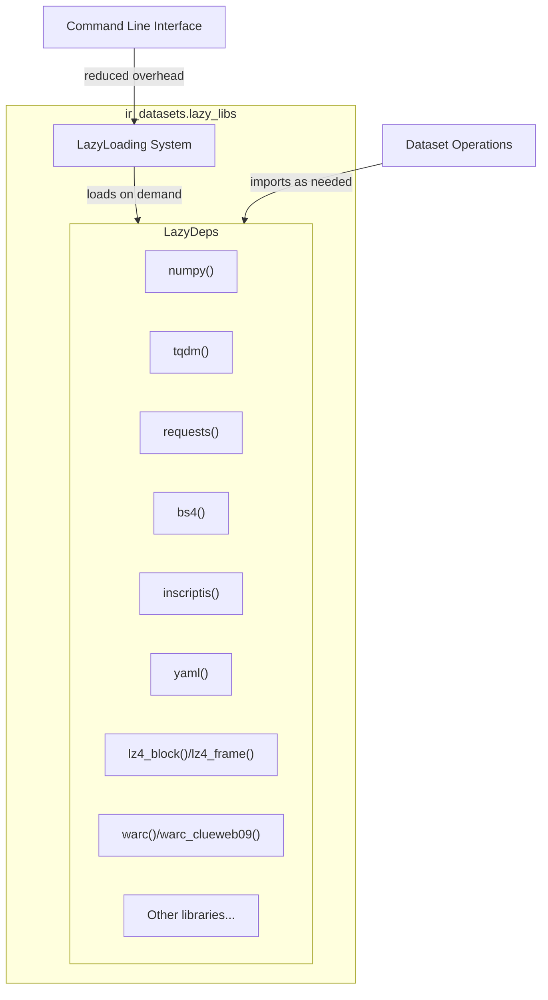
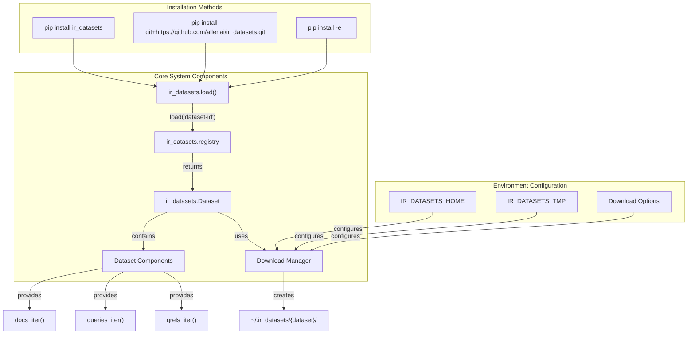
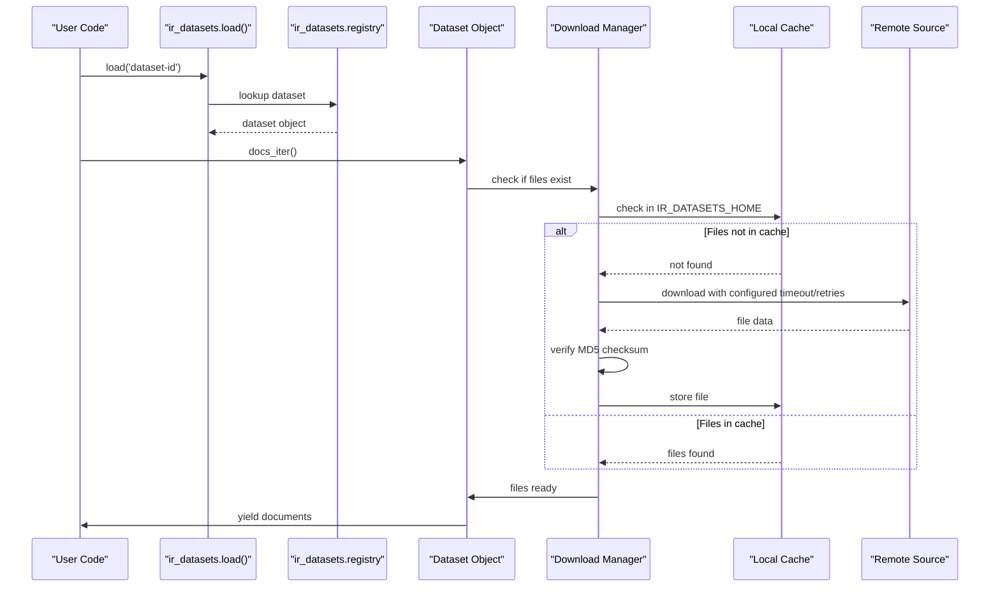

<!-- source: DeepWiki mcp.deepwiki.com · repo allenai/ir_datasets · page 3.1 Installation and Configuration · fetched 2026-10-26 -->

# Installation and Configuration

<details>
<summary>Relevant source files</summary>

The following files were used as context for generating this wiki page:

- [.github/workflows/deploy.yml](.github/workflows/deploy.yml)
- [.github/workflows/test.yml](.github/workflows/test.yml)
- [README.md](README.md)
- [ir_datasets/__init__.py](ir_datasets/__init__.py)
- [ir_datasets/lazy_libs.py](ir_datasets/lazy_libs.py)
- [ir_datasets/wrappers/__init__.py](ir_datasets/wrappers/__init__.py)
- [ir_datasets/wrappers/html_extractor.py](ir_datasets/wrappers/html_extractor.py)
- [requirements.txt](requirements.txt)
- [test/integration/clueweb12.py](test/integration/clueweb12.py)
- [test/util.py](test/util.py)

</details>


This page provides technical documentation for installing the ir_datasets library and configuring its environment variables. For information about using the library after installation, see [Python API](#3.3) and [Command Line Interface](#3.2).

## Installation Methods

ir_datasets provides multiple installation methods using Python's pip package manager.

### Standard Installation

```bash
pip install ir_datasets
```

### Development Installation

```bash
pip install git+https://github.com/allenai/ir_datasets.git
```

### Local Editable Installation

For developers who want to modify the code:

```bash
git clone https://github.com/allenai/ir_datasets
cd ir_datasets
pip install -e .
```

### Python Version Compatibility

ir_datasets is compatible with Python versions 3.7, 3.8, 3.9, and 3.10, with a minimum requirement of Python 3.7.

Sources: [README.md:26-46]()

## Dependencies

ir_datasets relies on several external packages that are automatically installed during the pip installation process:

| Package | Purpose |
|---------|---------|
| beautifulsoup4 | HTML parsing |
| inscriptis | HTML text extraction |
| lxml | XML/HTML processing |
| numpy | Numerical operations |
| pyyaml | YAML parsing |
| requests | HTTP downloads |
| tqdm | Progress bars |
| trec-car-tools | TREC CAR format support |
| lz4 | Compression/decompression |
| warc3-wet, warc3-wet-clueweb09 | WARC format support |
| zlib-state | zlib state management |
| ijson | Incremental JSON parsing |
| unlzw3 | LZW decompression |
| pyarrow | Parquet format support |

Sources: [requirements.txt:1-15]()

## Lazy Dependency Loading

To minimize startup time and memory footprint, especially for command-line operations, ir_datasets implements a lazy loading mechanism for dependencies:



This pattern prevents loading heavyweight libraries until they're actually needed, which significantly improves startup time for the command-line interface.

Sources: [ir_datasets/lazy_libs.py:1-130]()

## Environment Variables

ir_datasets behavior can be configured through various environment variables:

### Data Storage Locations

| Environment Variable | Default Value | Description |
|---------------------|---------------|-------------|
| `IR_DATASETS_HOME` | `~/.ir_datasets/` | Primary directory for dataset storage |
| `IR_DATASETS_TMP` | `/tmp/ir_datasets/` | Temporary working directory for extraction |

### Download Configuration

| Environment Variable | Default Value | Description |
|---------------------|---------------|-------------|
| `IR_DATASETS_DL_TIMEOUT` | `15` | Download stream read timeout in seconds |
| `IR_DATASETS_DL_TRIES` | `3` | Number of download attempts before failing |
| `IR_DATASETS_DL_DISABLE_PBAR` | Not set | When `true`, disables download progress bars |
| `IR_DATASETS_DL_SKIP_SSL` | Not set | When `true`, disables SSL certificate verification |

### Additional Settings

| Environment Variable | Default Value | Description |
|---------------------|---------------|-------------|
| `IR_DATASETS_SKIP_DISK_FREE` | Not set | When `true`, disables disk space checks |
| `IR_DATASETS_SMALL_FILE_SIZE` | `5000000` (5MB) | Size threshold for displaying linking instructions |

Sources: [README.md:199-216]()

## System Architecture and Data Flow

The following diagram illustrates how installation, configuration, and data flow relate to the core ir_datasets components:



Sources: [README.md:20-25](), [ir_datasets/__init__.py:21-22](), [README.md:70-84]()

## Dataset Download and Storage Process

This diagram illustrates how ir_datasets handles dataset downloading, verification, and storage:



Sources: [README.md:70-122]()

## Verification

After installation, you can verify that ir_datasets is working correctly:

```bash
python -c "import ir_datasets; print(ir_datasets.__version__)"
```

To test basic dataset loading functionality:

```bash
python -c "import ir_datasets; dataset = ir_datasets.load('vaswani'); print(next(dataset.docs_iter()))"
```

Sources: [ir_datasets/__init__.py:104](), [README.md:20-25]()

## Cache Directory Structure

When using ir_datasets, the following directory structure is created:

```
~/.ir_datasets/              # Main data directory (configurable via IR_DATASETS_HOME)
├── dataset1/                # Dataset-specific directories 
│   ├── downloaded_files     # Original source files
│   └── processed_data       # Processed and indexed data
├── dataset2/
│   ├── ...
└── ...
```

Datasets are downloaded on demand, creating the appropriate directory structure as needed. The exact structure varies depending on the specific dataset.

Sources: [README.md:80-84]()

## Installation Troubleshooting

Common installation issues include:

1. **Missing dependencies**: If you encounter import errors, ensure all required dependencies are installed. Some specialized datasets require additional dependencies that are not installed by default.

2. **Permission issues**: Ensure you have write access to the installation directory and the cache directory (`IR_DATASETS_HOME`).

3. **SSL certificate errors**: If you encounter SSL certificate validation errors during downloads, you can temporarily bypass them with the `IR_DATASETS_DL_SKIP_SSL` environment variable.

Sources: [README.md:210-212](), [ir_datasets/lazy_libs.py:109-115](), [ir_datasets/lazy_libs.py:123-130]()

---

