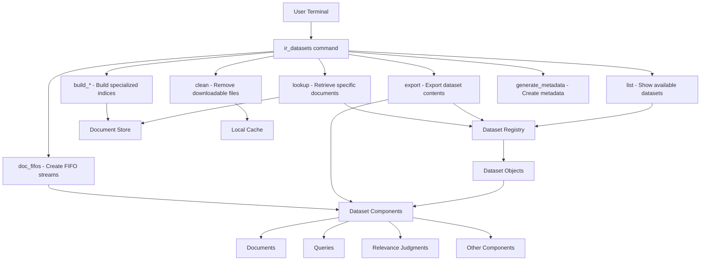
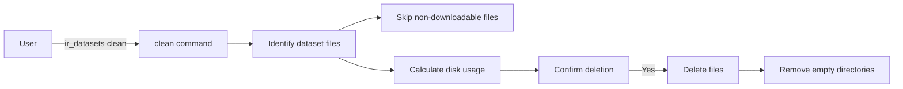
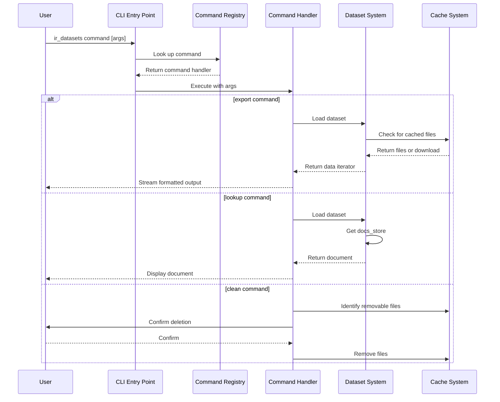

<!-- source: DeepWiki mcp.deepwiki.com · repo allenai/ir_datasets · page 3.2 Command Line Interface · fetched 2026-10-26 -->

# Command Line Interface

<details>
<summary>Relevant source files</summary>

The following files were used as context for generating this wiki page:

- [README.md](README.md)
- [ir_datasets/commands/__init__.py](ir_datasets/commands/__init__.py)
- [ir_datasets/commands/clean.py](ir_datasets/commands/clean.py)
- [ir_datasets/datasets/aol_ia.py](ir_datasets/datasets/aol_ia.py)
- [ir_datasets/datasets/tripclick.py](ir_datasets/datasets/tripclick.py)

</details>


This page documents the command-line interface (CLI) provided by ir_datasets. The CLI allows users to interact with the library's functionality through the command line, making it easier to examine datasets, export their contents, lookup specific documents, and perform maintenance operations. For information about using ir_datasets as a Python library, see [Python API](#3.3).

## Overview

The ir_datasets CLI provides a set of commands for accessing and managing IR datasets without writing Python code. Common operations like listing available datasets, exporting data, and looking up specific documents can be performed directly from the terminal.

```bash
ir_datasets [command] [options]
```

## Command Structure



Sources: [ir_datasets/commands/__init__.py:1-21]()

## Available Commands

The CLI provides the following commands:

| Command | Description |
|---------|-------------|
| `list` | Lists available datasets |
| `export` | Exports dataset content (documents, queries, qrels, etc.) |
| `lookup` | Retrieves specific documents by ID |
| `clean` | Removes files that can be automatically recreated |
| `doc_fifos` | Creates FIFO streams for documents |
| `build_clueweb_warc_indexes` | Builds indexes for ClueWeb WARC files |
| `build_c4_checkpoints` | Builds checkpoints for C4 dataset |
| `build_download_cache` | Builds download cache |
| `generate_metadata` | Generates metadata for datasets |

Sources: [ir_datasets/commands/__init__.py:11-21]()

### List Command

The `list` command shows available datasets in the registry:

```bash
ir_datasets list [--all] [--counts] [--by-size]
```

Options:
- `--all`: Show all available datasets (including sub-datasets)
- `--counts`: Display document/query/qrel counts when available
- `--by-size`: Sort datasets by their approximate size

### Export Command

The `export` command outputs dataset components in standard formats:

```bash
ir_datasets export <dataset-id> {docs|queries|qrels} [options]
```

For example, to export the first 10 documents from MS MARCO passage collection:

```bash
ir_datasets export msmarco-passage/train docs --max-records 10
```

This command streams data in a tab-separated format that can be piped to other tools or saved to a file.

### Lookup Command

The `lookup` command retrieves specific documents by their ID:

```bash
ir_datasets lookup <dataset-id> <doc-id> [<doc-id> ...]
```

For example:

```bash
ir_datasets lookup msmarco-passage 243
```

This will retrieve and display document 243 from the MS MARCO passage collection.

### Clean Command

The `clean` command removes downloaded files that can be re-downloaded or recreated:

```bash
ir_datasets clean [--yes] [--list] [-H] [dataset-ids]
```

Options:
- `--yes` or `-y`: Automatically confirm deletion
- `--list` or `-l`: List datasets available for cleanup without performing any deletion
- `-H`: Output raw sizes instead of human-readable formats



Sources: [ir_datasets/commands/clean.py:14-106]()

## Command Execution Flow

The CLI system uses a command dispatcher pattern to route commands to their appropriate handlers:



Sources: [ir_datasets/commands/clean.py:33-77]()

## Environment Variables

The CLI behavior can be influenced by several environment variables:

| Variable | Description | Default |
|----------|-------------|---------|
| `IR_DATASETS_HOME` | Home directory for ir_datasets data | `~/.ir_datasets/` |
| `IR_DATASETS_TMP` | Temporary working directory | `/tmp/ir_datasets/` |
| `IR_DATASETS_DL_TIMEOUT` | Download stream read timeout (seconds) | `15` |
| `IR_DATASETS_DL_TRIES` | Number of download attempts | `3` |
| `IR_DATASETS_DL_DISABLE_PBAR` | Disable progress bar for downloads | `false` |
| `IR_DATASETS_DL_SKIP_SSL` | Disable SSL certificate checking | `false` |
| `IR_DATASETS_SKIP_DISK_FREE` | Disable free space checks | `false` |
| `IR_DATASETS_SMALL_FILE_SIZE` | Size threshold for "small" files (bytes) | `5000000` (5MB) |

Sources: [README.md:199-217]()

## Example Usage Patterns

### Piping Exported Data

```bash
# Export MSMARCO queries and pipe to grep to find queries containing "cancer"
ir_datasets export msmarco-passage queries | grep cancer

# Export documents and save to a file
ir_datasets export clueweb12/b13 docs > clueweb_docs.tsv

# Process queries with awk to extract just the query text
ir_datasets export trec-robust04 queries | awk '{print $2}' > query_texts.txt
```

### Dataset Exploration

```bash
# List all available datasets
ir_datasets list --all

# Get information about dataset sizes
ir_datasets list --by-size

# Get dataset counts
ir_datasets list --counts
```

### Working with Large Collections

For working with large collections like ClueWeb, the CLI is particularly useful:

```bash
# Look up specific documents from ClueWeb without loading entire collection
ir_datasets lookup clueweb12 clueweb12-0000tw-05-00014

# Export a subset of a large collection
ir_datasets export clueweb12 docs --max-records 1000 > sample.tsv
```

### Cleanup Operations

```bash
# List datasets that can be cleaned up
ir_datasets clean --list

# Clean specific datasets
ir_datasets clean msmarco-passage clueweb09

# Clean a dataset with automatic confirmation
ir_datasets clean msmarco-passage --yes
```

Sources: [README.md:64-68](), [ir_datasets/commands/clean.py:79-102]()

## Integration with Other Tools

The CLI is designed to work well with standard Unix tools and pipelines:

```bash
# Count number of documents in a collection
ir_datasets export msmarco-passage docs | wc -l

# Find most frequent terms in a collection (basic example)
ir_datasets export vaswani docs | tr ' ' '\n' | sort | uniq -c | sort -nr | head -n 20

# Get statistics about relevance judgments
ir_datasets export trec-robust04 qrels | awk '{print $4}' | sort | uniq -c
```

This document provides an overview of the ir_datasets CLI. Each command offers additional options that can be explored using the `--help` flag (e.g., `ir_datasets export --help`).

---

