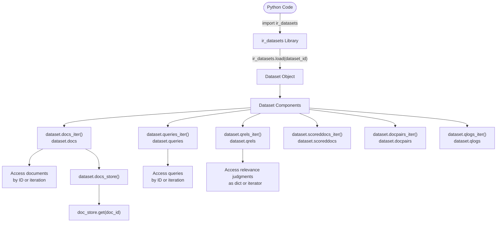
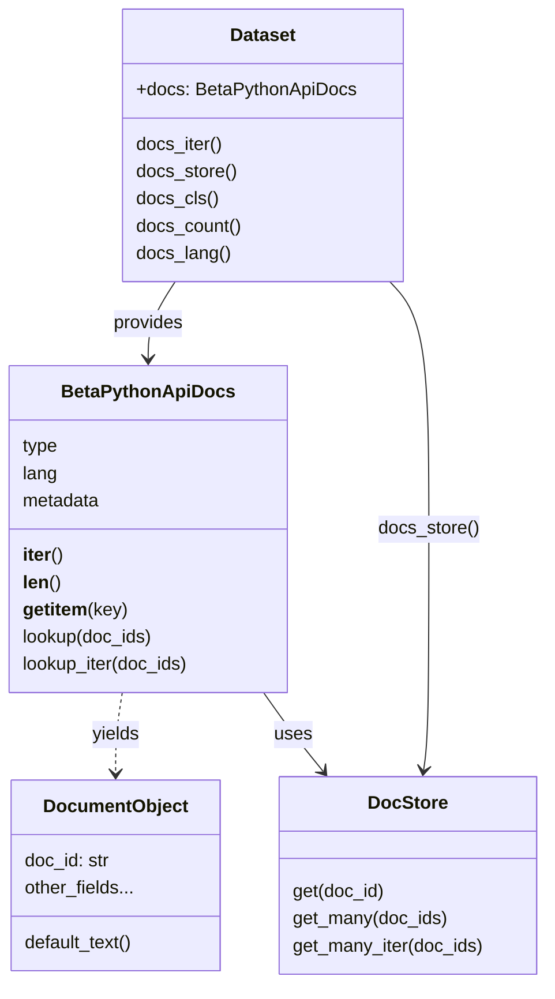
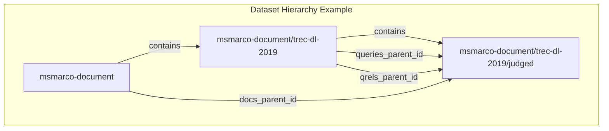

<!-- source: DeepWiki mcp.deepwiki.com · repo allenai/ir_datasets · page 3.3 Python API · fetched 2026-10-26 -->

# Python API

<details>
<summary>Relevant source files</summary>

The following files were used as context for generating this wiki page:

- [.github/workflows/deploy.yml](.github/workflows/deploy.yml)
- [.github/workflows/test.yml](.github/workflows/test.yml)
- [ir_datasets/__init__.py](ir_datasets/__init__.py)
- [ir_datasets/datasets/base.py](ir_datasets/datasets/base.py)
- [ir_datasets/datasets/trec_cast.py](ir_datasets/datasets/trec_cast.py)
- [ir_datasets/datasets/wapo.py](ir_datasets/datasets/wapo.py)
- [ir_datasets/docs/trec-cast.yaml](ir_datasets/docs/trec-cast.yaml)
- [ir_datasets/util/metadata.py](ir_datasets/util/metadata.py)
- [test/integration/base.py](test/integration/base.py)
- [test/integration/trec_cast.py](test/integration/trec_cast.py)
- [test/util.py](test/util.py)

</details>


This page documents the core Python programming interface for `ir_datasets`, focusing on how to use the library in Python code. For information about the command-line interface, see [Command Line Interface](#3.2). For details on installation, see [Installation and Configuration](#3.1).

The Python API provides methods to access datasets, iterate through their components (documents, queries, relevance judgments), and perform common information retrieval tasks.

## Core API Overview



Sources: [ir_datasets/__init__.py:1-104](), [ir_datasets/datasets/base.py:1-446]()

## Loading Datasets

The most common starting point with ir_datasets is loading a dataset using the `load()` function:

```python
import ir_datasets
dataset = ir_datasets.load('msmarco-passage')
```

This returns a `Dataset` object that provides access to all available components for the specified dataset. The dataset identifiers follow a hierarchical pattern with slashes (e.g., `msmarco-passage/trec-dl-2019/judged`).

You can check if a dataset supports specific components using the `has_*()` methods:

```python
if dataset.has_docs():
    # Work with documents
if dataset.has_queries():
    # Work with queries
if dataset.has_qrels():
    # Work with relevance judgments
```

The `Dataset` object also provides a string representation that shows available components:

```python
>>> print(dataset)
Dataset(id='msmarco-passage', provides=['docs', 'queries', 'qrels'])
```

Sources: [ir_datasets/__init__.py:13-23](), [ir_datasets/datasets/base.py:12-70]()

## Entity Types

The library defines six core entity types that may be available in datasets:

| Entity Type | Description | Common Access Method | Return Type |
|-------------|-------------|----------------------|------------|
| docs | Document collection | `dataset.docs_iter()` | Document objects (structure varies by dataset) |
| queries | Search queries | `dataset.queries_iter()` | Query objects (typically with `query_id` and text) |
| qrels | Relevance judgments | `dataset.qrels_iter()` | Judgment objects (typically with `query_id`, `doc_id`, and relevance score) |
| scoreddocs | Scored documents (e.g., from retrieval systems) | `dataset.scoreddocs_iter()` | ScoredDoc objects |
| docpairs | Document pairs (for learning-to-rank) | `dataset.docpairs_iter()` | DocPair objects |
| qlogs | Query logs | `dataset.qlogs_iter()` | QLog objects |

Not all datasets provide all entity types. You can check availability using the `has()` method with an entity type:

```python
if dataset.has(ir_datasets.EntityType.docs):
    # Dataset has documents
```

Sources: [ir_datasets/__init__.py:1-9](), [ir_datasets/datasets/base.py:82-98]()

## Working with Documents

### Iterating Through Documents

There are two main ways to access documents: the legacy iterator approach and the newer Python API:

#### Legacy Iterator Approach:
```python
# Iterate through all documents
for doc in dataset.docs_iter():
    print(doc.doc_id, doc.default_text())
```

#### Python API Approach (Beta):
```python
# Iterate through all documents
for doc in dataset.docs:
    print(doc.doc_id, doc.default_text())

# Get document type information
print(dataset.docs.type)  # Shows document class type
print(dataset.docs.lang)  # Shows document language
```

The document structure varies by dataset, but all document types provide a `doc_id` field and a `default_text()` method that returns the textual content of the document.



Sources: [ir_datasets/datasets/base.py:101-138](), [test/integration/base.py:10-47]()

### Using Document Stores

For efficient random access to documents by ID, use the document store:

```python
# Get document store
doc_store = dataset.docs_store()

# Retrieve a single document by ID
doc = doc_store.get('some-doc-id')

# Retrieve multiple documents by ID
docs = doc_store.get_many(['doc-id-1', 'doc-id-2'])

# Iterate through documents by ID
for doc in doc_store.get_many_iter(['doc-id-1', 'doc-id-2']):
    print(doc.doc_id)
```

The beta Python API provides an easier interface for looking up documents:

```python
# Single document lookup
doc = dataset.docs.lookup('some-doc-id')

# Multiple document lookup
docs = dataset.docs.lookup(['doc-id-1', 'doc-id-2'])

# Iterator for multiple document lookup
for doc in dataset.docs.lookup_iter(['doc-id-1', 'doc-id-2']):
    print(doc.doc_id)
```

Document stores are built on first access and cached on disk, providing fast random access to documents in subsequent runs.

Sources: [ir_datasets/datasets/base.py:101-138](), [test/integration/base.py:41-47]()

## Working with Queries

Similar to documents, queries can be accessed either through iterators or the beta Python API:

```python
# Legacy approach
for query in dataset.queries_iter():
    print(query.query_id, query.default_text())

# Python API approach
for query in dataset.queries:
    print(query.query_id, query.default_text())
```

The Python API also provides methods for looking up queries by ID:

```python
# Get a single query by ID
query = dataset.queries.lookup('query-id')

# Get multiple queries by ID
queries = dataset.queries.lookup(['query-id-1', 'query-id-2'])

# Iterate through queries by ID
for query in dataset.queries.lookup_iter(['query-id-1', 'query-id-2']):
    print(query.query_id)
```

Queries typically provide `query_id` and `default_text()` methods, though specific query structures can vary by dataset.

Sources: [ir_datasets/datasets/base.py:140-182](), [test/integration/base.py:49-69]()

## Working with Relevance Judgments (Qrels)

Relevance judgments (qrels) represent assessments of document relevance for specific queries:

```python
# Iterate through relevance judgments
for qrel in dataset.qrels_iter():
    print(qrel.query_id, qrel.doc_id, qrel.relevance)

# Python API approach
for qrel in dataset.qrels:
    print(qrel.query_id, qrel.doc_id, qrel.relevance)
```

The qrels API also provides a dictionary representation for efficient access:

```python
# Get qrels as a nested dictionary {query_id -> {doc_id -> relevance}}
qrels_dict = dataset.qrels.asdict()

# Check if a document is relevant to a query
relevance = qrels_dict.get(query_id, {}).get(doc_id)
```

The `qrels.defs` property provides relevance grade definitions:

```python
# Get relevance scale definitions
relevance_defs = dataset.qrels.defs
print(relevance_defs)  # e.g. {0: "not relevant", 1: "relevant", 2: "highly relevant"}
```

Sources: [ir_datasets/datasets/base.py:185-215](), [test/integration/base.py:71-91]()

## Other Entity Types

### Scored Documents

Scored documents represent retrieved results, typically from a baseline retrieval system:

```python
for scored_doc in dataset.scoreddocs_iter():
    print(scored_doc.query_id, scored_doc.doc_id, scored_doc.score)
```

### Document Pairs

Document pairs are used for learning-to-rank scenarios:

```python
for doc_pair in dataset.docpairs_iter():
    print(doc_pair.query_id, doc_pair.doc_id_a, doc_pair.doc_id_b)
```

### Query Logs

Query logs contain information about real user queries:

```python
for qlog in dataset.qlogs_iter():
    print(qlog.query_id, qlog.timestamp)
```

Sources: [ir_datasets/datasets/base.py:218-287](), [test/integration/base.py:115-134](), [test/integration/base.py:217-235](), [test/integration/base.py:237-247]()

## Dataset Relationships and Parent IDs

Datasets are organized hierarchically, and you can find parent datasets using the `parent_id` functions:

```python
# Get the parent dataset that provides the documents
parent_id = ir_datasets.docs_parent_id('msmarco-document/trec-dl-2019/judged')
# Returns 'msmarco-document'

# Get parent ID for other entity types
queries_parent = ir_datasets.queries_parent_id('dataset-id')
qrels_parent = ir_datasets.qrels_parent_id('dataset-id')
```

This is useful when you need to access the main corpus for a dataset that only provides a subset for evaluation.



Sources: [ir_datasets/__init__.py:25-73]()

## Creating Custom Datasets

You can create custom datasets using the `create_dataset` function with local files:

```python
custom_dataset = ir_datasets.create_dataset(
    docs_tsv='/path/to/docs.tsv',
    queries_tsv='/path/to/queries.tsv',
    qrels_trec='/path/to/qrels.txt'
)
```

This is useful for working with your own data in the ir_datasets format.

Sources: [ir_datasets/__init__.py:76-88]()

## Metadata Access

Datasets provide metadata about their components:

```python
# Get metadata for documents
docs_metadata = dataset.docs.metadata

# Get metadata for queries
queries_metadata = dataset.queries.metadata

# Get counts
docs_count = len(dataset.docs)
queries_count = len(dataset.queries)
qrels_count = len(dataset.qrels)
```

Sources: [ir_datasets/util/metadata.py:1-86]()

## Example Usage Patterns

Here's an end-to-end example showing common usage patterns:

```python
import ir_datasets

# Load a dataset
dataset = ir_datasets.load('msmarco-passage/trec-dl-2019/judged')

# Check available components
print(f"Dataset: {dataset}")
print(f"Has documents: {dataset.has_docs()}")
print(f"Has queries: {dataset.has_queries()}")
print(f"Has relevance judgments: {dataset.has_qrels()}")

# Get document type information
if dataset.has_docs():
    print(f"Document type: {dataset.docs.type}")
    print(f"Document language: {dataset.docs.lang}")

# Get relevance judgment definitions
if dataset.has_qrels():
    print(f"Relevance definitions: {dataset.qrels.defs}")

# Create a dictionary mapping query IDs to text
query_dict = {q.query_id: q.default_text() for q in dataset.queries_iter()}

# Iterate through relevance judgments and look up documents
for qrel in dataset.qrels_iter():
    query_text = query_dict.get(qrel.query_id, "Unknown query")
    doc = dataset.docs_store().get(qrel.doc_id)
    if doc:
        print(f"Query: {query_text}")
        print(f"Document: {doc.default_text()[:100]}...")
        print(f"Relevance: {qrel.relevance} ({dataset.qrels.defs.get(qrel.relevance, 'Unknown')})")
        print("-" * 40)
```

## Common Patterns and Best Practices

1. **Efficient Lookups**: Use `docs_store()` for random document access rather than iterating through all documents

2. **Data Types**: Check the dataset's specific document and query types to understand available fields

3. **Memory Management**: Use iterators when processing large datasets to avoid loading everything into memory

4. **Caching**: The first access to document stores may be slow as they're being built, but subsequent accesses will be fast due to caching

5. **Type Information**: Use `dataset.docs.type` and `dataset.queries.type` to discover the structure of data objects

---

