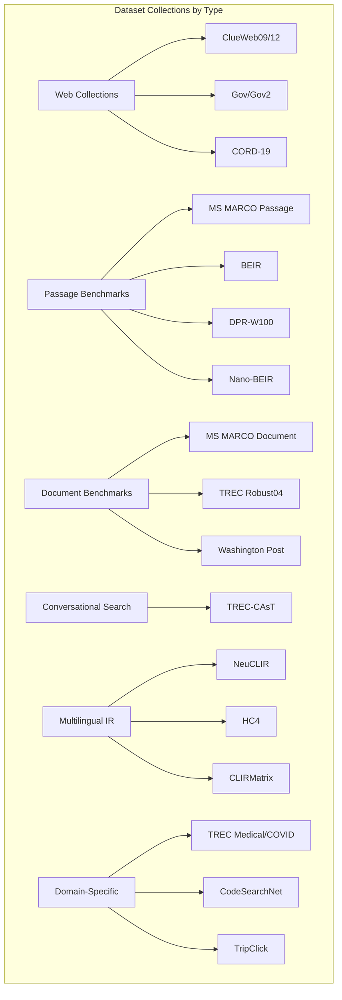
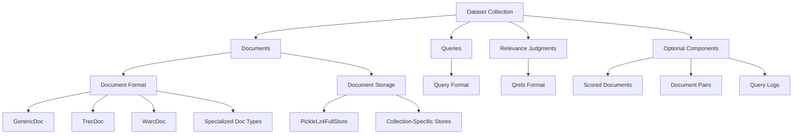
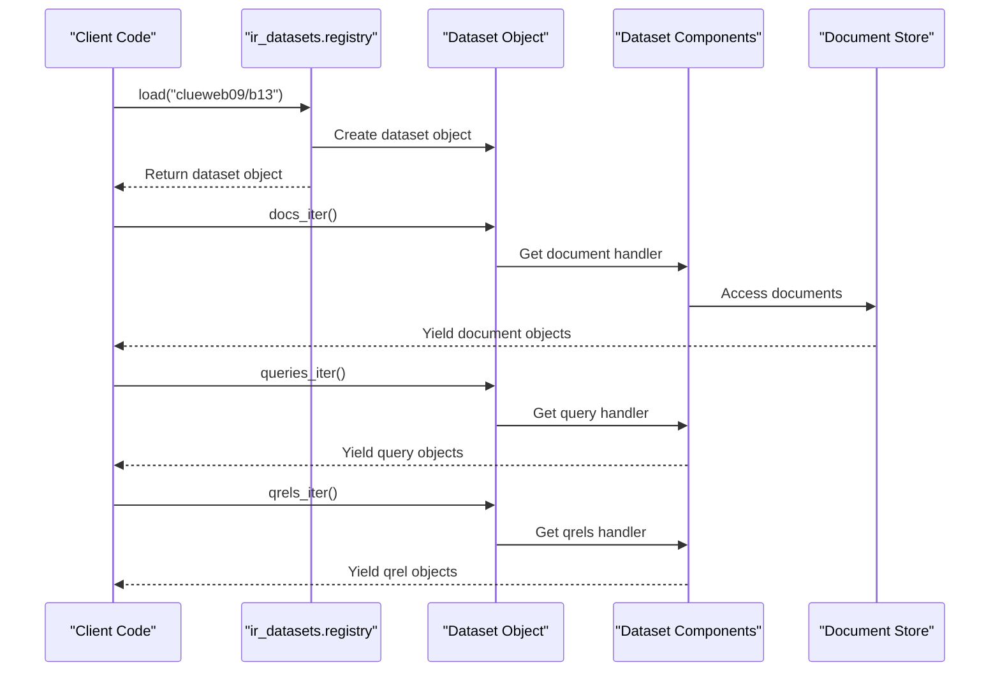
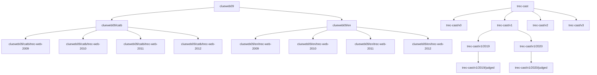

<!-- source: DeepWiki mcp.deepwiki.com · repo allenai/ir_datasets · page 4 Dataset Collections · fetched 2026-10-26 -->

# Dataset Collections

<details>
<summary>Relevant source files</summary>

The following files were used as context for generating this wiki page:

- [ir_datasets/datasets/__init__.py](ir_datasets/datasets/__init__.py)
- [ir_datasets/datasets/base.py](ir_datasets/datasets/base.py)
- [ir_datasets/docs/bibliography.bib](ir_datasets/docs/bibliography.bib)
- [ir_datasets/docs/trec-cast.yaml](ir_datasets/docs/trec-cast.yaml)
- [ir_datasets/etc/downloads.json](ir_datasets/etc/downloads.json)
- [ir_datasets/etc/metadata.json](ir_datasets/etc/metadata.json)
- [ir_datasets/formats/__init__.py](ir_datasets/formats/__init__.py)
- [ir_datasets/util/metadata.py](ir_datasets/util/metadata.py)
- [test/integration/trec_cast.py](test/integration/trec_cast.py)

</details>


This document provides an overview of the diverse dataset collections available in the IR Datasets library and explains how they are organized, accessed, and used. For details on how to install and configure IR Datasets, please see [Installation and Configuration](#3.1).

## Dataset Collections Overview

IR Datasets provides a comprehensive collection of datasets for information retrieval research and evaluation. These collections span various domains, languages, and IR tasks, enabling researchers to benchmark and compare IR systems across a wide range of scenarios.

The dataset collections in IR Datasets are organized into logical groupings based on their origin, purpose, or application area. Each collection typically consists of documents, queries, and relevance judgments (qrels), though some may contain additional components like scored documents or query logs.



Sources: [ir_datasets/datasets/__init__.py:1-59](), [ir_datasets/etc/downloads.json:1-873]()

## Dataset Collection Structure

Each dataset in IR Datasets follows a consistent structure, making it easier to work with different collections in a uniform way. A typical dataset collection consists of documents, queries, and relevance judgments, all accessible through a common interface.



Sources: [ir_datasets/datasets/base.py:12-446](), [ir_datasets/formats/__init__.py:1-14]()

## Major Dataset Collections

IR Datasets includes a wide range of dataset collections covering various IR tasks and domains. The following sections highlight some of the most significant collections.

### Web Collections

Web collections contain large-scale web document datasets frequently used for IR evaluation.

| Collection | Description | Documents | Key Features |
|------------|-------------|-----------|-------------|
| ClueWeb09  | Web crawl from 2009 | ~1B | Multiple languages, TREC Web Track evaluations |
| ClueWeb12  | Web crawl from 2012 | ~733M | TREC Web Track, Misinfo Track |
| Gov2       | Crawl of .gov domain (2004) | ~25M | TREC Terabyte Track |
| CORD-19    | COVID-19 research papers | ~192K | TREC-COVID challenge |

Sources: [ir_datasets/etc/metadata.json:1-100](), [ir_datasets/etc/downloads.json:403-498](), [ir_datasets/etc/downloads.json:513-690](), [ir_datasets/etc/downloads.json:758-870]()

### MS MARCO Collections

MS MARCO (Microsoft Machine Reading Comprehension) provides large-scale collections widely used as benchmarks for passage ranking, document ranking, and question answering tasks.

| Collection | Description | Documents | Queries |
|------------|-------------|-----------|---------|
| MS MARCO Passage | Passages from web documents | ~8.8M | ~500K train, ~7K dev |
| MS MARCO Document | Web documents | ~3.2M | ~500K train, ~7K dev |
| MS MARCO Passage v2 | Expanded passage collection | ~138M | ~500K train, ~7K dev |
| MS MARCO Document v2 | Expanded document collection | ~11.9M | ~500K train, ~7K dev |

Sources: [ir_datasets/etc/metadata.json:56-58](), [ir_datasets/datasets/__init__.py:30-34]()

### TREC Collections

TREC (Text REtrieval Conference) collections are developed through NIST's annual evaluation tracks and provide high-quality test collections with carefully assessed relevance judgments.

| Collection | Description | Documents | Key Features |
|------------|-------------|-----------|-------------|
| TREC Robust04 | News articles | ~528K | Difficult topics with high-quality judgments |
| TREC CAsT | Conversational search | Varies | Multi-turn conversations |
| TREC CAR | Complex answer retrieval | ~29M passages | Derived from Wikipedia |
| TREC-COVID | COVID-19 research | ~191K | Multi-round evaluations |

Sources: [ir_datasets/docs/trec-cast.yaml:1-133](), [ir_datasets/etc/metadata.json:171-177](), [ir_datasets/etc/metadata.json:79-88](), [ir_datasets/etc/metadata.json:159-167]()

### Specialized Collections

IR Datasets includes many specialized collections for specific domains or IR tasks.

| Collection | Description | Key Features |
|------------|-------------|-------------|
| BEIR | Heterogeneous IR benchmark | 17 diverse datasets |
| TripClick | Medical search logs | Real-world search behavior |
| CodeSearchNet | Code search | Multiple programming languages |
| NeuCLIR | Multilingual retrieval | Multiple languages with parallel queries |

Sources: [ir_datasets/etc/metadata.json:26-73](), [ir_datasets/datasets/__init__.py:19-19](), [ir_datasets/datasets/__init__.py:48-48](), [ir_datasets/datasets/__init__.py:57-57]()

## Dataset Registry and Access Pattern

IR Datasets uses a registry system to manage dataset identifiers and provide consistent access patterns across all collections. This system allows datasets to be organized in a hierarchical structure with parent-child relationships.



Sources: [ir_datasets/datasets/base.py:12-95](), [ir_datasets/util/metadata.py:1-86]()

## Hierarchical Organization

Dataset collections in IR Datasets follow a hierarchical organization with parent-child relationships. This structure allows for sharing common document collections across multiple evaluation sets.



Sources: [ir_datasets/etc/metadata.json:100-149](), [test/integration/trec_cast.py:1-139](), [ir_datasets/docs/trec-cast.yaml:1-133]()

## Common Usage Patterns

Working with IR Datasets collections follows consistent patterns regardless of the specific collection being used. Below are common usage patterns for accessing different components of a dataset.

### Loading a Dataset

```python
import ir_datasets

# Load a specific dataset
dataset = ir_datasets.load("msmarco-passage")

# Access dataset components
docs = dataset.docs_iter()
queries = dataset.queries_iter()
qrels = dataset.qrels_iter()
```

### Working with Documents

```python
# Iterate through documents
for doc in dataset.docs_iter():
    print(doc.doc_id, doc.text)

# Look up specific documents
docstore = dataset.docs_store()
doc = docstore.get("doc_id_123")
```

### Working with Queries and Qrels

```python
# Iterate through queries
for query in dataset.queries_iter():
    print(query.query_id, query.text)

# Iterate through relevance judgments
for qrel in dataset.qrels_iter():
    print(qrel.query_id, qrel.doc_id, qrel.relevance)

# Get qrels as a dictionary
qrels_dict = dataset.qrels.asdict()
```

Sources: [ir_datasets/datasets/base.py:101-215]()

## Conclusion

IR Datasets provides access to a comprehensive collection of information retrieval datasets through a unified interface. The dataset collections span various domains, languages, and IR tasks, making it a valuable resource for IR research and evaluation. The hierarchical organization and consistent access patterns make it easy to work with different collections in a uniform way.

---

