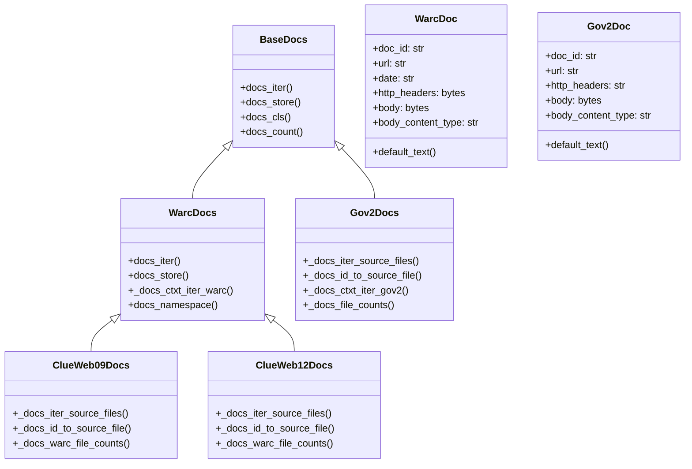
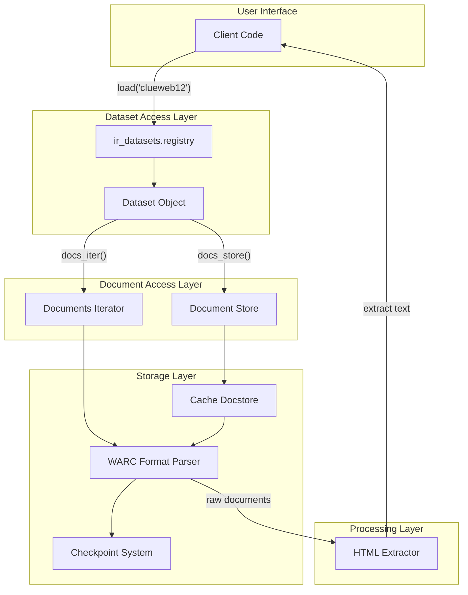
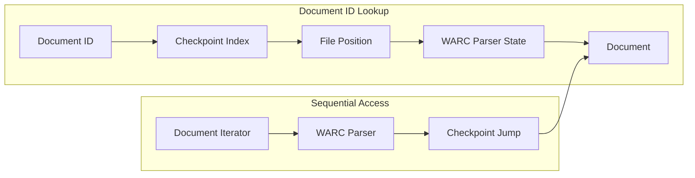
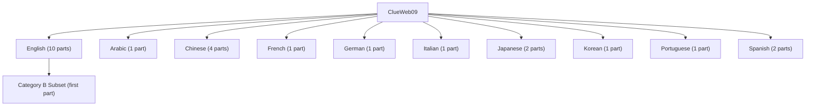
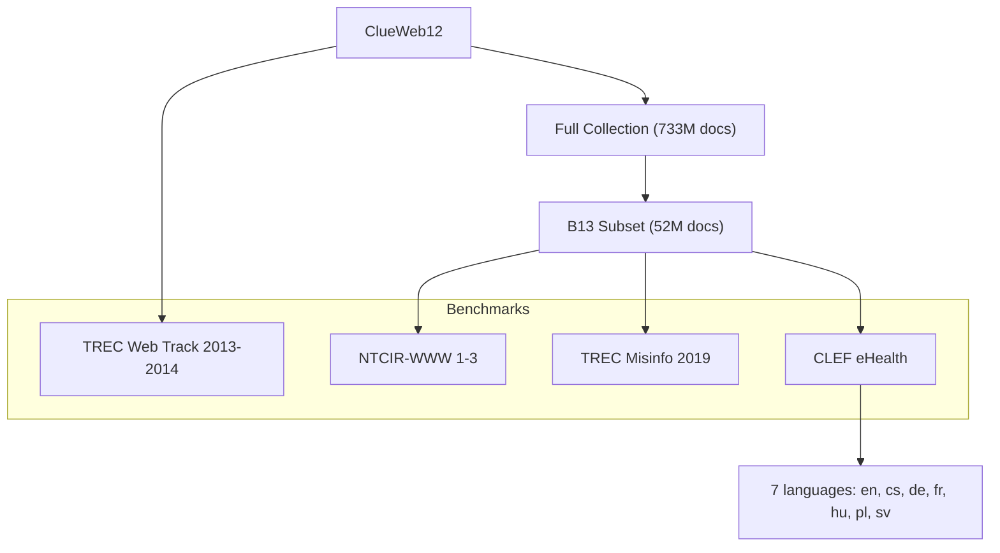
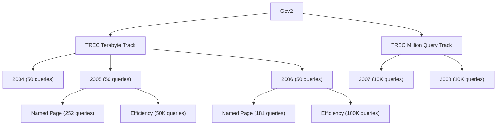
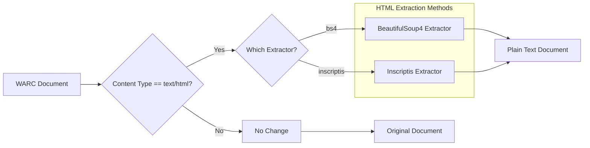

<!-- source: DeepWiki mcp.deepwiki.com · repo allenai/ir_datasets · page 4.1 Web Collections · fetched 2026-10-26 -->

# Web Collections

<details>
<summary>Relevant source files</summary>

The following files were used as context for generating this wiki page:

- [ir_datasets/datasets/clueweb09.py](ir_datasets/datasets/clueweb09.py)
- [ir_datasets/datasets/clueweb12.py](ir_datasets/datasets/clueweb12.py)
- [ir_datasets/datasets/gov2.py](ir_datasets/datasets/gov2.py)
- [ir_datasets/docs/clueweb09.yaml](ir_datasets/docs/clueweb09.yaml)
- [ir_datasets/docs/clueweb12.yaml](ir_datasets/docs/clueweb12.yaml)
- [ir_datasets/docs/gov2.yaml](ir_datasets/docs/gov2.yaml)
- [ir_datasets/formats/webarc.py](ir_datasets/formats/webarc.py)
- [ir_datasets/indices/clueweb_warc.py](ir_datasets/indices/clueweb_warc.py)
- [ir_datasets/indices/lz4_pickle.py](ir_datasets/indices/lz4_pickle.py)
- [ir_datasets/lazy_libs.py](ir_datasets/lazy_libs.py)
- [ir_datasets/wrappers/__init__.py](ir_datasets/wrappers/__init__.py)
- [ir_datasets/wrappers/html_extractor.py](ir_datasets/wrappers/html_extractor.py)
- [requirements.txt](requirements.txt)
- [test/integration/clueweb09.py](test/integration/clueweb09.py)
- [test/integration/clueweb12.py](test/integration/clueweb12.py)
- [test/integration/gov2.py](test/integration/gov2.py)

</details>


This page documents the web collections available in ir_datasets, their structure, access methods, and implementation details. Web collections are large-scale crawls of web documents used for information retrieval research and evaluation.

## Overview

Web collections in ir_datasets comprise several major crawls of web documents, including:

- ClueWeb09: 1 billion web pages in 10 languages collected in 2009
- ClueWeb12: 733 million web pages collected in 2012
- Gov2: 25 million .gov domain pages collected in 2004

These collections share important characteristics:
- They require obtaining data from organizations like Carnegie Mellon University or University of Glasgow
- They use specialized document formats (typically WARC)
- They have associated query benchmarks with relevance judgments
- They require efficient storage and access mechanisms

Sources: [ir_datasets/docs/clueweb09.yaml:1-18](), [ir_datasets/docs/clueweb12.yaml:1-17](), [ir_datasets/docs/gov2.yaml:1-16]()

## Architecture of Web Collections

Web collections in ir_datasets follow a consistent design pattern that allows for efficient document storage, retrieval, and processing.

### Document Structure Diagram



Sources: [ir_datasets/formats/webarc.py:1-96](), [ir_datasets/datasets/clueweb09.py:37-112](), [ir_datasets/datasets/clueweb12.py:57-70](), [ir_datasets/datasets/gov2.py:43-217]()

### Document Access Flow



Sources: [ir_datasets/formats/webarc.py:25-96](), [ir_datasets/indices/clueweb_warc.py:68-251](), [ir_datasets/wrappers/html_extractor.py:11-139]()

## Document Storage and Retrieval

The web collections implement specialized mechanisms for efficient storage and retrieval of documents.

### Document Storage System

Web collections use a layered approach to document storage:

1. **Raw Document Storage**: WARC format files stored on disk
2. **Index Layer**: Checkpoint files for efficient random access to documents
3. **Cache Layer**: In-memory cache for frequently accessed documents

Both ClueWeb09 and ClueWeb12 use the `WarcDocs` class for document access, which provides:
- Sequential iteration via `docs_iter()`
- Random access via `docs_store()`
- Extraction of document metadata and content

Gov2 uses a similar but separate implementation via `Gov2Docs`.

Sources: [ir_datasets/formats/webarc.py:25-96](), [ir_datasets/indices/clueweb_warc.py:8-251]()

### Document Indexing

Web collections use checkpoint files to enable efficient document lookups:



The `ClueWebWarcIndex` class provides efficient random access to WARC files by:
1. Building an index of document positions within WARC files
2. Using zlib state checkpoints to resume WARC parsing from arbitrary positions
3. Caching documents for repeated access

Sources: [ir_datasets/indices/clueweb_warc.py:68-236]()

## Collection Specifics

### ClueWeb09

ClueWeb09 contains over 1 billion web pages in 10 languages. The collection is organized into language-specific subsets.



**Key benchmarks**:
- TREC Web Track 2009-2012 ad-hoc tasks
- TREC Web Track 2009-2012 diversity tasks
- TREC Million Query (MQ) track 2009

Sources: [ir_datasets/datasets/clueweb09.py:136-271](), [ir_datasets/docs/clueweb09.yaml:1-185]()

### ClueWeb12

ClueWeb12 contains approximately 733 million web pages, primarily in English.



**Key benchmarks**:
- TREC Web Track 2013-2014
- NTCIR-WWW 1-3
- TREC Misinfo 2019
- CLEF eHealth (with multilingual queries)

Sources: [ir_datasets/datasets/clueweb12.py:269-411](), [ir_datasets/docs/clueweb12.yaml:1-234]()

### Gov2

Gov2 is a collection of approximately 25 million web pages from the .gov domain, gathered in 2004.



**Key benchmarks**:
- TREC Terabyte Track 2004-2006 (ad-hoc tasks)
- TREC Terabyte Named Page tasks
- TREC Terabyte Efficiency tasks
- TREC Million Query Track 2007-2008

Sources: [ir_datasets/datasets/gov2.py:269-426](), [ir_datasets/docs/gov2.yaml:1-200]()

## HTML Extraction

Web collections contain HTML documents that often need to be converted to plain text for search applications. The `HtmlDocExtractor` wrapper provides this functionality:



The HTML extraction can be parallelized for better performance using Python's multiprocessing capabilities. The extractor wrapper maintains the original document structure but replaces HTML content with plain text.

Sources: [ir_datasets/wrappers/html_extractor.py:11-139]()

## Usage Examples

### Loading a Web Collection

```python
import ir_datasets

# Load a collection
dataset = ir_datasets.load("clueweb12")

# Load a collection with a specific benchmark
dataset = ir_datasets.load("clueweb12/trec-web-2013")
```

### Iterating Through Documents

```python
# Iterate through documents
for doc in dataset.docs_iter():
    print(doc.doc_id, doc.url)
    
# Iterate with HTML extraction
html_dataset = ir_datasets.wrappers.HtmlDocExtractor(dataset)
for doc in html_dataset.docs_iter():
    print(doc.doc_id, doc.default_text())
```

### Looking Up Documents by ID

```python
# Get document store
docstore = dataset.docs_store()

# Look up a single document
doc = docstore.get("clueweb12-0000tw-00-00000")

# Look up multiple documents
docs = list(docstore.get_many(["clueweb12-0000tw-00-00000", "clueweb12-0000tw-00-00001"]))
```

### Working with Queries and Relevance Judgments

```python
# Get queries
for query in dataset.queries_iter():
    print(query.query_id, query.text)

# Get relevance judgments
for qrel in dataset.qrels_iter():
    print(qrel.query_id, qrel.doc_id, qrel.relevance)
```

## Implementation Notes

### Lazy Loading of Dependencies

Web collections use lazy loading of dependencies to minimize startup overhead. The `lazy_libs` module only imports libraries like BeautifulSoup, requests, and WARC parsers when they are actually needed.

Sources: [ir_datasets/lazy_libs.py:1-131]()

### Efficient Document Stores

The document stores use several optimization techniques:
- Checkpoints for efficient WARC file access
- Caching of frequently accessed documents
- Parallel processing for HTML extraction
- LZ4 compression for cached documents

Sources: [ir_datasets/indices/clueweb_warc.py:132-162](), [ir_datasets/indices/lz4_pickle.py:261-297]()

### Storage Requirements

Web collections require significant storage space:
- ClueWeb09: ~5 TB (full collection)
- ClueWeb12: ~5.5 TB (full collection)
- Gov2: ~426 GB

Users must obtain these collections directly from their respective sources (Carnegie Mellon University for ClueWeb, University of Glasgow for Gov2).

Sources: [ir_datasets/docs/clueweb09.yaml:16-39](), [ir_datasets/docs/clueweb12.yaml:17-37](), [ir_datasets/docs/gov2.yaml:16-32]()

## Testing

The ir_datasets library includes integration tests for web collections that verify:
- Document iteration and access
- Query processing
- Relevance judgment processing
- HTML extraction functionality
- Document store performance

These tests ensure that all components work correctly together and can be found in the `test/integration` directory.

Sources: [test/integration/clueweb09.py:1-273](), [test/integration/clueweb12.py:1-158](), [test/integration/gov2.py:1-161]()

---

