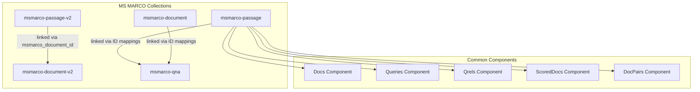
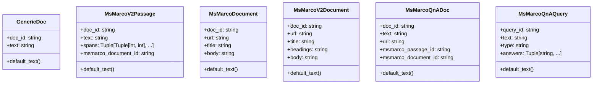
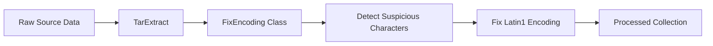
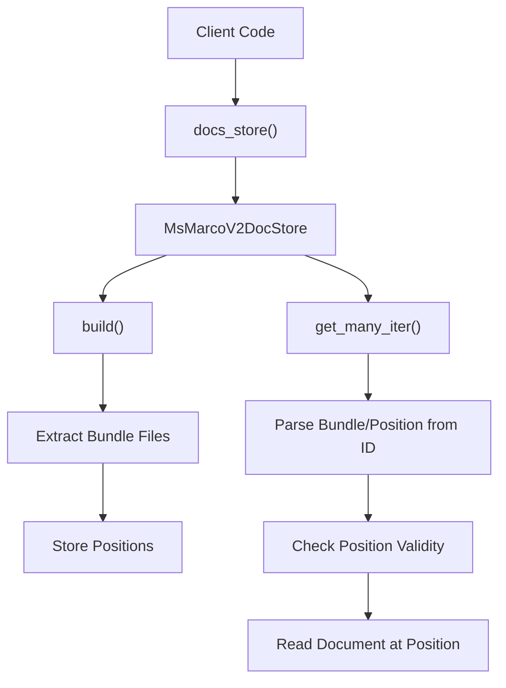
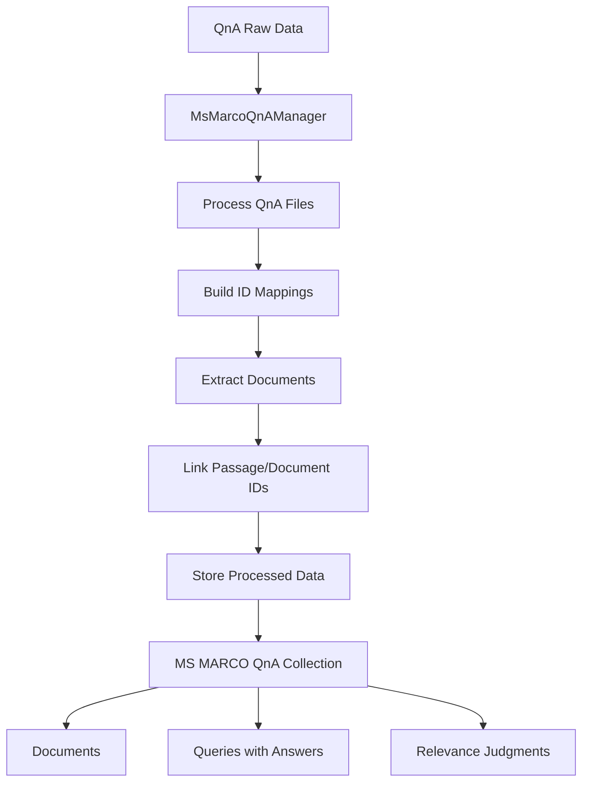

<!-- source: DeepWiki mcp.deepwiki.com · repo allenai/ir_datasets · page 4.2 MS MARCO Collections · fetched 2026-10-26 -->

# MS MARCO Collections

<details>
<summary>Relevant source files</summary>

The following files were used as context for generating this wiki page:

- [ir_datasets/datasets/msmarco_document.py](ir_datasets/datasets/msmarco_document.py)
- [ir_datasets/datasets/msmarco_document_v2.py](ir_datasets/datasets/msmarco_document_v2.py)
- [ir_datasets/datasets/msmarco_passage.py](ir_datasets/datasets/msmarco_passage.py)
- [ir_datasets/datasets/msmarco_passage_v2.py](ir_datasets/datasets/msmarco_passage_v2.py)
- [ir_datasets/datasets/msmarco_qna.py](ir_datasets/datasets/msmarco_qna.py)
- [ir_datasets/docs/msmarco-document-v2.yaml](ir_datasets/docs/msmarco-document-v2.yaml)
- [ir_datasets/docs/msmarco-document.yaml](ir_datasets/docs/msmarco-document.yaml)
- [ir_datasets/docs/msmarco-passage-v2.yaml](ir_datasets/docs/msmarco-passage-v2.yaml)
- [ir_datasets/docs/msmarco-passage.yaml](ir_datasets/docs/msmarco-passage.yaml)
- [test/integration/msmarco_document.py](test/integration/msmarco_document.py)
- [test/integration/msmarco_document_v2.py](test/integration/msmarco_document_v2.py)
- [test/integration/msmarco_passage.py](test/integration/msmarco_passage.py)
- [test/integration/msmarco_passage_v2.py](test/integration/msmarco_passage_v2.py)
- [test/integration/msmarco_qna.py](test/integration/msmarco_qna.py)

</details>


This document provides detailed information about the MS MARCO (Microsoft Machine Reading Comprehension) collections implemented in the ir_datasets library. These collections are widely used benchmarks for information retrieval research, particularly for passage ranking, document ranking, and question answering tasks.

## Collection Overview

The ir_datasets library includes multiple MS MARCO collections, each serving different research purposes:

| Collection | ID | Description | Size |
|------------|---|-------------|------|
| MS MARCO Passage | `msmarco-passage` | Passage collection for passage ranking | 8.8M passages |
| MS MARCO Passage v2 | `msmarco-passage-v2` | Expanded passage collection | 138M passages |
| MS MARCO Document | `msmarco-document` | Document collection for document ranking | 3.2M documents |
| MS MARCO Document v2 | `msmarco-document-v2` | Expanded document collection | 12M documents |
| MS MARCO QnA | `msmarco-qna` | Original question-answering dataset | 9M passages |

### Collections Relationship Diagram



Sources: [ir_datasets/datasets/msmarco_passage.py](). [ir_datasets/datasets/msmarco_passage_v2.py](). [ir_datasets/datasets/msmarco_document.py](). [ir_datasets/datasets/msmarco_document_v2.py](). [ir_datasets/datasets/msmarco_qna.py]().

## Data Models

Each MS MARCO collection uses a specific data model to represent its documents and queries:



Sources: [ir_datasets/datasets/msmarco_passage_v2.py:26-36](). [ir_datasets/datasets/msmarco_document.py:30-40](). [ir_datasets/datasets/msmarco_document_v2.py:25-36](). [ir_datasets/datasets/msmarco_qna.py:28-38, 40-48, 51-57]().

## MS MARCO Passage Collection

The original MS MARCO Passage collection contains 8.8 million passages extracted from web documents, used primarily for passage ranking tasks.

### Implementation and Special Features

The collection has several notable implementation features:

1. **Encoding Fixes**: The collection implements special handling for encoding issues in the original dataset through the `FixEncoding` class which addresses issues with characters in the 128-255 range.



2. **Document Pair Processing**: For training data with document pairs, special handling is implemented to reduce storage requirements through the `MapSmallTriplesQidPid` class.

Sources: [ir_datasets/datasets/msmarco_passage.py:63-100](). [ir_datasets/datasets/msmarco_passage.py:104-154]().

### Collection Subsets

The collection includes numerous subsets for different research scenarios:

| Subset | Description | Query Count | Has Qrels | Has ScoredDocs |
|--------|-------------|-------------|-----------|----------------|
| `train` | Main training set | 808,731 | Yes | Yes |
| `dev` | Development set | 101,093 | Yes | No |
| `eval` | Evaluation set (leaderboard) | 101,092 | Hidden | Yes |
| `trec-dl-2019` | TREC DL 2019 queries | 200 | Yes | Yes |
| `trec-dl-2020` | TREC DL 2020 queries | 200 | Yes | Yes |
| `train/judged` | Only train queries with qrels | 502,939 | Yes | Yes |
| `dev/judged` | Only dev queries with qrels | 55,578 | Yes | No |
| `train/split200-train` | Train split for validation | 808,531 | Yes | Yes |
| `train/split200-valid` | Validation split | 200 | Yes | Yes |
| `train/medical` | Medical query subset | 78,895 | Yes | Yes |
| `trec-dl-hard` | Challenging TREC-DL subset | 50 | Yes | No |

Sources: [ir_datasets/datasets/msmarco_passage.py:169-346](). [test/integration/msmarco_passage.py:24-45]().

## MS MARCO Passage v2 Collection

MS MARCO Passage v2 is an expanded collection with 138 million passages, linked to documents in MS MARCO Document v2.

### Implementation and Special Features

The key features of this collection include:

1. **Specialized Document Structure**: Passages include span information showing their position in the original document.

2. **Custom Docstore Implementation**: MS MARCO Passage v2 uses a specialized docstore implementation (`MsMarcoV2DocStore`) for efficient retrieval based on document IDs that encode bundle and position information.



Sources: [ir_datasets/datasets/msmarco_passage_v2.py:94-252](). [ir_datasets/datasets/msmarco_passage_v2.py:38-46]().

### Collection Subsets

The v2 collection includes various subsets:

| Subset | Description | Query Count | Has Qrels |
|--------|-------------|-------------|-----------|
| `dedup` | Deduplicated passage collection | N/A | No |
| `train` | Training set | 277,144 | Yes |
| `dev1` | Development set 1 | 3,903 | Yes |
| `dev2` | Development set 2 | 4,281 | Yes |
| `trec-dl-2021` | TREC DL 2021 queries | 477 | Yes |
| `trec-dl-2022` | TREC DL 2022 queries | 500 | Yes |
| `trec-dl-2023` | TREC DL 2023 queries | 700 | No |

Sources: [ir_datasets/datasets/msmarco_passage_v2.py:270-320](). [test/integration/msmarco_passage_v2.py:27-67]().

## MS MARCO Document Collections

### MS MARCO Document (v1)

The MS MARCO Document collection contains 3.2 million documents extracted from web pages.

#### Implementation

The collection uses a `TrecDocs` parser with special handling to extract the URL, title, and body from the text format:

```python
class MsMarcoDocument(NamedTuple):
    doc_id: str
    url: str
    title: str
    body: str
```

#### Collection Subsets

The document collection includes subsets similar to the passage collection:

| Subset | Description | Query Count | Has Qrels |
|--------|-------------|-------------|-----------|
| `train` | Training set | 367,013 | Yes |
| `dev` | Development set | 5,193 | Yes |
| `eval` | Evaluation set | 5,793 | Hidden |
| `trec-dl-2019` | TREC DL 2019 queries | 200 | Yes |
| `trec-dl-2020` | TREC DL 2020 queries | 200 | Yes |
| `orcas` | Click-based dataset | 10,405,342 | Yes |
| `anchor-text` | Documents with anchor text | N/A | No |

Sources: [ir_datasets/datasets/msmarco_document.py:30-40](). [ir_datasets/datasets/msmarco_document.py:122-226]().

### MS MARCO Document v2

MS MARCO Document v2 is an expanded collection with 12 million documents.

#### Implementation

Documents in v2 have an enhanced structure:

```python
class MsMarcoV2Document(NamedTuple):
    doc_id: str
    url: str
    title: str
    headings: str
    body: str
```

#### Collection Subsets

Similar to Document v1, with newer TREC-DL track datasets:

| Subset | Description | Query Count | Has Qrels |
|--------|-------------|-------------|-----------|
| `train` | Training set | 322,196 | Yes |
| `dev1` | Development set 1 | 4,552 | Yes |
| `dev2` | Development set 2 | 5,000 | Yes |
| `trec-dl-2021` | TREC DL 2021 queries | 477 | Yes |
| `trec-dl-2022` | TREC DL 2022 queries | 500 | Yes |
| `trec-dl-2023` | TREC DL 2023 queries | 700 | No |
| `anchor-text` | Documents with anchor text | N/A | No |

Sources: [ir_datasets/datasets/msmarco_document_v2.py:25-36](). [ir_datasets/datasets/msmarco_document_v2.py:160-226]().

## MS MARCO QnA Collection

The MS MARCO QnA collection is the original question-answering dataset that forms the basis of the MS MARCO collections.

### Implementation and Data Flow

The QnA collection links queries to both passages and documents through a complex mapping process:



The collection requires specialized processing to map between the original QnA format and the passage/document collections through the `MsMarcoQnAManager` class.

Sources: [ir_datasets/datasets/msmarco_qna.py:95-299](). [ir_datasets/datasets/msmarco_qna.py:28-57]().

### Collection Subsets

The QnA collection includes:

| Subset | Description | Query Count | Has Qrels |
|--------|-------------|-------------|-----------|
| `train` | Training queries with answers | 808,731 | Yes |
| `dev` | Development queries with answers | 101,093 | Yes |
| `eval` | Evaluation queries (no answers) | 101,092 | No |

Sources: [ir_datasets/datasets/msmarco_qna.py:320-338](). [test/integration/msmarco_qna.py:17-31]().

## Usage Examples

### Loading Collections and Subsets

```python
import ir_datasets

# Load main collections
passage_dataset = ir_datasets.load('msmarco-passage')
passage_v2_dataset = ir_datasets.load('msmarco-passage-v2')
document_dataset = ir_datasets.load('msmarco-document')
document_v2_dataset = ir_datasets.load('msmarco-document-v2')
qna_dataset = ir_datasets.load('msmarco-qna')

# Load specific subsets
train_dataset = ir_datasets.load('msmarco-passage/train')
trec_dl_dataset = ir_datasets.load('msmarco-passage/trec-dl-2019')
```

### Working with Documents

```python
# Iterate through documents
for doc in passage_dataset.docs_iter():
    print(doc.doc_id, doc.text)

# Lookup specific documents
doc = passage_dataset.docs.lookup('1234')
```

### Working with Queries and Relevance Judgments

```python
# Iterate through queries
for query in train_dataset.queries_iter():
    print(query.query_id, query.text)

# Iterate through relevance judgments
for qrel in train_dataset.qrels_iter():
    print(qrel.query_id, qrel.doc_id, qrel.relevance)
```

### Working with Special Components

```python
# Iterate through scored documents (for re-ranking)
for scored_doc in train_dataset.scoreddocs_iter():
    print(scored_doc.query_id, scored_doc.doc_id, scored_doc.score)

# Iterate through document pairs (for pairwise training)
for doc_pair in train_dataset.docpairs_iter():
    print(doc_pair.query_id, doc_pair.doc_id_a, doc_pair.doc_id_b)
```

Sources: [test/integration/msmarco_passage.py](). [test/integration/msmarco_passage_v2.py](). [test/integration/msmarco_document.py](). [test/integration/msmarco_document_v2.py](). [test/integration/msmarco_qna.py]().

---

