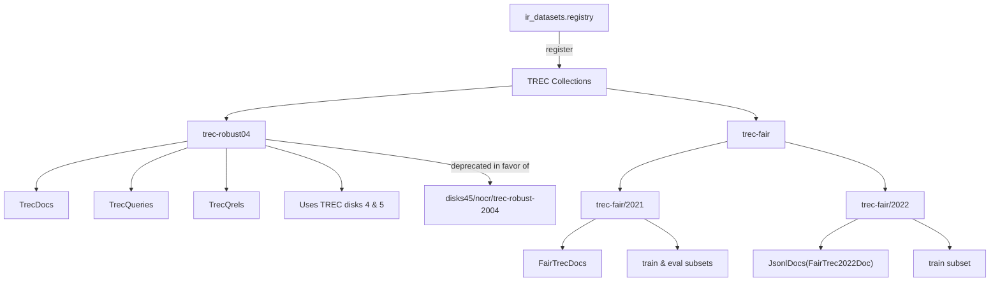
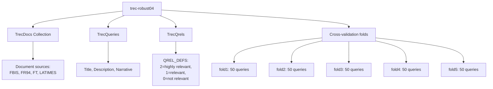
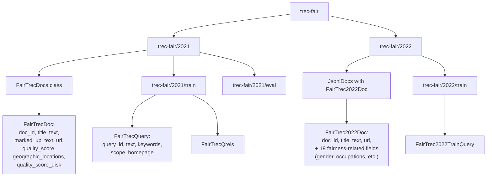

<!-- source: DeepWiki mcp.deepwiki.com · repo allenai/ir_datasets · page 4.3 TREC Collections · fetched 2026-10-26 -->

# TREC Collections

<details>
<summary>Relevant source files</summary>

The following files were used as context for generating this wiki page:

- [ir_datasets/datasets/trec_fair.py](ir_datasets/datasets/trec_fair.py)
- [ir_datasets/datasets/trec_robust04.py](ir_datasets/datasets/trec_robust04.py)
- [ir_datasets/docs/trec-fair.yaml](ir_datasets/docs/trec-fair.yaml)
- [ir_datasets/docs/trec-robust04.yaml](ir_datasets/docs/trec-robust04.yaml)
- [test/integration/trec_fair.py](test/integration/trec_fair.py)

</details>


## Purpose and Scope
This document provides a technical overview of TREC (Text REtrieval Conference) collections in the ir_datasets library. It covers the implementation details, data structures, and access patterns for TREC Robust 2004 and TREC Fair Ranking datasets. For other collections like MS MARCO, see [MS MARCO Collections](#4.2).

## Overview of TREC Collections

TREC collections form a significant part of the ir_datasets ecosystem, providing standardized benchmark datasets created through the TREC program organized by the National Institute of Standards and Technology (NIST). These collections are implemented with specialized document handlers, query formats, and relevance judgment structures.



Sources: [ir_datasets/datasets/trec_robust04.py](), [ir_datasets/datasets/trec_fair.py]()

## TREC Robust 2004

### Implementation Details

The TREC Robust 2004 dataset is implemented using standard TREC format handlers but requires users to provide the underlying document collection due to licensing constraints.



Sources: [ir_datasets/datasets/trec_robust04.py:10-14](), [ir_datasets/datasets/trec_robust04.py:20-27]()

The Robust 2004 dataset is structured with the following key components:

| Component | Description | Implementation |
|-----------|-------------|----------------|
| Documents | News articles from 4 sources (FBIS, FR94, FT, LATIMES) | `TrecDocs` format handler |
| Queries | 250 topics with title, description, and narrative | `TrecQueries` format handler |
| Relevance Judgments | 3-level scale (0, 1, 2) | `TrecQrels` with `QREL_DEFS` |
| Folds | 5 cross-validation folds (Huston & Croft 2014) | Filtered query sets in `FOLDS` dict |

Sources: [ir_datasets/datasets/trec_robust04.py:38-49]()

### Data Requirements and Access

TREC Robust 2004 requires a data usage agreement with NIST as specified in the Data Usage Agreement (DUA) constant:

```python
DUA = ("Please confirm you agree to the TREC Robust 2004 data usage agreement found at "
       "<https://trec.nist.gov/data/cd45/index.html>")
```

Sources: [ir_datasets/datasets/trec_robust04.py:16-17]()

The dataset initialization code in `_init()` function sets up:
1. Document collection from TREC disks 4 and 5
2. Queries from the official TREC query file
3. Relevance judgments from official qrels file
4. Cross-validation folds with filtered queries and qrels

```python
collection = TrecDocs(dlc['docs'], path_globs=['**/FBIS/FB*', '**/FR94/??/FR*', '**/FT/*/FT*', '**/LATIMES/LA*'], 
                      namespace=NAME, lang='en', expected_file_count=2295, count_hint=ir_datasets.util.count_hint(NAME))
```

Sources: [ir_datasets/datasets/trec_robust04.py:39]()

**Note**: The `trec-robust04` dataset ID is now deprecated in favor of `disks45/nocr/trec-robust-2004`, which provides better parsing of the corpus.

Sources: [ir_datasets/datasets/trec_robust04.py:30](), [ir_datasets/datasets/trec_robust04.py:49]()

## TREC Fair Ranking

### Implementation Details

The TREC Fair Ranking track is implemented with specialized document and query classes to handle the rich metadata associated with fairness evaluation tasks.



Sources: [ir_datasets/datasets/trec_fair.py:22-66](), [ir_datasets/datasets/trec_fair.py:268-270]()

### Document and Query Classes

TREC Fair Ranking implements specialized data structures:

1. **Document Classes**:
   - `FairTrecDoc`: For 2021 documents with basic metadata
   - `FairTrec2022Doc`: Enhanced version with 19 additional fairness-related fields

2. **Query Classes**:
   - `FairTrecQuery`: Standard query for 2021 train set
   - `FairTrecEvalQuery`: Evaluation queries for 2021
   - `FairTrec2022TrainQuery`: Training queries for 2022

3. **Document Handlers**:
   - `FairTrecDocs`: Specialized handler for 2021 documents
   - `JsonlDocs`: Generic JSONL handler with mapping for 2022 documents

Sources: [ir_datasets/datasets/trec_fair.py:22-101](), [ir_datasets/datasets/trec_fair.py:104-170](), [ir_datasets/datasets/trec_fair.py:216-262]()

### Collection Statistics

Based on integration tests, the TREC Fair Ranking collections have the following statistics:

| Collection | Documents | Queries | Relevance Judgments |
|------------|-----------|---------|---------------------|
| trec-fair/2021 | 6,280,328 | N/A | N/A |
| trec-fair/2021/train | ↑ | 57 | 2,185,446 |
| trec-fair/2021/eval | ↑ | 49 | 13,757 |
| trec-fair/2022 | 6,475,537 | N/A | N/A |
| trec-fair/2022/train | ↑ | 50 | 2,088,306 |

Sources: [test/integration/trec_fair.py:9-53]()

## Access Patterns

### Loading TREC Collections

TREC collections follow the standard ir_datasets access pattern through the registry system:

```python
import ir_datasets

# For TREC Robust 2004 (Note: Now deprecated)
dataset = ir_datasets.load('trec-robust04')
# Preferred approach:
dataset = ir_datasets.load('disks45/nocr/trec-robust-2004')

# For a specific fold
fold1 = ir_datasets.load('trec-robust04/fold1')

# For TREC Fair Ranking
fair_2021 = ir_datasets.load('trec-fair/2021')
fair_2021_train = ir_datasets.load('trec-fair/2021/train')
fair_2022 = ir_datasets.load('trec-fair/2022')
```

### Accessing Collection Components

All TREC collections provide standard iterators for documents, queries, and relevance judgments:

```python
# Documents
for doc in dataset.docs_iter():
    # For TREC Robust: doc_id, text
    # For TREC Fair: doc_id, title, text, plus metadata
    print(doc.doc_id, doc.default_text())

# Queries
for query in dataset.queries_iter():
    print(query.query_id, query.text)

# Relevance judgments
for qrel in dataset.qrels_iter():
    print(qrel.query_id, qrel.doc_id, qrel.relevance)
```

## Document Storage

TREC Fair Ranking uses `PickleLz4FullStore` for efficient document retrieval:

```python
def docs_store(self, field='doc_id'):
    return PickleLz4FullStore(
        path=f'{ir_datasets.util.home_path()/NAME}/2021/docs.pklz4',
        init_iter_fn=self._docs_iter,
        data_cls=self.docs_cls(),
        lookup_field=field,
        size_hint=30735927055,
        index_fields=['doc_id'],
        count_hint=ir_datasets.util.count_hint(NAME),
    )
```

Sources: [ir_datasets/datasets/trec_fair.py:150-159]()

## Deprecated Identifiers

TREC Fair Ranking previously used year-specific top-level identifiers which are now deprecated:

```python
ir_datasets.registry.register('trec-fair-2021', Dataset(subsets['2021'], 
    Deprecated('acessing TREC Fair Ranking 2021 through trec-fair-2021 is deprecated; use trec-fair/2021 instead.')))
```

Similarly, TREC Robust 2004 is deprecated in favor of the improved implementation:

```python
Deprecated(DEPRECATED_MESSAGE.format(NAME, f'disks45/nocr/trec-robust-2004'))
```

Sources: [ir_datasets/datasets/trec_fair.py:309-311](), [ir_datasets/datasets/trec_robust04.py:49]()

---

