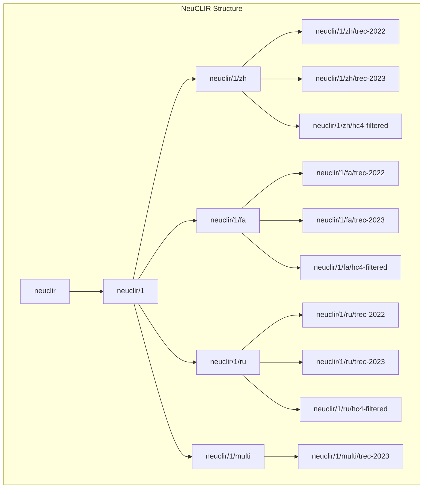
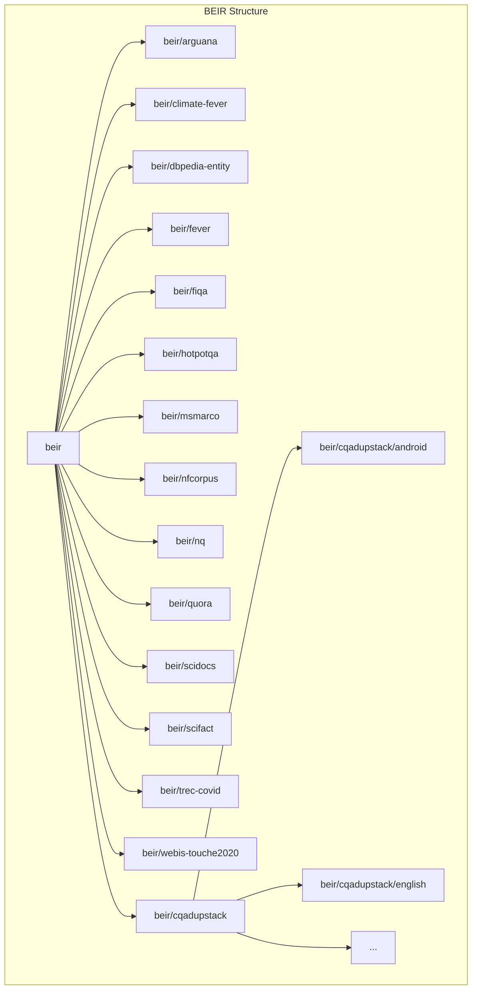
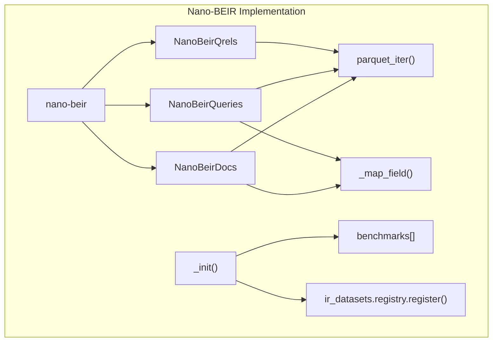
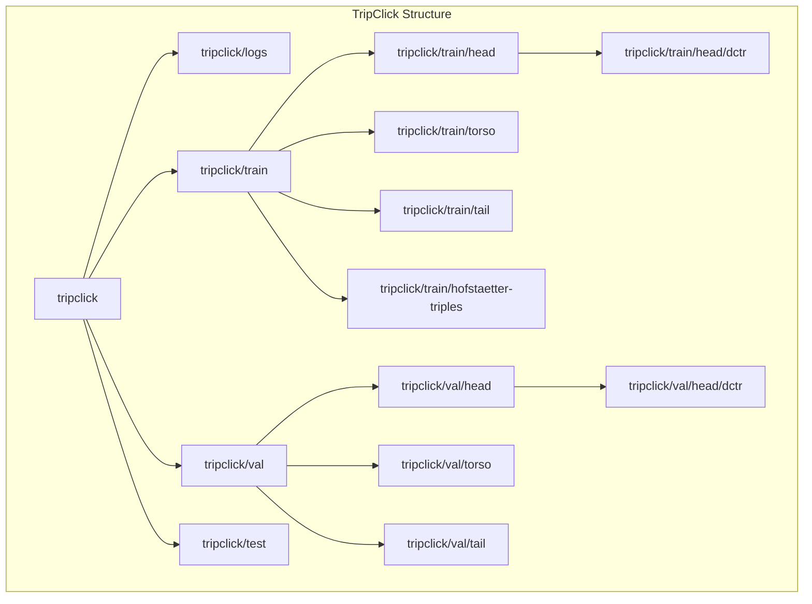
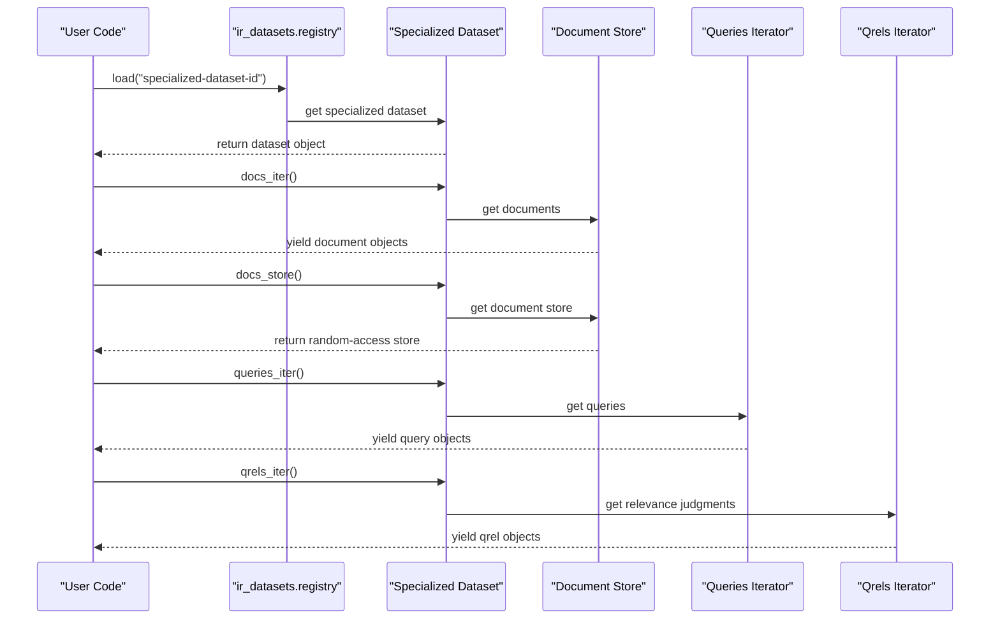
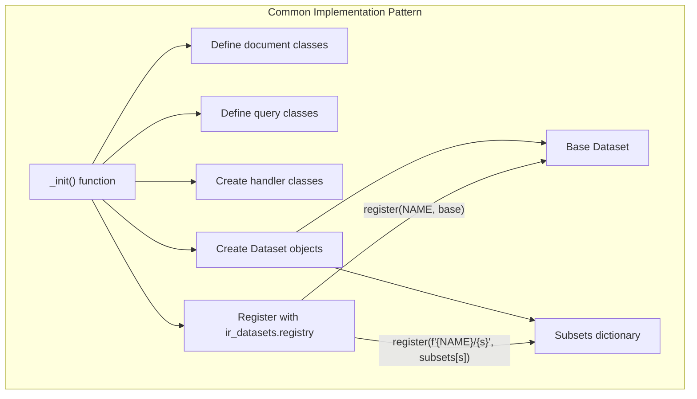

<!-- source: DeepWiki mcp.deepwiki.com · repo allenai/ir_datasets · page 4.4 Specialized Collections · fetched 2026-10-26 -->

# Specialized Collections

<details>
<summary>Relevant source files</summary>

The following files were used as context for generating this wiki page:

- [ir_datasets/commands/__init__.py](ir_datasets/commands/__init__.py)
- [ir_datasets/commands/clean.py](ir_datasets/commands/clean.py)
- [ir_datasets/datasets/aol_ia.py](ir_datasets/datasets/aol_ia.py)
- [ir_datasets/datasets/beir.py](ir_datasets/datasets/beir.py)
- [ir_datasets/datasets/hc4.py](ir_datasets/datasets/hc4.py)
- [ir_datasets/datasets/nano_beir.py](ir_datasets/datasets/nano_beir.py)
- [ir_datasets/datasets/neuclir.py](ir_datasets/datasets/neuclir.py)
- [ir_datasets/datasets/tripclick.py](ir_datasets/datasets/tripclick.py)
- [ir_datasets/docs/beir.yaml](ir_datasets/docs/beir.yaml)
- [ir_datasets/docs/hc4.yaml](ir_datasets/docs/hc4.yaml)
- [ir_datasets/docs/nano-beir.yaml](ir_datasets/docs/nano-beir.yaml)
- [ir_datasets/formats/extracted_cc.py](ir_datasets/formats/extracted_cc.py)
- [test/integration/beir.py](test/integration/beir.py)
- [test/integration/hc4.py](test/integration/hc4.py)
- [test/integration/nano_beir.py](test/integration/nano_beir.py)
- [test/integration/neuclir.py](test/integration/neuclir.py)

</details>


This page documents specialized collections in IR Datasets that serve unique information retrieval research purposes beyond standard web, document, and passage rankings. These collections include cross-language retrieval datasets, benchmark suites for zero-shot evaluation, and click-based interaction datasets.

## 1. Cross-Language Information Retrieval Collections

Cross-language information retrieval (CLIR) collections support evaluation of retrieval systems that search documents in one language using queries in another.

### 1.1 NeuCLIR 

NeuCLIR provides a suite for ad hoc cross-language information retrieval using Common Crawl News documents.



Key features:
- **Documents**: Common Crawl News documents in Chinese (zh), Persian (fa), and Russian (ru)
- **Document Counts**: Chinese: 3.1M, Persian: 2.2M, Russian: 4.6M documents
- **Queries**: Available in English with human and machine translations to target languages
- **Evaluation Sets**: TREC 2022, TREC 2023, and hc4-filtered variants

The NeuCLIR dataset uses specialized query classes that contain both the original English queries and their translations:

```python
# Example of a NeuCLIR query class
ExctractedCCNoReportQuery(
    query_id='1',
    title='English Title',
    description='English Description',
    narrative='English Narrative',
    ht_title='Human Translated Title',
    ht_description='Human Translated Description',
    ht_narrative='Human Translated Narrative',
    mt_title='Machine Translated Title',
    mt_description='Machine Translated Description',
    mt_narrative='Machine Translated Narrative',
    translation_lang='zh'  # Target language
)
```

Sources: [ir_datasets/datasets/neuclir.py]()</a>, [test/integration/neuclir.py](), [ir_datasets/formats/extracted_cc.py]()

### 1.2 HC4

HC4 (HLTCOE CLIR Common-Crawl Collection) is another cross-language retrieval dataset used as a filtering source for NeuCLIR's hc4-filtered variants.

Key features:
- **Documents**: Common Crawl web pages in Chinese, Persian, and Russian
- **Document Access**: Documents must be downloaded separately using the provided script
- **Queries**: TREC-style title/description/narrative queries in English with translations
- **Relevance Judgments**: Three-level graded relevance

Sources: [ir_datasets/docs/hc4.yaml](), [ir_datasets/datasets/hc4.py](), [test/integration/hc4.py]()

## 2. Benchmark Suites

IR Datasets includes benchmark collections specifically designed to evaluate and compare retrieval models across diverse domains.

### 2.1 BEIR

BEIR (Benchmark for Information Retrieval) is a comprehensive collection of diverse retrieval tasks to evaluate zero-shot transfer capabilities of retrieval models.



BEIR includes 18 diverse datasets covering:
- **Fact Verification**: FEVER, Climate-FEVER, SciFact
- **Argument Retrieval**: ArgUAna, Touché-2020
- **Question Answering**: NQ, HotpotQA
- **Entity Retrieval**: DBPedia-Entity
- **Citation Prediction**: SCIDOCS
- **Duplicate Question Detection**: Quora, CQADupStack
- **Domain-specific**: TREC-COVID, NFCorpus, FIQA

The implementation provides specialized document and query classes to accommodate the diverse formats of these datasets:

```python
# Example of a BEIR document with metadata
BeirDoc(
    doc_id='doc123',
    text='Document content',
    title='Document title',
    metadata={'key': 'value'} 
)

# Domain-specific document types
BeirSciDoc(
    doc_id='doc123',
    text='Paper content',
    title='Paper title',
    authors=['Author 1', 'Author 2'],
    year=2020,
    cited_by=['paper1', 'paper2'],
    references=['ref1', 'ref2']
)
```

Sources: [ir_datasets/datasets/beir.py](), [ir_datasets/docs/beir.yaml](), [test/integration/beir.py]()

### 2.2 Nano-BEIR

Nano-BEIR is a lightweight version of BEIR designed for faster evaluation, containing a maximum of 50 queries per benchmark dataset.



Key features:
- **Same datasets** as BEIR but with reduced query counts
- **Parquet format** for efficient storage and access
- **Identical structure** to BEIR to maintain compatibility
- Includes benchmarks such as climate-fever, dbpedia-entity, fever, fiqa, hotpotqa, msmarco, nfcorpus, nq, quora, scidocs, arguana, scifact, and webis-touche2020

Nano-BEIR reduces the computational cost of evaluation while preserving dataset diversity.

Sources: [ir_datasets/datasets/nano_beir.py](), [ir_datasets/docs/nano-beir.yaml](), [test/integration/nano_beir.py]()

## 3. Click-Based Collections

Click-based collections contain user interaction data, providing insights into search behavior and implicit relevance judgments.

### 3.1 TripClick

TripClick is a medical domain click log dataset derived from user interactions with health information retrieval systems.



Key features:
- **Medical Domain**: Documents and queries related to medical information
- **Head-Torso-Tail Split**: Queries divided by frequency (head=popular, tail=rare)
- **Click Data**: Two relevance definitions:
  - Raw: Binary relevance (clicked or not)
  - DCTR: Graded relevance based on click-through rates (0-3)
- **Document Pairs**: Includes document pairs for training pairwise ranking models

TripClick provides specialized classes for working with the dataset:

```python
# TripClick document class
TripClickPartialDoc(
    doc_id='123',
    title='Medical Article Title',
    url='https://example.com/article'
)

# TripClick query log entry
TripClickQlog(
    session_id='session123',
    query_id='query456',
    query='diabetes symptoms',
    query_orig='diabetes symptoms',
    time=datetime(2019, 5, 10, 14, 30),
    items=(LogItem('doc1', True), LogItem('doc2', False))
)
```

Sources: [ir_datasets/datasets/tripclick.py]()

### 3.2 AOL-IA

AOL-IA (AOL - Internet Archive) combines the AOL query logs with document content retrieved from the Internet Archive's web archive.

Key features:
- **Query Logs**: Original AOL search logs with anonymized user IDs
- **Document Content**: Retrieved from Internet Archive's web crawls
- **Click Data**: Implicit relevance judgments from user clicks

Sources: [ir_datasets/datasets/aol_ia.py]()

## 4. Accessing Specialized Collections

All specialized collections follow the standard IR Datasets access pattern:



Example usage:

```python
import ir_datasets

# Load a NeuCLIR dataset
neuclir = ir_datasets.load('neuclir/1/zh')
for doc in neuclir.docs_iter():
    print(doc.doc_id, doc.title)

# Load a BEIR dataset
beir_dataset = ir_datasets.load('beir/scifact')
for query in beir_dataset.queries_iter():
    print(query.query_id, query.text)

# Load TripClick
tripclick = ir_datasets.load('tripclick/train/head')
for qrel in tripclick.qrels_iter():
    print(qrel.query_id, qrel.doc_id, qrel.relevance)
```

Sources: [ir_datasets/datasets/nano_beir.py](), [ir_datasets/datasets/beir.py](), [ir_datasets/datasets/tripclick.py](), [ir_datasets/datasets/neuclir.py]()

## 5. Implementation Pattern

Specialized collections in IR Datasets follow a common implementation pattern:

1. Define specialized document, query, and qrel classes
2. Create handler classes for documents, queries, and qrels
3. Initialize datasets and subsets
4. Register with the IR Datasets registry



This pattern ensures that all specialized collections integrate smoothly with the IR Datasets ecosystem.

Sources: [ir_datasets/datasets/nano_beir.py:115-158](), [ir_datasets/datasets/beir.py:255-337](), [ir_datasets/datasets/tripclick.py:240-396](), [ir_datasets/datasets/neuclir.py:77-142]()

## 6. Summary

Specialized collections in IR Datasets provide unique datasets for specific research needs:

| Collection | Domain | Purpose | Key Features |
|------------|--------|---------|-------------|
| NeuCLIR | Cross-language | CLIR research | Documents in zh/fa/ru, queries in English, human and machine translations |
| HC4 | Cross-language | CLIR research | Common Crawl documents, three levels of relevance |
| BEIR | Multi-domain | Zero-shot evaluation | 18 diverse datasets, standardized format |
| Nano-BEIR | Multi-domain | Efficient evaluation | Smaller version of BEIR (max 50 queries) |
| TripClick | Medical | Click log analysis | Medical domain, head/torso/tail query splits, raw and DCTR relevance |
| AOL-IA | Web search | Query log analysis | AOL logs with Internet Archive content |

These collections enable researchers to evaluate retrieval systems on specialized tasks and domains using a consistent interface.

---

