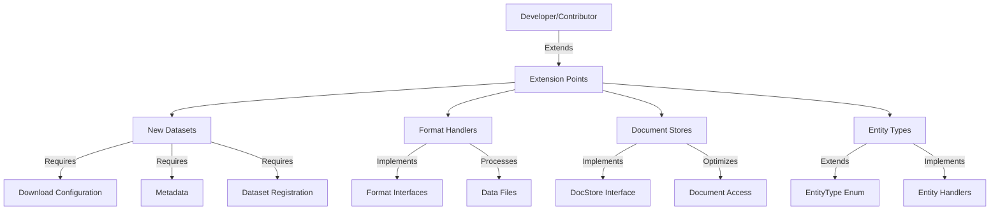
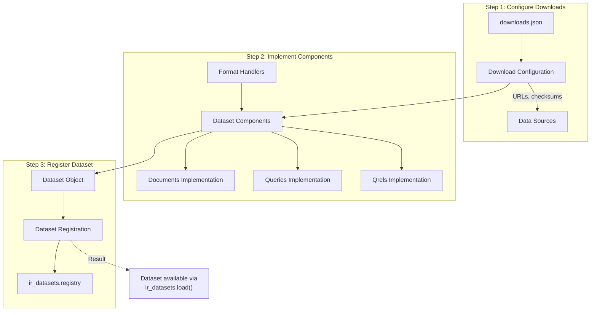
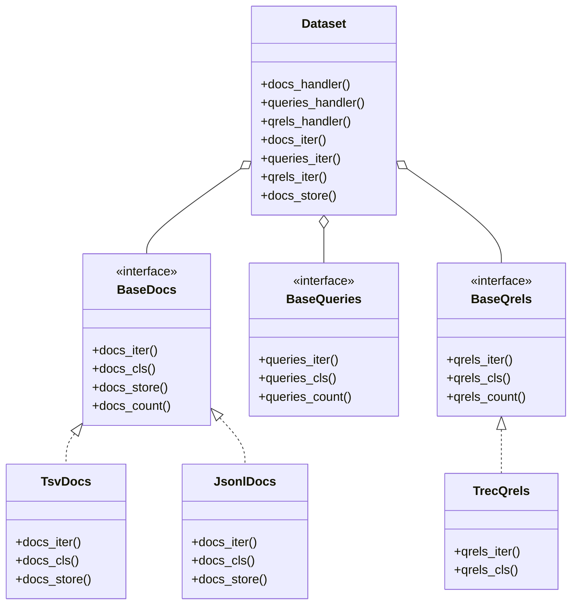
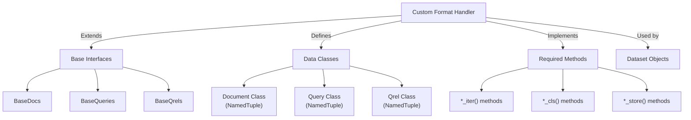
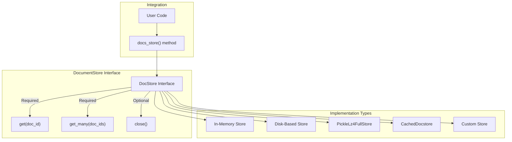
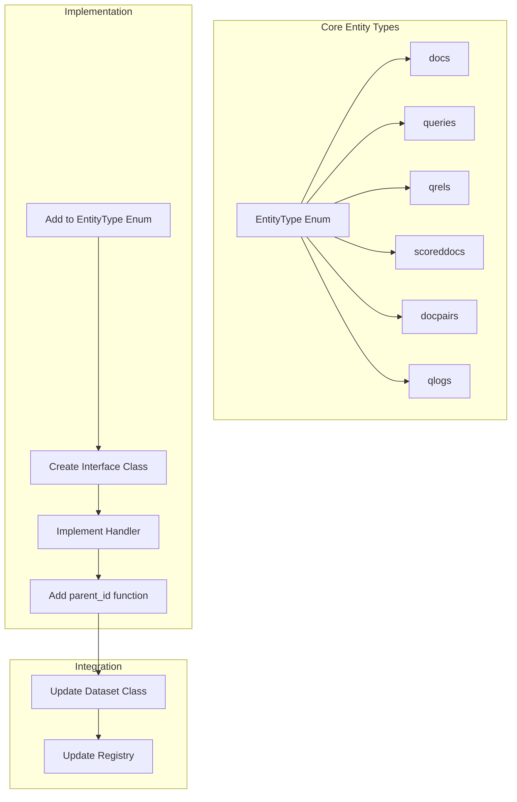
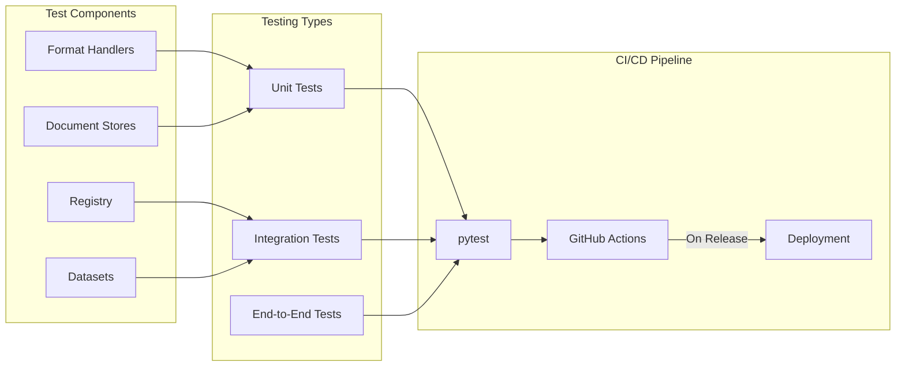

<!-- source: DeepWiki mcp.deepwiki.com · repo allenai/ir_datasets · page 5 Extending IR Datasets · fetched 2026-10-26 -->

# Extending IR Datasets

<details>
<summary>Relevant source files</summary>

The following files were used as context for generating this wiki page:

- [.github/workflows/deploy.yml](.github/workflows/deploy.yml)
- [.github/workflows/test.yml](.github/workflows/test.yml)
- [ir_datasets/__init__.py](ir_datasets/__init__.py)
- [ir_datasets/datasets/__init__.py](ir_datasets/datasets/__init__.py)
- [ir_datasets/docs/bibliography.bib](ir_datasets/docs/bibliography.bib)
- [ir_datasets/etc/downloads.json](ir_datasets/etc/downloads.json)
- [ir_datasets/etc/metadata.json](ir_datasets/etc/metadata.json)
- [ir_datasets/formats/__init__.py](ir_datasets/formats/__init__.py)
- [test/util.py](test/util.py)

</details>


This document provides comprehensive guidance for extending the IR Datasets library with new datasets, custom format handlers, document stores, and other components. It covers the key extension points in the system and provides step-by-step instructions for contributors who want to add their own datasets or enhance the library's functionality.

For information about using the existing datasets and features, see [Using IR Datasets](#3).

## Extension Points Overview

IR Datasets is designed with modularity and extensibility in mind. The main extension points include adding new datasets to the registry, implementing custom format handlers, creating specialized document stores, and extending the supported entity types.

**Extension Points Diagram**


Sources: [ir_datasets/__init__.py](), [ir_datasets/formats/__init__.py]()

## Adding New Datasets

The most common way to extend IR Datasets is by adding support for new datasets. This involves three main steps:

1. Configuring downloads in the downloads.json file
2. Implementing dataset components using appropriate format handlers
3. Registering the dataset with the system registry

**Dataset Addition Process**


Sources: [ir_datasets/etc/downloads.json](), [ir_datasets/datasets/__init__.py]()

### Step 1: Download Configuration

The first step is to configure download information in `ir_datasets/etc/downloads.json`. This file maps dataset identifiers to download sources including URLs, checksums, and cache paths.

The download configuration follows this pattern:

```
"dataset-id": {
  "component-id": {
    "url": "https://example.com/path/to/file",
    "size_hint": 10485760,
    "expected_md5": "checksum",
    "cache_path": "relative/path/in/cache"
  }
}
```

For datasets requiring manual downloads or licensing, use the `instructions` field:

```
"licensed-dataset": {
  "docs": {
    "instructions": "This dataset requires registration at <URL>.\nPlace the file here: {path}",
    "expected_md5": "checksum",
    "cache_path": "corpus"
  }
}
```

Sources: [ir_datasets/etc/downloads.json:1-879]()

### Step 2: Implement Dataset Components

Next, create a new Python module in the `ir_datasets/datasets/` directory to implement your dataset. Use the appropriate format handlers for your data files.

**Component Implementation Pattern**


Sources: [ir_datasets/formats/__init__.py:1-14](), [ir_datasets/datasets/__init__.py:1-58]()

When implementing a dataset module, typically you would:

1. Create component handlers using appropriate format classes
2. Use the `Lazy` wrapper for efficient loading
3. Create a `Dataset` instance with the handlers
4. Register the dataset with the registry

Example implementation pattern:

```python
from ir_datasets.util import DownloadConfig, Lazy
from ir_datasets.formats import TsvDocs, TsvQueries, TrecQrels
from ir_datasets.datasets.base import Dataset
from ir_datasets import registry

# Define configuration
_config = {
    'docs': DownloadConfig('path/to/docs.tsv', 'https://example.com/docs.tsv', expected_md5='...'),
    'queries': DownloadConfig('path/to/queries.tsv', 'https://example.com/queries.tsv', expected_md5='...'),
    'qrels': DownloadConfig('path/to/qrels.txt', 'https://example.com/qrels.txt', expected_md5='...'),
}

# Create handlers using Lazy for deferred loading
docs = Lazy(lambda: TsvDocs(_config['docs']))
queries = Lazy(lambda: TsvQueries(_config['queries']))
qrels = Lazy(lambda: TrecQrels(_config['qrels']))

# Create dataset object
dataset = Dataset(docs, queries, qrels)

# Register dataset
registry.register('my-dataset', dataset)
```

### Step 3: Register Dataset

Finally, register your dataset module in `ir_datasets/datasets/__init__.py` by adding an import statement:

```python
from . import my_dataset
```

Then update the metadata in `ir_datasets/etc/metadata.json` to include information about your dataset:

```json
"my-dataset": {
  "docs": {
    "count": 10000,
    "fields": {
      "doc_id": {
        "max_len": 10,
        "common_prefix": ""
      }
    }
  },
  "queries": {
    "count": 100
  },
  "qrels": {
    "count": 1000,
    "fields": {
      "relevance": {
        "counts_by_value": {
          "0": 800,
          "1": 150,
          "2": 50
        }
      }
    }
  }
}
```

Sources: [ir_datasets/etc/metadata.json:1-171](), [ir_datasets/__init__.py:11-15]()

## Implementing Custom Format Handlers

If your dataset uses a format not already supported by IR Datasets, you'll need to implement a custom format handler.

**Format Handler Implementation**


Sources: [ir_datasets/formats/__init__.py:1-13]()

### Format Interface Implementation

IR Datasets provides base interfaces for different data types in `ir_datasets/formats/base.py`:
- `BaseDocs` - for document collections
- `BaseQueries` - for query sets
- `BaseQrels` - for relevance judgments
- `BaseScoredDocs` - for scored document results
- `BaseDocPairs` - for document pairs
- `BaseQlogs` - for query logs

To implement a custom format handler:

1. Create a data class using `NamedTuple` to represent your data
2. Implement a class that extends the appropriate base interface
3. Implement the required methods for that interface

Example of a custom document format handler:

```python
from typing import NamedTuple, Iterable
from ir_datasets.formats import BaseDocs
import ir_datasets

class CustomDoc(NamedTuple):
    doc_id: str
    title: str
    content: str
    
    def default_text(self):
        """Method used for default text field in retrieval"""
        return f"{self.title} {self.content}"

class CustomFormatDocs(BaseDocs):
    def __init__(self, dlc):
        self.dlc = dlc
        
    def docs_iter(self) -> Iterable[CustomDoc]:
        """Return an iterator of documents"""
        with self.dlc.stream() as f:
            # Implement parsing logic for your custom format
            for line in f:
                # Parse line and create a CustomDoc
                yield CustomDoc(doc_id="...", title="...", content="...")
    
    def docs_cls(self):
        """Return the document class"""
        return CustomDoc
    
    def docs_store(self, field='document'):
        """Return a document store for efficient lookup"""
        return ir_datasets.util.PickleLz4FullStore(
            path=f'{self.dlc.path()}.pklz4',
            init_iter_fn=self.docs_iter,
            data_cls=self.docs_cls(),
            lookup_field='doc_id'
        )
```

After implementing your format handler, you can use it in dataset implementations:

```python
docs = Lazy(lambda: CustomFormatDocs(_config['docs']))
```

Sources: [ir_datasets/formats/__init__.py:1-14]()

## Creating Custom Document Stores

Document stores provide efficient access to documents by ID. IR Datasets includes several document store implementations, but you can create custom ones for specific needs.

**Document Store Architecture**


Sources: [ir_datasets/__init__.py:76-88]()

### Document Store Interface

A document store must implement at least the following methods:

- `get(doc_id)`: Retrieve a single document by ID
- `get_many(doc_ids)`: Retrieve multiple documents by their IDs (optional, but recommended for performance)
- `close()`: Clean up resources (optional)

Example of a basic custom document store:

```python
class CustomDocStore:
    def __init__(self, docs_iter_fn, lookup_field='doc_id'):
        # Build an in-memory index
        self.docs = {}
        for doc in docs_iter_fn():
            self.docs[getattr(doc, lookup_field)] = doc
    
    def get(self, doc_id):
        """Retrieve a document by ID"""
        return self.docs.get(doc_id)
    
    def get_many(self, doc_ids):
        """Retrieve multiple documents by ID"""
        return [self.get(doc_id) for doc_id in doc_ids]
    
    def close(self):
        """Clean up resources"""
        self.docs = None
```

To use your custom document store in a format handler:

```python
def docs_store(self):
    return CustomDocStore(self.docs_iter, 'doc_id')
```

IR Datasets provides some useful document store implementations that you can extend or use as examples:

- `PickleLz4FullStore`: Stores documents in a compressed pickle format
- `CacheDocstore`: Caches documents in memory for faster access
- `ClueWebWarcDocstore`: Specialized for ClueWeb WARC files

Sources: [ir_datasets/__init__.py:76-88]()

## Extending Entity Types

IR Datasets organizes data into entities like documents, queries, and relevance judgments. You can extend the system to support new entity types.

**Entity Type Extension**


Sources: [ir_datasets/__init__.py:1-9](), [ir_datasets/__init__.py:25-48]()

To add a new entity type:

1. Add the entity type to the `EntityType` enum in `ir_datasets/__init__.py`
2. Create a base interface class in `ir_datasets/formats/base.py`
3. Create specific format handlers that implement the interface
4. Update the `Dataset` class to support the new entity type
5. Add a parent_id function for the entity type

Example of adding a new entity type:

```python
# Step 1: Add to EntityType enum
class EntityType(Enum):
    docs = "docs"
    queries = "queries"
    qrels = "qrels"
    scoreddocs = "scoreddocs"
    docpairs = "docpairs"
    qlogs = "qlogs"
    newentity = "newentity"  # Added new entity type

# Step 2: Create base interface
class BaseNewEntity:
    def newentity_iter(self):
        raise NotImplementedError()
    
    def newentity_cls(self):
        raise NotImplementedError()

# Step 3: Add parent_id function
def newentity_parent_id(dataset_id: str) -> str:
    return parent_id(dataset_id, EntityType.newentity)
```

## Testing and CI/CD

When extending IR Datasets, it's important to ensure your additions work correctly and integrate well with the existing system.

**Testing Framework**


Sources: [.github/workflows/test.yml:1-44](), [.github/workflows/deploy.yml:1-27](), [test/util.py:1-60]()

### Writing Tests

For any extensions you make, you should add appropriate tests:

1. **Unit tests** for format handlers, document stores, and other components
2. **Integration tests** for dataset implementations
3. **End-to-end tests** for the full data loading pipeline

Example of a format handler test:

```python
import unittest
from ir_datasets.formats import YourCustomFormat

class TestCustomFormat(unittest.TestCase):
    def test_format_parsing(self):
        # Test your format parsing logic
        pass
    
    def test_iterator_functionality(self):
        # Test iterator behavior
        pass
```

Example of a dataset integration test:

```python
import unittest
import ir_datasets

class TestYourDataset(unittest.TestCase):
    def test_load(self):
        # Test loading the dataset
        dataset = ir_datasets.load('your-dataset')
        self.assertIsNotNone(dataset)
    
    def test_docs_iter(self):
        # Test document iteration
        dataset = ir_datasets.load('your-dataset')
        docs = list(dataset.docs_iter())
        self.assertGreater(len(docs), 0)
```

### CI/CD Pipeline

IR Datasets uses GitHub Actions for CI/CD:

1. **Testing workflow** runs on push to master and pull requests
2. **Deployment workflow** runs when a new release is created

The testing workflow runs unit and integration tests on multiple Python versions and operating systems to ensure cross-platform compatibility.

Sources: [.github/workflows/test.yml:1-44](), [.github/workflows/deploy.yml:1-27]()

## Best Practices

When extending IR Datasets, follow these best practices to ensure your contributions integrate well with the existing system.

### 1. Consistency

- Follow existing naming conventions and code style
- Structure dataset implementations similarly to existing ones
- Use established patterns for format handlers and document stores

### 2. Performance

- Use lazy loading with the `Lazy` wrapper to defer resource-intensive operations
- Implement efficient document stores for large datasets
- Consider streaming for large files to reduce memory usage

### 3. Documentation

- Include docstrings in your code
- Add comments for complex logic
- Document dataset properties in metadata.json
- Add citations to the bibliography.bib file

### 4. Error Handling

- Validate input parameters and data
- Provide helpful error messages
- Handle edge cases gracefully

### 5. Testing

- Write comprehensive tests for your extensions
- Test with both valid and invalid inputs
- Verify performance with large datasets

## Conclusion

Extending IR Datasets allows you to add support for new datasets, custom formats, and specialized functionality. By following the patterns and guidelines in this document, you can contribute high-quality extensions that integrate seamlessly with the existing system.

For information about using IR Datasets, see [Using IR Datasets](#3).

Sources: [ir_datasets/__init__.py](), [ir_datasets/formats/__init__.py](), [ir_datasets/datasets/__init__.py]()

---

