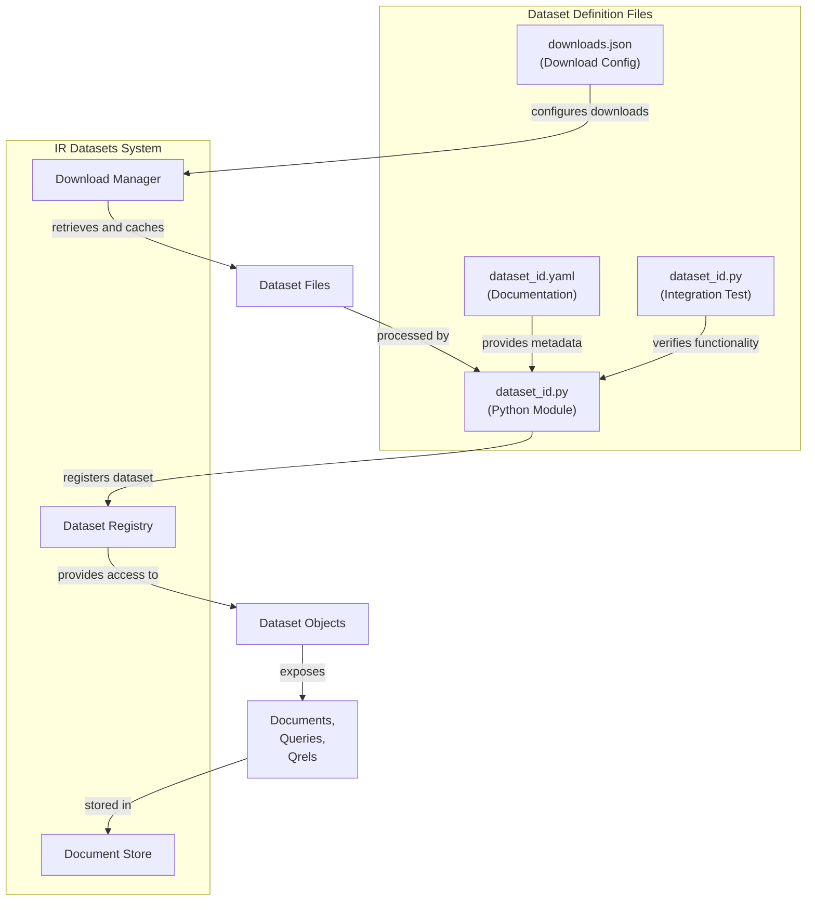
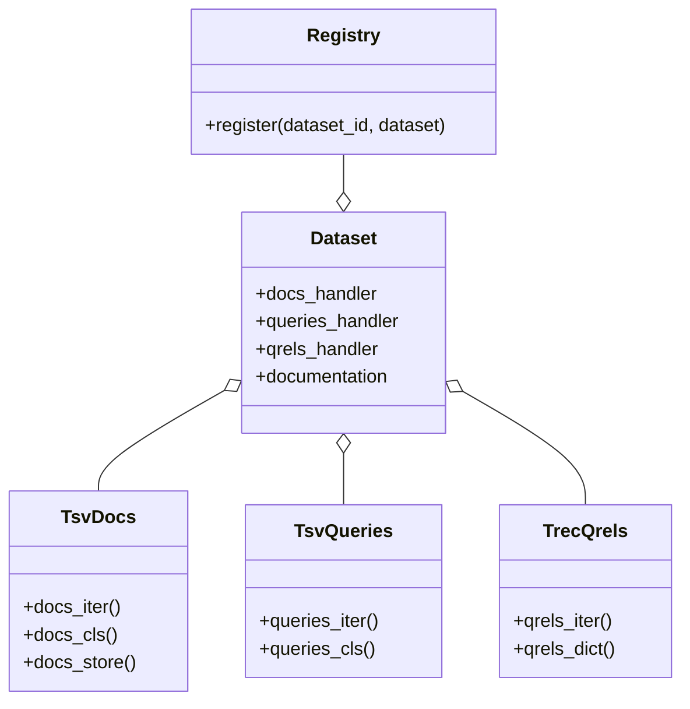
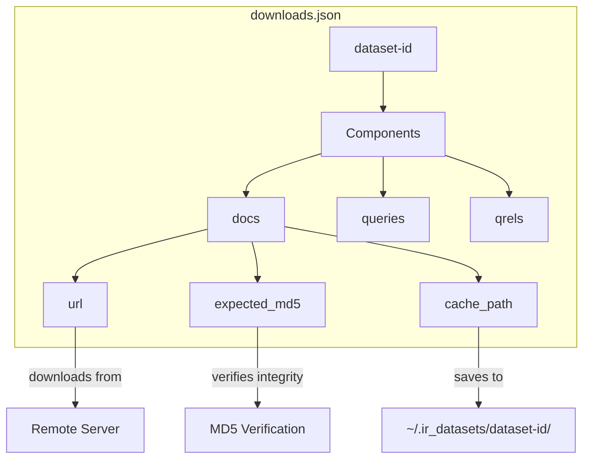
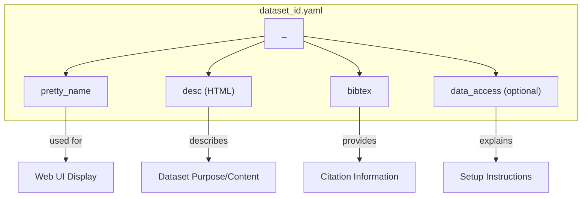

<!-- source: DeepWiki mcp.deepwiki.com · repo allenai/ir_datasets · page 5.1 Adding New Datasets · fetched 2026-10-26 -->

# Adding New Datasets

<details>
<summary>Relevant source files</summary>

The following files were used as context for generating this wiki page:

- [examples/adding_datasets.ipynb](examples/adding_datasets.ipynb)
- [ir_datasets/commands/build_download_cache.py](ir_datasets/commands/build_download_cache.py)
- [ir_datasets/datasets/__init__.py](ir_datasets/datasets/__init__.py)
- [ir_datasets/datasets/base.py](ir_datasets/datasets/base.py)
- [ir_datasets/datasets/dpr_w100.py](ir_datasets/datasets/dpr_w100.py)
- [ir_datasets/docs/bibliography.bib](ir_datasets/docs/bibliography.bib)
- [ir_datasets/docs/trec-cast.yaml](ir_datasets/docs/trec-cast.yaml)
- [ir_datasets/etc/downloads.json](ir_datasets/etc/downloads.json)
- [ir_datasets/etc/metadata.json](ir_datasets/etc/metadata.json)
- [ir_datasets/formats/__init__.py](ir_datasets/formats/__init__.py)
- [ir_datasets/formats/tsv.py](ir_datasets/formats/tsv.py)
- [ir_datasets/util/metadata.py](ir_datasets/util/metadata.py)
- [test/integration/dpr_w100.py](test/integration/dpr_w100.py)
- [test/integration/trec_cast.py](test/integration/trec_cast.py)

</details>


This document provides a comprehensive guide for adding new datasets to the ir_datasets library. IR Datasets standardizes access to information retrieval datasets, and this guide explains how to integrate new collections into the framework. For extending the library with custom data formats, see [Custom Data Handlers](#5.2).

## Overview of the Process

Adding a new dataset to ir_datasets requires creating or modifying four key files:

1. **Dataset Module** - Python code file defining the dataset's structure and components
2. **Download Configuration** - Entries in the downloads.json file that specify how to obtain the data
3. **Documentation** - YAML file describing the dataset for users
4. **Integration Tests** - Tests to verify the dataset works correctly

## Dataset Registration Flow



Sources: [ir_datasets/datasets/base.py](), [examples/adding_datasets.ipynb]()

## Creating the Dataset Module

The dataset module is a Python file that defines how the dataset is structured and processed. It lives in the `ir_datasets/datasets/` directory.

### Basic Structure

A dataset module should:
1. Define a unique dataset identifier
2. Specify relevance judgment definitions (if applicable)
3. Create handlers for documents, queries, and relevance judgments
4. Register the dataset with the registry system



Sources: [ir_datasets/datasets/dpr_w100.py](), [ir_datasets/datasets/base.py]()

### Example Module Structure

A typical dataset module looks like this:

```python
# A unique identifier for the dataset
NAME = 'dataset-id'

# Definitions for relevance judgments
QREL_DEFS = {
    1: 'relevant',
    0: 'not relevant',
}

def _init():
    # Set up paths
    base_path = ir_datasets.util.home_path() / NAME
    
    # Configure documentation
    documentation = YamlDocumentation(f'docs/{NAME}.yaml')
    
    # Configure download references
    dlc = ir_datasets.util.DownloadConfig.context(NAME, base_path)
    
    # Define document handler
    docs = TsvDocs(dlc['docs'], namespace=NAME, lang='en')
    
    # Define query handler
    queries = TsvQueries(dlc['queries'], namespace=NAME, lang='en')
    
    # Define qrels handler
    qrels = TrecQrels(dlc['qrels'], QREL_DEFS)
    
    # Create dataset object
    dataset = Dataset(docs, queries, qrels, documentation('_'))
    
    # Register with ir_datasets
    ir_datasets.registry.register(NAME, dataset)
    
    return dataset

dataset = _init()
```

After creating the module, add it to `ir_datasets/datasets/__init__.py`:

```python
from . import dataset_id
```

Sources: [examples/adding_datasets.ipynb](), [ir_datasets/datasets/__init__.py]()

### Custom Document Types

For datasets with specialized document formats, you may need to define custom document types:

```python
class CustomDoc(NamedTuple):
    doc_id: str
    text: str
    title: str
    # other fields as needed
    
    def default_text(self):
        """
        Returns the default text representation
        """
        return f'{self.title} {self.text}'
```

Sources: [ir_datasets/datasets/dpr_w100.py:23-32]()

## Configuring Downloads

The `ir_datasets/etc/downloads.json` file defines how dataset files are downloaded, verified, and cached. Each dataset must have entries for its data files.

### Basic Structure



Sources: [ir_datasets/etc/downloads.json](), [ir_datasets/commands/build_download_cache.py]()

### Example Configuration

A typical entry in `downloads.json` looks like this:

```json
"dataset-id": {
  "docs": {
    "url": "https://example.com/dataset/docs.tsv",
    "expected_md5": "c7bb5a1a3a07d51de50e8414245c2be4",
    "cache_path": "docs.tsv"
  },
  "queries": {
    "url": "https://example.com/dataset/queries.tsv",
    "expected_md5": "08ba86d990cbe6890f727946346964db",
    "cache_path": "queries.tsv"
  },
  "qrels": {
    "url": "https://example.com/dataset/qrels",
    "expected_md5": "79ed359fe0afa0f67eb39f468d162920",
    "cache_path": "qrels"
  }
}
```

Sources: [examples/adding_datasets.ipynb](), [ir_datasets/etc/downloads.json:1-101]()

### Special Configurations

For datasets that require local files (e.g., from LDC or other sources that can't be publicly downloaded), use the `instructions` parameter:

```json
"docs": {
  "instructions": "The dataset is available from <https://example.org>.\nAfter downloading, link the file here: {path}",
  "expected_md5": "ac623257d8dd35326c9d500d5f6834e5",
  "cache_path": "source.tgz"
}
```

Sources: [ir_datasets/etc/downloads.json:57-61](), [ir_datasets/etc/downloads.json:404-407]()

## Adding Documentation

Documentation for datasets is stored in YAML files under `ir_datasets/docs/`.

### YAML Documentation Structure



Sources: [ir_datasets/docs/trec-cast.yaml](), [examples/adding_datasets.ipynb:126-147]()

### Example Documentation

A basic documentation file looks like this:

```yaml
_:
  pretty_name: 'Dataset Name'
  desc: '<p>
  HTML-encoded and human-readable information about this dataset.
  Include a brief description of the dataset.
  </p>
  <ul>
    <li><a href="https://example.com/dataset">Link to source</a></li>
  </ul>'
  bibtex: |
    @inproceedings{dataset,
      title={Dataset: a dataset for information retrieval},
      author={Author, A.},
      booktitle={Conference},
      year={2023}
    }
```

For datasets with multiple subsets or variants, add additional documentation sections:

```yaml
subset:
  desc: '<p>This is a subset of the main dataset.</p>'
  bibtex_ids: ['citation_key']
```

Sources: [ir_datasets/docs/trec-cast.yaml:1-14](), [ir_datasets/docs/trec-cast.yaml:35-55]()

## Creating Integration Tests

Integration tests ensure that the dataset is processed correctly. They are stored in `test/integration/`.

### Test Structure

A typical test file inherits from `DatasetIntegrationTest` and tests documents, queries, and relevance judgments:

```python
class TestDataset(DatasetIntegrationTest):
    def test_docs(self):
        self._test_docs('dataset-id', count=15, items={
            0: GenericDoc('doc1', 'Document 1 text'),
            9: GenericDoc('doc10', 'Document 10 text'),
        })

    def test_queries(self):
        self._test_queries('dataset-id', count=4, items={
            0: GenericQuery('q1', 'Query 1 text'),
            3: GenericQuery('q4', 'Query 4 text'),
        })

    def test_qrels(self):
        self._test_qrels('dataset-id', count=60, items={
            0: TrecQrel('q1', 'doc1', 0, '0'),
            59: TrecQrel('q4', 'doc15', 0, '0'),
        })
```

Sources: [test/integration/dpr_w100.py](), [examples/adding_datasets.ipynb:154-186](), [test/integration/trec_cast.py]()

### Generating Test Data

You can use helper methods to generate test data templates:

```python
# Generate template for document tests
self._build_test_docs('dataset-id')

# Generate template for query tests
self._build_test_queries('dataset-id')

# Generate template for qrels tests
self._build_test_qrels('dataset-id')
```

These helpers produce code that you can copy into your test file and modify as needed.

Sources: [examples/adding_datasets.ipynb:185-186]()

## Complete Example

Here's a complete example of adding a hypothetical dataset called "dummy" with TSV documents and queries, and TREC-format qrels:

### Dataset Module: `ir_datasets/datasets/dummy.py`

```python
import ir_datasets
from ir_datasets.formats import TsvDocs, TsvQueries, TrecQrels
from ir_datasets.datasets.base import Dataset, YamlDocumentation

NAME = 'dummy'

QREL_DEFS = {
    1: 'relevant',
    0: 'not relevant',
}

def _init():
    base_path = ir_datasets.util.home_path() / NAME
    documentation = YamlDocumentation(f'docs/{NAME}.yaml')
    dlc = ir_datasets.util.DownloadConfig.context(NAME, base_path)
    
    docs = TsvDocs(dlc['docs'], namespace=NAME, lang='en')
    queries = TsvQueries(dlc['queries'], namespace=NAME, lang='en')
    qrels = TrecQrels(dlc['qrels'], QREL_DEFS)
    
    dataset = Dataset(docs, queries, qrels, documentation('_'))
    ir_datasets.registry.register(NAME, dataset)
    
    return dataset

dataset = _init()
```

### Download Config: Addition to `ir_datasets/etc/downloads.json`

```json
"dummy": {
  "docs": {
    "url": "https://example.com/dummy/docs.tsv",
    "expected_md5": "c7bb5a1a3a07d51de50e8414245c2be4",
    "cache_path": "docs.tsv"
  },
  "queries": {
    "url": "https://example.com/dummy/queries.tsv",
    "expected_md5": "08ba86d990cbe6890f727946346964db",
    "cache_path": "queries.tsv"
  },
  "qrels": {
    "url": "https://example.com/dummy/qrels",
    "expected_md5": "79ed359fe0afa0f67eb39f468d162920",
    "cache_path": "qrels"
  }
}
```

### Documentation: `ir_datasets/docs/dummy.yaml`

```yaml
_:
  pretty_name: 'Dummy Dataset'
  desc: '<p>
  A simple example dataset used for demonstration purposes.
  </p>
  <ul>
    <li><a href="https://example.com/dummy">Dataset website</a></li>
  </ul>'
  bibtex: |
    @misc{dummy,
      title={Dummy: a sample dataset},
      author={Example, Author},
      year={2023}
    }
```

### Integration Test: `test/integration/dummy.py`

```python
from ir_datasets.formats import GenericQuery, GenericDoc, TrecQrel
from .base import DatasetIntegrationTest

class TestDummy(DatasetIntegrationTest):
    def test_docs(self):
        self._test_docs('dummy', count=15, items={
            0: GenericDoc('doc1', 'Document 1 text'),
            9: GenericDoc('doc10', 'Document 10 text'),
            14: GenericDoc('doc15', 'Document 15 text'),
        })

    def test_queries(self):
        self._test_queries('dummy', count=4, items={
            0: GenericQuery('q1', 'Query 1 text'),
            3: GenericQuery('q4', 'Query 4 text'),
        })

    def test_qrels(self):
        self._test_qrels('dummy', count=60, items={
            0: TrecQrel('q1', 'doc1', 0, '0'),
            9: TrecQrel('q1', 'doc10', 0, '0'),
            59: TrecQrel('q4', 'doc15', 0, '0'),
        })
```

### Update `ir_datasets/datasets/__init__.py`

```python
from . import dummy
```

Sources: [examples/adding_datasets.ipynb]()

## Metadata Configuration

The IR Datasets system maintains metadata about datasets in `ir_datasets/etc/metadata.json`. This includes statistics like document counts and field information. When adding a new dataset, you don't typically need to manually modify this file, as it's generated through the system's analysis process.

For optimal performance, you can provide size hints for document stores:

```python
docs = TsvDocs(
    dlc['docs'],
    namespace=NAME,
    lang='en',
    docstore_size_hint=12827215492,  # Approximate size in bytes
    count_hint=ir_datasets.util.count_hint(NAME)  # Get count from metadata
)
```

Sources: [ir_datasets/datasets/dpr_w100.py:131](), [ir_datasets/util/metadata.py]()

## Conclusion

Adding a new dataset to IR Datasets involves creating four key files: a Python module defining the dataset, entries in the download configuration, documentation, and integration tests. By following the patterns shown in this guide, you can contribute new datasets to the IR Datasets ecosystem, making them available to researchers in a standardized format.

When adding complex datasets with custom formats, you may need to implement specialized handlers. See [Custom Data Handlers](#5.2) for more information on extending the system with custom data processing logic.

---

