<!-- source: DeepWiki mcp.deepwiki.com · repo allenai/ir_datasets · page 5.2 Custom Data Handlers · fetched 2026-10-26 -->

# Custom Data Handlers

Relevant source files

The following files were used as context for generating this wiki page:

- [ir_datasets/commands/__init__.py](ir_datasets/commands/__init__.py)
- [ir_datasets/commands/clean.py](ir_datasets/commands/clean.py)
- [ir_datasets/datasets/aol_ia.py](ir_datasets/datasets/aol_ia.py)
- [ir_datasets/datasets/tripclick.py](ir_datasets/datasets/tripclick.py)
- [ir_datasets/formats/trec.py](ir_datasets/formats/trec.py)
- [ir_datasets/lazy_libs.py](ir_datasets/lazy_libs.py)
- [ir_datasets/wrappers/__init__.py](ir_datasets/wrappers/__init__.py)
- [ir_datasets/wrappers/html_extractor.py](ir_datasets/wrappers/html_extractor.py)
- [requirements.txt](requirements.txt)
- [test/integration/clueweb12.py](test/integration/clueweb12.py)

This document explains how to implement custom data handlers for specialized dataset formats in the ir_datasets library. Custom data handlers allow you to integrate new dataset formats or specialized processing routines into the ir_datasets framework. For adding complete new datasets to the registry, see [Adding New Datasets](#5.1).

## Introduction to Data Handlers

IR Datasets provides a standardized interface for accessing various information retrieval datasets. Behind the scenes, this is achieved through a set of handler classes that process and standardize different file formats. The library comes with built-in handlers for common formats like TREC, TSV, and JSONL, but you can extend the system with custom handlers for specialized formats.

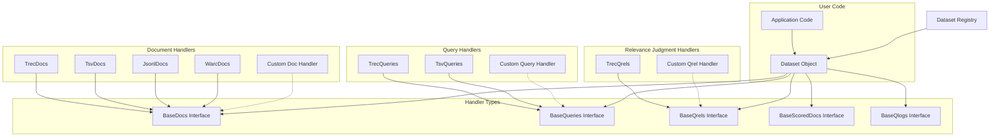

Sources: [ir_datasets/formats/trec.py:13-535]()

## Handler Base Interfaces

All custom data handlers in ir_datasets derive from a set of base interfaces that define the standard methods each handler must implement. These base interfaces ensure consistency across different handlers.

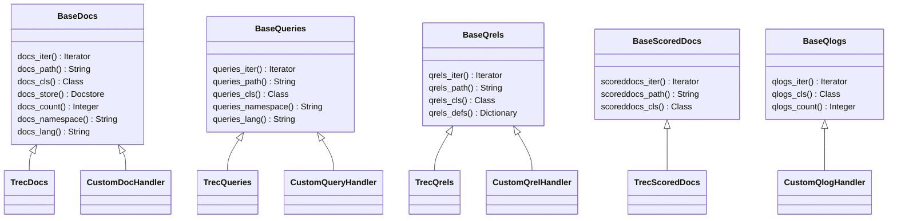

Sources: [ir_datasets/formats/trec.py:13-535]()

## Implementing Custom Document Handlers

Document handlers are responsible for parsing document collections in specific formats. To create a custom document handler, you need to implement the `BaseDocs` interface.

### Required Methods for Document Handlers

To implement a custom document handler, you must implement the following methods:

1. `docs_iter()`: Returns an iterator over document objects
2. `docs_path()`: Returns the path to the document source
3. `docs_cls()`: Returns the document class (namedtuple) that defines the document structure
4. `docs_store()` (optional): Returns a document store for random access to documents

Here's an example of implementing a custom document handler:

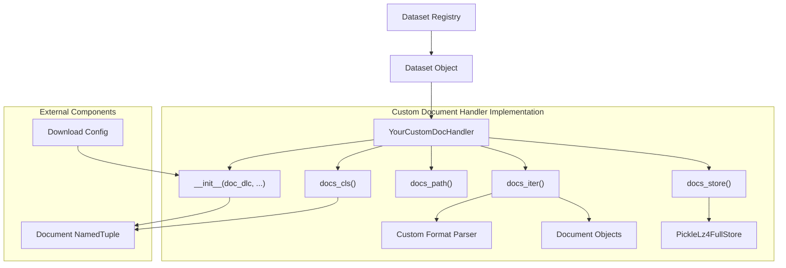

Sources: [ir_datasets/formats/trec.py:86-283]()

### Example: TripClick Custom Document Handler

The TripClick dataset uses a custom document handler to fix problems with its document collection format:

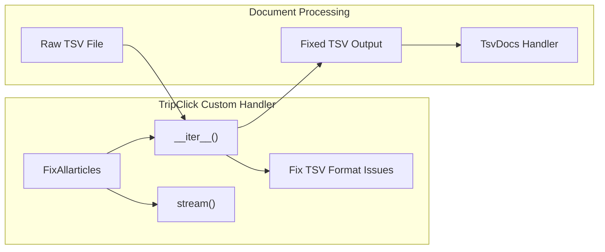

Sources: [ir_datasets/datasets/tripclick.py:195-238]()

## Implementing Custom Query Handlers

Query handlers parse and standardize queries from various formats. To create a custom query handler, you need to implement the `BaseQueries` interface.

### Required Methods for Query Handlers

To implement a custom query handler, you must implement these methods:

1. `queries_iter()`: Returns an iterator over query objects
2. `queries_path()`: Returns the path to the query source
3. `queries_cls()`: Returns the query class (namedtuple) that defines the query structure

### Example: Combining Multiple Query Sources

Sometimes you may need to combine queries from multiple sources. Here's an example from the TripClick dataset:

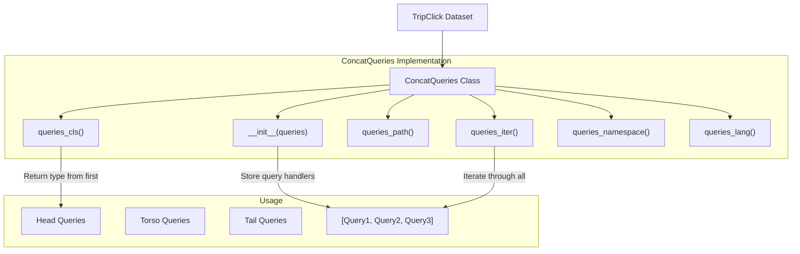

Sources: [ir_datasets/datasets/tripclick.py:41-59]()

## Implementing Custom Relevance Judgment Handlers

Relevance judgment (qrels) handlers process assessments of document relevance to queries. To create a custom qrels handler, implement the `BaseQrels` interface.

### Required Methods for Qrels Handlers

To implement a custom qrels handler, you must implement these methods:

1. `qrels_iter()`: Returns an iterator over qrel objects
2. `qrels_path()`: Returns the path to the qrels source
3. `qrels_cls()`: Returns the qrels class (namedtuple) that defines the qrel structure
4. `qrels_defs()`: Returns a dictionary defining relevance grades

### Example: Specialized Relevance Judgment Format

The TripClick dataset uses specialized relevance judgments based on clicks:

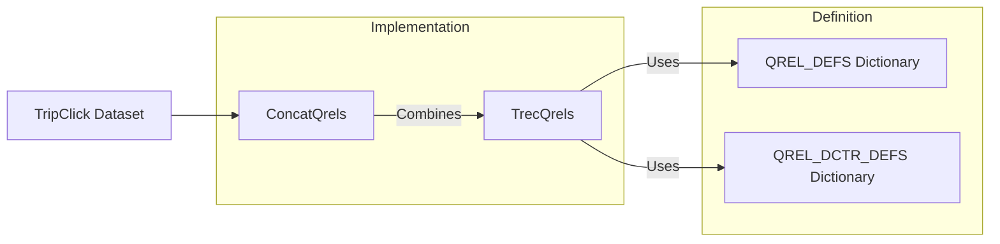

Sources: [ir_datasets/datasets/tripclick.py:21-31](), [ir_datasets/datasets/tripclick.py:62-77]()

## Query Log Handlers

Query logs capture user interactions with search systems. They require specialized handlers that implement the `BaseQlogs` interface.

### Required Methods for Qlog Handlers

To implement a custom query log handler, you must implement these methods:

1. `qlogs_iter()`: Returns an iterator over qlog objects
2. `qlogs_cls()`: Returns the qlog class (namedtuple) that defines the query log structure
3. `qlogs_count()` (optional): Returns the number of qlogs

### Example: AOL Query Log Handler

The AOL dataset implements a custom query log handler:

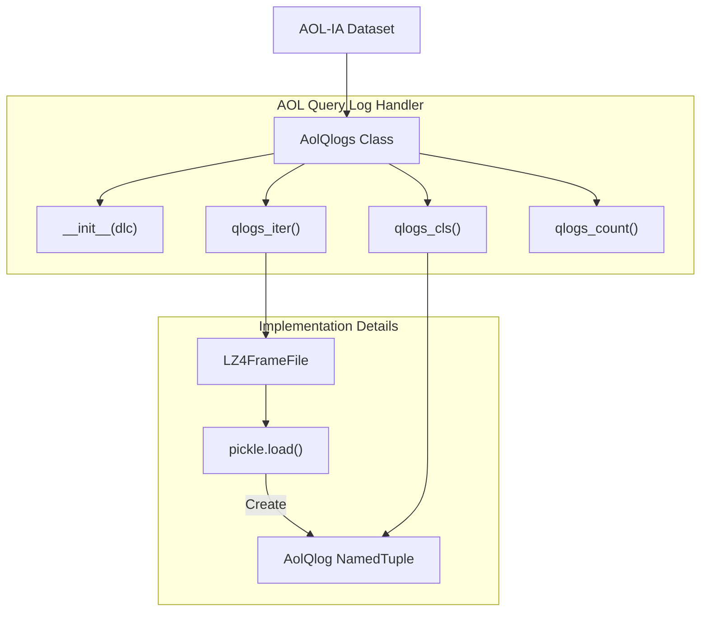

Sources: [ir_datasets/datasets/aol_ia.py:53-72]()

## Content Processing Handlers

Sometimes you need to process or transform the content of documents. The ir_datasets library provides wrappers for this purpose, such as the HTML content extractor.

### Example: HTML Document Extractor

The `HtmlDocExtractor` wrapper processes HTML documents and extracts their text content:

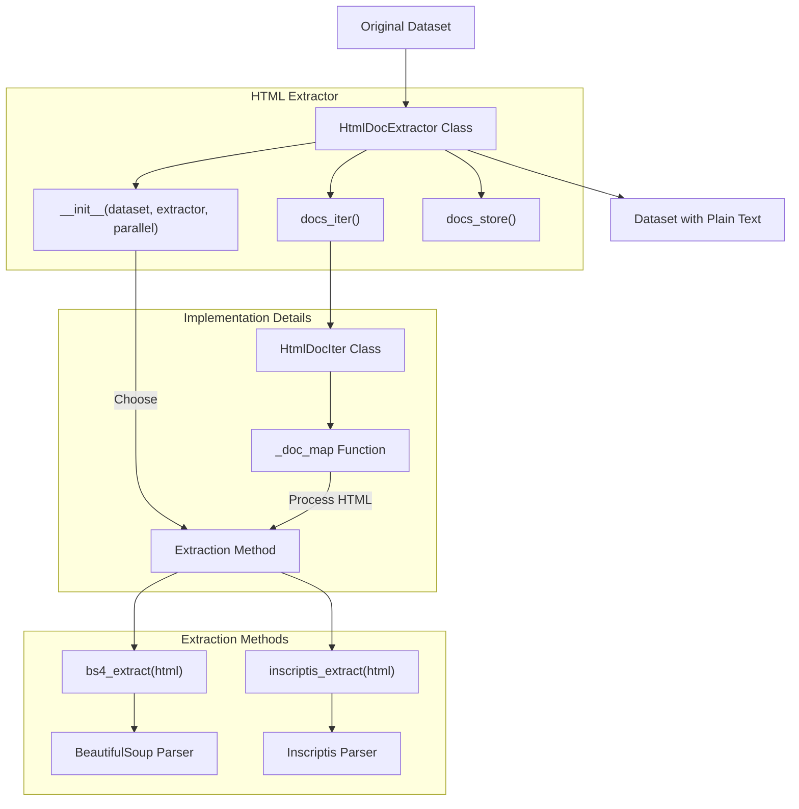

Sources: [ir_datasets/wrappers/html_extractor.py:1-139]()

## Best Practices for Custom Handlers

Here are some best practices to follow when implementing custom data handlers:

1. **Lazy Loading**: Use the `lazy_libs` module to defer loading heavy dependencies until they're needed:

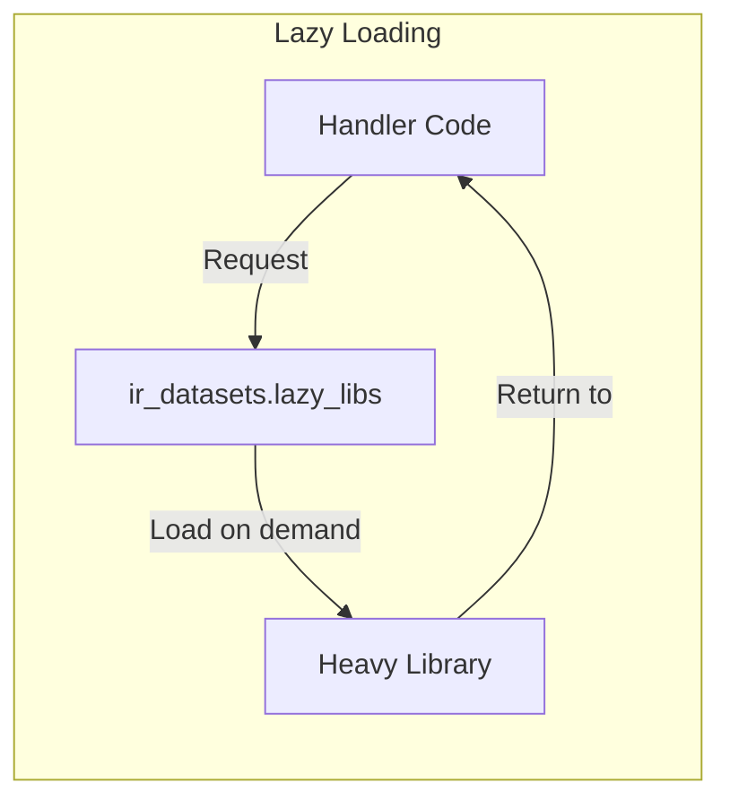

Sources: [ir_datasets/lazy_libs.py:1-131](), [ir_datasets/formats/trec.py:172-172]()

2. **Error Handling**: Implement robust error handling for file parsing:

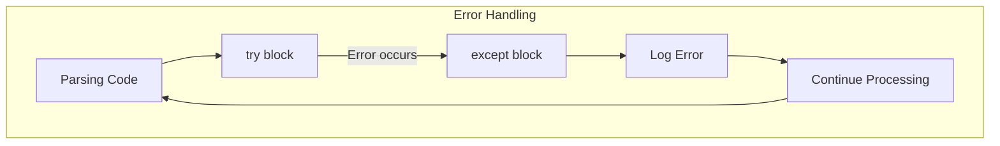

3. **Progress Reporting**: Use the built-in progress bar for long-running operations:

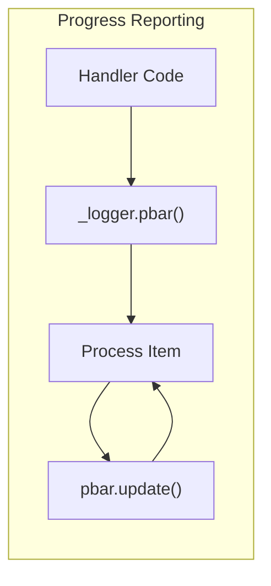

Sources: [ir_datasets/datasets/tripclick.py:162-163]()

4. **Memory Efficiency**: Implement streaming where possible to minimize memory usage:

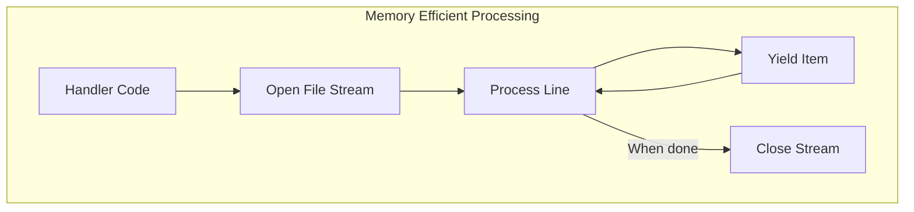

## Integrating Custom Handlers with Datasets

To integrate your custom handler with a dataset, you include it when constructing the Dataset object:

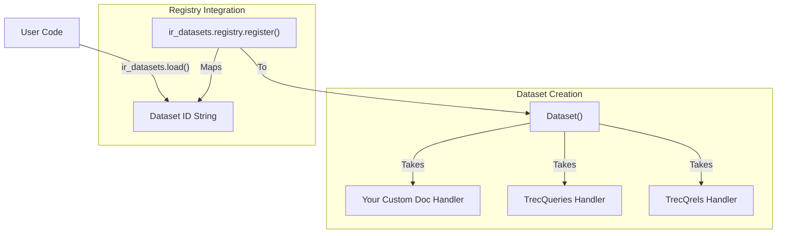

Sources: [ir_datasets/datasets/tripclick.py:251-305](), [ir_datasets/datasets/aol_ia.py:200-205]()

## Summary

Custom data handlers in ir_datasets allow you to integrate specialized dataset formats into the standardized framework. By implementing the appropriate base interfaces (`BaseDocs`, `BaseQueries`, `BaseQrels`, `BaseScoredDocs`, or `BaseQlogs`), you can create handlers that process your specific data formats while providing a consistent interface to users.

When implementing custom handlers, follow the best practices for lazy loading, error handling, progress reporting, and memory efficiency to ensure your handler works well within the ir_datasets ecosystem.

---

