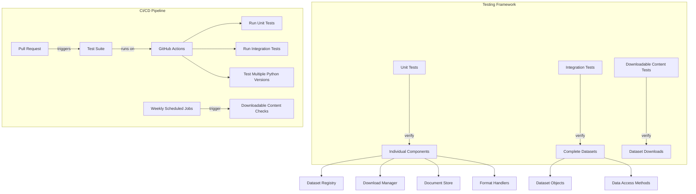
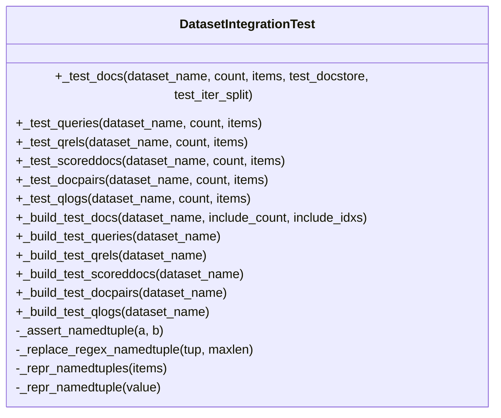
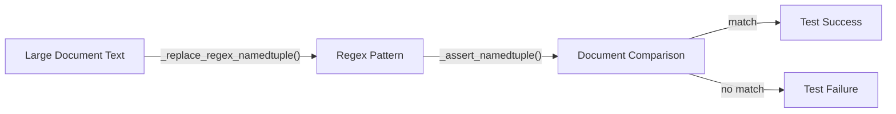
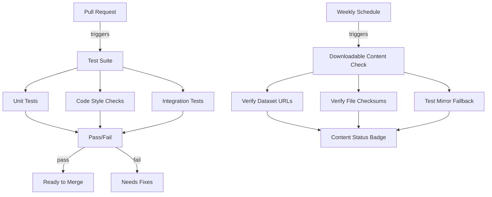

<!-- source: DeepWiki mcp.deepwiki.com · repo allenai/ir_datasets · page 5.3 Testing and CI/CD · fetched 2026-10-26 -->

# Testing and CI/CD

<details>
<summary>Relevant source files</summary>

The following files were used as context for generating this wiki page:

- [README.md](README.md)
- [ir_datasets/datasets/trec_cast.py](ir_datasets/datasets/trec_cast.py)
- [ir_datasets/datasets/wapo.py](ir_datasets/datasets/wapo.py)
- [test/integration/base.py](test/integration/base.py)

</details>


This page documents the testing framework and continuous integration/continuous deployment (CI/CD) processes for the ir_datasets library. It covers how tests are organized, how they can be run and extended, and how the CI/CD pipeline ensures code quality and reliability. For information about adding new datasets, see [Adding New Datasets](#5.1).

## Overview of the Testing Framework

The ir_datasets library employs a comprehensive testing strategy to ensure that all components work correctly across various datasets. Testing is particularly important for ir_datasets because:

1. It needs to handle many different dataset formats consistently
2. It must correctly download and process potentially large files
3. It must maintain backward compatibility for existing datasets
4. It needs to ensure data integrity across different environments



Sources: [README.md:46-46](), [README.md:72-73]()

## Integration Tests

The core of ir_datasets' testing framework is its integration tests, which verify that each dataset can be correctly loaded, and that its components (documents, queries, relevance judgments) can be accessed correctly.

### DatasetIntegrationTest Class

The `DatasetIntegrationTest` class in [test/integration/base.py]() provides the foundation for testing datasets. It extends Python's `unittest.TestCase` and provides methods for testing various components of datasets.



Sources: [test/integration/base.py:9-311]()

### Testing Dataset Components

The test methods follow a consistent pattern:

1. Load the dataset by name
2. Iterate through the component (docs, queries, etc.)
3. Verify that specific items match expected values
4. Verify that the total count matches the expected count

For example, testing documents:

```python
def _test_docs(self, dataset_name, count=None, items=None, test_docstore=True, test_iter_split=True):
    # Test documents iteration
    # Test document store access
    # Test document slicing and indexing
```

Sources: [test/integration/base.py:10-41]()

### Test Case Generation

The `_build_test_*` methods generate test cases for specific datasets, making it easier to create comprehensive tests for new datasets:

```python
def _build_test_docs(self, dataset_name, include_count=True, include_idxs=(0, 9)):
    # Generate test case code for documents in a dataset
```

Sources: [test/integration/base.py:137-155]()

## Special Test Utilities

### Handling Large Documents with Regex

For documents with large text fields, the testing framework uses regular expressions to create more concise test cases:



This approach creates a regex pattern that matches the beginning and end of large text fields, avoiding the need to include the entire text in test cases.

Sources: [test/integration/base.py:268-285]()

### NamedTuple Comparison

The `_assert_namedtuple` method provides a flexible comparison of NamedTuple objects, which are the primary data structures for documents, queries, and other dataset components:

```python
def _assert_namedtuple(self, a, b):
    # Compare two named tuples, allowing for regex matching
```

Sources: [test/integration/base.py:249-266]()

## CI/CD Pipeline

The ir_datasets project uses GitHub Actions for continuous integration and deployment, ensuring code quality and functionality across environments.

### GitHub Actions Workflows

The primary workflows include:

1. **Pull Request Tests**: Run when PRs are created or updated
   - Unit tests
   - Integration tests
   - Code style checks

2. **Downloadable Content Verification**: Run weekly to ensure dataset sources are available
   - Verifies URLs in downloads.json
   - Checks MD5 checksums
   - Tests the fallback to mirror.ir-datasets.com



Sources: [README.md:72-76]()

### Python Version Compatibility

Tests are run against multiple Python versions to ensure compatibility:

- Python 3.7 (minimum supported version)
- Python 3.8
- Python 3.9
- Python 3.10

Sources: [README.md:46-46]()

## Writing Tests for New Datasets

When adding a new dataset to ir_datasets, it's important to include tests to ensure proper functionality. This section outlines how to create effective tests for new datasets.

### Creating Integration Tests

For a new dataset, you should create integration tests that verify:

1. Documents can be loaded and accessed
2. Queries are correctly formatted
3. Relevance judgments (if present) are accessible
4. Other components (scored documents, query logs, document pairs) work as expected

Use the test building functions to generate test cases:

```python
# Example of building test cases for a new dataset
def test_my_dataset(self):
    self._build_test_docs("my-dataset")
    self._build_test_queries("my-dataset")
    self._build_test_qrels("my-dataset")
```

Sources: [test/integration/base.py:137-155](), [test/integration/base.py:160-171](), [test/integration/base.py:173-187]()

### Test Organization

Tests are typically organized by dataset collection. For new datasets, consider adding tests to an existing collection file or creating a new one if the dataset belongs to a new collection.

Here's the typical structure of an integration test for a dataset:

```python
class MyDatasetTest(DatasetIntegrationTest):
    def test_docs(self):
        self._test_docs("my-dataset", count=1000, items={
            0: GenericDoc(doc_id="1", text="document text"),
            9: GenericDoc(doc_id="10", text="another document"),
            999: GenericDoc(doc_id="1000", text="last document"),
        })
        
    def test_queries(self):
        self._test_queries("my-dataset", count=50, items={
            0: GenericQuery(query_id="q1", text="query text"),
            49: GenericQuery(query_id="q50", text="last query"),
        })
```

## Running Tests

### Running Integration Tests

Integration tests can be run using Python's unittest framework:

```bash
# Run all integration tests
python -m unittest discover test/integration

# Run tests for a specific dataset
python -m unittest test.integration.test_msmarco
```

### Running Tests During Development

When making changes to ir_datasets, it's important to run relevant tests to ensure functionality is maintained:

1. For changes to dataset-specific code, run the integration tests for that dataset
2. For changes to core components, run all tests to ensure no regressions are introduced
3. For new datasets, create and run tests that verify all components

## Continuous Integration Best Practices

When contributing to ir_datasets, follow these best practices to ensure your code passes CI checks:

1. Run tests locally before creating a pull request
2. Add tests for new functionality or datasets
3. Ensure code follows the project's style guidelines
4. Update documentation for user-facing changes
5. Test with multiple Python versions if possible (at least the minimum supported version)

Sources: [README.md:17-18]()

## Weekly Verification of Downloadable Content

A key aspect of ir_datasets' reliability is its ability to download and verify dataset files. A weekly CI job checks all downloadable content to ensure:

1. URLs are accessible
2. File checksums match expected values
3. Mirror fallbacks work when primary sources are unavailable

The status of this check is displayed as a badge in the project README. This provides confidence that datasets will be accessible when needed.

Sources: [README.md:72-75]()