# Page: Introduction to IR Datasets

# Introduction to IR Datasets

<details>
<summary>Relevant source files</summary>

The following files were used as context for generating this wiki page:

- [README.md](README.md)
- [ir_datasets/datasets/__init__.py](ir_datasets/datasets/__init__.py)
- [ir_datasets/docs/bibliography.bib](ir_datasets/docs/bibliography.bib)
- [ir_datasets/etc/downloads.json](ir_datasets/etc/downloads.json)
- [ir_datasets/etc/metadata.json](ir_datasets/etc/metadata.json)
- [ir_datasets/formats/__init__.py](ir_datasets/formats/__init__.py)

</details>


This document provides an overview of the `ir_datasets` library, a Python package designed to simplify access to information retrieval (IR) datasets for research and evaluation. It explains the core concepts, architecture, and usage patterns of the system. For detailed API documentation, see [Python API](#3.3), and for information on extending the library with new datasets, see [Extending IR Datasets](#5).

## Purpose and Scope

`ir_datasets` addresses a common challenge in information retrieval research: accessing and managing diverse datasets in a consistent way. The library provides:

1. A unified interface for accessing documents, queries, and relevance judgments
2. Automatic downloading and verification of publicly available datasets
3. Instructions for obtaining datasets that require licenses
4. Standardized data formats across different collection types
5. Efficient document lookup capabilities
6. Support for both small and large-scale collections

Sources: [README.md:3-13]()

## System Architecture Overview

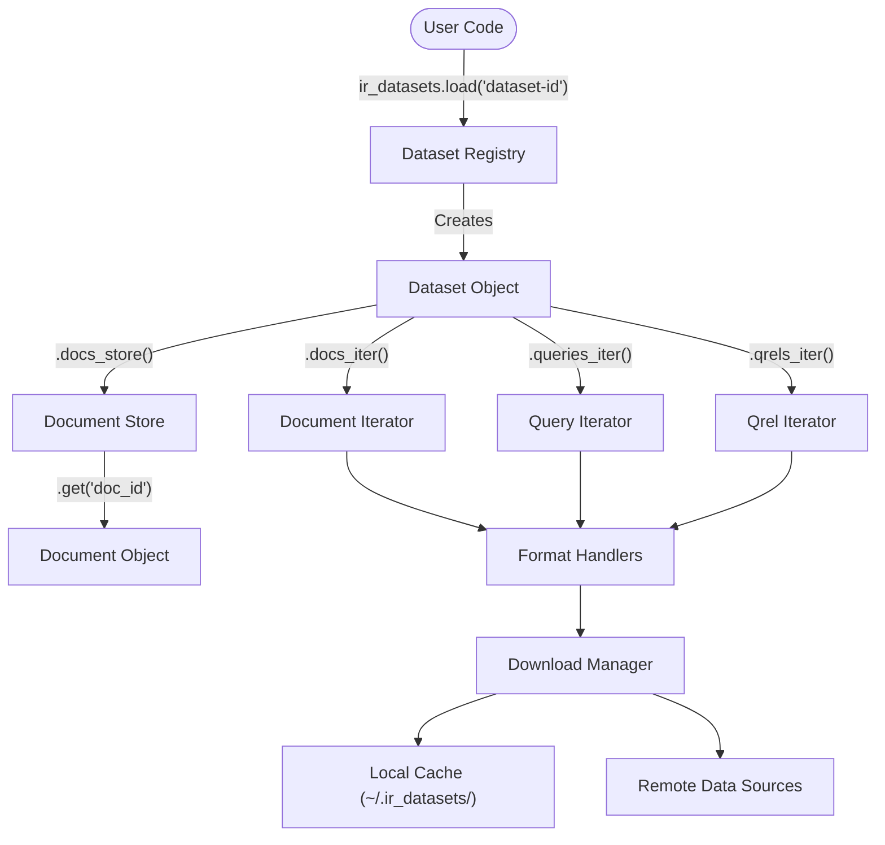

**High-Level System Architecture**

The architecture revolves around a central registry that maps dataset identifiers to dataset implementation objects. Users access datasets through a common interface regardless of the underlying data format or source. The system handles downloading, caching, and format conversion automatically.

Sources: [README.md:50-68](), [ir_datasets/datasets/__init__.py:1-58]()

## Data Model and Components

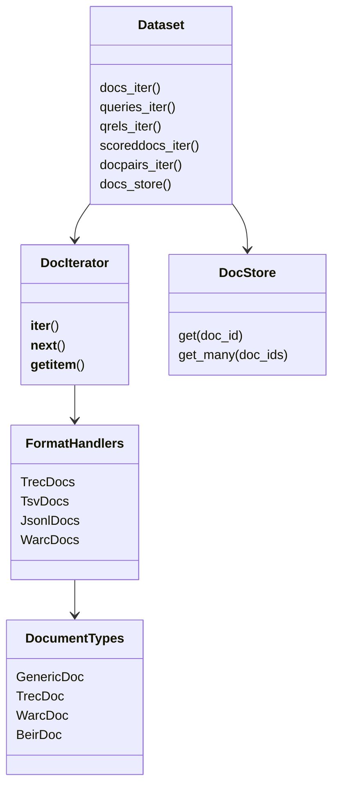

**Core Data Model Components**

`ir_datasets` uses a consistent data model across all datasets. The key components include:

1. **Documents**: Text items to be retrieved, with a unique `doc_id` and content
2. **Queries**: Search expressions with a unique `query_id` and text
3. **Relevance Judgments (qrels)**: Annotations indicating relevance between queries and documents
4. **Scored Documents**: Documents with relevance scores from a retrieval system
5. **Document Pairs**: Pairs of documents with a specific relationship

Each component is represented by standardized data classes regardless of the original format.

Sources: [ir_datasets/formats/__init__.py:1-14]()

## Getting Started with IR Datasets

The primary way to access datasets is through the `load()` function:

```python
import ir_datasets
dataset = ir_datasets.load('msmarco-passage')

# Iterate through documents
for doc in dataset.docs_iter():
    print(doc.doc_id, doc.text)

# Get a specific document
docstore = dataset.docs_store()
document = docstore.get('1')
```

The same datasets can also be accessed through the command-line interface:

```bash
ir_datasets export msmarco-passage docs | head -n2
```

Sources: [README.md:26-68]()

## Dataset Access and Download System

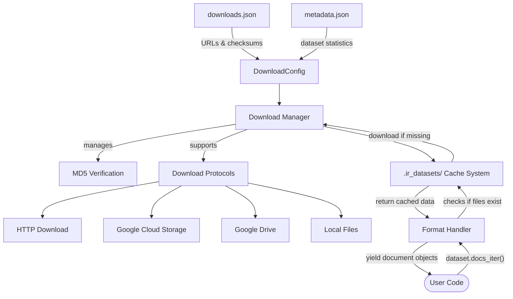

**Dataset Download and Cache System**

When you request a dataset component, `ir_datasets`:

1. Checks if the required files exist in the local cache (`~/.ir_datasets/`)
2. If not, downloads them from the source defined in `downloads.json`
3. Verifies the integrity using MD5 checksums
4. For non-public datasets, provides instructions on how to obtain them

The system is designed to handle this process automatically, so users don't need to manually download or manage dataset files.

Sources: [ir_datasets/etc/downloads.json:1-924](), [README.md:70-76]()

## Available Datasets

`ir_datasets` provides access to a diverse collection of datasets:

| Category | Examples |
|----------|----------|
| Web Collections | ClueWeb09, ClueWeb12, GOV2 |
| Passage Collections | MS MARCO Passage, BEIR, DPR-W100 |
| Document Collections | MS MARCO Document, TREC Robust04, Washington Post |
| Specialized Collections | CORD-19, TripClick, TREC-CAST, NeuCLIR |

Datasets are organized hierarchically. For example, `clueweb12/b13/trec-misinfo-2019` provides the queries and judgments from the 2019 TREC misinformation track based on the ClueWeb12 Category B13 document collection.

Sources: [README.md:154-193](), [ir_datasets/datasets/__init__.py:1-58]()

## Key Features

1. **Format Standardization**: Normalizes different data formats into consistent Python objects
2. **Efficient Document Access**: Implements specialized document stores for fast lookup
3. **Dataset Slicing**: Supports advanced slicing operations for parallel processing
4. **Issue Correction**: Automatically fixes known issues in datasets (e.g., encoding problems)
5. **Lazy Loading**: Only loads and processes data when actually needed
6. **Download Management**: Handles file acquisition, verification, and caching

The combination of these features makes `ir_datasets` a valuable tool for information retrieval research, enabling researchers to focus on their experiments rather than data wrangling.

Sources: [README.md:48-152]()

## Conclusion

`ir_datasets` simplifies working with information retrieval datasets by providing a unified interface, handling data acquisition, and standardizing formats. Whether you're working with web collections, passage ranking, or specialized datasets, the library offers a consistent way to access and utilize the data for research and evaluation.

For more detailed information on specific aspects of the system, refer to the other sections of this documentation.

---

# Page: Core Architecture

# Core Architecture

<details>
<summary>Relevant source files</summary>

The following files were used as context for generating this wiki page:

- [.github/workflows/deploy.yml](.github/workflows/deploy.yml)
- [.github/workflows/test.yml](.github/workflows/test.yml)
- [ir_datasets/__init__.py](ir_datasets/__init__.py)
- [ir_datasets/datasets/__init__.py](ir_datasets/datasets/__init__.py)
- [ir_datasets/datasets/base.py](ir_datasets/datasets/base.py)
- [ir_datasets/docs/bibliography.bib](ir_datasets/docs/bibliography.bib)
- [ir_datasets/docs/trec-cast.yaml](ir_datasets/docs/trec-cast.yaml)
- [ir_datasets/etc/downloads.json](ir_datasets/etc/downloads.json)
- [ir_datasets/etc/metadata.json](ir_datasets/etc/metadata.json)
- [ir_datasets/formats/__init__.py](ir_datasets/formats/__init__.py)
- [ir_datasets/util/metadata.py](ir_datasets/util/metadata.py)
- [test/integration/trec_cast.py](test/integration/trec_cast.py)
- [test/util.py](test/util.py)

</details>


This document explains the fundamental design principles and architecture of the ir_datasets system, which provides a standardized interface for accessing and working with information retrieval datasets. For detailed information about installing and using the system, see [Installation and Configuration](#3.1) and [Python API](#3.3).

## System Overview

IR Datasets is designed around core principles of standardization, efficient data access, and transparent resource management. The system provides a unified interface to access a diverse collection of IR datasets through a consistent API, regardless of their original format or storage mechanism.

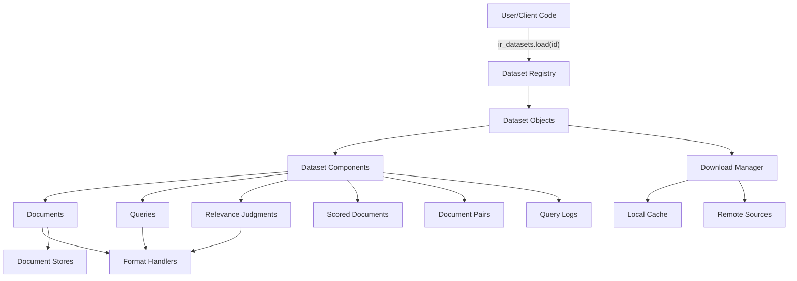

Sources: [ir_datasets/__init__.py](https://github.com/allenai/ir_datasets/blob/master/ir_datasets/__init__.py), [ir_datasets/datasets/base.py](https://github.com/allenai/ir_datasets/blob/master/ir_datasets/datasets/base.py)

## Entity Types

The system defines several fundamental entity types that represent different kinds of data within information retrieval datasets:

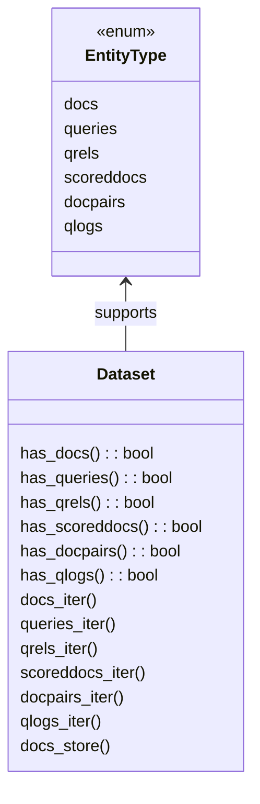

These entity types are defined in the `EntityType` enum in [ir_datasets/__init__.py:2-8](https://github.com/allenai/ir_datasets/blob/master/ir_datasets/__init__.py#L2-L8) and represent:

- **docs**: The corpus documents to be retrieved
- **queries**: Information needs expressed as text
- **qrels**: Relevance judgments connecting queries to documents
- **scoreddocs**: Documents with their retrieval scores
- **docpairs**: Pairs of documents (e.g., for learning-to-rank)
- **qlogs**: Query logs (e.g., from search engines)

Sources: [ir_datasets/__init__.py:2-8](https://github.com/allenai/ir_datasets/blob/master/ir_datasets/__init__.py#L2-L8)

## Dataset Registry

The dataset registry is the central entry point for accessing datasets. It maps dataset identifiers (strings) to dataset objects and is initialized and populated at startup.

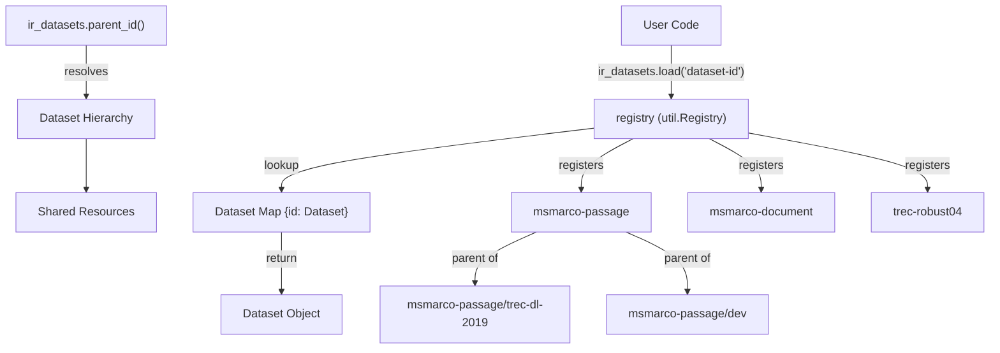

The registry is created using `util.Registry()` in [ir_datasets/__init__.py:13](https://github.com/allenai/ir_datasets/blob/master/ir_datasets/__init__.py#L13) and datasets are loaded with:

```python
def load(name):
    return registry[name]
```

Dataset identifiers use a hierarchical structure (e.g., "msmarco-passage/trec-dl-2019/judged"), where:
- The first component often identifies the document collection ("msmarco-passage")
- Subsequent components identify specific subsets or tasks ("trec-dl-2019/judged")

The `parent_id` function [ir_datasets/__init__.py:25-48](https://github.com/allenai/ir_datasets/blob/master/ir_datasets/__init__.py#L25-L48) resolves the relationship between datasets and their parent collections, which is useful for sharing resources like document stores or indices.

Sources: [ir_datasets/__init__.py:13](https://github.com/allenai/ir_datasets/blob/master/ir_datasets/__init__.py#L13), [ir_datasets/__init__.py:21-22](https://github.com/allenai/ir_datasets/blob/master/ir_datasets/__init__.py#L21-22), [ir_datasets/__init__.py:25-48](https://github.com/allenai/ir_datasets/blob/master/ir_datasets/__init__.py#L25-48)

## Dataset Class

The `Dataset` class is the core class that provides access to the various entity types:

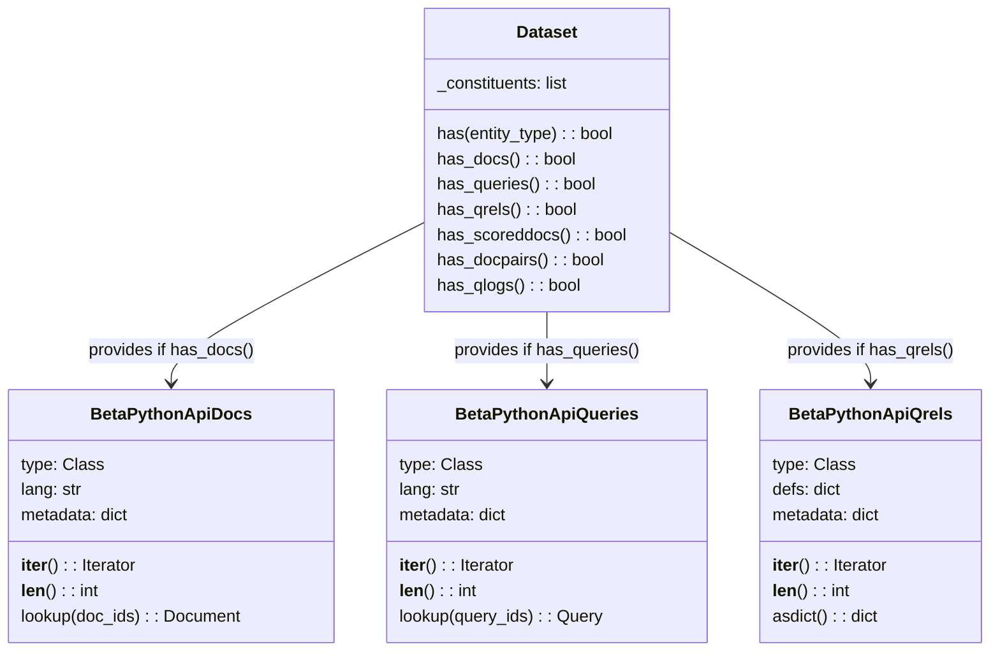

Datasets are composed of various "constituents" that provide the implementation for accessing different entity types. When a dataset attribute like `docs`, `queries`, or `qrels` is accessed, the system returns a Python API object that provides convenient methods for working with that entity type.

Sources: [ir_datasets/datasets/base.py:12-97](https://github.com/allenai/ir_datasets/blob/master/ir_datasets/datasets/base.py#L12-L97)

## Format Handlers

IR Datasets supports a variety of dataset formats through specialized format handlers defined in the formats module:

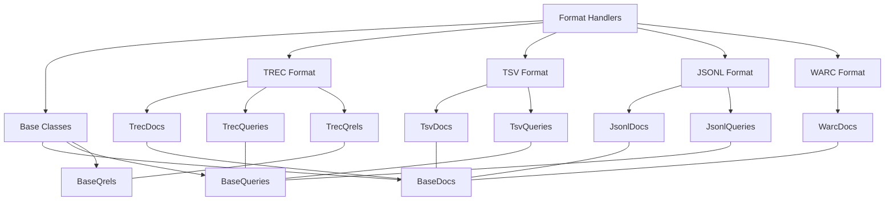

These format handlers parse the raw dataset files and convert them into standardized objects that conform to the IR Datasets data model. Common formats include:

- **TREC Format**: Standard formats used in TREC competitions (TrecDocs, TrecQueries, TrecQrels)
- **TSV Format**: Tab-separated value files (TsvDocs, TsvQueries)
- **JSONL Format**: Line-delimited JSON files (JsonlDocs, JsonlQueries)
- **WARC Format**: Web ARChive format for web pages (WarcDocs)

Each format handler implements methods for iterating through the entities in the dataset files.

Sources: [ir_datasets/formats/__init__.py](https://github.com/allenai/ir_datasets/blob/master/ir_datasets/formats/__init__.py)

## Document Storage and Retrieval

IR Datasets provides efficient document storage and retrieval through a variety of document store implementations:

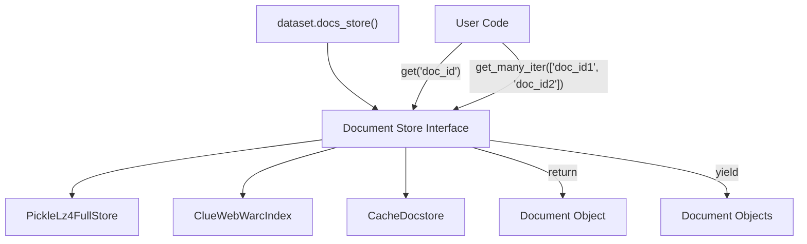

The document stores provide fast random access to documents by ID, which is essential for tasks like reranking or evaluation. This avoids the need to scan through the entire collection when only specific documents are needed.

The `docs_store()` method builds or loads an appropriate document store based on the dataset type, with implementations optimized for different collection sizes and formats.

## Download and Caching System

IR Datasets manages dataset files through a download and caching system:

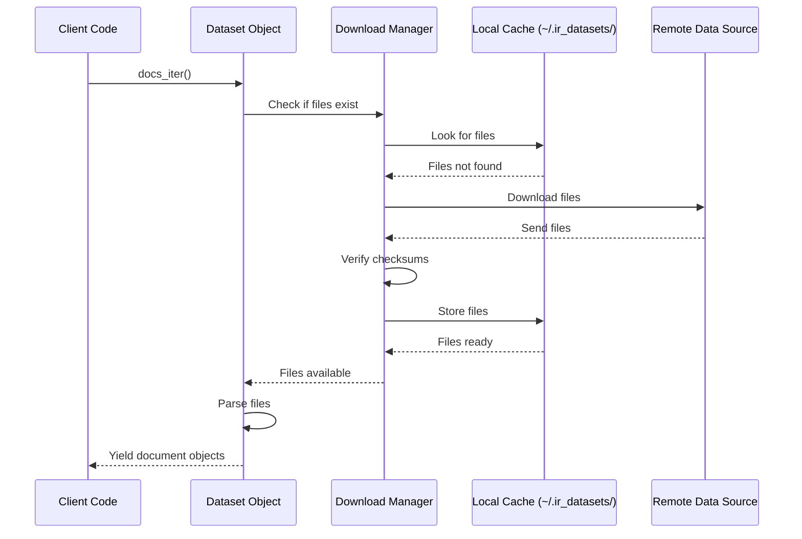

The download system uses configuration from [ir_datasets/etc/downloads.json](https://github.com/allenai/ir_datasets/blob/master/ir_datasets/etc/downloads.json), which specifies:

- URLs for dataset files
- Expected file sizes and MD5 checksums
- Local cache paths

Files are downloaded only when needed, verified for integrity using MD5 checksums, and stored in a local cache (typically `~/.ir_datasets/`). This ensures that users don't need to manually download and manage large datasets.

Sources: [ir_datasets/etc/downloads.json](https://github.com/allenai/ir_datasets/blob/master/ir_datasets/etc/downloads.json)

## Metadata System

IR Datasets includes metadata about each dataset to provide useful information without requiring full dataset processing:

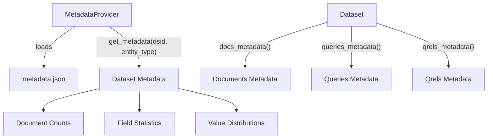

The metadata system is implemented in [ir_datasets/util/metadata.py](https://github.com/allenai/ir_datasets/blob/master/ir_datasets/util/metadata.py) and provides access to dataset statistics like document counts, field lengths, and value distributions without requiring processing of the entire dataset.

Sources: [ir_datasets/etc/metadata.json](https://github.com/allenai/ir_datasets/blob/master/ir_datasets/etc/metadata.json), [ir_datasets/util/metadata.py](https://github.com/allenai/ir_datasets/blob/master/ir_datasets/util/metadata.py)

## Typical Usage Flow

The typical interaction with IR Datasets follows this pattern:

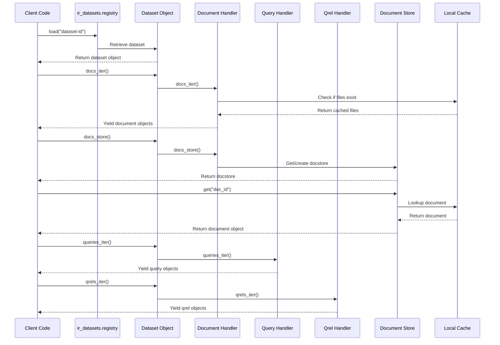

This architecture provides a seamless experience for users, handling all the complexities of dataset management behind a simple and consistent interface.

## Lazy Loading Design

IR Datasets uses a lazy loading approach for many components:

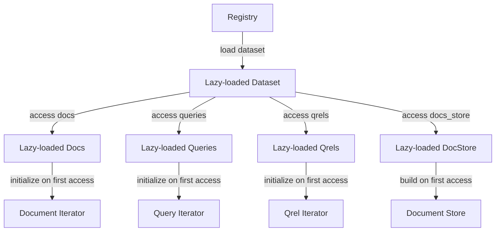

Resources are only loaded when actually needed, which helps with memory efficiency and startup time. This design is particularly important for handling large datasets, as it ensures that users only pay the cost for the specific resources they're using.

## Summary

The core architecture of IR Datasets provides:

1. **Standardized Access**: A consistent API across diverse datasets
2. **Efficient Storage**: Optimized document stores for fast access
3. **Transparent Resource Management**: Automatic downloading and caching
4. **Format Abstraction**: Support for various dataset formats
5. **Hierarchical Organization**: Parent-child relationships between datasets

This architecture enables researchers and practitioners to focus on their information retrieval tasks rather than data management challenges.

Sources: [ir_datasets/__init__.py](https://github.com/allenai/ir_datasets/blob/master/ir_datasets/__init__.py), [ir_datasets/datasets/base.py](https://github.com/allenai/ir_datasets/blob/master/ir_datasets/datasets/base.py), [ir_datasets/formats/__init__.py](https://github.com/allenai/ir_datasets/blob/master/ir_datasets/formats/__init__.py)

---

# Page: Dataset Registry System

# Dataset Registry System

<details>
<summary>Relevant source files</summary>

The following files were used as context for generating this wiki page:

- [.github/workflows/deploy.yml](.github/workflows/deploy.yml)
- [.github/workflows/test.yml](.github/workflows/test.yml)
- [ir_datasets/__init__.py](ir_datasets/__init__.py)
- [ir_datasets/util/__init__.py](ir_datasets/util/__init__.py)
- [ir_datasets/util/download.py](ir_datasets/util/download.py)
- [ir_datasets/util/fileio.py](ir_datasets/util/fileio.py)
- [ir_datasets/util/registry.py](ir_datasets/util/registry.py)
- [test/downloads.py](test/downloads.py)
- [test/util.py](test/util.py)

</details>


The Dataset Registry System is the central component of ir_datasets that manages access to all available datasets. This system provides a lookup mechanism for dataset identifiers, handles hierarchical dataset relationships, and enables dynamic dataset creation through pattern matching. This document explains how the registry works, its API, and how it interacts with other components of ir_datasets.

For information about the structure of dataset objects themselves, see [Data Model](#2.2). For details on how datasets are downloaded and cached, see [Download and Caching System](#2.3).

## Overview

The registry system provides a unified interface for accessing various information retrieval datasets through standardized identifiers. It allows users to load datasets using simple string identifiers, while abstracting away the complexities of dataset location, format, and loading.

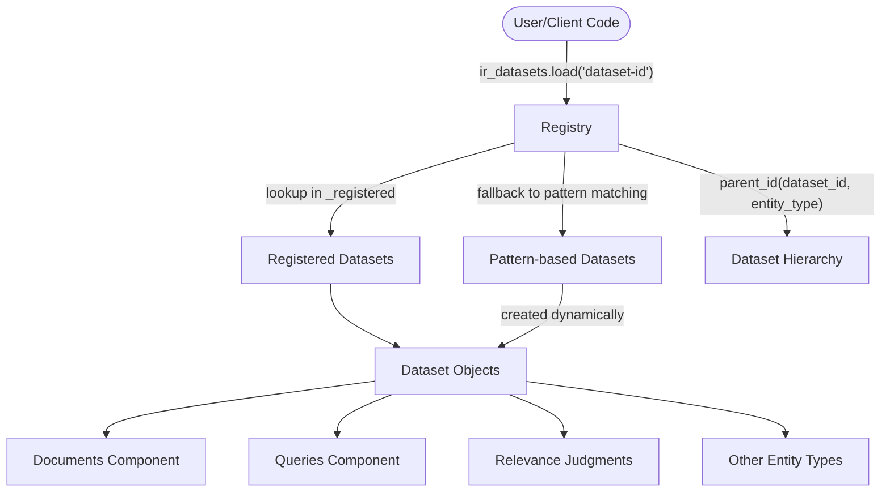

Sources: [ir_datasets/util/registry.py:11-47](), [ir_datasets/__init__.py:13-24]()

## Registry Implementation

The Registry class is a dictionary-like container that maps dataset identifiers to their corresponding dataset objects. The registry also supports pattern-based dataset creation for dynamic datasets.

### Core Components

The registry implementation consists of:

1. `Registry` class - A dictionary-like container for datasets
2. The global `registry` instance - Created at module load time
3. `load(name)` function - A convenient wrapper for accessing the registry
4. `EntityType` enum - Defines the types of data components a dataset can have

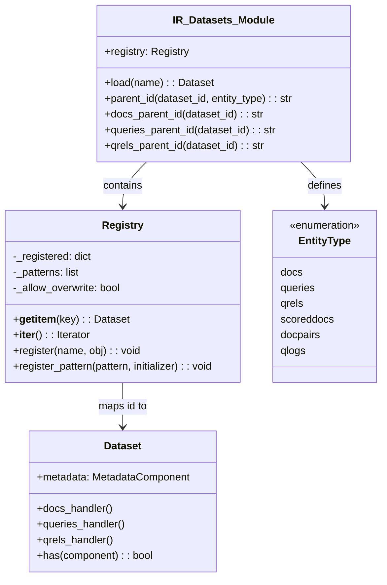

Sources: [ir_datasets/util/registry.py:11-47](), [ir_datasets/__init__.py:2-73]()

### Registry Initialization

The registry is initialized as a global variable in the ir_datasets module:

```python
registry = util.Registry()
```

This single registry instance is used throughout the library to register and look up datasets.

Sources: [ir_datasets/__init__.py:13]()

## Dataset Loading Process

When a user calls `ir_datasets.load("dataset-id")`, the following sequence of operations occurs:

```mermaid
sequenceDiagram
    participant User as Client Code
    participant Load as ir_datasets.load
    participant Registry as ir_datasets.registry
    participant Patterns as Pattern Matching
    participant Dataset as Dataset Object
    
    User->>Load: load("dataset-id")
    Load->>Registry: registry["dataset-id"]
    
    alt Dataset directly registered
        Registry-->>Load: return registered dataset
    else Dataset not directly registered
        Registry->>Patterns: Check patterns
        loop Through each pattern
            Patterns->>Patterns: pattern.match(key)
            alt Pattern matches
                Patterns->>Patterns: initializer(key, match.groups())
                Patterns->>Registry: register(key, dataset)
                Patterns-->>Registry: Dataset object
                break
            end
        end
        Registry-->>Load: return dataset or KeyError
    end
    
    Load-->>User: return dataset
    
    Note over Registry,Patterns: If dataset has a "deprecated" attribute,<br>a warning will be displayed
```

Sources: [ir_datasets/__init__.py:21-22](), [ir_datasets/util/registry.py:17-29]()

## Dataset Hierarchy and Parent IDs

IR Datasets supports hierarchical dataset identifiers (e.g., "msmarco-document/trec-dl-2019/judged"). The registry includes functionality to navigate this hierarchy using parent ID functions.

### Parent ID Functions

The system provides several functions to find parent dataset IDs that share the same entity handlers:

- `parent_id(dataset_id, entity_type)` - Generic function to find parent ID for any entity type
- `docs_parent_id(dataset_id)` - Find parent ID for documents
- `queries_parent_id(dataset_id)` - Find parent ID for queries
- `qrels_parent_id(dataset_id)` - Find parent ID for relevance judgments

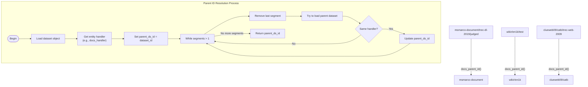

Example results:
- `docs_parent_id("msmarco-document/trec-dl-2019/judged")` → `"msmarco-document"`
- `docs_parent_id("clueweb09/catb/trec-web-2009")` → `"clueweb09/catb"`

Sources: [ir_datasets/__init__.py:25-73]()

## Registry API

The Registry class provides a simple dictionary-like interface with additional functionality for pattern matching.

### Key Methods

| Method | Description |
|--------|-------------|
| `__getitem__(key)` | Retrieves a dataset by ID, using pattern matching if needed |
| `__iter__()` | Iterates through registered dataset IDs |
| `register(name, obj)` | Registers a dataset object with the given name |
| `register_pattern(pattern, initializer)` | Registers a pattern for dynamic dataset creation |

### Pattern Registration

Patterns allow for dynamic dataset creation when a dataset ID matches a particular regular expression:

```python
registry.register_pattern(r'pattern-(\w+)', lambda key, match: create_dataset(match[0]))
```

When a user attempts to load a dataset with an ID that matches the pattern (e.g., "pattern-xyz"), the initializer function is called to create the dataset on demand.

Sources: [ir_datasets/util/registry.py:11-47]()

## Integration with Download System

The Registry System works closely with the Download and Caching System to manage dataset files.

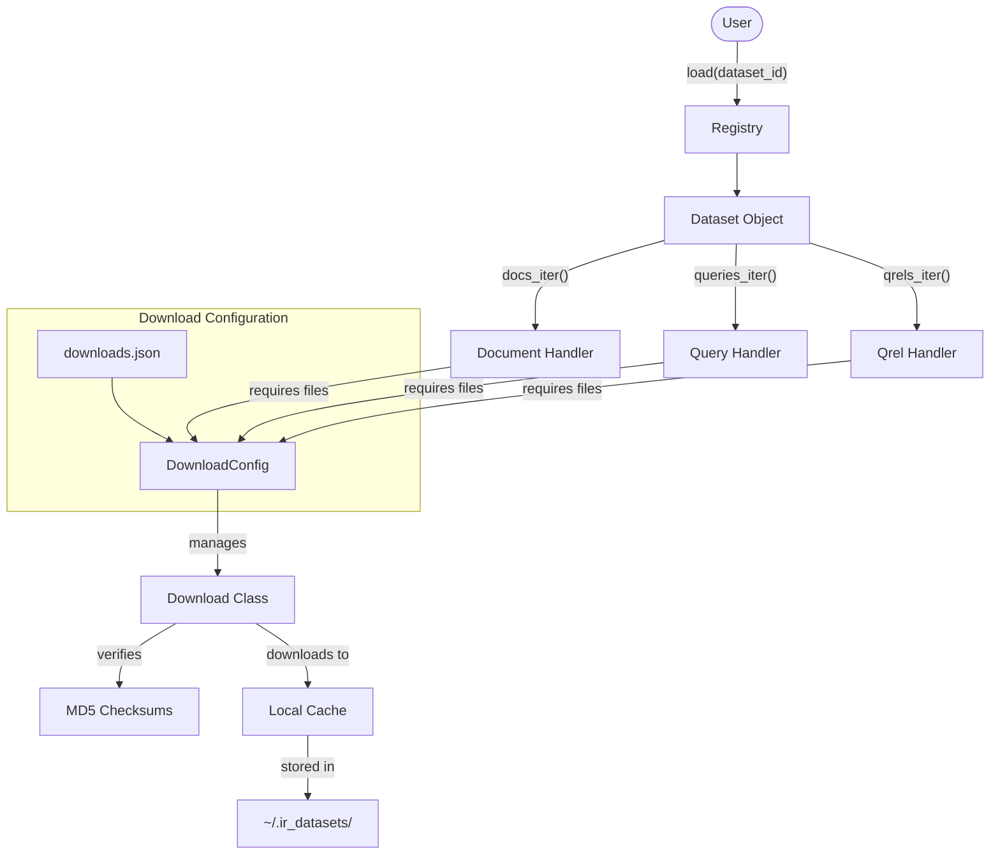

When a dataset component needs to access data files, it uses the Download system to:
1. Check if the files are available in the local cache
2. Download files from remote sources if needed
3. Verify file integrity using MD5 checksums
4. Extract and process the files as needed

Sources: [ir_datasets/util/download.py:222-371]()

## Using the Registry System

### Loading Datasets

To load a dataset:

```python
import ir_datasets
dataset = ir_datasets.load("msmarco-passage")
```

### Finding Parent Datasets

To find the parent dataset for documents:

```python
import ir_datasets
parent_id = ir_datasets.docs_parent_id("msmarco-document/trec-dl-2019/judged")
# Returns "msmarco-document"
```

### Creating Custom Datasets

The registry also provides a utility function to create simple custom datasets:

```python
import ir_datasets
custom_dataset = ir_datasets.create_dataset(
    docs_tsv="path/to/docs.tsv",
    queries_tsv="path/to/queries.tsv",
    qrels_trec="path/to/qrels.txt"
)
```

Sources: [ir_datasets/__init__.py:76-88]()

## System Limitations and Design Considerations

1. The registry does not support removing datasets once registered (unless allow_overwrite=True is set when creating the registry).
2. Parent ID relationships are determined by convention, finding the lowest dataset_id in the hierarchy with the same entity handler.
3. When a deprecated dataset is loaded, a warning message is displayed (unless IR_DATASETS_SKIP_DEPRECATED_WARNING is set).

Sources: [ir_datasets/util/registry.py:11-47](), [ir_datasets/__init__.py:25-34]()

---

# Page: Data Model

# Data Model

<details>
<summary>Relevant source files</summary>

The following files were used as context for generating this wiki page:

- [examples/adding_datasets.ipynb](examples/adding_datasets.ipynb)
- [ir_datasets/commands/build_download_cache.py](ir_datasets/commands/build_download_cache.py)
- [ir_datasets/datasets/dpr_w100.py](ir_datasets/datasets/dpr_w100.py)
- [ir_datasets/formats/trec.py](ir_datasets/formats/trec.py)
- [ir_datasets/formats/tsv.py](ir_datasets/formats/tsv.py)
- [test/integration/dpr_w100.py](test/integration/dpr_w100.py)

</details>


## Purpose and Scope

This document describes the core data model of IR Datasets, explaining how documents, queries, relevance judgments, and other information retrieval components are represented within the system. The data model provides a standardized representation and interface for accessing diverse datasets in a consistent manner.

For information on the dataset registry system that manages dataset identifiers, see [Dataset Registry System](#2.1). For details on the download and caching system, see [Download and Caching System](#2.3).

## Core Entity Types

IR Datasets represents data using strongly-typed immutable data structures implemented as Python `NamedTuple` classes. These entities form the foundation of the data model, providing consistent representations for the primary components of information retrieval datasets.

```mermaid
classDiagram
    class GenericDoc {
        doc_id: str
        text: str
        default_text()
    }
    
    class TrecDoc {
        doc_id: str
        text: str
        marked_up_doc: str
        default_text()
    }
    
    class TitleUrlTextDoc {
        doc_id: str
        title: str
        url: str
        text: str
        default_text()
    }
    
    class TrecParsedDoc {
        doc_id: str
        title: str
        body: str
        marked_up_doc: bytes
        default_text()
    }
    
    class DprW100Doc {
        doc_id: str
        text: str
        title: str
        default_text()
    }
    
    class GenericQuery {
        query_id: str
        text: str
        default_text()
    }
    
    class TrecQuery {
        query_id: str
        title: str
        description: str
        narrative: str
        default_text()
    }
    
    class DprW100Query {
        query_id: str
        text: str
        answers: Tuple[str, ]
        default_text()
    }
    
    class GenericScoredDoc {
        query_id: str
        doc_id: str
        score: float
    }
    
    class TrecQrel {
        query_id: str
        doc_id: str
        relevance: int
        iteration: str
    }
    
    class TrecSubQrel {
        query_id: str
        doc_id: str
        relevance: int
        subtopic_id: str
    }
```

Sources: [ir_datasets/formats/trec.py:16-84](), [ir_datasets/datasets/dpr_w100.py:23-42]()

### Document Representations

Documents are the primary content units in information retrieval. The system supports multiple document representations:

- **GenericDoc**: Simple document with ID and text fields
- **TrecDoc**: TREC-style document with ID, text, and original markup
- **TitleUrlTextDoc**: Document with title, URL, and text fields (commonly used for web pages)
- **TrecParsedDoc**: Document with separate title and body fields, plus original markup
- **DprW100Doc**: Specialized document format for DPR-W100 dataset with title and text

All document types implement a `default_text()` method that provides the standard text representation for the document, which is used for indexing and retrieval purposes.

### Query Representations

Queries represent the information needs that retrieval systems aim to satisfy:

- **GenericQuery**: Simple query with ID and text fields
- **TrecQuery**: TREC-style query with title, description, and narrative fields
- **DprW100Query**: Specialized query format with answers field for question-answering tasks

Like documents, all query types implement a `default_text()` method that provides the standard text representation.

### Relevance Judgments

Relevance judgments (qrels) represent assessments of how relevant a document is to a query:

- **TrecQrel**: Standard TREC-style relevance judgment with query ID, document ID, relevance score, and iteration field
- **TrecSubQrel**: Extended relevance judgment that includes subtopic information
- **TrecPrel**: Partially relevant judgment with additional metadata

## Component Interfaces

The data model defines a set of interfaces that standardize access to collections of entities. These interfaces follow a consistent pattern for accessing data.

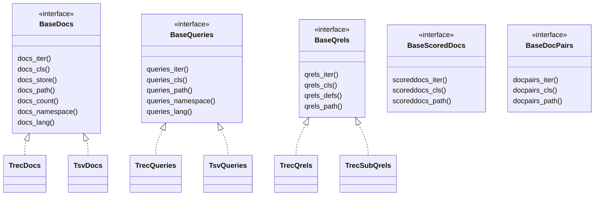

Sources: [ir_datasets/formats/trec.py:86-135](), [ir_datasets/formats/trec.py:286-335](), [ir_datasets/formats/trec.py:419-457]()

### Common Interface Patterns

All component interfaces follow a consistent pattern:

1. `*_iter()` methods that return iterators over the entities
2. `*_cls()` methods that return the class type of the entities
3. `*_path()` methods that return the path to the source data
4. Additional metadata methods like `*_namespace()` and `*_lang()`

This consistent interface allows client code to work with different dataset types in a uniform way.

## Format Implementations

The IR Datasets library provides format-specific implementations of the component interfaces to handle different data formats:

```mermaid
graph TD
    subgraph "Document Formats"
        TrecDocs["TrecDocs"] -->|"returns"| TrecDoc["TrecDoc"]
        TsvDocs["TsvDocs"] -->|"returns"| GenericDoc["GenericDoc"] 
        DprW100Docs["DprW100Docs"] -->|"returns"| DprW100Doc["DprW100Doc"]
    end
    
    subgraph "Query Formats"
        TrecQueries["TrecQueries"] -->|"returns"| TrecQuery["TrecQuery"]
        TsvQueries["TsvQueries"] -->|"returns"| GenericQuery["GenericQuery"]
        DprW100Queries["DprW100Queries"] -->|"returns"| DprW100Query["DprW100Query"]
    end
    
    subgraph "Relevance Judgment Formats"
        TrecQrels["TrecQrels"] -->|"returns"| TrecQrel["TrecQrel"]
        TrecSubQrels["TrecSubQrels"] -->|"returns"| TrecSubQrel["TrecSubQrel"]
    end
    
    BaseDocs -->|"implemented by"| TrecDocs
    BaseDocs -->|"implemented by"| TsvDocs
    BaseDocs -->|"implemented by"| DprW100Docs
    
    BaseQueries -->|"implemented by"| TrecQueries
    BaseQueries -->|"implemented by"| TsvQueries
    BaseQueries -->|"implemented by"| DprW100Queries
    
    BaseQrels -->|"implemented by"| TrecQrels
    BaseQrels -->|"implemented by"| TrecSubQrels
```

Sources: [ir_datasets/formats/trec.py:86-284](), [ir_datasets/formats/tsv.py:133-174](), [ir_datasets/formats/tsv.py:176-195]()

### TREC Format Implementations

TREC format handlers parse standard TREC-style collections:

- **TrecDocs**: Handles TREC document collections, supporting different content extraction methods (BeautifulSoup, text, SAX)
- **TrecQueries**: Processes TREC topic files with title, description, and narrative fields
- **TrecQrels**: Processes standard TREC relevance judgments files

### TSV Format Implementations

TSV format handlers parse tab-separated value files:

- **TsvDocs**: Parses tab-separated document collections
- **TsvQueries**: Parses tab-separated query collections
- **TsvDocPairs**: Handles document pairs in TSV format

### Dataset-Specific Implementations

For specialized datasets with unique formats, IR Datasets provides custom implementations:

- **DprW100Queries**: Handles the specialized query format for DPR-W100 dataset
- **MsMarcoDocStore**: Specialized document store for MS MARCO documents
- **ClueWebWarcDocstore**: Specialized document store for ClueWeb WARC files

## Data Access Patterns

The IR Datasets data model provides a consistent pattern for accessing and working with dataset components:

```mermaid
sequenceDiagram
    participant Client as "Client Code"
    participant Dataset as "Dataset"
    participant Docs as "BaseDocs"
    participant DocStore as "Document Store"
    participant DLC as "DownloadableContent"
    
    Client->>Dataset: load("dataset-id")
    Client->>Docs: docs_iter()
    Docs->>DLC: stream()
    DLC-->>Docs: file stream
    Docs-->>Client: document objects
    
    Client->>Docs: docs_store()
    Docs->>DocStore: create/get PickleLz4FullStore
    DocStore-->>Client: document store
    
    Client->>DocStore: get("doc_id")
    DocStore-->>Client: document object
```

Sources: [ir_datasets/formats/trec.py:112-130](), [ir_datasets/formats/tsv.py:145-148](), [ir_datasets/formats/trec.py:260-272]()

### Iteration Access Pattern

The primary access pattern is iteration through dataset components:

- `docs_iter()`: Returns an iterator over document objects
- `queries_iter()`: Returns an iterator over query objects
- `qrels_iter()`: Returns an iterator over relevance judgment objects

These methods provide memory-efficient access to potentially large collections.

### Random Access via Document Stores

For more efficient random access to documents, the data model provides document stores:

- `docs_store()`: Returns a document store that provides efficient random access by document ID
- The primary implementation is `PickleLz4FullStore`, which compresses documents for efficient storage

### Component Metadata

The data model includes methods for accessing metadata about components:

- `docs_namespace()` / `queries_namespace()`: Returns the namespace of the collection (typically the dataset ID)
- `docs_lang()` / `queries_lang()`: Returns the language of the collection
- `qrels_defs()`: Returns definitions of relevance judgment scores

## Dataset Composition

The Dataset class combines multiple components to create a complete dataset:

```mermaid
graph TD
    Dataset["Dataset"] -->|"contains"| Docs["docs: BaseDocs"]
    Dataset -->|"contains"| Queries["queries: BaseQueries"]
    Dataset -->|"contains"| Qrels["qrels: BaseQrels"]
    Dataset -->|"contains"| ScoredDocs["scoreddocs: BaseScoredDocs"]
    Dataset -->|"contains"| DocPairs["docpairs: BaseDocPairs"]
    
    Registry["Registry"] -->|"manages"| Dataset
    
    Client["Client Code"] -->|"ir_datasets.load(id)"| Registry
    Registry -->|"returns"| Dataset
    
    Client -->|"docs_iter()"| Docs
    Client -->|"queries_iter()"| Queries  
    Client -->|"qrels_iter()"| Qrels
    Client -->|"docs_store().get(id)"| Docs
```

Sources: [ir_datasets/datasets/dpr_w100.py:132-143](), [examples/adding_datasets.ipynb:34-82]()

This composable design allows datasets to include only the components they support. For example, a dataset might include documents and queries but no relevance judgments, or it might include multiple subsets with different query sets.

## Data Model Extensibility

The IR Datasets data model is designed to be extensible:

1. **New Entity Types**: Create new `NamedTuple` classes to represent specialized document or query formats
2. **Format Handlers**: Implement base interfaces (`BaseDocs`, `BaseQueries`, etc.) for new formats
3. **Dataset Registration**: Register new datasets composed of the appropriate components

This extensibility allows IR Datasets to support a wide range of information retrieval datasets with different formats and structures.

---

# Page: Download and Caching System

# Download and Caching System

<details>
<summary>Relevant source files</summary>

The following files were used as context for generating this wiki page:

- [ir_datasets/datasets/__init__.py](ir_datasets/datasets/__init__.py)
- [ir_datasets/datasets/gov2.py](ir_datasets/datasets/gov2.py)
- [ir_datasets/docs/bibliography.bib](ir_datasets/docs/bibliography.bib)
- [ir_datasets/docs/clueweb09.yaml](ir_datasets/docs/clueweb09.yaml)
- [ir_datasets/docs/clueweb12.yaml](ir_datasets/docs/clueweb12.yaml)
- [ir_datasets/docs/gov2.yaml](ir_datasets/docs/gov2.yaml)
- [ir_datasets/etc/downloads.json](ir_datasets/etc/downloads.json)
- [ir_datasets/etc/metadata.json](ir_datasets/etc/metadata.json)
- [ir_datasets/formats/__init__.py](ir_datasets/formats/__init__.py)
- [ir_datasets/indices/lz4_pickle.py](ir_datasets/indices/lz4_pickle.py)
- [ir_datasets/util/__init__.py](ir_datasets/util/__init__.py)
- [ir_datasets/util/download.py](ir_datasets/util/download.py)
- [ir_datasets/util/fileio.py](ir_datasets/util/fileio.py)
- [ir_datasets/util/registry.py](ir_datasets/util/registry.py)
- [test/downloads.py](test/downloads.py)
- [test/integration/gov2.py](test/integration/gov2.py)

</details>


The download and caching system in ir_datasets provides mechanisms to efficiently acquire, verify, store, and access dataset files. This system automatically downloads files when needed, verifies their integrity, and caches them locally to avoid redundant downloads. For information about the overall architecture, see [Core Architecture](#2).

## Overview

The download and caching system is responsible for:

1. Downloading dataset files from remote sources
2. Verifying file integrity using MD5 checksums
3. Caching files in a local directory structure
4. Providing access to these files for dataset components

```mermaid
flowchart TD
    User["Client Code"] -->|"dataset = load('dataset-id')"| Registry["ir_datasets.registry"]
    Registry --> DatasetObject["Dataset Object"]
    DatasetObject -->|"uses"| DownloadManager["Download Manager"]
    
    subgraph "Download System"
        DownloadManager -->|"creates"| Download["Download Class"]
        DownloadConfig["DownloadConfig"] -->|"configures"| Download
        Download -->|"tries"| Mirrors["Download Mirrors"]
        
        Mirrors --> RequestDL["RequestsDownload"]
        Mirrors --> LocalDL["LocalDownload"]
        Mirrors --> GCloudDL["GoogleCloudBucketStream"]
        Mirrors --> GDriveDL["GoogleDriveDownload"]
        
        Download -->|"verifies"| MD5Verify["MD5 Verification"]
        Download -->|"stores in"| LocalCache["Local Cache ~/.ir_datasets/"]
    end
    
    subgraph "File Processing"
        Download -->|"may use"| Extractors["File Extractors"]
        Extractors --> TarExtract["TarExtract"]
        Extractors --> GzipExtract["GzipExtract"]
        Extractors --> ZipExtract["ZipExtract"]
    end
    
    DatasetObject -->|"access components"| Components["Dataset Components"]
    Components --> Docs["Documents"]
    Components --> Queries["Queries"]
    Components --> Qrels["Relevance Judgments"]
```

Sources: [ir_datasets/util/download.py:222-298](), [ir_datasets/util/fileio.py:1-16]()

## Configuration System

The download and caching system is configured through a centralized JSON file (`downloads.json`) that defines download URLs, MD5 checksums, file sizes, and caching paths for dataset files.

```mermaid
flowchart LR
    DownloadsJSON["downloads.json"] -->|"parsed by"| DownloadConfig["DownloadConfig Class"]
    DownloadConfig -->|"creates"| Download["Download Objects"]
    
    subgraph "Configuration Elements"
        DownloadsJSON -->|"contains"| URLs["Download URLs"]
        DownloadsJSON -->|"contains"| Checksums["MD5 Checksums"]
        DownloadsJSON -->|"contains"| SizeHints["Size Hints"]
        DownloadsJSON -->|"contains"| CachePaths["Cache Paths"]
    end
    
    subgraph "Environment Variables"
        EnvVars["Environment Variables"] --> HomePath["IR_DATASETS_HOME"]
        EnvVars --> TmpPath["IR_DATASETS_TMP"]
        EnvVars --> SkipDiskCheck["IR_DATASETS_SKIP_DISK_FREE"]
        EnvVars --> DlTimeout["IR_DATASETS_DL_TIMEOUT"]
        EnvVars --> DlTries["IR_DATASETS_DL_TRIES"]
    end
    
    HomePath -->|"configures"| LocalCache["Local Cache Location"]
    LocalCache -->|"stores"| Download
```

Sources: [ir_datasets/util/download.py:301-371](), [ir_datasets/etc/downloads.json:1-120]()

### Downloads.json Structure

The `downloads.json` file contains a hierarchical structure of dataset IDs and their associated download information:

```
{
  "dataset-id": {
    "component-id": {
      "url": "https://example.com/file.zip",
      "expected_md5": "md5checksum",
      "size_hint": 1234567,
      "cache_path": "path/to/store/file"
    }
  }
}
```

Each download entry can contain the following fields:

| Field | Purpose | Required |
|-------|---------|----------|
| `url` | Remote URL to download the file | Yes (or `instructions`) |
| `expected_md5` | MD5 checksum for verification | Yes |
| `size_hint` | Approximate file size in bytes | No |
| `cache_path` | Where to store the file in the cache | No |
| `irds_mirror` | Whether file is mirrored on ir-datasets server | No |
| `instructions` | Instructions when file needs manual download | Yes (or `url`) |
| `skip_test` | Skip file in download tests | No |
| `auth` | Authentication requirement info | No |
| `download_args` | Extra arguments for download | No |

Sources: [ir_datasets/etc/downloads.json:1-30](), [ir_datasets/util/download.py:343-367]()

## Download Process

When a dataset component is requested, the system follows a multi-step process to locate or download the required files.

```mermaid
sequenceDiagram
    participant Client as "Client Code"
    participant Dataset as "Dataset Object"
    participant DLConfig as "DownloadConfig"
    participant Download as "Download Class"
    participant Cache as "Local Cache"
    participant Remote as "Remote Server"
    
    Client->>Dataset: Request component (e.g., docs, queries)
    Dataset->>DLConfig: Get download configuration
    DLConfig->>Download: Create Download object
    
    Download->>Cache: Check if file exists
    
    alt File already cached
        Cache-->>Download: Return cached file
    else File not cached
        Download->>Remote: Request file
        Remote-->>Download: Stream file data
        Download->>Download: Verify MD5 checksum
        Download->>Cache: Store in cache
    end
    
    Download-->>Dataset: Provide file access
    Dataset-->>Client: Return requested component
```

Sources: [ir_datasets/util/download.py:222-298](), [test/downloads.py:38-125]()

### Download Class

The `Download` class ([ir_datasets/util/download.py:222-298]()) manages the complete download process:

1. Tries multiple mirror sources if available
2. Streams data from the source
3. Verifies the file using MD5 checksum
4. Stores the file in the local cache
5. Provides access to the file

### Download Sources

The system supports multiple types of download sources, implemented as subclasses of `BaseDownload`:

| Source Type | Class | Purpose |
|-------------|-------|---------|
| HTTP/HTTPS | `RequestsDownload` | Downloads from web servers using requests library |
| Google Cloud | `GoogleCloudBucketStream` | Downloads from Google Cloud Storage buckets |
| Google Drive | `GoogleDriveDownload` | Downloads from Google Drive |
| Local Files | `LocalDownload` | Accesses or prompts for locally available files |

Sources: [ir_datasets/util/download.py:20-190]()

## Caching System

Downloaded files are stored in a local cache to avoid redundant downloads. The cache location and structure are designed for efficient storage and access.

```mermaid
flowchart TD
    Root["~/.ir_datasets/"] -->|"dataset files"| Downloads["downloads/"]
    Root -->|"downloaded files"| DatasetDirs["dataset-specific directories"]
    
    DatasetDirs --> ClueWeb["clueweb09/"]
    DatasetDirs --> MsMarco["msmarco/"]
    DatasetDirs --> Gov2["gov2/"]
    
    Root -->|"auth credentials"| Auth["auth/"]
    Root -->|"version tracking"| Meta["version info"]
    
    Downloads -->|"by MD5"| DownloadedFiles["files stored by MD5 hash"]
    
    subgraph "Environment Variables"
        IR_DATASETS_HOME -->|"override"| Root
        IR_DATASETS_TMP -->|"temporary files"| TmpDir["temporary directory"]
    end
```

Sources: [ir_datasets/util/download.py:245-281](), [ir_datasets/util/__init__.py:23-34]()

### Cache Location

The default cache location is `~/.ir_datasets/`, which can be overridden by setting the `IR_DATASETS_HOME` environment variable.

### Cache Structure

The cache is organized as follows:

- `~/.ir_datasets/downloads/`: Files downloaded by MD5 hash (for deduplication)
- `~/.ir_datasets/{dataset-id}/`: Dataset-specific files and directories
- `~/.ir_datasets/auth/`: Authentication credentials for protected resources

### Cache Management

Files in the cache are organized based on the `cache_path` specified in the download configuration. The system performs disk space checks before large downloads (unless disabled using the `IR_DATASETS_SKIP_DISK_FREE` environment variable).

Sources: [ir_datasets/util/__init__.py:214-242](), [ir_datasets/util/download.py:259-261]()

## File Extraction and Processing

Many dataset files are compressed or packaged in various formats. The system provides utilities to handle extraction and processing of these files.

```mermaid
flowchart LR
    Download["Download"] -->|"provides"| CompressedFile["Compressed/Archived File"]
    
    CompressedFile -->|"extracted by"| Extractors["Extraction Classes"]
    
    Extractors --> TarExtract["TarExtract"]
    Extractors --> TarExtractAll["TarExtractAll"]
    Extractors --> GzipExtract["GzipExtract"]
    Extractors --> Bz2Extract["Bz2Extract"]
    Extractors --> Lz4Extract["Lz4Extract"]
    Extractors --> ZipExtract["ZipExtract"]
    
    Extractors -->|"produce"| ExtractedContent["Extracted Content"]
    ExtractedContent -->|"used by"| DatasetComponents["Dataset Components"]
```

Sources: [ir_datasets/util/fileio.py:88-205]()

### Extraction Utilities

The following extraction utilities are available:

| Utility | Purpose |
|---------|---------|
| `TarExtract` | Extracts a specific file from a tar archive |
| `TarExtractAll` | Extracts all files from a tar archive |
| `GzipExtract` | Decompresses gzip files |
| `Bz2Extract` | Decompresses bzip2 files |
| `Lz4Extract` | Decompresses lz4 files |
| `ZipExtract` | Extracts files from zip archives |
| `ZipExtractCache` | Extracts and caches files from zip archives |

Sources: [ir_datasets/util/fileio.py:88-290]()

## Advanced Features

### Resumable Downloads

The download system supports resumable downloads when the remote server supports range requests. If a download is interrupted, the system will attempt to resume from where it left off.

```python
# Logic for resumable downloads (simplified)
if response.headers.get('accept-ranges') == 'bytes':
    _logger.info(f'Retrying range "{pbar.n}-" [{remaining_tries} attempts left]')
    http_args['headers']['Range'] = f'bytes={pbar.n}-'
```

Sources: [ir_datasets/util/download.py:118-127]()

### Download Verification

Files are verified using MD5 checksums to ensure integrity. The verification is done using a streaming approach, so the entire file doesn't need to be loaded into memory.

Sources: [ir_datasets/util/download.py:265-267]()

### Environment Variable Configuration

The download system can be configured using several environment variables:

| Environment Variable | Purpose | Default |
|----------------------|---------|---------|
| `IR_DATASETS_HOME` | Base directory for cached files | `~/.ir_datasets` |
| `IR_DATASETS_TMP` | Directory for temporary files | `$TMPDIR/ir_datasets` |
| `IR_DATASETS_DL_TIMEOUT` | Download socket timeout in seconds | 15 |
| `IR_DATASETS_DL_TRIES` | Number of download retry attempts | 3 |
| `IR_DATASETS_DL_SKIP_SSL` | Skip SSL verification if "true" | false |
| `IR_DATASETS_SKIP_DISK_FREE` | Skip disk space check if "true" | false |
| `IR_DATASETS_DL_DISABLE_PBAR` | Disable progress bar if "true" | false |

Sources: [ir_datasets/util/download.py:78-96](), [ir_datasets/util/__init__.py:214-222]()

## Integration with Dataset Registry

The download and caching system is integrated with the dataset registry to provide seamless access to dataset components.

```mermaid
flowchart TD
    User["Client Code"] -->|"load('dataset-id')"| Registry["Registry"]
    Registry -->|"lookup"| DatasetMap["Dataset Map"]
    DatasetMap -->|"create"| DatasetObj["Dataset Object"]
    
    DatasetObj -->|"access"| Components["Dataset Components"]
    Components -->|"requires"| DownloadSystem["Download System"]
    
    DownloadSystem -->|"checks"| LocalCache["Local Cache"]
    LocalCache -->|"if missing"| RemoteDownload["Remote Download"]
    
    DownloadSystem -->|"returns"| Files["Required Files"]
    Files -->|"processed by"| Components
    
    Components -->|"returned to"| User
```

Sources: [ir_datasets/util/registry.py:11-46](), [test/downloads.py:38-125]()

When a dataset is loaded using `ir_datasets.load('dataset-id')`, the registry looks up the dataset configuration, which may include download requirements. The download system is then used to ensure all necessary files are available locally before processing and returning the requested dataset components.

---

# Page: Using IR Datasets

# Using IR Datasets

<details>
<summary>Relevant source files</summary>

The following files were used as context for generating this wiki page:

- [.github/workflows/deploy.yml](.github/workflows/deploy.yml)
- [.github/workflows/test.yml](.github/workflows/test.yml)
- [README.md](README.md)
- [ir_datasets/__init__.py](ir_datasets/__init__.py)
- [test/util.py](test/util.py)

</details>


This page provides a comprehensive guide on using the IR Datasets library in your research and applications. The document covers installation, configuration, and practical usage through both the Python API and command-line interface. For information about the underlying architecture of IR Datasets, see [Core Architecture](#2). For details about specific dataset collections, see [Dataset Collections](#4).

## Installation

IR Datasets can be installed via pip:

```bash
pip install ir_datasets
```

For the latest development version from the main branch:

```bash
pip install git+https://github.com/allenai/ir_datasets.git
```

If you need to run an editable version locally for development:

```bash
git clone https://github.com/allenai/ir_datasets
cd ir_datasets
pip install -e .
```

IR Datasets supports Python versions 3.7, 3.8, 3.9, and 3.10.

Sources: [README.md:26-46]()

## Configuration

The behavior of IR Datasets can be customized using the following environment variables:

| Environment Variable | Description | Default Value |
|---------------------|-------------|---------------|
| `IR_DATASETS_HOME` | Home directory for dataset storage | `~/.ir_datasets/` |
| `IR_DATASETS_TMP` | Temporary working directory | `/tmp/ir_datasets/` |
| `IR_DATASETS_DL_TIMEOUT` | Download stream read timeout (seconds) | `15` |
| `IR_DATASETS_DL_TRIES` | Number of download attempts | `3` |
| `IR_DATASETS_DL_DISABLE_PBAR` | Disable the progress bar for downloads | `false` |
| `IR_DATASETS_DL_SKIP_SSL` | Skip SSL certificate verification | `false` |
| `IR_DATASETS_SKIP_DISK_FREE` | Skip checking for free disk space | `false` |
| `IR_DATASETS_SMALL_FILE_SIZE` | Size threshold for "small" files (bytes) | `5000000` (5MB) |

Sources: [README.md:199-216]()

## Basic Usage Patterns

### Dataset Loading and Access Flow

The following diagram illustrates the typical flow of using IR Datasets:

```mermaid
flowchart TD
    User(["User"]) -->|"ir_datasets.load('dataset-id')"| Registry["Registry"]
    Registry -->|"returns"| Dataset["Dataset Object"]
    Dataset -->|"docs_iter()"| DocsIter["Document Iterator"]
    Dataset -->|"queries_iter()"| QueriesIter["Query Iterator"]
    Dataset -->|"qrels_iter()"| QrelsIter["Qrel Iterator"]
    Dataset -->|"docs_store()"| DocStore["Document Store"]
    DocsIter -->|"yields"| Doc["Document Objects"]
    QueriesIter -->|"yields"| Query["Query Objects"]
    QrelsIter -->|"yields"| Qrel["Qrel Objects"]
    DocStore -->|"get('doc_id')"| SingleDoc["Single Document"]
    DocStore -->|"get_many(['id1', 'id2'])"| MultiDocs["Multiple Documents"]
```

Sources: [README.md:50-68](), [ir_datasets/__init__.py:21-22]()

### Python Example

```python
import ir_datasets

# Load a dataset
dataset = ir_datasets.load('msmarco-passage/train')

# Access documents
for doc in dataset.docs_iter():
    print(doc)
    # GenericDoc(doc_id='0', text='The presence of communication amid scientific minds was equa...')
    break

# Access queries
for query in dataset.queries_iter():
    print(query)
    # GenericQuery(query_id='121352', text='define extreme')
    break

# Access relevance judgments
for qrel in dataset.qrels_iter():
    print(qrel)
    # TrecQrel(query_id='121352', doc_id='7187158', relevance=1, iteration='0')
    break
```

Sources: [README.md:53-68]()

### Command Line Example

```bash
# Export documents from a dataset
ir_datasets export msmarco-passage/train docs | head -n2
# 0 The presence of communication amid scientific minds was equally important to the success of the Manh...
# 1 The Manhattan Project and its atomic bomb helped bring an end to World War II. Its legacy of peacefu...
```

Sources: [README.md:64-68]()

## Python API Details

### Dataset Object Structure

```mermaid
classDiagram
    class Dataset {
        has_docs()
        has_queries()
        has_qrels()
        has_scoreddocs()
        has_docpairs()
        has_qlogs()
        docs_iter()
        docs_store()
        queries_iter()
        qrels_iter()
        scoreddocs_iter()
        docpairs_iter()
        qlogs_iter()
    }
    class Registry {
        load(dataset_id)
    }
    class EntityType {
        <<enumeration>>
        docs
        queries
        qrels
        scoreddocs
        docpairs
        qlogs
    }
    Registry --> Dataset : returns
    Dataset --> EntityType : contains
```

Sources: [ir_datasets/__init__.py:1-9, 19-22]()

### Loading Datasets

Datasets are loaded using the `ir_datasets.load()` function, which accepts a dataset identifier:

```python
import ir_datasets
dataset = ir_datasets.load('msmarco-passage/train')
```

Dataset identifiers are hierarchical, with components separated by slashes. For example:
- `msmarco-passage` - The base MS MARCO passage dataset
- `msmarco-passage/train` - The training subset of MS MARCO passage
- `clueweb12/b13/trec-misinfo-2019` - The TREC 2019 misinformation track using ClueWeb12 Category B13

Sources: [ir_datasets/__init__.py:21-22](), [README.md:191-197]()

### Working with Documents

Documents can be accessed through iterators or random access:

```python
# Iterate through documents
for doc in dataset.docs_iter():
    print(doc.doc_id, doc.text[:50])

# Random access to documents
docstore = dataset.docs_store()
doc = docstore.get('1')
print(doc.text)

# Access multiple documents efficiently
docs = docstore.get_many(['1', '2', '3'])
```

IR Datasets automatically handles document format differences, encoding issues, and efficient access for large collections.

Sources: [README.md:110-122]()

### Iterator Slicing

IR Datasets supports powerful slicing operations on iterators:

```python
# First 10 documents
for doc in dataset.docs_iter()[:10]:
    process_doc(doc)

# Documents from index 100 to 200
for doc in dataset.docs_iter()[100:200]:
    process_doc(doc)

# Every 100th document
for doc in dataset.docs_iter()[::100]:
    process_doc(doc)

# Middle third of the collection
for doc in dataset.docs_iter()[1/3:2/3]:
    process_doc(doc)
```

Sources: [README.md:136-151](), [test/util.py:6-21]()

### Entity Type Hierarchies

IR Datasets understands hierarchical relationships between dataset components using the `parent_id` function:

```python
# Find the parent dataset ID that provides documents for a given dataset
parent_ds_id = ir_datasets.docs_parent_id('msmarco-document/trec-dl-2019/judged')
# Returns 'msmarco-document'

# Can also be used for other entity types
query_parent_id = ir_datasets.queries_parent_id('wikir/en1k/test')
# Returns 'wikir/en1k'
```

This is useful when creating shared resources among multiple dataset subsets.

Sources: [ir_datasets/__init__.py:25-73]()

### Creating Custom Datasets

You can create custom datasets from local files:

```python
import ir_datasets
custom_dataset = ir_datasets.create_dataset(
    docs_tsv='/path/to/docs.tsv',
    queries_tsv='/path/to/queries.tsv',
    qrels_trec='/path/to/qrels.txt'
)
```

Sources: [ir_datasets/__init__.py:76-88]()

## Command Line Interface

IR Datasets provides a command-line interface for common operations.

### CLI Structure

```mermaid
flowchart TD
    CLI["ir_datasets"] --> Export["export"]
    CLI --> List["list"]
    CLI --> Info["info"]
    CLI --> Lookup["lookup"]
    
    Export --> ExportDocs["docs"]
    Export --> ExportQueries["queries"]
    Export --> ExportQrels["qrels"]
    Export --> ExportScoredDocs["scoreddocs"]
    
    List --> ListAll["list all datasets"]
    List --> ListWithPattern["list with pattern"]
    
    Info --> DatasetInfo["dataset information"]
    
    Lookup --> LookupDoc["doc <id>"]
    Lookup --> LookupQuery["query <id>"]
```

Sources: [ir_datasets/__init__.py:91-102]()

### Common CLI Commands

```bash
# List all available datasets
ir_datasets list

# List datasets matching a pattern
ir_datasets list msmarco

# Show information about a dataset
ir_datasets info msmarco-passage

# Export documents (to stdout)
ir_datasets export msmarco-passage docs

# Export queries (to stdout)
ir_datasets export msmarco-passage queries

# Export relevance judgments (to stdout)
ir_datasets export msmarco-passage/train qrels

# Look up a specific document
ir_datasets lookup msmarco-passage doc 1

# Look up a specific query
ir_datasets lookup msmarco-passage query 1
```

Sources: [README.md:64-68]()

## Automatic Dataset Management

IR Datasets handles several aspects of dataset management automatically:

### Automatic Downloading

When accessing a dataset, IR Datasets automatically downloads and verifies the necessary files:

```python
import ir_datasets
dataset = ir_datasets.load('msmarco-passage')
for doc in dataset.docs_iter():  # Downloads collection.tar.gz on first access
    print(doc.doc_id)
    break
```

Sources: [README.md:70-84]()

### Documentation for Non-Public Datasets

For datasets requiring data usage agreements, IR Datasets provides clear instructions:

```python
import ir_datasets
dataset = ir_datasets.load('trec-arabic')
# When trying to access docs, you'll get instructions for obtaining the data
```

Sources: [README.md:86-98]()

### Handling Large Datasets

IR Datasets efficiently processes large datasets that may not fit in memory:

```python
import ir_datasets
dataset = ir_datasets.load('clueweb09')
# Efficiently iterates through ~1B documents without loading all into memory
for doc in dataset.docs_iter():
    process_document(doc)
```

For large collections like ClueWeb, IR Datasets uses specialized techniques like checkpoint files to load documents 40x faster than normal.

Sources: [README.md:100-108](), [README.md:123-134]()

### Automatic Fixes for Known Dataset Issues

IR Datasets automatically handles known issues in datasets, such as encoding problems:

```python
import ir_datasets
dataset = ir_datasets.load('msmarco-passage')
docstore = dataset.docs_store()
doc = docstore.get('243')
# Text is properly encoded with correct UTF-8 handling
# Without fixes, would have artifacts like "â\x80\x93" instead of "–"
```

Sources: [README.md:110-122]()

## Common Use Cases

### Training Data for IR Models

```python
import ir_datasets
dataset = ir_datasets.load('msmarco-passage/train')

# Get queries and relevant passages for training
queries = {}
for query in dataset.queries_iter():
    queries[query.query_id] = query.text

relevance = {}
for qrel in dataset.qrels_iter():
    if qrel.query_id not in relevance:
        relevance[qrel.query_id] = []
    relevance[qrel.query_id].append(qrel.doc_id)

# Get the text for relevant documents
docstore = dataset.docs_store()
for query_id, rel_doc_ids in relevance.items():
    query_text = queries[query_id]
    rel_docs = docstore.get_many(rel_doc_ids)
    # Use for training...
```

### Evaluating IR Systems

```python
import ir_datasets
dataset = ir_datasets.load('msmarco-passage/dev')

# Get queries and relevance judgments for evaluation
test_queries = {q.query_id: q.text for q in dataset.queries_iter()}
test_qrels = {}
for qrel in dataset.qrels_iter():
    if qrel.query_id not in test_qrels:
        test_qrels[qrel.query_id] = {}
    test_qrels[qrel.query_id][qrel.doc_id] = qrel.relevance

# Evaluate your IR system
for query_id, query_text in test_queries.items():
    results = your_search_system(query_text)  # Your system's results
    relevant_docs = test_qrels.get(query_id, {})
    # Calculate metrics...
```

Sources: [README.md:45-134]()

This wiki page provides an overview of how to use IR Datasets in your work. For information on extending IR Datasets with new datasets, see [Extending IR Datasets](#5).

Sources: [README.md:1-216](), [ir_datasets/__init__.py:1-104]()

---

# Page: Installation and Configuration

# Installation and Configuration

<details>
<summary>Relevant source files</summary>

The following files were used as context for generating this wiki page:

- [.github/workflows/deploy.yml](.github/workflows/deploy.yml)
- [.github/workflows/test.yml](.github/workflows/test.yml)
- [README.md](README.md)
- [ir_datasets/__init__.py](ir_datasets/__init__.py)
- [ir_datasets/lazy_libs.py](ir_datasets/lazy_libs.py)
- [ir_datasets/wrappers/__init__.py](ir_datasets/wrappers/__init__.py)
- [ir_datasets/wrappers/html_extractor.py](ir_datasets/wrappers/html_extractor.py)
- [requirements.txt](requirements.txt)
- [test/integration/clueweb12.py](test/integration/clueweb12.py)
- [test/util.py](test/util.py)

</details>


This page provides technical documentation for installing the ir_datasets library and configuring its environment variables. For information about using the library after installation, see [Python API](#3.3) and [Command Line Interface](#3.2).

## Installation Methods

ir_datasets provides multiple installation methods using Python's pip package manager.

### Standard Installation

```bash
pip install ir_datasets
```

### Development Installation

```bash
pip install git+https://github.com/allenai/ir_datasets.git
```

### Local Editable Installation

For developers who want to modify the code:

```bash
git clone https://github.com/allenai/ir_datasets
cd ir_datasets
pip install -e .
```

### Python Version Compatibility

ir_datasets is compatible with Python versions 3.7, 3.8, 3.9, and 3.10, with a minimum requirement of Python 3.7.

Sources: [README.md:26-46]()

## Dependencies

ir_datasets relies on several external packages that are automatically installed during the pip installation process:

| Package | Purpose |
|---------|---------|
| beautifulsoup4 | HTML parsing |
| inscriptis | HTML text extraction |
| lxml | XML/HTML processing |
| numpy | Numerical operations |
| pyyaml | YAML parsing |
| requests | HTTP downloads |
| tqdm | Progress bars |
| trec-car-tools | TREC CAR format support |
| lz4 | Compression/decompression |
| warc3-wet, warc3-wet-clueweb09 | WARC format support |
| zlib-state | zlib state management |
| ijson | Incremental JSON parsing |
| unlzw3 | LZW decompression |
| pyarrow | Parquet format support |

Sources: [requirements.txt:1-15]()

## Lazy Dependency Loading

To minimize startup time and memory footprint, especially for command-line operations, ir_datasets implements a lazy loading mechanism for dependencies:

```mermaid
flowchart TD
    subgraph "ir_datasets.lazy_libs"
        LazyLoader["LazyLoading System"] -->|loads on demand| LazyDeps
    end

    subgraph "LazyDeps"
        Numpy["numpy()"]
        Tqdm["tqdm()"]
        Requests["requests()"]
        Bs4["bs4()"]
        Inscriptis["inscriptis()"]
        Yaml["yaml()"]
        LZ4["lz4_block()/lz4_frame()"]
        Warc["warc()/warc_clueweb09()"]
        Others["Other libraries..."]
    end
    
    CLI["Command Line Interface"] -->|reduced overhead| LazyLoader
    Dataset["Dataset Operations"] -->|imports as needed| LazyDeps
```

This pattern prevents loading heavyweight libraries until they're actually needed, which significantly improves startup time for the command-line interface.

Sources: [ir_datasets/lazy_libs.py:1-130]()

## Environment Variables

ir_datasets behavior can be configured through various environment variables:

### Data Storage Locations

| Environment Variable | Default Value | Description |
|---------------------|---------------|-------------|
| `IR_DATASETS_HOME` | `~/.ir_datasets/` | Primary directory for dataset storage |
| `IR_DATASETS_TMP` | `/tmp/ir_datasets/` | Temporary working directory for extraction |

### Download Configuration

| Environment Variable | Default Value | Description |
|---------------------|---------------|-------------|
| `IR_DATASETS_DL_TIMEOUT` | `15` | Download stream read timeout in seconds |
| `IR_DATASETS_DL_TRIES` | `3` | Number of download attempts before failing |
| `IR_DATASETS_DL_DISABLE_PBAR` | Not set | When `true`, disables download progress bars |
| `IR_DATASETS_DL_SKIP_SSL` | Not set | When `true`, disables SSL certificate verification |

### Additional Settings

| Environment Variable | Default Value | Description |
|---------------------|---------------|-------------|
| `IR_DATASETS_SKIP_DISK_FREE` | Not set | When `true`, disables disk space checks |
| `IR_DATASETS_SMALL_FILE_SIZE` | `5000000` (5MB) | Size threshold for displaying linking instructions |

Sources: [README.md:199-216]()

## System Architecture and Data Flow

The following diagram illustrates how installation, configuration, and data flow relate to the core ir_datasets components:

```mermaid
flowchart TD
    subgraph "Installation Methods"
        PipInstall["pip install ir_datasets"]
        GitInstall["pip install git+https://github.com/allenai/ir_datasets.git"]
        DevInstall["pip install -e ."]
    end
    
    subgraph "Core System Components"
        Registry["ir_datasets.registry"]
        LoadFunc["ir_datasets.load()"]
        Dataset["ir_datasets.Dataset"]
        DsComponents["Dataset Components"]
        DLManager["Download Manager"]
    end
    
    subgraph "Environment Configuration"
        EnvHome["IR_DATASETS_HOME"]
        EnvTemp["IR_DATASETS_TMP"]
        EnvDLOpts["Download Options"]
    end
    
    PipInstall --> LoadFunc
    GitInstall --> LoadFunc
    DevInstall --> LoadFunc
    
    LoadFunc -->|"load('dataset-id')"| Registry
    Registry -->|returns| Dataset
    Dataset -->|contains| DsComponents
    Dataset -->|uses| DLManager
    
    EnvHome -->|configures| DLManager
    EnvTemp -->|configures| DLManager
    EnvDLOpts -->|configures| DLManager
    
    DsComponents -->|provides| Docs["docs_iter()"]
    DsComponents -->|provides| Queries["queries_iter()"]
    DsComponents -->|provides| Qrels["qrels_iter()"]
    
    DLManager -->|creates| CacheFolder["~/.ir_datasets/{dataset}/"]
```

Sources: [README.md:20-25](), [ir_datasets/__init__.py:21-22](), [README.md:70-84]()

## Dataset Download and Storage Process

This diagram illustrates how ir_datasets handles dataset downloading, verification, and storage:

```mermaid
sequenceDiagram
    participant User as "User Code"
    participant IRD as "ir_datasets.load()"
    participant Registry as "ir_datasets.registry"
    participant Dataset as "Dataset Object"
    participant DLManager as "Download Manager"
    participant Cache as "Local Cache"
    participant Remote as "Remote Source"

    User->>IRD: load('dataset-id')
    IRD->>Registry: lookup dataset
    Registry-->>IRD: dataset object
    
    User->>Dataset: docs_iter()
    Dataset->>DLManager: check if files exist
    DLManager->>Cache: check in IR_DATASETS_HOME
    
    alt Files not in cache
        Cache-->>DLManager: not found
        DLManager->>Remote: download with configured timeout/retries
        Remote-->>DLManager: file data
        DLManager->>DLManager: verify MD5 checksum
        DLManager->>Cache: store file
    else Files in cache
        Cache-->>DLManager: files found
    end
    
    DLManager->>Dataset: files ready
    Dataset->>User: yield documents
```

Sources: [README.md:70-122]()

## Verification

After installation, you can verify that ir_datasets is working correctly:

```bash
python -c "import ir_datasets; print(ir_datasets.__version__)"
```

To test basic dataset loading functionality:

```bash
python -c "import ir_datasets; dataset = ir_datasets.load('vaswani'); print(next(dataset.docs_iter()))"
```

Sources: [ir_datasets/__init__.py:104](), [README.md:20-25]()

## Cache Directory Structure

When using ir_datasets, the following directory structure is created:

```
~/.ir_datasets/              # Main data directory (configurable via IR_DATASETS_HOME)
├── dataset1/                # Dataset-specific directories 
│   ├── downloaded_files     # Original source files
│   └── processed_data       # Processed and indexed data
├── dataset2/
│   ├── ...
└── ...
```

Datasets are downloaded on demand, creating the appropriate directory structure as needed. The exact structure varies depending on the specific dataset.

Sources: [README.md:80-84]()

## Installation Troubleshooting

Common installation issues include:

1. **Missing dependencies**: If you encounter import errors, ensure all required dependencies are installed. Some specialized datasets require additional dependencies that are not installed by default.

2. **Permission issues**: Ensure you have write access to the installation directory and the cache directory (`IR_DATASETS_HOME`).

3. **SSL certificate errors**: If you encounter SSL certificate validation errors during downloads, you can temporarily bypass them with the `IR_DATASETS_DL_SKIP_SSL` environment variable.

Sources: [README.md:210-212](), [ir_datasets/lazy_libs.py:109-115](), [ir_datasets/lazy_libs.py:123-130]()

---

# Page: Command Line Interface

# Command Line Interface

<details>
<summary>Relevant source files</summary>

The following files were used as context for generating this wiki page:

- [README.md](README.md)
- [ir_datasets/commands/__init__.py](ir_datasets/commands/__init__.py)
- [ir_datasets/commands/clean.py](ir_datasets/commands/clean.py)
- [ir_datasets/datasets/aol_ia.py](ir_datasets/datasets/aol_ia.py)
- [ir_datasets/datasets/tripclick.py](ir_datasets/datasets/tripclick.py)

</details>


This page documents the command-line interface (CLI) provided by ir_datasets. The CLI allows users to interact with the library's functionality through the command line, making it easier to examine datasets, export their contents, lookup specific documents, and perform maintenance operations. For information about using ir_datasets as a Python library, see [Python API](#3.3).

## Overview

The ir_datasets CLI provides a set of commands for accessing and managing IR datasets without writing Python code. Common operations like listing available datasets, exporting data, and looking up specific documents can be performed directly from the terminal.

```bash
ir_datasets [command] [options]
```

## Command Structure

```mermaid
flowchart TD
    User["User Terminal"] --> CMD["ir_datasets command"]
    CMD --> LIST["list - Show available datasets"]
    CMD --> EXPORT["export - Export dataset contents"]
    CMD --> LOOKUP["lookup - Retrieve specific documents"]
    CMD --> CLEAN["clean - Remove downloadable files"]
    CMD --> DOCFIFO["doc_fifos - Create FIFO streams"]
    CMD --> BUILD["build_* - Build specialized indices"]
    CMD --> GENERATE["generate_metadata - Create metadata"]
    
    LIST --> Registry["Dataset Registry"]
    EXPORT --> Registry
    LOOKUP --> Registry
    
    Registry --> DS["Dataset Objects"]
    DS --> Components["Dataset Components"]
    
    EXPORT --> Components
    LOOKUP --> DocStore["Document Store"]
    CLEAN --> Cache["Local Cache"]
    DOCFIFO --> Components
    BUILD --> DocStore
    
    Components --> Docs["Documents"]
    Components --> Queries["Queries"]
    Components --> Qrels["Relevance Judgments"]
    Components --> Others["Other Components"]
```

Sources: [ir_datasets/commands/__init__.py:1-21]()

## Available Commands

The CLI provides the following commands:

| Command | Description |
|---------|-------------|
| `list` | Lists available datasets |
| `export` | Exports dataset content (documents, queries, qrels, etc.) |
| `lookup` | Retrieves specific documents by ID |
| `clean` | Removes files that can be automatically recreated |
| `doc_fifos` | Creates FIFO streams for documents |
| `build_clueweb_warc_indexes` | Builds indexes for ClueWeb WARC files |
| `build_c4_checkpoints` | Builds checkpoints for C4 dataset |
| `build_download_cache` | Builds download cache |
| `generate_metadata` | Generates metadata for datasets |

Sources: [ir_datasets/commands/__init__.py:11-21]()

### List Command

The `list` command shows available datasets in the registry:

```bash
ir_datasets list [--all] [--counts] [--by-size]
```

Options:
- `--all`: Show all available datasets (including sub-datasets)
- `--counts`: Display document/query/qrel counts when available
- `--by-size`: Sort datasets by their approximate size

### Export Command

The `export` command outputs dataset components in standard formats:

```bash
ir_datasets export <dataset-id> {docs|queries|qrels} [options]
```

For example, to export the first 10 documents from MS MARCO passage collection:

```bash
ir_datasets export msmarco-passage/train docs --max-records 10
```

This command streams data in a tab-separated format that can be piped to other tools or saved to a file.

### Lookup Command

The `lookup` command retrieves specific documents by their ID:

```bash
ir_datasets lookup <dataset-id> <doc-id> [<doc-id> ...]
```

For example:

```bash
ir_datasets lookup msmarco-passage 243
```

This will retrieve and display document 243 from the MS MARCO passage collection.

### Clean Command

The `clean` command removes downloaded files that can be re-downloaded or recreated:

```bash
ir_datasets clean [--yes] [--list] [-H] [dataset-ids]
```

Options:
- `--yes` or `-y`: Automatically confirm deletion
- `--list` or `-l`: List datasets available for cleanup without performing any deletion
- `-H`: Output raw sizes instead of human-readable formats

```mermaid
flowchart LR
    User["User"] -->|"ir_datasets clean"| CleanCMD["clean command"]
    CleanCMD --> ID["Identify dataset files"]
    ID --> SKIP["Skip non-downloadable files"]
    ID --> SIZE["Calculate disk usage"]
    SIZE --> CONFIRM["Confirm deletion"]
    CONFIRM -->|"Yes"| DEL["Delete files"]
    DEL --> RMDIR["Remove empty directories"]
```

Sources: [ir_datasets/commands/clean.py:14-106]()

## Command Execution Flow

The CLI system uses a command dispatcher pattern to route commands to their appropriate handlers:

```mermaid
sequenceDiagram
    participant User as User
    participant CLI as CLI Entry Point
    participant Registry as Command Registry
    participant Command as Command Handler
    participant Dataset as Dataset System
    participant Cache as Cache System
    
    User->>CLI: ir_datasets command [args]
    CLI->>Registry: Look up command
    Registry-->>CLI: Return command handler
    CLI->>Command: Execute with args
    
    alt export command
        Command->>Dataset: Load dataset
        Dataset->>Cache: Check for cached files
        Cache-->>Dataset: Return files or download
        Dataset-->>Command: Return data iterator
        Command-->>User: Stream formatted output
    else lookup command
        Command->>Dataset: Load dataset
        Dataset->>Dataset: Get docs_store
        Dataset-->>Command: Return document
        Command-->>User: Display document
    else clean command
        Command->>Cache: Identify removable files
        Command->>User: Confirm deletion
        User-->>Command: Confirm
        Command->>Cache: Remove files
    end
```

Sources: [ir_datasets/commands/clean.py:33-77]()

## Environment Variables

The CLI behavior can be influenced by several environment variables:

| Variable | Description | Default |
|----------|-------------|---------|
| `IR_DATASETS_HOME` | Home directory for ir_datasets data | `~/.ir_datasets/` |
| `IR_DATASETS_TMP` | Temporary working directory | `/tmp/ir_datasets/` |
| `IR_DATASETS_DL_TIMEOUT` | Download stream read timeout (seconds) | `15` |
| `IR_DATASETS_DL_TRIES` | Number of download attempts | `3` |
| `IR_DATASETS_DL_DISABLE_PBAR` | Disable progress bar for downloads | `false` |
| `IR_DATASETS_DL_SKIP_SSL` | Disable SSL certificate checking | `false` |
| `IR_DATASETS_SKIP_DISK_FREE` | Disable free space checks | `false` |
| `IR_DATASETS_SMALL_FILE_SIZE` | Size threshold for "small" files (bytes) | `5000000` (5MB) |

Sources: [README.md:199-217]()

## Example Usage Patterns

### Piping Exported Data

```bash
# Export MSMARCO queries and pipe to grep to find queries containing "cancer"
ir_datasets export msmarco-passage queries | grep cancer

# Export documents and save to a file
ir_datasets export clueweb12/b13 docs > clueweb_docs.tsv

# Process queries with awk to extract just the query text
ir_datasets export trec-robust04 queries | awk '{print $2}' > query_texts.txt
```

### Dataset Exploration

```bash
# List all available datasets
ir_datasets list --all

# Get information about dataset sizes
ir_datasets list --by-size

# Get dataset counts
ir_datasets list --counts
```

### Working with Large Collections

For working with large collections like ClueWeb, the CLI is particularly useful:

```bash
# Look up specific documents from ClueWeb without loading entire collection
ir_datasets lookup clueweb12 clueweb12-0000tw-05-00014

# Export a subset of a large collection
ir_datasets export clueweb12 docs --max-records 1000 > sample.tsv
```

### Cleanup Operations

```bash
# List datasets that can be cleaned up
ir_datasets clean --list

# Clean specific datasets
ir_datasets clean msmarco-passage clueweb09

# Clean a dataset with automatic confirmation
ir_datasets clean msmarco-passage --yes
```

Sources: [README.md:64-68](), [ir_datasets/commands/clean.py:79-102]()

## Integration with Other Tools

The CLI is designed to work well with standard Unix tools and pipelines:

```bash
# Count number of documents in a collection
ir_datasets export msmarco-passage docs | wc -l

# Find most frequent terms in a collection (basic example)
ir_datasets export vaswani docs | tr ' ' '\n' | sort | uniq -c | sort -nr | head -n 20

# Get statistics about relevance judgments
ir_datasets export trec-robust04 qrels | awk '{print $4}' | sort | uniq -c
```

This document provides an overview of the ir_datasets CLI. Each command offers additional options that can be explored using the `--help` flag (e.g., `ir_datasets export --help`).

---

# Page: Python API

# Python API

<details>
<summary>Relevant source files</summary>

The following files were used as context for generating this wiki page:

- [.github/workflows/deploy.yml](.github/workflows/deploy.yml)
- [.github/workflows/test.yml](.github/workflows/test.yml)
- [ir_datasets/__init__.py](ir_datasets/__init__.py)
- [ir_datasets/datasets/base.py](ir_datasets/datasets/base.py)
- [ir_datasets/datasets/trec_cast.py](ir_datasets/datasets/trec_cast.py)
- [ir_datasets/datasets/wapo.py](ir_datasets/datasets/wapo.py)
- [ir_datasets/docs/trec-cast.yaml](ir_datasets/docs/trec-cast.yaml)
- [ir_datasets/util/metadata.py](ir_datasets/util/metadata.py)
- [test/integration/base.py](test/integration/base.py)
- [test/integration/trec_cast.py](test/integration/trec_cast.py)
- [test/util.py](test/util.py)

</details>


This page documents the core Python programming interface for `ir_datasets`, focusing on how to use the library in Python code. For information about the command-line interface, see [Command Line Interface](#3.2). For details on installation, see [Installation and Configuration](#3.1).

The Python API provides methods to access datasets, iterate through their components (documents, queries, relevance judgments), and perform common information retrieval tasks.

## Core API Overview

```mermaid
flowchart TD
    User(["Python Code"]) -->|"import ir_datasets"| Library["ir_datasets Library"]
    Library -->|"ir_datasets.load(dataset_id)"| Dataset["Dataset Object"]
    
    Dataset --> Components["Dataset Components"]
    
    Components --> Docs["dataset.docs_iter()
    dataset.docs"]
    Components --> Queries["dataset.queries_iter()
    dataset.queries"]
    Components --> Qrels["dataset.qrels_iter()
    dataset.qrels"]
    Components --> ScoredDocs["dataset.scoreddocs_iter()
    dataset.scoreddocs"]
    Components --> DocPairs["dataset.docpairs_iter()
    dataset.docpairs"]
    Components --> Qlogs["dataset.qlogs_iter()
    dataset.qlogs"]
    
    Docs --> DocOps["Access documents 
    by ID or iteration"]
    Queries --> QueryOps["Access queries 
    by ID or iteration"]
    Qrels --> QrelOps["Access relevance judgments
    as dict or iterator"]
    
    Docs --> DS["dataset.docs_store()"]
    DS --> DocLookup["doc_store.get(doc_id)"]
```

Sources: [ir_datasets/__init__.py:1-104](), [ir_datasets/datasets/base.py:1-446]()

## Loading Datasets

The most common starting point with ir_datasets is loading a dataset using the `load()` function:

```python
import ir_datasets
dataset = ir_datasets.load('msmarco-passage')
```

This returns a `Dataset` object that provides access to all available components for the specified dataset. The dataset identifiers follow a hierarchical pattern with slashes (e.g., `msmarco-passage/trec-dl-2019/judged`).

You can check if a dataset supports specific components using the `has_*()` methods:

```python
if dataset.has_docs():
    # Work with documents
if dataset.has_queries():
    # Work with queries
if dataset.has_qrels():
    # Work with relevance judgments
```

The `Dataset` object also provides a string representation that shows available components:

```python
>>> print(dataset)
Dataset(id='msmarco-passage', provides=['docs', 'queries', 'qrels'])
```

Sources: [ir_datasets/__init__.py:13-23](), [ir_datasets/datasets/base.py:12-70]()

## Entity Types

The library defines six core entity types that may be available in datasets:

| Entity Type | Description | Common Access Method | Return Type |
|-------------|-------------|----------------------|------------|
| docs | Document collection | `dataset.docs_iter()` | Document objects (structure varies by dataset) |
| queries | Search queries | `dataset.queries_iter()` | Query objects (typically with `query_id` and text) |
| qrels | Relevance judgments | `dataset.qrels_iter()` | Judgment objects (typically with `query_id`, `doc_id`, and relevance score) |
| scoreddocs | Scored documents (e.g., from retrieval systems) | `dataset.scoreddocs_iter()` | ScoredDoc objects |
| docpairs | Document pairs (for learning-to-rank) | `dataset.docpairs_iter()` | DocPair objects |
| qlogs | Query logs | `dataset.qlogs_iter()` | QLog objects |

Not all datasets provide all entity types. You can check availability using the `has()` method with an entity type:

```python
if dataset.has(ir_datasets.EntityType.docs):
    # Dataset has documents
```

Sources: [ir_datasets/__init__.py:1-9](), [ir_datasets/datasets/base.py:82-98]()

## Working with Documents

### Iterating Through Documents

There are two main ways to access documents: the legacy iterator approach and the newer Python API:

#### Legacy Iterator Approach:
```python
# Iterate through all documents
for doc in dataset.docs_iter():
    print(doc.doc_id, doc.default_text())
```

#### Python API Approach (Beta):
```python
# Iterate through all documents
for doc in dataset.docs:
    print(doc.doc_id, doc.default_text())

# Get document type information
print(dataset.docs.type)  # Shows document class type
print(dataset.docs.lang)  # Shows document language
```

The document structure varies by dataset, but all document types provide a `doc_id` field and a `default_text()` method that returns the textual content of the document.

```mermaid
classDiagram
    class Dataset {
        docs_iter()
        docs_store()
        docs_cls()
        docs_count()
        docs_lang()
        +docs: BetaPythonApiDocs
    }
    
    class BetaPythonApiDocs {
        __iter__()
        __len__()
        __getitem__(key)
        lookup(doc_ids)
        lookup_iter(doc_ids)
        type
        lang
        metadata
    }
    
    class DocumentObject {
        doc_id: str
        other_fields...
        default_text()
    }
    
    class DocStore {
        get(doc_id)
        get_many(doc_ids)
        get_many_iter(doc_ids)
    }
    
    Dataset --> BetaPythonApiDocs: provides
    BetaPythonApiDocs ..> DocumentObject: yields
    Dataset --> DocStore: docs_store()
    BetaPythonApiDocs --> DocStore: uses
```

Sources: [ir_datasets/datasets/base.py:101-138](), [test/integration/base.py:10-47]()

### Using Document Stores

For efficient random access to documents by ID, use the document store:

```python
# Get document store
doc_store = dataset.docs_store()

# Retrieve a single document by ID
doc = doc_store.get('some-doc-id')

# Retrieve multiple documents by ID
docs = doc_store.get_many(['doc-id-1', 'doc-id-2'])

# Iterate through documents by ID
for doc in doc_store.get_many_iter(['doc-id-1', 'doc-id-2']):
    print(doc.doc_id)
```

The beta Python API provides an easier interface for looking up documents:

```python
# Single document lookup
doc = dataset.docs.lookup('some-doc-id')

# Multiple document lookup
docs = dataset.docs.lookup(['doc-id-1', 'doc-id-2'])

# Iterator for multiple document lookup
for doc in dataset.docs.lookup_iter(['doc-id-1', 'doc-id-2']):
    print(doc.doc_id)
```

Document stores are built on first access and cached on disk, providing fast random access to documents in subsequent runs.

Sources: [ir_datasets/datasets/base.py:101-138](), [test/integration/base.py:41-47]()

## Working with Queries

Similar to documents, queries can be accessed either through iterators or the beta Python API:

```python
# Legacy approach
for query in dataset.queries_iter():
    print(query.query_id, query.default_text())

# Python API approach
for query in dataset.queries:
    print(query.query_id, query.default_text())
```

The Python API also provides methods for looking up queries by ID:

```python
# Get a single query by ID
query = dataset.queries.lookup('query-id')

# Get multiple queries by ID
queries = dataset.queries.lookup(['query-id-1', 'query-id-2'])

# Iterate through queries by ID
for query in dataset.queries.lookup_iter(['query-id-1', 'query-id-2']):
    print(query.query_id)
```

Queries typically provide `query_id` and `default_text()` methods, though specific query structures can vary by dataset.

Sources: [ir_datasets/datasets/base.py:140-182](), [test/integration/base.py:49-69]()

## Working with Relevance Judgments (Qrels)

Relevance judgments (qrels) represent assessments of document relevance for specific queries:

```python
# Iterate through relevance judgments
for qrel in dataset.qrels_iter():
    print(qrel.query_id, qrel.doc_id, qrel.relevance)

# Python API approach
for qrel in dataset.qrels:
    print(qrel.query_id, qrel.doc_id, qrel.relevance)
```

The qrels API also provides a dictionary representation for efficient access:

```python
# Get qrels as a nested dictionary {query_id -> {doc_id -> relevance}}
qrels_dict = dataset.qrels.asdict()

# Check if a document is relevant to a query
relevance = qrels_dict.get(query_id, {}).get(doc_id)
```

The `qrels.defs` property provides relevance grade definitions:

```python
# Get relevance scale definitions
relevance_defs = dataset.qrels.defs
print(relevance_defs)  # e.g. {0: "not relevant", 1: "relevant", 2: "highly relevant"}
```

Sources: [ir_datasets/datasets/base.py:185-215](), [test/integration/base.py:71-91]()

## Other Entity Types

### Scored Documents

Scored documents represent retrieved results, typically from a baseline retrieval system:

```python
for scored_doc in dataset.scoreddocs_iter():
    print(scored_doc.query_id, scored_doc.doc_id, scored_doc.score)
```

### Document Pairs

Document pairs are used for learning-to-rank scenarios:

```python
for doc_pair in dataset.docpairs_iter():
    print(doc_pair.query_id, doc_pair.doc_id_a, doc_pair.doc_id_b)
```

### Query Logs

Query logs contain information about real user queries:

```python
for qlog in dataset.qlogs_iter():
    print(qlog.query_id, qlog.timestamp)
```

Sources: [ir_datasets/datasets/base.py:218-287](), [test/integration/base.py:115-134](), [test/integration/base.py:217-235](), [test/integration/base.py:237-247]()

## Dataset Relationships and Parent IDs

Datasets are organized hierarchically, and you can find parent datasets using the `parent_id` functions:

```python
# Get the parent dataset that provides the documents
parent_id = ir_datasets.docs_parent_id('msmarco-document/trec-dl-2019/judged')
# Returns 'msmarco-document'

# Get parent ID for other entity types
queries_parent = ir_datasets.queries_parent_id('dataset-id')
qrels_parent = ir_datasets.qrels_parent_id('dataset-id')
```

This is useful when you need to access the main corpus for a dataset that only provides a subset for evaluation.

```mermaid
flowchart TD
    subgraph "Dataset Hierarchy Example"
        MsMarco["msmarco-document"]
        TrecDL["msmarco-document/trec-dl-2019"]
        TrecDLJudged["msmarco-document/trec-dl-2019/judged"]
        
        MsMarco -->|"contains"| TrecDL
        TrecDL -->|"contains"| TrecDLJudged
        
        MsMarco -->|"docs_parent_id"| TrecDLJudged
        TrecDL -->|"queries_parent_id"| TrecDLJudged
        TrecDL -->|"qrels_parent_id"| TrecDLJudged
    end
```

Sources: [ir_datasets/__init__.py:25-73]()

## Creating Custom Datasets

You can create custom datasets using the `create_dataset` function with local files:

```python
custom_dataset = ir_datasets.create_dataset(
    docs_tsv='/path/to/docs.tsv',
    queries_tsv='/path/to/queries.tsv',
    qrels_trec='/path/to/qrels.txt'
)
```

This is useful for working with your own data in the ir_datasets format.

Sources: [ir_datasets/__init__.py:76-88]()

## Metadata Access

Datasets provide metadata about their components:

```python
# Get metadata for documents
docs_metadata = dataset.docs.metadata

# Get metadata for queries
queries_metadata = dataset.queries.metadata

# Get counts
docs_count = len(dataset.docs)
queries_count = len(dataset.queries)
qrels_count = len(dataset.qrels)
```

Sources: [ir_datasets/util/metadata.py:1-86]()

## Example Usage Patterns

Here's an end-to-end example showing common usage patterns:

```python
import ir_datasets

# Load a dataset
dataset = ir_datasets.load('msmarco-passage/trec-dl-2019/judged')

# Check available components
print(f"Dataset: {dataset}")
print(f"Has documents: {dataset.has_docs()}")
print(f"Has queries: {dataset.has_queries()}")
print(f"Has relevance judgments: {dataset.has_qrels()}")

# Get document type information
if dataset.has_docs():
    print(f"Document type: {dataset.docs.type}")
    print(f"Document language: {dataset.docs.lang}")

# Get relevance judgment definitions
if dataset.has_qrels():
    print(f"Relevance definitions: {dataset.qrels.defs}")

# Create a dictionary mapping query IDs to text
query_dict = {q.query_id: q.default_text() for q in dataset.queries_iter()}

# Iterate through relevance judgments and look up documents
for qrel in dataset.qrels_iter():
    query_text = query_dict.get(qrel.query_id, "Unknown query")
    doc = dataset.docs_store().get(qrel.doc_id)
    if doc:
        print(f"Query: {query_text}")
        print(f"Document: {doc.default_text()[:100]}...")
        print(f"Relevance: {qrel.relevance} ({dataset.qrels.defs.get(qrel.relevance, 'Unknown')})")
        print("-" * 40)
```

## Common Patterns and Best Practices

1. **Efficient Lookups**: Use `docs_store()` for random document access rather than iterating through all documents

2. **Data Types**: Check the dataset's specific document and query types to understand available fields

3. **Memory Management**: Use iterators when processing large datasets to avoid loading everything into memory

4. **Caching**: The first access to document stores may be slow as they're being built, but subsequent accesses will be fast due to caching

5. **Type Information**: Use `dataset.docs.type` and `dataset.queries.type` to discover the structure of data objects

---

# Page: Dataset Collections

# Dataset Collections

<details>
<summary>Relevant source files</summary>

The following files were used as context for generating this wiki page:

- [ir_datasets/datasets/__init__.py](ir_datasets/datasets/__init__.py)
- [ir_datasets/datasets/base.py](ir_datasets/datasets/base.py)
- [ir_datasets/docs/bibliography.bib](ir_datasets/docs/bibliography.bib)
- [ir_datasets/docs/trec-cast.yaml](ir_datasets/docs/trec-cast.yaml)
- [ir_datasets/etc/downloads.json](ir_datasets/etc/downloads.json)
- [ir_datasets/etc/metadata.json](ir_datasets/etc/metadata.json)
- [ir_datasets/formats/__init__.py](ir_datasets/formats/__init__.py)
- [ir_datasets/util/metadata.py](ir_datasets/util/metadata.py)
- [test/integration/trec_cast.py](test/integration/trec_cast.py)

</details>


This document provides an overview of the diverse dataset collections available in the IR Datasets library and explains how they are organized, accessed, and used. For details on how to install and configure IR Datasets, please see [Installation and Configuration](#3.1).

## Dataset Collections Overview

IR Datasets provides a comprehensive collection of datasets for information retrieval research and evaluation. These collections span various domains, languages, and IR tasks, enabling researchers to benchmark and compare IR systems across a wide range of scenarios.

The dataset collections in IR Datasets are organized into logical groupings based on their origin, purpose, or application area. Each collection typically consists of documents, queries, and relevance judgments (qrels), though some may contain additional components like scored documents or query logs.

```mermaid
flowchart TD
    subgraph "Dataset Collections by Type"
        WebCollections["Web Collections"] --> CW["ClueWeb09/12"]
        WebCollections --> GOV["Gov/Gov2"]
        WebCollections --> CORD["CORD-19"]
    
        PassageBenchmarks["Passage Benchmarks"] --> MSP["MS MARCO Passage"]
        PassageBenchmarks --> BEIR["BEIR"]
        PassageBenchmarks --> DPR["DPR-W100"]
        PassageBenchmarks --> NBEIR["Nano-BEIR"]
        
        DocBenchmarks["Document Benchmarks"] --> MSD["MS MARCO Document"]
        DocBenchmarks --> ROBUST["TREC Robust04"]
        DocBenchmarks --> WAPO["Washington Post"]
        
        ConvSearch["Conversational Search"] --> CAST["TREC-CAsT"]
        
        MultiLingual["Multilingual IR"] --> NEUC["NeuCLIR"]
        MultiLingual --> HC4["HC4"]
        MultiLingual --> CMAT["CLIRMatrix"]
        
        DomainSpecific["Domain-Specific"] --> MEDICAL["TREC Medical/COVID"]
        DomainSpecific --> CODE["CodeSearchNet"]
        DomainSpecific --> TRIPS["TripClick"]
    end
```

Sources: [ir_datasets/datasets/__init__.py:1-59](), [ir_datasets/etc/downloads.json:1-873]()

## Dataset Collection Structure

Each dataset in IR Datasets follows a consistent structure, making it easier to work with different collections in a uniform way. A typical dataset collection consists of documents, queries, and relevance judgments, all accessible through a common interface.

```mermaid
flowchart TD
    Dataset["Dataset Collection"] --> Docs["Documents"]
    Dataset --> Queries["Queries"]
    Dataset --> Qrels["Relevance Judgments"]
    Dataset --> Optional["Optional Components"]
    
    Docs --> DocFormat["Document Format"]
    Docs --> DocStore["Document Storage"]
    
    Queries --> QueryFormat["Query Format"]
    
    Qrels --> QrelFormat["Qrels Format"]
    
    Optional --> ScoredDocs["Scored Documents"]
    Optional --> DocPairs["Document Pairs"]
    Optional --> QLogs["Query Logs"]
    
    DocFormat --> GenericDoc["GenericDoc"]
    DocFormat --> TrecDoc["TrecDoc"]
    DocFormat --> WarcDoc["WarcDoc"]
    DocFormat --> SpecializedDoc["Specialized Doc Types"]
    
    DocStore --> FullStore["PickleLz4FullStore"]
    DocStore --> IndexStore["Collection-Specific Stores"]
```

Sources: [ir_datasets/datasets/base.py:12-446](), [ir_datasets/formats/__init__.py:1-14]()

## Major Dataset Collections

IR Datasets includes a wide range of dataset collections covering various IR tasks and domains. The following sections highlight some of the most significant collections.

### Web Collections

Web collections contain large-scale web document datasets frequently used for IR evaluation.

| Collection | Description | Documents | Key Features |
|------------|-------------|-----------|-------------|
| ClueWeb09  | Web crawl from 2009 | ~1B | Multiple languages, TREC Web Track evaluations |
| ClueWeb12  | Web crawl from 2012 | ~733M | TREC Web Track, Misinfo Track |
| Gov2       | Crawl of .gov domain (2004) | ~25M | TREC Terabyte Track |
| CORD-19    | COVID-19 research papers | ~192K | TREC-COVID challenge |

Sources: [ir_datasets/etc/metadata.json:1-100](), [ir_datasets/etc/downloads.json:403-498](), [ir_datasets/etc/downloads.json:513-690](), [ir_datasets/etc/downloads.json:758-870]()

### MS MARCO Collections

MS MARCO (Microsoft Machine Reading Comprehension) provides large-scale collections widely used as benchmarks for passage ranking, document ranking, and question answering tasks.

| Collection | Description | Documents | Queries |
|------------|-------------|-----------|---------|
| MS MARCO Passage | Passages from web documents | ~8.8M | ~500K train, ~7K dev |
| MS MARCO Document | Web documents | ~3.2M | ~500K train, ~7K dev |
| MS MARCO Passage v2 | Expanded passage collection | ~138M | ~500K train, ~7K dev |
| MS MARCO Document v2 | Expanded document collection | ~11.9M | ~500K train, ~7K dev |

Sources: [ir_datasets/etc/metadata.json:56-58](), [ir_datasets/datasets/__init__.py:30-34]()

### TREC Collections

TREC (Text REtrieval Conference) collections are developed through NIST's annual evaluation tracks and provide high-quality test collections with carefully assessed relevance judgments.

| Collection | Description | Documents | Key Features |
|------------|-------------|-----------|-------------|
| TREC Robust04 | News articles | ~528K | Difficult topics with high-quality judgments |
| TREC CAsT | Conversational search | Varies | Multi-turn conversations |
| TREC CAR | Complex answer retrieval | ~29M passages | Derived from Wikipedia |
| TREC-COVID | COVID-19 research | ~191K | Multi-round evaluations |

Sources: [ir_datasets/docs/trec-cast.yaml:1-133](), [ir_datasets/etc/metadata.json:171-177](), [ir_datasets/etc/metadata.json:79-88](), [ir_datasets/etc/metadata.json:159-167]()

### Specialized Collections

IR Datasets includes many specialized collections for specific domains or IR tasks.

| Collection | Description | Key Features |
|------------|-------------|-------------|
| BEIR | Heterogeneous IR benchmark | 17 diverse datasets |
| TripClick | Medical search logs | Real-world search behavior |
| CodeSearchNet | Code search | Multiple programming languages |
| NeuCLIR | Multilingual retrieval | Multiple languages with parallel queries |

Sources: [ir_datasets/etc/metadata.json:26-73](), [ir_datasets/datasets/__init__.py:19-19](), [ir_datasets/datasets/__init__.py:48-48](), [ir_datasets/datasets/__init__.py:57-57]()

## Dataset Registry and Access Pattern

IR Datasets uses a registry system to manage dataset identifiers and provide consistent access patterns across all collections. This system allows datasets to be organized in a hierarchical structure with parent-child relationships.

```mermaid
sequenceDiagram
    participant User as "Client Code"
    participant Registry as "ir_datasets.registry"
    participant Dataset as "Dataset Object"
    participant Components as "Dataset Components"
    participant Store as "Document Store"
    
    User->>Registry: load("clueweb09/b13")
    Registry->>Dataset: Create dataset object
    Registry-->>User: Return dataset object
    
    User->>Dataset: docs_iter()
    Dataset->>Components: Get document handler
    Components->>Store: Access documents
    Store-->>User: Yield document objects
    
    User->>Dataset: queries_iter()
    Dataset->>Components: Get query handler
    Components-->>User: Yield query objects
    
    User->>Dataset: qrels_iter()
    Dataset->>Components: Get qrels handler
    Components-->>User: Yield qrel objects
```

Sources: [ir_datasets/datasets/base.py:12-95](), [ir_datasets/util/metadata.py:1-86]()

## Hierarchical Organization

Dataset collections in IR Datasets follow a hierarchical organization with parent-child relationships. This structure allows for sharing common document collections across multiple evaluation sets.

```mermaid
flowchart TD
    clueweb09["clueweb09"] --> clueweb09_en["clueweb09/en"]
    clueweb09 --> clueweb09_catb["clueweb09/catb"]
    
    clueweb09_catb --> catb_web2009["clueweb09/catb/trec-web-2009"]
    clueweb09_catb --> catb_web2010["clueweb09/catb/trec-web-2010"]
    clueweb09_catb --> catb_web2011["clueweb09/catb/trec-web-2011"]
    clueweb09_catb --> catb_web2012["clueweb09/catb/trec-web-2012"]
    
    clueweb09_en --> en_web2009["clueweb09/en/trec-web-2009"]
    clueweb09_en --> en_web2010["clueweb09/en/trec-web-2010"]
    clueweb09_en --> en_web2011["clueweb09/en/trec-web-2011"]
    clueweb09_en --> en_web2012["clueweb09/en/trec-web-2012"]
    
    cast["trec-cast"] --> cast_v0["trec-cast/v0"]
    cast --> cast_v1["trec-cast/v1"]
    cast --> cast_v2["trec-cast/v2"]
    cast --> cast_v3["trec-cast/v3"]
    
    cast_v1 --> cast_v1_2019["trec-cast/v1/2019"]
    cast_v1 --> cast_v1_2020["trec-cast/v1/2020"]
    
    cast_v1_2019 --> cast_v1_2019_judged["trec-cast/v1/2019/judged"]
    cast_v1_2020 --> cast_v1_2020_judged["trec-cast/v1/2020/judged"]
```

Sources: [ir_datasets/etc/metadata.json:100-149](), [test/integration/trec_cast.py:1-139](), [ir_datasets/docs/trec-cast.yaml:1-133]()

## Common Usage Patterns

Working with IR Datasets collections follows consistent patterns regardless of the specific collection being used. Below are common usage patterns for accessing different components of a dataset.

### Loading a Dataset

```python
import ir_datasets

# Load a specific dataset
dataset = ir_datasets.load("msmarco-passage")

# Access dataset components
docs = dataset.docs_iter()
queries = dataset.queries_iter()
qrels = dataset.qrels_iter()
```

### Working with Documents

```python
# Iterate through documents
for doc in dataset.docs_iter():
    print(doc.doc_id, doc.text)

# Look up specific documents
docstore = dataset.docs_store()
doc = docstore.get("doc_id_123")
```

### Working with Queries and Qrels

```python
# Iterate through queries
for query in dataset.queries_iter():
    print(query.query_id, query.text)

# Iterate through relevance judgments
for qrel in dataset.qrels_iter():
    print(qrel.query_id, qrel.doc_id, qrel.relevance)

# Get qrels as a dictionary
qrels_dict = dataset.qrels.asdict()
```

Sources: [ir_datasets/datasets/base.py:101-215]()

## Conclusion

IR Datasets provides access to a comprehensive collection of information retrieval datasets through a unified interface. The dataset collections span various domains, languages, and IR tasks, making it a valuable resource for IR research and evaluation. The hierarchical organization and consistent access patterns make it easy to work with different collections in a uniform way.

---

# Page: Web Collections

# Web Collections

<details>
<summary>Relevant source files</summary>

The following files were used as context for generating this wiki page:

- [ir_datasets/datasets/clueweb09.py](ir_datasets/datasets/clueweb09.py)
- [ir_datasets/datasets/clueweb12.py](ir_datasets/datasets/clueweb12.py)
- [ir_datasets/datasets/gov2.py](ir_datasets/datasets/gov2.py)
- [ir_datasets/docs/clueweb09.yaml](ir_datasets/docs/clueweb09.yaml)
- [ir_datasets/docs/clueweb12.yaml](ir_datasets/docs/clueweb12.yaml)
- [ir_datasets/docs/gov2.yaml](ir_datasets/docs/gov2.yaml)
- [ir_datasets/formats/webarc.py](ir_datasets/formats/webarc.py)
- [ir_datasets/indices/clueweb_warc.py](ir_datasets/indices/clueweb_warc.py)
- [ir_datasets/indices/lz4_pickle.py](ir_datasets/indices/lz4_pickle.py)
- [ir_datasets/lazy_libs.py](ir_datasets/lazy_libs.py)
- [ir_datasets/wrappers/__init__.py](ir_datasets/wrappers/__init__.py)
- [ir_datasets/wrappers/html_extractor.py](ir_datasets/wrappers/html_extractor.py)
- [requirements.txt](requirements.txt)
- [test/integration/clueweb09.py](test/integration/clueweb09.py)
- [test/integration/clueweb12.py](test/integration/clueweb12.py)
- [test/integration/gov2.py](test/integration/gov2.py)

</details>


This page documents the web collections available in ir_datasets, their structure, access methods, and implementation details. Web collections are large-scale crawls of web documents used for information retrieval research and evaluation.

## Overview

Web collections in ir_datasets comprise several major crawls of web documents, including:

- ClueWeb09: 1 billion web pages in 10 languages collected in 2009
- ClueWeb12: 733 million web pages collected in 2012
- Gov2: 25 million .gov domain pages collected in 2004

These collections share important characteristics:
- They require obtaining data from organizations like Carnegie Mellon University or University of Glasgow
- They use specialized document formats (typically WARC)
- They have associated query benchmarks with relevance judgments
- They require efficient storage and access mechanisms

Sources: [ir_datasets/docs/clueweb09.yaml:1-18](), [ir_datasets/docs/clueweb12.yaml:1-17](), [ir_datasets/docs/gov2.yaml:1-16]()

## Architecture of Web Collections

Web collections in ir_datasets follow a consistent design pattern that allows for efficient document storage, retrieval, and processing.

### Document Structure Diagram

```mermaid
classDiagram
    class BaseDocs {
        +docs_iter()
        +docs_store()
        +docs_cls()
        +docs_count()
    }
    
    class WarcDocs {
        +docs_iter()
        +docs_store()
        +_docs_ctxt_iter_warc()
        +docs_namespace()
    }
    
    class ClueWeb09Docs {
        +_docs_iter_source_files()
        +_docs_id_to_source_file()
        +_docs_warc_file_counts()
    }
    
    class ClueWeb12Docs {
        +_docs_iter_source_files()
        +_docs_id_to_source_file()
        +_docs_warc_file_counts()
    }
    
    class Gov2Docs {
        +_docs_iter_source_files()
        +_docs_id_to_source_file()
        +_docs_ctxt_iter_gov2()
        +_docs_file_counts()
    }
    
    BaseDocs <|-- WarcDocs
    BaseDocs <|-- Gov2Docs
    WarcDocs <|-- ClueWeb09Docs
    WarcDocs <|-- ClueWeb12Docs
    
    class WarcDoc {
        +doc_id: str
        +url: str
        +date: str
        +http_headers: bytes
        +body: bytes
        +body_content_type: str
        +default_text()
    }
    
    class Gov2Doc {
        +doc_id: str
        +url: str
        +http_headers: str
        +body: bytes
        +body_content_type: str
        +default_text()
    }
```

Sources: [ir_datasets/formats/webarc.py:1-96](), [ir_datasets/datasets/clueweb09.py:37-112](), [ir_datasets/datasets/clueweb12.py:57-70](), [ir_datasets/datasets/gov2.py:43-217]()

### Document Access Flow

```mermaid
flowchart TD
    subgraph "User Interface"
        Client["Client Code"]
    end
    
    subgraph "Dataset Access Layer"
        Registry["ir_datasets.registry"]
        Dataset["Dataset Object"]
    end
    
    subgraph "Document Access Layer"
        DocIter["Documents Iterator"]
        DocStore["Document Store"]
    end
    
    subgraph "Storage Layer"
        WarcParser["WARC Format Parser"]
        Checkpoint["Checkpoint System"]
        CacheStore["Cache Docstore"]
    end
    
    subgraph "Processing Layer"
        HtmlExtractor["HTML Extractor"]
    end
    
    Client -->|"load('clueweb12')"| Registry
    Registry --> Dataset
    Dataset -->|"docs_iter()"| DocIter
    Dataset -->|"docs_store()"| DocStore
    DocIter --> WarcParser
    DocStore --> CacheStore
    CacheStore --> WarcParser
    WarcParser --> Checkpoint
    WarcParser -->|"raw documents"| HtmlExtractor
    HtmlExtractor -->|"extract text"| Client
```

Sources: [ir_datasets/formats/webarc.py:25-96](), [ir_datasets/indices/clueweb_warc.py:68-251](), [ir_datasets/wrappers/html_extractor.py:11-139]()

## Document Storage and Retrieval

The web collections implement specialized mechanisms for efficient storage and retrieval of documents.

### Document Storage System

Web collections use a layered approach to document storage:

1. **Raw Document Storage**: WARC format files stored on disk
2. **Index Layer**: Checkpoint files for efficient random access to documents
3. **Cache Layer**: In-memory cache for frequently accessed documents

Both ClueWeb09 and ClueWeb12 use the `WarcDocs` class for document access, which provides:
- Sequential iteration via `docs_iter()`
- Random access via `docs_store()`
- Extraction of document metadata and content

Gov2 uses a similar but separate implementation via `Gov2Docs`.

Sources: [ir_datasets/formats/webarc.py:25-96](), [ir_datasets/indices/clueweb_warc.py:8-251]()

### Document Indexing

Web collections use checkpoint files to enable efficient document lookups:

```mermaid
flowchart LR
    subgraph "Document ID Lookup"
        DocID["Document ID"] --> Checkpoint["Checkpoint Index"]
        Checkpoint --> FilePosition["File Position"]
        FilePosition --> WarcState["WARC Parser State"]
        WarcState --> Document["Document"]
    end
    
    subgraph "Sequential Access"
        Iterator["Document Iterator"] --> Parser["WARC Parser"]
        Parser --> CheckpointJump["Checkpoint Jump"]
        CheckpointJump --> Document
    end
```

The `ClueWebWarcIndex` class provides efficient random access to WARC files by:
1. Building an index of document positions within WARC files
2. Using zlib state checkpoints to resume WARC parsing from arbitrary positions
3. Caching documents for repeated access

Sources: [ir_datasets/indices/clueweb_warc.py:68-236]()

## Collection Specifics

### ClueWeb09

ClueWeb09 contains over 1 billion web pages in 10 languages. The collection is organized into language-specific subsets.

```mermaid
flowchart TD
    ClueWeb09 --> English["English (10 parts)"]
    ClueWeb09 --> Arabic["Arabic (1 part)"]
    ClueWeb09 --> Chinese["Chinese (4 parts)"]
    ClueWeb09 --> French["French (1 part)"]
    ClueWeb09 --> German["German (1 part)"]
    ClueWeb09 --> Italian["Italian (1 part)"]
    ClueWeb09 --> Japanese["Japanese (2 parts)"]
    ClueWeb09 --> Korean["Korean (1 part)"]
    ClueWeb09 --> Portuguese["Portuguese (1 part)"]
    ClueWeb09 --> Spanish["Spanish (2 parts)"]
    
    English --> CatB["Category B Subset (first part)"]
```

**Key benchmarks**:
- TREC Web Track 2009-2012 ad-hoc tasks
- TREC Web Track 2009-2012 diversity tasks
- TREC Million Query (MQ) track 2009

Sources: [ir_datasets/datasets/clueweb09.py:136-271](), [ir_datasets/docs/clueweb09.yaml:1-185]()

### ClueWeb12

ClueWeb12 contains approximately 733 million web pages, primarily in English.

```mermaid
flowchart TD
    ClueWeb12 --> Full["Full Collection (733M docs)"]
    Full --> B13["B13 Subset (52M docs)"]
    
    subgraph "Benchmarks"
        TrecWeb["TREC Web Track 2013-2014"]
        NtcirWWW["NTCIR-WWW 1-3"]
        TrecMisinfo["TREC Misinfo 2019"]
        ClefEHealth["CLEF eHealth"]
    end
    
    ClueWeb12 --> TrecWeb
    B13 --> NtcirWWW
    B13 --> TrecMisinfo
    B13 --> ClefEHealth
    
    ClefEHealth --> Languages["7 languages: en, cs, de, fr, hu, pl, sv"]
```

**Key benchmarks**:
- TREC Web Track 2013-2014
- NTCIR-WWW 1-3
- TREC Misinfo 2019
- CLEF eHealth (with multilingual queries)

Sources: [ir_datasets/datasets/clueweb12.py:269-411](), [ir_datasets/docs/clueweb12.yaml:1-234]()

### Gov2

Gov2 is a collection of approximately 25 million web pages from the .gov domain, gathered in 2004.

```mermaid
flowchart TD
    Gov2 --> TrecTB["TREC Terabyte Track"]
    Gov2 --> TrecMQ["TREC Million Query Track"]
    
    TrecTB --> TB2004["2004 (50 queries)"]
    TrecTB --> TB2005["2005 (50 queries)"]
    TrecTB --> TB2006["2006 (50 queries)"]
    
    TB2005 --> NamedPage2005["Named Page (252 queries)"]
    TB2005 --> Efficiency2005["Efficiency (50K queries)"]
    
    TB2006 --> NamedPage2006["Named Page (181 queries)"]
    TB2006 --> Efficiency2006["Efficiency (100K queries)"]
    
    TrecMQ --> MQ2007["2007 (10K queries)"]
    TrecMQ --> MQ2008["2008 (10K queries)"]
```

**Key benchmarks**:
- TREC Terabyte Track 2004-2006 (ad-hoc tasks)
- TREC Terabyte Named Page tasks
- TREC Terabyte Efficiency tasks
- TREC Million Query Track 2007-2008

Sources: [ir_datasets/datasets/gov2.py:269-426](), [ir_datasets/docs/gov2.yaml:1-200]()

## HTML Extraction

Web collections contain HTML documents that often need to be converted to plain text for search applications. The `HtmlDocExtractor` wrapper provides this functionality:

```mermaid
flowchart LR
    subgraph "HTML Extraction Methods"
        BS4["BeautifulSoup4 Extractor"]
        Inscriptis["Inscriptis Extractor"]
    end
    
    WarcDoc["WARC Document"] --> ContentType{"Content Type == text/html?"}
    ContentType -->|"Yes"| ExtractorChoice{"Which Extractor?"}
    ContentType -->|"No"| NoChange["No Change"]
    
    ExtractorChoice -->|"bs4"| BS4
    ExtractorChoice -->|"inscriptis"| Inscriptis
    
    BS4 --> PlainText["Plain Text Document"]
    Inscriptis --> PlainText
    NoChange --> OriginalDoc["Original Document"]
```

The HTML extraction can be parallelized for better performance using Python's multiprocessing capabilities. The extractor wrapper maintains the original document structure but replaces HTML content with plain text.

Sources: [ir_datasets/wrappers/html_extractor.py:11-139]()

## Usage Examples

### Loading a Web Collection

```python
import ir_datasets

# Load a collection
dataset = ir_datasets.load("clueweb12")

# Load a collection with a specific benchmark
dataset = ir_datasets.load("clueweb12/trec-web-2013")
```

### Iterating Through Documents

```python
# Iterate through documents
for doc in dataset.docs_iter():
    print(doc.doc_id, doc.url)
    
# Iterate with HTML extraction
html_dataset = ir_datasets.wrappers.HtmlDocExtractor(dataset)
for doc in html_dataset.docs_iter():
    print(doc.doc_id, doc.default_text())
```

### Looking Up Documents by ID

```python
# Get document store
docstore = dataset.docs_store()

# Look up a single document
doc = docstore.get("clueweb12-0000tw-00-00000")

# Look up multiple documents
docs = list(docstore.get_many(["clueweb12-0000tw-00-00000", "clueweb12-0000tw-00-00001"]))
```

### Working with Queries and Relevance Judgments

```python
# Get queries
for query in dataset.queries_iter():
    print(query.query_id, query.text)

# Get relevance judgments
for qrel in dataset.qrels_iter():
    print(qrel.query_id, qrel.doc_id, qrel.relevance)
```

## Implementation Notes

### Lazy Loading of Dependencies

Web collections use lazy loading of dependencies to minimize startup overhead. The `lazy_libs` module only imports libraries like BeautifulSoup, requests, and WARC parsers when they are actually needed.

Sources: [ir_datasets/lazy_libs.py:1-131]()

### Efficient Document Stores

The document stores use several optimization techniques:
- Checkpoints for efficient WARC file access
- Caching of frequently accessed documents
- Parallel processing for HTML extraction
- LZ4 compression for cached documents

Sources: [ir_datasets/indices/clueweb_warc.py:132-162](), [ir_datasets/indices/lz4_pickle.py:261-297]()

### Storage Requirements

Web collections require significant storage space:
- ClueWeb09: ~5 TB (full collection)
- ClueWeb12: ~5.5 TB (full collection)
- Gov2: ~426 GB

Users must obtain these collections directly from their respective sources (Carnegie Mellon University for ClueWeb, University of Glasgow for Gov2).

Sources: [ir_datasets/docs/clueweb09.yaml:16-39](), [ir_datasets/docs/clueweb12.yaml:17-37](), [ir_datasets/docs/gov2.yaml:16-32]()

## Testing

The ir_datasets library includes integration tests for web collections that verify:
- Document iteration and access
- Query processing
- Relevance judgment processing
- HTML extraction functionality
- Document store performance

These tests ensure that all components work correctly together and can be found in the `test/integration` directory.

Sources: [test/integration/clueweb09.py:1-273](), [test/integration/clueweb12.py:1-158](), [test/integration/gov2.py:1-161]()

---

# Page: MS MARCO Collections

# MS MARCO Collections

<details>
<summary>Relevant source files</summary>

The following files were used as context for generating this wiki page:

- [ir_datasets/datasets/msmarco_document.py](ir_datasets/datasets/msmarco_document.py)
- [ir_datasets/datasets/msmarco_document_v2.py](ir_datasets/datasets/msmarco_document_v2.py)
- [ir_datasets/datasets/msmarco_passage.py](ir_datasets/datasets/msmarco_passage.py)
- [ir_datasets/datasets/msmarco_passage_v2.py](ir_datasets/datasets/msmarco_passage_v2.py)
- [ir_datasets/datasets/msmarco_qna.py](ir_datasets/datasets/msmarco_qna.py)
- [ir_datasets/docs/msmarco-document-v2.yaml](ir_datasets/docs/msmarco-document-v2.yaml)
- [ir_datasets/docs/msmarco-document.yaml](ir_datasets/docs/msmarco-document.yaml)
- [ir_datasets/docs/msmarco-passage-v2.yaml](ir_datasets/docs/msmarco-passage-v2.yaml)
- [ir_datasets/docs/msmarco-passage.yaml](ir_datasets/docs/msmarco-passage.yaml)
- [test/integration/msmarco_document.py](test/integration/msmarco_document.py)
- [test/integration/msmarco_document_v2.py](test/integration/msmarco_document_v2.py)
- [test/integration/msmarco_passage.py](test/integration/msmarco_passage.py)
- [test/integration/msmarco_passage_v2.py](test/integration/msmarco_passage_v2.py)
- [test/integration/msmarco_qna.py](test/integration/msmarco_qna.py)

</details>


This document provides detailed information about the MS MARCO (Microsoft Machine Reading Comprehension) collections implemented in the ir_datasets library. These collections are widely used benchmarks for information retrieval research, particularly for passage ranking, document ranking, and question answering tasks.

## Collection Overview

The ir_datasets library includes multiple MS MARCO collections, each serving different research purposes:

| Collection | ID | Description | Size |
|------------|---|-------------|------|
| MS MARCO Passage | `msmarco-passage` | Passage collection for passage ranking | 8.8M passages |
| MS MARCO Passage v2 | `msmarco-passage-v2` | Expanded passage collection | 138M passages |
| MS MARCO Document | `msmarco-document` | Document collection for document ranking | 3.2M documents |
| MS MARCO Document v2 | `msmarco-document-v2` | Expanded document collection | 12M documents |
| MS MARCO QnA | `msmarco-qna` | Original question-answering dataset | 9M passages |

### Collections Relationship Diagram

```mermaid
graph TD
    subgraph "MS MARCO Collections"
        Passage["msmarco-passage"]
        PassageV2["msmarco-passage-v2"]
        Document["msmarco-document"]
        DocumentV2["msmarco-document-v2"]
        QnA["msmarco-qna"]
    end
    
    Passage -- "linked via ID mappings" --> QnA
    Document -- "linked via ID mappings" --> QnA
    PassageV2 -- "linked via msmarco_document_id" --> DocumentV2
    
    subgraph "Common Components"
        Docs["Docs Component"]
        Queries["Queries Component"]
        Qrels["Qrels Component"]
        ScoredDocs["ScoredDocs Component"]
        DocPairs["DocPairs Component"]
    end
    
    Passage --> Docs
    Passage --> Queries
    Passage --> Qrels
    Passage --> ScoredDocs
    Passage --> DocPairs
```

Sources: [ir_datasets/datasets/msmarco_passage.py](). [ir_datasets/datasets/msmarco_passage_v2.py](). [ir_datasets/datasets/msmarco_document.py](). [ir_datasets/datasets/msmarco_document_v2.py](). [ir_datasets/datasets/msmarco_qna.py]().

## Data Models

Each MS MARCO collection uses a specific data model to represent its documents and queries:

```mermaid
classDiagram
    class GenericDoc {
        +doc_id: string
        +text: string
        +default_text()
    }
    
    class MsMarcoV2Passage {
        +doc_id: string
        +text: string
        +spans: Tuple[Tuple[int, int], ...]
        +msmarco_document_id: string
        +default_text()
    }
    
    class MsMarcoDocument {
        +doc_id: string
        +url: string
        +title: string
        +body: string
        +default_text()
    }
    
    class MsMarcoV2Document {
        +doc_id: string
        +url: string
        +title: string
        +headings: string
        +body: string
        +default_text()
    }
    
    class MsMarcoQnADoc {
        +doc_id: string
        +text: string
        +url: string
        +msmarco_passage_id: string
        +msmarco_document_id: string
        +default_text()
    }
    
    class MsMarcoQnAQuery {
        +query_id: string
        +text: string
        +type: string
        +answers: Tuple[string, ...]
        +default_text()
    }
```

Sources: [ir_datasets/datasets/msmarco_passage_v2.py:26-36](). [ir_datasets/datasets/msmarco_document.py:30-40](). [ir_datasets/datasets/msmarco_document_v2.py:25-36](). [ir_datasets/datasets/msmarco_qna.py:28-38, 40-48, 51-57]().

## MS MARCO Passage Collection

The original MS MARCO Passage collection contains 8.8 million passages extracted from web documents, used primarily for passage ranking tasks.

### Implementation and Special Features

The collection has several notable implementation features:

1. **Encoding Fixes**: The collection implements special handling for encoding issues in the original dataset through the `FixEncoding` class which addresses issues with characters in the 128-255 range.

```mermaid
flowchart LR
    RawData["Raw Source Data"] --> TarExtract["TarExtract"]
    TarExtract --> FixEncoding["FixEncoding Class"]
    FixEncoding --> DetectSus["Detect Suspicious Characters"]
    DetectSus --> FixLatin1["Fix Latin1 Encoding"]
    FixLatin1 --> ProcessedData["Processed Collection"]
```

2. **Document Pair Processing**: For training data with document pairs, special handling is implemented to reduce storage requirements through the `MapSmallTriplesQidPid` class.

Sources: [ir_datasets/datasets/msmarco_passage.py:63-100](). [ir_datasets/datasets/msmarco_passage.py:104-154]().

### Collection Subsets

The collection includes numerous subsets for different research scenarios:

| Subset | Description | Query Count | Has Qrels | Has ScoredDocs |
|--------|-------------|-------------|-----------|----------------|
| `train` | Main training set | 808,731 | Yes | Yes |
| `dev` | Development set | 101,093 | Yes | No |
| `eval` | Evaluation set (leaderboard) | 101,092 | Hidden | Yes |
| `trec-dl-2019` | TREC DL 2019 queries | 200 | Yes | Yes |
| `trec-dl-2020` | TREC DL 2020 queries | 200 | Yes | Yes |
| `train/judged` | Only train queries with qrels | 502,939 | Yes | Yes |
| `dev/judged` | Only dev queries with qrels | 55,578 | Yes | No |
| `train/split200-train` | Train split for validation | 808,531 | Yes | Yes |
| `train/split200-valid` | Validation split | 200 | Yes | Yes |
| `train/medical` | Medical query subset | 78,895 | Yes | Yes |
| `trec-dl-hard` | Challenging TREC-DL subset | 50 | Yes | No |

Sources: [ir_datasets/datasets/msmarco_passage.py:169-346](). [test/integration/msmarco_passage.py:24-45]().

## MS MARCO Passage v2 Collection

MS MARCO Passage v2 is an expanded collection with 138 million passages, linked to documents in MS MARCO Document v2.

### Implementation and Special Features

The key features of this collection include:

1. **Specialized Document Structure**: Passages include span information showing their position in the original document.

2. **Custom Docstore Implementation**: MS MARCO Passage v2 uses a specialized docstore implementation (`MsMarcoV2DocStore`) for efficient retrieval based on document IDs that encode bundle and position information.

```mermaid
flowchart TD
    Client["Client Code"] --> DSI["docs_store()"]
    DSI --> DocStore["MsMarcoV2DocStore"]
    
    DocStore --> Build["build()"]
    DocStore --> GetMany["get_many_iter()"]
    
    Build --> Extract["Extract Bundle Files"]
    Extract --> StorePos["Store Positions"]
    
    GetMany --> ParseID["Parse Bundle/Position from ID"]
    ParseID --> CheckPos["Check Position Validity"]
    CheckPos --> ReadDoc["Read Document at Position"]
```

Sources: [ir_datasets/datasets/msmarco_passage_v2.py:94-252](). [ir_datasets/datasets/msmarco_passage_v2.py:38-46]().

### Collection Subsets

The v2 collection includes various subsets:

| Subset | Description | Query Count | Has Qrels |
|--------|-------------|-------------|-----------|
| `dedup` | Deduplicated passage collection | N/A | No |
| `train` | Training set | 277,144 | Yes |
| `dev1` | Development set 1 | 3,903 | Yes |
| `dev2` | Development set 2 | 4,281 | Yes |
| `trec-dl-2021` | TREC DL 2021 queries | 477 | Yes |
| `trec-dl-2022` | TREC DL 2022 queries | 500 | Yes |
| `trec-dl-2023` | TREC DL 2023 queries | 700 | No |

Sources: [ir_datasets/datasets/msmarco_passage_v2.py:270-320](). [test/integration/msmarco_passage_v2.py:27-67]().

## MS MARCO Document Collections

### MS MARCO Document (v1)

The MS MARCO Document collection contains 3.2 million documents extracted from web pages.

#### Implementation

The collection uses a `TrecDocs` parser with special handling to extract the URL, title, and body from the text format:

```python
class MsMarcoDocument(NamedTuple):
    doc_id: str
    url: str
    title: str
    body: str
```

#### Collection Subsets

The document collection includes subsets similar to the passage collection:

| Subset | Description | Query Count | Has Qrels |
|--------|-------------|-------------|-----------|
| `train` | Training set | 367,013 | Yes |
| `dev` | Development set | 5,193 | Yes |
| `eval` | Evaluation set | 5,793 | Hidden |
| `trec-dl-2019` | TREC DL 2019 queries | 200 | Yes |
| `trec-dl-2020` | TREC DL 2020 queries | 200 | Yes |
| `orcas` | Click-based dataset | 10,405,342 | Yes |
| `anchor-text` | Documents with anchor text | N/A | No |

Sources: [ir_datasets/datasets/msmarco_document.py:30-40](). [ir_datasets/datasets/msmarco_document.py:122-226]().

### MS MARCO Document v2

MS MARCO Document v2 is an expanded collection with 12 million documents.

#### Implementation

Documents in v2 have an enhanced structure:

```python
class MsMarcoV2Document(NamedTuple):
    doc_id: str
    url: str
    title: str
    headings: str
    body: str
```

#### Collection Subsets

Similar to Document v1, with newer TREC-DL track datasets:

| Subset | Description | Query Count | Has Qrels |
|--------|-------------|-------------|-----------|
| `train` | Training set | 322,196 | Yes |
| `dev1` | Development set 1 | 4,552 | Yes |
| `dev2` | Development set 2 | 5,000 | Yes |
| `trec-dl-2021` | TREC DL 2021 queries | 477 | Yes |
| `trec-dl-2022` | TREC DL 2022 queries | 500 | Yes |
| `trec-dl-2023` | TREC DL 2023 queries | 700 | No |
| `anchor-text` | Documents with anchor text | N/A | No |

Sources: [ir_datasets/datasets/msmarco_document_v2.py:25-36](). [ir_datasets/datasets/msmarco_document_v2.py:160-226]().

## MS MARCO QnA Collection

The MS MARCO QnA collection is the original question-answering dataset that forms the basis of the MS MARCO collections.

### Implementation and Data Flow

The QnA collection links queries to both passages and documents through a complex mapping process:

```mermaid
flowchart TD
    QnAData["QnA Raw Data"] --> MManager["MsMarcoQnAManager"]
    MManager --> Process["Process QnA Files"]
    Process --> BuildMap["Build ID Mappings"]
    BuildMap --> ExtractDocs["Extract Documents"]
    ExtractDocs --> LinkIDs["Link Passage/Document IDs"]
    LinkIDs --> Store["Store Processed Data"]
    
    Store --> QnACollection["MS MARCO QnA Collection"]
    QnACollection --> Docs["Documents"]
    QnACollection --> Queries["Queries with Answers"]
    QnACollection --> Qrels["Relevance Judgments"]
```

The collection requires specialized processing to map between the original QnA format and the passage/document collections through the `MsMarcoQnAManager` class.

Sources: [ir_datasets/datasets/msmarco_qna.py:95-299](). [ir_datasets/datasets/msmarco_qna.py:28-57]().

### Collection Subsets

The QnA collection includes:

| Subset | Description | Query Count | Has Qrels |
|--------|-------------|-------------|-----------|
| `train` | Training queries with answers | 808,731 | Yes |
| `dev` | Development queries with answers | 101,093 | Yes |
| `eval` | Evaluation queries (no answers) | 101,092 | No |

Sources: [ir_datasets/datasets/msmarco_qna.py:320-338](). [test/integration/msmarco_qna.py:17-31]().

## Usage Examples

### Loading Collections and Subsets

```python
import ir_datasets

# Load main collections
passage_dataset = ir_datasets.load('msmarco-passage')
passage_v2_dataset = ir_datasets.load('msmarco-passage-v2')
document_dataset = ir_datasets.load('msmarco-document')
document_v2_dataset = ir_datasets.load('msmarco-document-v2')
qna_dataset = ir_datasets.load('msmarco-qna')

# Load specific subsets
train_dataset = ir_datasets.load('msmarco-passage/train')
trec_dl_dataset = ir_datasets.load('msmarco-passage/trec-dl-2019')
```

### Working with Documents

```python
# Iterate through documents
for doc in passage_dataset.docs_iter():
    print(doc.doc_id, doc.text)

# Lookup specific documents
doc = passage_dataset.docs.lookup('1234')
```

### Working with Queries and Relevance Judgments

```python
# Iterate through queries
for query in train_dataset.queries_iter():
    print(query.query_id, query.text)

# Iterate through relevance judgments
for qrel in train_dataset.qrels_iter():
    print(qrel.query_id, qrel.doc_id, qrel.relevance)
```

### Working with Special Components

```python
# Iterate through scored documents (for re-ranking)
for scored_doc in train_dataset.scoreddocs_iter():
    print(scored_doc.query_id, scored_doc.doc_id, scored_doc.score)

# Iterate through document pairs (for pairwise training)
for doc_pair in train_dataset.docpairs_iter():
    print(doc_pair.query_id, doc_pair.doc_id_a, doc_pair.doc_id_b)
```

Sources: [test/integration/msmarco_passage.py](). [test/integration/msmarco_passage_v2.py](). [test/integration/msmarco_document.py](). [test/integration/msmarco_document_v2.py](). [test/integration/msmarco_qna.py]().

---

# Page: TREC Collections

# TREC Collections

<details>
<summary>Relevant source files</summary>

The following files were used as context for generating this wiki page:

- [ir_datasets/datasets/trec_fair.py](ir_datasets/datasets/trec_fair.py)
- [ir_datasets/datasets/trec_robust04.py](ir_datasets/datasets/trec_robust04.py)
- [ir_datasets/docs/trec-fair.yaml](ir_datasets/docs/trec-fair.yaml)
- [ir_datasets/docs/trec-robust04.yaml](ir_datasets/docs/trec-robust04.yaml)
- [test/integration/trec_fair.py](test/integration/trec_fair.py)

</details>


## Purpose and Scope
This document provides a technical overview of TREC (Text REtrieval Conference) collections in the ir_datasets library. It covers the implementation details, data structures, and access patterns for TREC Robust 2004 and TREC Fair Ranking datasets. For other collections like MS MARCO, see [MS MARCO Collections](#4.2).

## Overview of TREC Collections

TREC collections form a significant part of the ir_datasets ecosystem, providing standardized benchmark datasets created through the TREC program organized by the National Institute of Standards and Technology (NIST). These collections are implemented with specialized document handlers, query formats, and relevance judgment structures.

```mermaid
graph TD
    Registry["ir_datasets.registry"] -->|register| TRECCollections["TREC Collections"]
    TRECCollections --> TrecRobust["trec-robust04"]
    TRECCollections --> TrecFair["trec-fair"]
    
    TrecRobust --> RobustDocs["TrecDocs"]
    TrecRobust --> RobustQueries["TrecQueries"]
    TrecRobust --> RobustQrels["TrecQrels"]
    
    TrecRobust --> DisksImpl["Uses TREC disks 4 & 5"]
    TrecRobust -->|deprecated in favor of| Disks45["disks45/nocr/trec-robust-2004"]
    
    TrecFair --> Fair2021["trec-fair/2021"]
    TrecFair --> Fair2022["trec-fair/2022"]
    
    Fair2021 --> Fair2021Docs["FairTrecDocs"]
    Fair2021 --> Fair2021Subsets["train & eval subsets"]
    
    Fair2022 --> Fair2022Docs["JsonlDocs(FairTrec2022Doc)"]
    Fair2022 --> Fair2022Subsets["train subset"]
```

Sources: [ir_datasets/datasets/trec_robust04.py](), [ir_datasets/datasets/trec_fair.py]()

## TREC Robust 2004

### Implementation Details

The TREC Robust 2004 dataset is implemented using standard TREC format handlers but requires users to provide the underlying document collection due to licensing constraints.

```mermaid
graph TD
    TrecRobust["trec-robust04"] --> Collection["TrecDocs Collection"]
    TrecRobust --> Queries["TrecQueries"]
    TrecRobust --> Qrels["TrecQrels"]
    
    Collection --> DocSources["Document sources:
                             FBIS, FR94, FT, LATIMES"]
    
    Queries --> QueryFormat["Title, Description, Narrative"]
    
    Qrels --> QrelsDefs["QREL_DEFS:
                        2=highly relevant,
                        1=relevant,
                        0=not relevant"]
    
    TrecRobust --> Folds["Cross-validation folds"]
    Folds --> Fold1["fold1: 50 queries"]
    Folds --> Fold2["fold2: 50 queries"]
    Folds --> Fold3["fold3: 50 queries"]
    Folds --> Fold4["fold4: 50 queries"]
    Folds --> Fold5["fold5: 50 queries"]
```

Sources: [ir_datasets/datasets/trec_robust04.py:10-14](), [ir_datasets/datasets/trec_robust04.py:20-27]()

The Robust 2004 dataset is structured with the following key components:

| Component | Description | Implementation |
|-----------|-------------|----------------|
| Documents | News articles from 4 sources (FBIS, FR94, FT, LATIMES) | `TrecDocs` format handler |
| Queries | 250 topics with title, description, and narrative | `TrecQueries` format handler |
| Relevance Judgments | 3-level scale (0, 1, 2) | `TrecQrels` with `QREL_DEFS` |
| Folds | 5 cross-validation folds (Huston & Croft 2014) | Filtered query sets in `FOLDS` dict |

Sources: [ir_datasets/datasets/trec_robust04.py:38-49]()

### Data Requirements and Access

TREC Robust 2004 requires a data usage agreement with NIST as specified in the Data Usage Agreement (DUA) constant:

```python
DUA = ("Please confirm you agree to the TREC Robust 2004 data usage agreement found at "
       "<https://trec.nist.gov/data/cd45/index.html>")
```

Sources: [ir_datasets/datasets/trec_robust04.py:16-17]()

The dataset initialization code in `_init()` function sets up:
1. Document collection from TREC disks 4 and 5
2. Queries from the official TREC query file
3. Relevance judgments from official qrels file
4. Cross-validation folds with filtered queries and qrels

```python
collection = TrecDocs(dlc['docs'], path_globs=['**/FBIS/FB*', '**/FR94/??/FR*', '**/FT/*/FT*', '**/LATIMES/LA*'], 
                      namespace=NAME, lang='en', expected_file_count=2295, count_hint=ir_datasets.util.count_hint(NAME))
```

Sources: [ir_datasets/datasets/trec_robust04.py:39]()

**Note**: The `trec-robust04` dataset ID is now deprecated in favor of `disks45/nocr/trec-robust-2004`, which provides better parsing of the corpus.

Sources: [ir_datasets/datasets/trec_robust04.py:30](), [ir_datasets/datasets/trec_robust04.py:49]()

## TREC Fair Ranking

### Implementation Details

The TREC Fair Ranking track is implemented with specialized document and query classes to handle the rich metadata associated with fairness evaluation tasks.

```mermaid
graph TD
    TrecFair["trec-fair"] --> TF2021["trec-fair/2021"]
    TrecFair --> TF2022["trec-fair/2022"]
    
    TF2021 --> TF2021Docs["FairTrecDocs class"]
    TF2021Docs --> FTDocFields["FairTrecDoc:
                              doc_id, title, text,
                              marked_up_text, url,
                              quality_score,
                              geographic_locations,
                              quality_score_disk"]
    
    TF2021 --> TF2021Train["trec-fair/2021/train"]
    TF2021 --> TF2021Eval["trec-fair/2021/eval"]
    
    TF2021Train --> TrainQueries["FairTrecQuery:
                                query_id, text, keywords,
                                scope, homepage"]
    TF2021Train --> TrainQrels["FairTrecQrels"]
    
    TF2022 --> TF2022Docs["JsonlDocs with FairTrec2022Doc"]
    TF2022Docs --> FT2022DocFields["FairTrec2022Doc:
                                  doc_id, title, text, url,
                                  + 19 fairness-related fields
                                  (gender, occupations, etc.)"]
    
    TF2022 --> TF2022Train["trec-fair/2022/train"]
    TF2022Train --> Train2022Queries["FairTrec2022TrainQuery"]
```

Sources: [ir_datasets/datasets/trec_fair.py:22-66](), [ir_datasets/datasets/trec_fair.py:268-270]()

### Document and Query Classes

TREC Fair Ranking implements specialized data structures:

1. **Document Classes**:
   - `FairTrecDoc`: For 2021 documents with basic metadata
   - `FairTrec2022Doc`: Enhanced version with 19 additional fairness-related fields

2. **Query Classes**:
   - `FairTrecQuery`: Standard query for 2021 train set
   - `FairTrecEvalQuery`: Evaluation queries for 2021
   - `FairTrec2022TrainQuery`: Training queries for 2022

3. **Document Handlers**:
   - `FairTrecDocs`: Specialized handler for 2021 documents
   - `JsonlDocs`: Generic JSONL handler with mapping for 2022 documents

Sources: [ir_datasets/datasets/trec_fair.py:22-101](), [ir_datasets/datasets/trec_fair.py:104-170](), [ir_datasets/datasets/trec_fair.py:216-262]()

### Collection Statistics

Based on integration tests, the TREC Fair Ranking collections have the following statistics:

| Collection | Documents | Queries | Relevance Judgments |
|------------|-----------|---------|---------------------|
| trec-fair/2021 | 6,280,328 | N/A | N/A |
| trec-fair/2021/train | ↑ | 57 | 2,185,446 |
| trec-fair/2021/eval | ↑ | 49 | 13,757 |
| trec-fair/2022 | 6,475,537 | N/A | N/A |
| trec-fair/2022/train | ↑ | 50 | 2,088,306 |

Sources: [test/integration/trec_fair.py:9-53]()

## Access Patterns

### Loading TREC Collections

TREC collections follow the standard ir_datasets access pattern through the registry system:

```python
import ir_datasets

# For TREC Robust 2004 (Note: Now deprecated)
dataset = ir_datasets.load('trec-robust04')
# Preferred approach:
dataset = ir_datasets.load('disks45/nocr/trec-robust-2004')

# For a specific fold
fold1 = ir_datasets.load('trec-robust04/fold1')

# For TREC Fair Ranking
fair_2021 = ir_datasets.load('trec-fair/2021')
fair_2021_train = ir_datasets.load('trec-fair/2021/train')
fair_2022 = ir_datasets.load('trec-fair/2022')
```

### Accessing Collection Components

All TREC collections provide standard iterators for documents, queries, and relevance judgments:

```python
# Documents
for doc in dataset.docs_iter():
    # For TREC Robust: doc_id, text
    # For TREC Fair: doc_id, title, text, plus metadata
    print(doc.doc_id, doc.default_text())

# Queries
for query in dataset.queries_iter():
    print(query.query_id, query.text)

# Relevance judgments
for qrel in dataset.qrels_iter():
    print(qrel.query_id, qrel.doc_id, qrel.relevance)
```

## Document Storage

TREC Fair Ranking uses `PickleLz4FullStore` for efficient document retrieval:

```python
def docs_store(self, field='doc_id'):
    return PickleLz4FullStore(
        path=f'{ir_datasets.util.home_path()/NAME}/2021/docs.pklz4',
        init_iter_fn=self._docs_iter,
        data_cls=self.docs_cls(),
        lookup_field=field,
        size_hint=30735927055,
        index_fields=['doc_id'],
        count_hint=ir_datasets.util.count_hint(NAME),
    )
```

Sources: [ir_datasets/datasets/trec_fair.py:150-159]()

## Deprecated Identifiers

TREC Fair Ranking previously used year-specific top-level identifiers which are now deprecated:

```python
ir_datasets.registry.register('trec-fair-2021', Dataset(subsets['2021'], 
    Deprecated('acessing TREC Fair Ranking 2021 through trec-fair-2021 is deprecated; use trec-fair/2021 instead.')))
```

Similarly, TREC Robust 2004 is deprecated in favor of the improved implementation:

```python
Deprecated(DEPRECATED_MESSAGE.format(NAME, f'disks45/nocr/trec-robust-2004'))
```

Sources: [ir_datasets/datasets/trec_fair.py:309-311](), [ir_datasets/datasets/trec_robust04.py:49]()

---

# Page: Specialized Collections

# Specialized Collections

<details>
<summary>Relevant source files</summary>

The following files were used as context for generating this wiki page:

- [ir_datasets/commands/__init__.py](ir_datasets/commands/__init__.py)
- [ir_datasets/commands/clean.py](ir_datasets/commands/clean.py)
- [ir_datasets/datasets/aol_ia.py](ir_datasets/datasets/aol_ia.py)
- [ir_datasets/datasets/beir.py](ir_datasets/datasets/beir.py)
- [ir_datasets/datasets/hc4.py](ir_datasets/datasets/hc4.py)
- [ir_datasets/datasets/nano_beir.py](ir_datasets/datasets/nano_beir.py)
- [ir_datasets/datasets/neuclir.py](ir_datasets/datasets/neuclir.py)
- [ir_datasets/datasets/tripclick.py](ir_datasets/datasets/tripclick.py)
- [ir_datasets/docs/beir.yaml](ir_datasets/docs/beir.yaml)
- [ir_datasets/docs/hc4.yaml](ir_datasets/docs/hc4.yaml)
- [ir_datasets/docs/nano-beir.yaml](ir_datasets/docs/nano-beir.yaml)
- [ir_datasets/formats/extracted_cc.py](ir_datasets/formats/extracted_cc.py)
- [test/integration/beir.py](test/integration/beir.py)
- [test/integration/hc4.py](test/integration/hc4.py)
- [test/integration/nano_beir.py](test/integration/nano_beir.py)
- [test/integration/neuclir.py](test/integration/neuclir.py)

</details>


This page documents specialized collections in IR Datasets that serve unique information retrieval research purposes beyond standard web, document, and passage rankings. These collections include cross-language retrieval datasets, benchmark suites for zero-shot evaluation, and click-based interaction datasets.

## 1. Cross-Language Information Retrieval Collections

Cross-language information retrieval (CLIR) collections support evaluation of retrieval systems that search documents in one language using queries in another.

### 1.1 NeuCLIR 

NeuCLIR provides a suite for ad hoc cross-language information retrieval using Common Crawl News documents.

```mermaid
graph TD
    subgraph "NeuCLIR Structure"
        NeuCLIR["neuclir"]
        NeuYear["neuclir/1"]
        
        NeuZH["neuclir/1/zh"]
        NeuFA["neuclir/1/fa"] 
        NeuRU["neuclir/1/ru"]
        NeuMulti["neuclir/1/multi"]
        
        NeuZHTREC["neuclir/1/zh/trec-2022"]
        NeuZHTREC2["neuclir/1/zh/trec-2023"]
        NeuZHHC4["neuclir/1/zh/hc4-filtered"]
        
        NeuFA_TREC["neuclir/1/fa/trec-2022"]
        NeuFA_TREC2["neuclir/1/fa/trec-2023"]
        NeuFA_HC4["neuclir/1/fa/hc4-filtered"]
        
        NeuRU_TREC["neuclir/1/ru/trec-2022"]
        NeuRU_TREC2["neuclir/1/ru/trec-2023"]
        NeuRU_HC4["neuclir/1/ru/hc4-filtered"]
        
        NeuMultiTREC["neuclir/1/multi/trec-2023"]
    end
    
    NeuCLIR --> NeuYear
    NeuYear --> NeuZH
    NeuYear --> NeuFA
    NeuYear --> NeuRU
    NeuYear --> NeuMulti
    
    NeuZH --> NeuZHTREC
    NeuZH --> NeuZHTREC2
    NeuZH --> NeuZHHC4
    
    NeuFA --> NeuFA_TREC
    NeuFA --> NeuFA_TREC2
    NeuFA --> NeuFA_HC4
    
    NeuRU --> NeuRU_TREC
    NeuRU --> NeuRU_TREC2
    NeuRU --> NeuRU_HC4
    
    NeuMulti --> NeuMultiTREC
```

Key features:
- **Documents**: Common Crawl News documents in Chinese (zh), Persian (fa), and Russian (ru)
- **Document Counts**: Chinese: 3.1M, Persian: 2.2M, Russian: 4.6M documents
- **Queries**: Available in English with human and machine translations to target languages
- **Evaluation Sets**: TREC 2022, TREC 2023, and hc4-filtered variants

The NeuCLIR dataset uses specialized query classes that contain both the original English queries and their translations:

```python
# Example of a NeuCLIR query class
ExctractedCCNoReportQuery(
    query_id='1',
    title='English Title',
    description='English Description',
    narrative='English Narrative',
    ht_title='Human Translated Title',
    ht_description='Human Translated Description',
    ht_narrative='Human Translated Narrative',
    mt_title='Machine Translated Title',
    mt_description='Machine Translated Description',
    mt_narrative='Machine Translated Narrative',
    translation_lang='zh'  # Target language
)
```

Sources: [ir_datasets/datasets/neuclir.py]()</a>, [test/integration/neuclir.py](), [ir_datasets/formats/extracted_cc.py]()

### 1.2 HC4

HC4 (HLTCOE CLIR Common-Crawl Collection) is another cross-language retrieval dataset used as a filtering source for NeuCLIR's hc4-filtered variants.

Key features:
- **Documents**: Common Crawl web pages in Chinese, Persian, and Russian
- **Document Access**: Documents must be downloaded separately using the provided script
- **Queries**: TREC-style title/description/narrative queries in English with translations
- **Relevance Judgments**: Three-level graded relevance

Sources: [ir_datasets/docs/hc4.yaml](), [ir_datasets/datasets/hc4.py](), [test/integration/hc4.py]()

## 2. Benchmark Suites

IR Datasets includes benchmark collections specifically designed to evaluate and compare retrieval models across diverse domains.

### 2.1 BEIR

BEIR (Benchmark for Information Retrieval) is a comprehensive collection of diverse retrieval tasks to evaluate zero-shot transfer capabilities of retrieval models.

```mermaid
graph TD
    subgraph "BEIR Structure"
        BEIR["beir"]
        
        ArgUAna["beir/arguana"]
        Climate["beir/climate-fever"]
        DBPedia["beir/dbpedia-entity"]
        FEVER["beir/fever"]
        FIQA["beir/fiqa"]
        HotpotQA["beir/hotpotqa"]
        MSMARCO["beir/msmarco"]
        NFCorpus["beir/nfcorpus"]
        NQ["beir/nq"]
        Quora["beir/quora"]
        SciDocs["beir/scidocs"]
        SciFact["beir/scifact"]
        TREC["beir/trec-covid"]
        Touche["beir/webis-touche2020"]
        
        CQA["beir/cqadupstack"]
        CQASub1["beir/cqadupstack/android"]
        CQASub2["beir/cqadupstack/english"]
        CQASubN["..."]
    end
    
    BEIR --> ArgUAna
    BEIR --> Climate
    BEIR --> DBPedia
    BEIR --> FEVER
    BEIR --> FIQA
    BEIR --> HotpotQA
    BEIR --> MSMARCO
    BEIR --> NFCorpus
    BEIR --> NQ
    BEIR --> Quora
    BEIR --> SciDocs
    BEIR --> SciFact
    BEIR --> TREC
    BEIR --> Touche
    BEIR --> CQA
    
    CQA --> CQASub1
    CQA --> CQASub2
    CQA --> CQASubN
```

BEIR includes 18 diverse datasets covering:
- **Fact Verification**: FEVER, Climate-FEVER, SciFact
- **Argument Retrieval**: ArgUAna, Touché-2020
- **Question Answering**: NQ, HotpotQA
- **Entity Retrieval**: DBPedia-Entity
- **Citation Prediction**: SCIDOCS
- **Duplicate Question Detection**: Quora, CQADupStack
- **Domain-specific**: TREC-COVID, NFCorpus, FIQA

The implementation provides specialized document and query classes to accommodate the diverse formats of these datasets:

```python
# Example of a BEIR document with metadata
BeirDoc(
    doc_id='doc123',
    text='Document content',
    title='Document title',
    metadata={'key': 'value'} 
)

# Domain-specific document types
BeirSciDoc(
    doc_id='doc123',
    text='Paper content',
    title='Paper title',
    authors=['Author 1', 'Author 2'],
    year=2020,
    cited_by=['paper1', 'paper2'],
    references=['ref1', 'ref2']
)
```

Sources: [ir_datasets/datasets/beir.py](), [ir_datasets/docs/beir.yaml](), [test/integration/beir.py]()

### 2.2 Nano-BEIR

Nano-BEIR is a lightweight version of BEIR designed for faster evaluation, containing a maximum of 50 queries per benchmark dataset.

```mermaid
graph TD
    subgraph "Nano-BEIR Implementation"
        NB["nano-beir"]
        NB_Docs["NanoBeirDocs"]
        NB_Queries["NanoBeirQueries"]
        NB_Qrels["NanoBeirQrels"]
        
        NB_Parquet["parquet_iter()"]
        NB_Map["_map_field()"]
        NB_Init["_init()"]
        
        NB_Benchmarks["benchmarks[]"]
        NB_Register["ir_datasets.registry.register()"]
    end
    
    NB --> NB_Docs
    NB --> NB_Queries
    NB --> NB_Qrels
    
    NB_Docs --> NB_Parquet
    NB_Queries --> NB_Parquet
    NB_Qrels --> NB_Parquet
    
    NB_Docs --> NB_Map
    NB_Queries --> NB_Map
    
    NB_Init --> NB_Benchmarks
    NB_Init --> NB_Register
```

Key features:
- **Same datasets** as BEIR but with reduced query counts
- **Parquet format** for efficient storage and access
- **Identical structure** to BEIR to maintain compatibility
- Includes benchmarks such as climate-fever, dbpedia-entity, fever, fiqa, hotpotqa, msmarco, nfcorpus, nq, quora, scidocs, arguana, scifact, and webis-touche2020

Nano-BEIR reduces the computational cost of evaluation while preserving dataset diversity.

Sources: [ir_datasets/datasets/nano_beir.py](), [ir_datasets/docs/nano-beir.yaml](), [test/integration/nano_beir.py]()

## 3. Click-Based Collections

Click-based collections contain user interaction data, providing insights into search behavior and implicit relevance judgments.

### 3.1 TripClick

TripClick is a medical domain click log dataset derived from user interactions with health information retrieval systems.

```mermaid
graph TD
    subgraph "TripClick Structure"
        TC["tripclick"]
        
        TC_Logs["tripclick/logs"]
        
        TC_Train["tripclick/train"]
        TC_Val["tripclick/val"]
        TC_Test["tripclick/test"]
        
        TC_TrainHead["tripclick/train/head"]
        TC_TrainTorso["tripclick/train/torso"]
        TC_TrainTail["tripclick/train/tail"]
        TC_TrainHofstaetter["tripclick/train/hofstaetter-triples"]
        TC_TrainHeadDCTR["tripclick/train/head/dctr"]
        
        TC_ValHead["tripclick/val/head"]
        TC_ValTorso["tripclick/val/torso"]
        TC_ValTail["tripclick/val/tail"]
        TC_ValHeadDCTR["tripclick/val/head/dctr"]
    end
    
    TC --> TC_Logs
    TC --> TC_Train
    TC --> TC_Val
    TC --> TC_Test
    
    TC_Train --> TC_TrainHead
    TC_Train --> TC_TrainTorso
    TC_Train --> TC_TrainTail
    TC_Train --> TC_TrainHofstaetter
    TC_TrainHead --> TC_TrainHeadDCTR
    
    TC_Val --> TC_ValHead
    TC_Val --> TC_ValTorso
    TC_Val --> TC_ValTail
    TC_ValHead --> TC_ValHeadDCTR
```

Key features:
- **Medical Domain**: Documents and queries related to medical information
- **Head-Torso-Tail Split**: Queries divided by frequency (head=popular, tail=rare)
- **Click Data**: Two relevance definitions:
  - Raw: Binary relevance (clicked or not)
  - DCTR: Graded relevance based on click-through rates (0-3)
- **Document Pairs**: Includes document pairs for training pairwise ranking models

TripClick provides specialized classes for working with the dataset:

```python
# TripClick document class
TripClickPartialDoc(
    doc_id='123',
    title='Medical Article Title',
    url='https://example.com/article'
)

# TripClick query log entry
TripClickQlog(
    session_id='session123',
    query_id='query456',
    query='diabetes symptoms',
    query_orig='diabetes symptoms',
    time=datetime(2019, 5, 10, 14, 30),
    items=(LogItem('doc1', True), LogItem('doc2', False))
)
```

Sources: [ir_datasets/datasets/tripclick.py]()

### 3.2 AOL-IA

AOL-IA (AOL - Internet Archive) combines the AOL query logs with document content retrieved from the Internet Archive's web archive.

Key features:
- **Query Logs**: Original AOL search logs with anonymized user IDs
- **Document Content**: Retrieved from Internet Archive's web crawls
- **Click Data**: Implicit relevance judgments from user clicks

Sources: [ir_datasets/datasets/aol_ia.py]()

## 4. Accessing Specialized Collections

All specialized collections follow the standard IR Datasets access pattern:

```mermaid
sequenceDiagram
    participant User as "User Code"
    participant Registry as "ir_datasets.registry"
    participant Dataset as "Specialized Dataset"
    participant Docs as "Document Store"
    participant Queries as "Queries Iterator"
    participant Qrels as "Qrels Iterator"
    
    User->>Registry: load("specialized-dataset-id")
    Registry->>Dataset: get specialized dataset
    Dataset-->>User: return dataset object
    
    User->>Dataset: docs_iter()
    Dataset->>Docs: get documents
    Docs-->>User: yield document objects
    
    User->>Dataset: docs_store()
    Dataset->>Docs: get document store
    Docs-->>User: return random-access store
    
    User->>Dataset: queries_iter()
    Dataset->>Queries: get queries
    Queries-->>User: yield query objects
    
    User->>Dataset: qrels_iter()
    Dataset->>Qrels: get relevance judgments
    Qrels-->>User: yield qrel objects
```

Example usage:

```python
import ir_datasets

# Load a NeuCLIR dataset
neuclir = ir_datasets.load('neuclir/1/zh')
for doc in neuclir.docs_iter():
    print(doc.doc_id, doc.title)

# Load a BEIR dataset
beir_dataset = ir_datasets.load('beir/scifact')
for query in beir_dataset.queries_iter():
    print(query.query_id, query.text)

# Load TripClick
tripclick = ir_datasets.load('tripclick/train/head')
for qrel in tripclick.qrels_iter():
    print(qrel.query_id, qrel.doc_id, qrel.relevance)
```

Sources: [ir_datasets/datasets/nano_beir.py](), [ir_datasets/datasets/beir.py](), [ir_datasets/datasets/tripclick.py](), [ir_datasets/datasets/neuclir.py]()

## 5. Implementation Pattern

Specialized collections in IR Datasets follow a common implementation pattern:

1. Define specialized document, query, and qrel classes
2. Create handler classes for documents, queries, and qrels
3. Initialize datasets and subsets
4. Register with the IR Datasets registry

```mermaid
flowchart TD
    subgraph "Common Implementation Pattern"
        Init["_init() function"]
        Docs["Define document classes"]
        Queries["Define query classes"]
        Handlers["Create handler classes"]
        
        CreateDS["Create Dataset objects"]
        Registry["Register with ir_datasets.registry"]
        
        BaseDS["Base Dataset"]
        Subsets["Subsets dictionary"]
    end
    
    Init --> Docs
    Init --> Queries
    Init --> Handlers
    Init --> CreateDS
    CreateDS --> BaseDS
    CreateDS --> Subsets
    Init --> Registry
    
    Registry --> |"register(NAME, base)"| BaseDS
    Registry --> |"register(f'{NAME}/{s}', subsets[s])"| Subsets
```

This pattern ensures that all specialized collections integrate smoothly with the IR Datasets ecosystem.

Sources: [ir_datasets/datasets/nano_beir.py:115-158](), [ir_datasets/datasets/beir.py:255-337](), [ir_datasets/datasets/tripclick.py:240-396](), [ir_datasets/datasets/neuclir.py:77-142]()

## 6. Summary

Specialized collections in IR Datasets provide unique datasets for specific research needs:

| Collection | Domain | Purpose | Key Features |
|------------|--------|---------|-------------|
| NeuCLIR | Cross-language | CLIR research | Documents in zh/fa/ru, queries in English, human and machine translations |
| HC4 | Cross-language | CLIR research | Common Crawl documents, three levels of relevance |
| BEIR | Multi-domain | Zero-shot evaluation | 18 diverse datasets, standardized format |
| Nano-BEIR | Multi-domain | Efficient evaluation | Smaller version of BEIR (max 50 queries) |
| TripClick | Medical | Click log analysis | Medical domain, head/torso/tail query splits, raw and DCTR relevance |
| AOL-IA | Web search | Query log analysis | AOL logs with Internet Archive content |

These collections enable researchers to evaluate retrieval systems on specialized tasks and domains using a consistent interface.

---

# Page: Extending IR Datasets

# Extending IR Datasets

<details>
<summary>Relevant source files</summary>

The following files were used as context for generating this wiki page:

- [.github/workflows/deploy.yml](.github/workflows/deploy.yml)
- [.github/workflows/test.yml](.github/workflows/test.yml)
- [ir_datasets/__init__.py](ir_datasets/__init__.py)
- [ir_datasets/datasets/__init__.py](ir_datasets/datasets/__init__.py)
- [ir_datasets/docs/bibliography.bib](ir_datasets/docs/bibliography.bib)
- [ir_datasets/etc/downloads.json](ir_datasets/etc/downloads.json)
- [ir_datasets/etc/metadata.json](ir_datasets/etc/metadata.json)
- [ir_datasets/formats/__init__.py](ir_datasets/formats/__init__.py)
- [test/util.py](test/util.py)

</details>


This document provides comprehensive guidance for extending the IR Datasets library with new datasets, custom format handlers, document stores, and other components. It covers the key extension points in the system and provides step-by-step instructions for contributors who want to add their own datasets or enhance the library's functionality.

For information about using the existing datasets and features, see [Using IR Datasets](#3).

## Extension Points Overview

IR Datasets is designed with modularity and extensibility in mind. The main extension points include adding new datasets to the registry, implementing custom format handlers, creating specialized document stores, and extending the supported entity types.

**Extension Points Diagram**
```mermaid
flowchart TD
    User["Developer/Contributor"] -->|"Extends"| ExtPoints["Extension Points"]
    
    ExtPoints --> NewDS["New Datasets"]
    ExtPoints --> FormatH["Format Handlers"]
    ExtPoints --> DocStore["Document Stores"]
    ExtPoints --> EntityTypes["Entity Types"]
    
    NewDS -->|"Requires"| DLConfig["Download Configuration"]
    NewDS -->|"Requires"| Meta["Metadata"]
    NewDS -->|"Requires"| DSReg["Dataset Registration"]
    
    FormatH -->|"Implements"| FormatInt["Format Interfaces"]
    FormatH -->|"Processes"| DataFiles["Data Files"]
    
    DocStore -->|"Implements"| DSInt["DocStore Interface"]
    DocStore -->|"Optimizes"| DocAccess["Document Access"]
    
    EntityTypes -->|"Extends"| EntityEnum["EntityType Enum"]
    EntityTypes -->|"Implements"| EntityHandlers["Entity Handlers"]
```

Sources: [ir_datasets/__init__.py](), [ir_datasets/formats/__init__.py]()

## Adding New Datasets

The most common way to extend IR Datasets is by adding support for new datasets. This involves three main steps:

1. Configuring downloads in the downloads.json file
2. Implementing dataset components using appropriate format handlers
3. Registering the dataset with the system registry

**Dataset Addition Process**
```mermaid
flowchart TD
    subgraph "Step 1: Configure Downloads"
        DLJson["downloads.json"] --> DLConfig["Download Configuration"]
        DLConfig -->|"URLs, checksums"| Sources["Data Sources"]
    end
    
    subgraph "Step 2: Implement Components"
        Comps["Dataset Components"] --> DocsImpl["Documents Implementation"]
        Comps --> QueryImpl["Queries Implementation"]
        Comps --> QrelsImpl["Qrels Implementation"]
        FormatHandlers["Format Handlers"] --> Comps
    end
    
    subgraph "Step 3: Register Dataset"
        RegDs["Dataset Registration"] --> Registry["ir_datasets.registry"]
        Comps --> DSObj["Dataset Object"]
        DSObj --> RegDs
    end
    
    DLConfig --> Comps
    RegDs -.->|"Result"| FinalDS["Dataset available via\nir_datasets.load()"]
```

Sources: [ir_datasets/etc/downloads.json](), [ir_datasets/datasets/__init__.py]()

### Step 1: Download Configuration

The first step is to configure download information in `ir_datasets/etc/downloads.json`. This file maps dataset identifiers to download sources including URLs, checksums, and cache paths.

The download configuration follows this pattern:

```
"dataset-id": {
  "component-id": {
    "url": "https://example.com/path/to/file",
    "size_hint": 10485760,
    "expected_md5": "checksum",
    "cache_path": "relative/path/in/cache"
  }
}
```

For datasets requiring manual downloads or licensing, use the `instructions` field:

```
"licensed-dataset": {
  "docs": {
    "instructions": "This dataset requires registration at <URL>.\nPlace the file here: {path}",
    "expected_md5": "checksum",
    "cache_path": "corpus"
  }
}
```

Sources: [ir_datasets/etc/downloads.json:1-879]()

### Step 2: Implement Dataset Components

Next, create a new Python module in the `ir_datasets/datasets/` directory to implement your dataset. Use the appropriate format handlers for your data files.

**Component Implementation Pattern**
```mermaid
classDiagram
    class Dataset {
        +docs_handler()
        +queries_handler()
        +qrels_handler()
        +docs_iter()
        +queries_iter()
        +qrels_iter()
        +docs_store()
    }
    
    class BaseDocs {
        <<interface>>
        +docs_iter()
        +docs_cls()
        +docs_store()
        +docs_count()
    }
    
    class BaseQueries {
        <<interface>>
        +queries_iter()
        +queries_cls()
        +queries_count()
    }
    
    class BaseQrels {
        <<interface>>
        +qrels_iter()
        +qrels_cls()
        +qrels_count()
    }
    
    class TsvDocs {
        +docs_iter()
        +docs_cls()
        +docs_store()
    }
    
    class JsonlDocs {
        +docs_iter()
        +docs_cls()
        +docs_store()
    }
    
    class TrecQrels {
        +qrels_iter()
        +qrels_cls()
    }
    
    Dataset o-- BaseDocs
    Dataset o-- BaseQueries
    Dataset o-- BaseQrels
    
    BaseDocs <|.. TsvDocs
    BaseDocs <|.. JsonlDocs
    BaseQrels <|.. TrecQrels
```

Sources: [ir_datasets/formats/__init__.py:1-14](), [ir_datasets/datasets/__init__.py:1-58]()

When implementing a dataset module, typically you would:

1. Create component handlers using appropriate format classes
2. Use the `Lazy` wrapper for efficient loading
3. Create a `Dataset` instance with the handlers
4. Register the dataset with the registry

Example implementation pattern:

```python
from ir_datasets.util import DownloadConfig, Lazy
from ir_datasets.formats import TsvDocs, TsvQueries, TrecQrels
from ir_datasets.datasets.base import Dataset
from ir_datasets import registry

# Define configuration
_config = {
    'docs': DownloadConfig('path/to/docs.tsv', 'https://example.com/docs.tsv', expected_md5='...'),
    'queries': DownloadConfig('path/to/queries.tsv', 'https://example.com/queries.tsv', expected_md5='...'),
    'qrels': DownloadConfig('path/to/qrels.txt', 'https://example.com/qrels.txt', expected_md5='...'),
}

# Create handlers using Lazy for deferred loading
docs = Lazy(lambda: TsvDocs(_config['docs']))
queries = Lazy(lambda: TsvQueries(_config['queries']))
qrels = Lazy(lambda: TrecQrels(_config['qrels']))

# Create dataset object
dataset = Dataset(docs, queries, qrels)

# Register dataset
registry.register('my-dataset', dataset)
```

### Step 3: Register Dataset

Finally, register your dataset module in `ir_datasets/datasets/__init__.py` by adding an import statement:

```python
from . import my_dataset
```

Then update the metadata in `ir_datasets/etc/metadata.json` to include information about your dataset:

```json
"my-dataset": {
  "docs": {
    "count": 10000,
    "fields": {
      "doc_id": {
        "max_len": 10,
        "common_prefix": ""
      }
    }
  },
  "queries": {
    "count": 100
  },
  "qrels": {
    "count": 1000,
    "fields": {
      "relevance": {
        "counts_by_value": {
          "0": 800,
          "1": 150,
          "2": 50
        }
      }
    }
  }
}
```

Sources: [ir_datasets/etc/metadata.json:1-171](), [ir_datasets/__init__.py:11-15]()

## Implementing Custom Format Handlers

If your dataset uses a format not already supported by IR Datasets, you'll need to implement a custom format handler.

**Format Handler Implementation**
```mermaid
flowchart TD
    FormatHandler["Custom Format Handler"]
    
    FormatHandler -->|"Extends"| BaseInterfaces["Base Interfaces"]
    BaseInterfaces --> BaseDocs["BaseDocs"]
    BaseInterfaces --> BaseQueries["BaseQueries"]
    BaseInterfaces --> BaseQrels["BaseQrels"]
    
    FormatHandler -->|"Defines"| DataObjects["Data Classes"]
    DataObjects --> DocClass["Document Class\n(NamedTuple)"]
    DataObjects --> QueryClass["Query Class\n(NamedTuple)"]
    DataObjects --> QrelClass["Qrel Class\n(NamedTuple)"]
    
    FormatHandler -->|"Implements"| Methods["Required Methods"]
    Methods --> IterMethod["*_iter() methods"]
    Methods --> ClsMethod["*_cls() methods"]
    Methods --> StoreMethod["*_store() methods"]
    
    FormatHandler -->|"Used by"| Dataset["Dataset Objects"]
```

Sources: [ir_datasets/formats/__init__.py:1-13]()

### Format Interface Implementation

IR Datasets provides base interfaces for different data types in `ir_datasets/formats/base.py`:
- `BaseDocs` - for document collections
- `BaseQueries` - for query sets
- `BaseQrels` - for relevance judgments
- `BaseScoredDocs` - for scored document results
- `BaseDocPairs` - for document pairs
- `BaseQlogs` - for query logs

To implement a custom format handler:

1. Create a data class using `NamedTuple` to represent your data
2. Implement a class that extends the appropriate base interface
3. Implement the required methods for that interface

Example of a custom document format handler:

```python
from typing import NamedTuple, Iterable
from ir_datasets.formats import BaseDocs
import ir_datasets

class CustomDoc(NamedTuple):
    doc_id: str
    title: str
    content: str
    
    def default_text(self):
        """Method used for default text field in retrieval"""
        return f"{self.title} {self.content}"

class CustomFormatDocs(BaseDocs):
    def __init__(self, dlc):
        self.dlc = dlc
        
    def docs_iter(self) -> Iterable[CustomDoc]:
        """Return an iterator of documents"""
        with self.dlc.stream() as f:
            # Implement parsing logic for your custom format
            for line in f:
                # Parse line and create a CustomDoc
                yield CustomDoc(doc_id="...", title="...", content="...")
    
    def docs_cls(self):
        """Return the document class"""
        return CustomDoc
    
    def docs_store(self, field='document'):
        """Return a document store for efficient lookup"""
        return ir_datasets.util.PickleLz4FullStore(
            path=f'{self.dlc.path()}.pklz4',
            init_iter_fn=self.docs_iter,
            data_cls=self.docs_cls(),
            lookup_field='doc_id'
        )
```

After implementing your format handler, you can use it in dataset implementations:

```python
docs = Lazy(lambda: CustomFormatDocs(_config['docs']))
```

Sources: [ir_datasets/formats/__init__.py:1-14]()

## Creating Custom Document Stores

Document stores provide efficient access to documents by ID. IR Datasets includes several document store implementations, but you can create custom ones for specific needs.

**Document Store Architecture**
```mermaid
flowchart TD
    subgraph "DocumentStore Interface"
        DSInterface["DocStore Interface"]
        DSInterface -->|"Required"| Get["get(doc_id)"]
        DSInterface -->|"Required"| GetMany["get_many(doc_ids)"]
        DSInterface -->|"Optional"| Close["close()"]
    end
    
    subgraph "Implementation Types"
        MemoryStore["In-Memory Store"]
        DiskStore["Disk-Based Store"]
        PickleLz4["PickleLz4FullStore"]
        CachedStore["CachedDocstore"]
        CustomStore["Custom Store"]
    end
    
    subgraph "Integration"
        DocsMethod["docs_store() method"]
        DocsMethod --> DSInterface
        DSInterface --> MemoryStore
        DSInterface --> DiskStore
        DSInterface --> PickleLz4
        DSInterface --> CachedStore
        DSInterface --> CustomStore
        UseCase["User Code"] --> DocsMethod
    end
```

Sources: [ir_datasets/__init__.py:76-88]()

### Document Store Interface

A document store must implement at least the following methods:

- `get(doc_id)`: Retrieve a single document by ID
- `get_many(doc_ids)`: Retrieve multiple documents by their IDs (optional, but recommended for performance)
- `close()`: Clean up resources (optional)

Example of a basic custom document store:

```python
class CustomDocStore:
    def __init__(self, docs_iter_fn, lookup_field='doc_id'):
        # Build an in-memory index
        self.docs = {}
        for doc in docs_iter_fn():
            self.docs[getattr(doc, lookup_field)] = doc
    
    def get(self, doc_id):
        """Retrieve a document by ID"""
        return self.docs.get(doc_id)
    
    def get_many(self, doc_ids):
        """Retrieve multiple documents by ID"""
        return [self.get(doc_id) for doc_id in doc_ids]
    
    def close(self):
        """Clean up resources"""
        self.docs = None
```

To use your custom document store in a format handler:

```python
def docs_store(self):
    return CustomDocStore(self.docs_iter, 'doc_id')
```

IR Datasets provides some useful document store implementations that you can extend or use as examples:

- `PickleLz4FullStore`: Stores documents in a compressed pickle format
- `CacheDocstore`: Caches documents in memory for faster access
- `ClueWebWarcDocstore`: Specialized for ClueWeb WARC files

Sources: [ir_datasets/__init__.py:76-88]()

## Extending Entity Types

IR Datasets organizes data into entities like documents, queries, and relevance judgments. You can extend the system to support new entity types.

**Entity Type Extension**
```mermaid
flowchart TD
    subgraph "Core Entity Types"
        EntityEnum["EntityType Enum"]
        EntityEnum --> Docs["docs"]
        EntityEnum --> Queries["queries"]
        EntityEnum --> Qrels["qrels"]
        EntityEnum --> ScoredDocs["scoreddocs"]
        EntityEnum --> DocPairs["docpairs"]
        EntityEnum --> Qlogs["qlogs"]
    end
    
    subgraph "Implementation"
        AddEnum["Add to EntityType Enum"]
        AddInterface["Create Interface Class"]
        AddHandler["Implement Handler"]
        AddParentId["Add parent_id function"]
    end
    
    subgraph "Integration"
        DatasetClass["Update Dataset Class"]
        RegistryUpdate["Update Registry"]
    end
    
    AddEnum --> AddInterface --> AddHandler --> AddParentId --> DatasetClass --> RegistryUpdate
```

Sources: [ir_datasets/__init__.py:1-9](), [ir_datasets/__init__.py:25-48]()

To add a new entity type:

1. Add the entity type to the `EntityType` enum in `ir_datasets/__init__.py`
2. Create a base interface class in `ir_datasets/formats/base.py`
3. Create specific format handlers that implement the interface
4. Update the `Dataset` class to support the new entity type
5. Add a parent_id function for the entity type

Example of adding a new entity type:

```python
# Step 1: Add to EntityType enum
class EntityType(Enum):
    docs = "docs"
    queries = "queries"
    qrels = "qrels"
    scoreddocs = "scoreddocs"
    docpairs = "docpairs"
    qlogs = "qlogs"
    newentity = "newentity"  # Added new entity type

# Step 2: Create base interface
class BaseNewEntity:
    def newentity_iter(self):
        raise NotImplementedError()
    
    def newentity_cls(self):
        raise NotImplementedError()

# Step 3: Add parent_id function
def newentity_parent_id(dataset_id: str) -> str:
    return parent_id(dataset_id, EntityType.newentity)
```

## Testing and CI/CD

When extending IR Datasets, it's important to ensure your additions work correctly and integrate well with the existing system.

**Testing Framework**
```mermaid
flowchart LR
    subgraph "Testing Types"
        UnitTests["Unit Tests"]
        IntegrationTests["Integration Tests"]
        E2ETests["End-to-End Tests"]
    end
    
    subgraph "CI/CD Pipeline"
        GitHub["GitHub Actions"]
        PyTest["pytest"]
        Deploy["Deployment"]
    end
    
    UnitTests --> PyTest
    IntegrationTests --> PyTest
    E2ETests --> PyTest
    
    PyTest --> GitHub
    GitHub -->|"On Release"| Deploy
    
    subgraph "Test Components"
        FormatTests["Format Handlers"]
        DocStoreTests["Document Stores"]
        RegistryTests["Registry"]
        DatasetTests["Datasets"]
    end
    
    FormatTests --> UnitTests
    DocStoreTests --> UnitTests
    RegistryTests --> IntegrationTests
    DatasetTests --> IntegrationTests
```

Sources: [.github/workflows/test.yml:1-44](), [.github/workflows/deploy.yml:1-27](), [test/util.py:1-60]()

### Writing Tests

For any extensions you make, you should add appropriate tests:

1. **Unit tests** for format handlers, document stores, and other components
2. **Integration tests** for dataset implementations
3. **End-to-end tests** for the full data loading pipeline

Example of a format handler test:

```python
import unittest
from ir_datasets.formats import YourCustomFormat

class TestCustomFormat(unittest.TestCase):
    def test_format_parsing(self):
        # Test your format parsing logic
        pass
    
    def test_iterator_functionality(self):
        # Test iterator behavior
        pass
```

Example of a dataset integration test:

```python
import unittest
import ir_datasets

class TestYourDataset(unittest.TestCase):
    def test_load(self):
        # Test loading the dataset
        dataset = ir_datasets.load('your-dataset')
        self.assertIsNotNone(dataset)
    
    def test_docs_iter(self):
        # Test document iteration
        dataset = ir_datasets.load('your-dataset')
        docs = list(dataset.docs_iter())
        self.assertGreater(len(docs), 0)
```

### CI/CD Pipeline

IR Datasets uses GitHub Actions for CI/CD:

1. **Testing workflow** runs on push to master and pull requests
2. **Deployment workflow** runs when a new release is created

The testing workflow runs unit and integration tests on multiple Python versions and operating systems to ensure cross-platform compatibility.

Sources: [.github/workflows/test.yml:1-44](), [.github/workflows/deploy.yml:1-27]()

## Best Practices

When extending IR Datasets, follow these best practices to ensure your contributions integrate well with the existing system.

### 1. Consistency

- Follow existing naming conventions and code style
- Structure dataset implementations similarly to existing ones
- Use established patterns for format handlers and document stores

### 2. Performance

- Use lazy loading with the `Lazy` wrapper to defer resource-intensive operations
- Implement efficient document stores for large datasets
- Consider streaming for large files to reduce memory usage

### 3. Documentation

- Include docstrings in your code
- Add comments for complex logic
- Document dataset properties in metadata.json
- Add citations to the bibliography.bib file

### 4. Error Handling

- Validate input parameters and data
- Provide helpful error messages
- Handle edge cases gracefully

### 5. Testing

- Write comprehensive tests for your extensions
- Test with both valid and invalid inputs
- Verify performance with large datasets

## Conclusion

Extending IR Datasets allows you to add support for new datasets, custom formats, and specialized functionality. By following the patterns and guidelines in this document, you can contribute high-quality extensions that integrate seamlessly with the existing system.

For information about using IR Datasets, see [Using IR Datasets](#3).

Sources: [ir_datasets/__init__.py](), [ir_datasets/formats/__init__.py](), [ir_datasets/datasets/__init__.py]()

---

# Page: Adding New Datasets

# Adding New Datasets

<details>
<summary>Relevant source files</summary>

The following files were used as context for generating this wiki page:

- [examples/adding_datasets.ipynb](examples/adding_datasets.ipynb)
- [ir_datasets/commands/build_download_cache.py](ir_datasets/commands/build_download_cache.py)
- [ir_datasets/datasets/__init__.py](ir_datasets/datasets/__init__.py)
- [ir_datasets/datasets/base.py](ir_datasets/datasets/base.py)
- [ir_datasets/datasets/dpr_w100.py](ir_datasets/datasets/dpr_w100.py)
- [ir_datasets/docs/bibliography.bib](ir_datasets/docs/bibliography.bib)
- [ir_datasets/docs/trec-cast.yaml](ir_datasets/docs/trec-cast.yaml)
- [ir_datasets/etc/downloads.json](ir_datasets/etc/downloads.json)
- [ir_datasets/etc/metadata.json](ir_datasets/etc/metadata.json)
- [ir_datasets/formats/__init__.py](ir_datasets/formats/__init__.py)
- [ir_datasets/formats/tsv.py](ir_datasets/formats/tsv.py)
- [ir_datasets/util/metadata.py](ir_datasets/util/metadata.py)
- [test/integration/dpr_w100.py](test/integration/dpr_w100.py)
- [test/integration/trec_cast.py](test/integration/trec_cast.py)

</details>


This document provides a comprehensive guide for adding new datasets to the ir_datasets library. IR Datasets standardizes access to information retrieval datasets, and this guide explains how to integrate new collections into the framework. For extending the library with custom data formats, see [Custom Data Handlers](#5.2).

## Overview of the Process

Adding a new dataset to ir_datasets requires creating or modifying four key files:

1. **Dataset Module** - Python code file defining the dataset's structure and components
2. **Download Configuration** - Entries in the downloads.json file that specify how to obtain the data
3. **Documentation** - YAML file describing the dataset for users
4. **Integration Tests** - Tests to verify the dataset works correctly

## Dataset Registration Flow

```mermaid
flowchart TD
    subgraph "Dataset Definition Files"
        PyMod["dataset_id.py\n(Python Module)"]
        DlConf["downloads.json\n(Download Config)"]
        DocYaml["dataset_id.yaml\n(Documentation)"]
        TestPy["dataset_id.py\n(Integration Test)"]
    end
    
    subgraph "IR Datasets System"
        Registry["Dataset Registry"]
        DlManager["Download Manager"]
        DocStore["Document Store"]
    end
    
    PyMod -->|"registers dataset"| Registry
    DlConf -->|"configures downloads"| DlManager
    DocYaml -->|"provides metadata"| PyMod
    TestPy -->|"verifies functionality"| PyMod
    
    Registry -->|"provides access to"| DatasetObj["Dataset Objects"]
    DlManager -->|"retrieves and caches"| DataFiles["Dataset Files"]
    DataFiles -->|"processed by"| PyMod
    
    DatasetObj -->|"exposes"| Components["Documents,\nQueries,\nQrels"]
    Components -->|"stored in"| DocStore
```

Sources: [ir_datasets/datasets/base.py](), [examples/adding_datasets.ipynb]()

## Creating the Dataset Module

The dataset module is a Python file that defines how the dataset is structured and processed. It lives in the `ir_datasets/datasets/` directory.

### Basic Structure

A dataset module should:
1. Define a unique dataset identifier
2. Specify relevance judgment definitions (if applicable)
3. Create handlers for documents, queries, and relevance judgments
4. Register the dataset with the registry system

```mermaid
classDiagram
    class Dataset {
        +docs_handler
        +queries_handler
        +qrels_handler
        +documentation
    }
    
    class TsvDocs {
        +docs_iter()
        +docs_cls()
        +docs_store()
    }
    
    class TsvQueries {
        +queries_iter()
        +queries_cls()
    }
    
    class TrecQrels {
        +qrels_iter()
        +qrels_dict()
    }
    
    Dataset o-- TsvDocs
    Dataset o-- TsvQueries
    Dataset o-- TrecQrels
    
    class Registry {
        +register(dataset_id, dataset)
    }
    
    Registry --o Dataset
```

Sources: [ir_datasets/datasets/dpr_w100.py](), [ir_datasets/datasets/base.py]()

### Example Module Structure

A typical dataset module looks like this:

```python
# A unique identifier for the dataset
NAME = 'dataset-id'

# Definitions for relevance judgments
QREL_DEFS = {
    1: 'relevant',
    0: 'not relevant',
}

def _init():
    # Set up paths
    base_path = ir_datasets.util.home_path() / NAME
    
    # Configure documentation
    documentation = YamlDocumentation(f'docs/{NAME}.yaml')
    
    # Configure download references
    dlc = ir_datasets.util.DownloadConfig.context(NAME, base_path)
    
    # Define document handler
    docs = TsvDocs(dlc['docs'], namespace=NAME, lang='en')
    
    # Define query handler
    queries = TsvQueries(dlc['queries'], namespace=NAME, lang='en')
    
    # Define qrels handler
    qrels = TrecQrels(dlc['qrels'], QREL_DEFS)
    
    # Create dataset object
    dataset = Dataset(docs, queries, qrels, documentation('_'))
    
    # Register with ir_datasets
    ir_datasets.registry.register(NAME, dataset)
    
    return dataset

dataset = _init()
```

After creating the module, add it to `ir_datasets/datasets/__init__.py`:

```python
from . import dataset_id
```

Sources: [examples/adding_datasets.ipynb](), [ir_datasets/datasets/__init__.py]()

### Custom Document Types

For datasets with specialized document formats, you may need to define custom document types:

```python
class CustomDoc(NamedTuple):
    doc_id: str
    text: str
    title: str
    # other fields as needed
    
    def default_text(self):
        """
        Returns the default text representation
        """
        return f'{self.title} {self.text}'
```

Sources: [ir_datasets/datasets/dpr_w100.py:23-32]()

## Configuring Downloads

The `ir_datasets/etc/downloads.json` file defines how dataset files are downloaded, verified, and cached. Each dataset must have entries for its data files.

### Basic Structure

```mermaid
flowchart TD
    subgraph "downloads.json"
        Dataset["dataset-id"] --> Components
        Components --> Doc["docs"]
        Components --> Queries["queries"]
        Components --> Qrels["qrels"]
        
        Doc --> DocUrl["url"]
        Doc --> DocMd5["expected_md5"]
        Doc --> DocPath["cache_path"]
    end
    
    DocUrl -->|"downloads from"| RemoteServer["Remote Server"]
    DocMd5 -->|"verifies integrity"| Verification["MD5 Verification"]
    DocPath -->|"saves to"| LocalCache["~/.ir_datasets/dataset-id/"]
```

Sources: [ir_datasets/etc/downloads.json](), [ir_datasets/commands/build_download_cache.py]()

### Example Configuration

A typical entry in `downloads.json` looks like this:

```json
"dataset-id": {
  "docs": {
    "url": "https://example.com/dataset/docs.tsv",
    "expected_md5": "c7bb5a1a3a07d51de50e8414245c2be4",
    "cache_path": "docs.tsv"
  },
  "queries": {
    "url": "https://example.com/dataset/queries.tsv",
    "expected_md5": "08ba86d990cbe6890f727946346964db",
    "cache_path": "queries.tsv"
  },
  "qrels": {
    "url": "https://example.com/dataset/qrels",
    "expected_md5": "79ed359fe0afa0f67eb39f468d162920",
    "cache_path": "qrels"
  }
}
```

Sources: [examples/adding_datasets.ipynb](), [ir_datasets/etc/downloads.json:1-101]()

### Special Configurations

For datasets that require local files (e.g., from LDC or other sources that can't be publicly downloaded), use the `instructions` parameter:

```json
"docs": {
  "instructions": "The dataset is available from <https://example.org>.\nAfter downloading, link the file here: {path}",
  "expected_md5": "ac623257d8dd35326c9d500d5f6834e5",
  "cache_path": "source.tgz"
}
```

Sources: [ir_datasets/etc/downloads.json:57-61](), [ir_datasets/etc/downloads.json:404-407]()

## Adding Documentation

Documentation for datasets is stored in YAML files under `ir_datasets/docs/`.

### YAML Documentation Structure

```mermaid
flowchart TD
    subgraph "dataset_id.yaml"
        Root["_"] --> PrettyName["pretty_name"]
        Root --> Desc["desc (HTML)"]
        Root --> BibTex["bibtex"]
        Root --> DataAccess["data_access (optional)"]
    end
    
    PrettyName -->|"used for"| WebUI["Web UI Display"]
    Desc -->|"describes"| Dataset["Dataset Purpose/Content"]
    BibTex -->|"provides"| Citation["Citation Information"]
    DataAccess -->|"explains"| Setup["Setup Instructions"]
```

Sources: [ir_datasets/docs/trec-cast.yaml](), [examples/adding_datasets.ipynb:126-147]()

### Example Documentation

A basic documentation file looks like this:

```yaml
_:
  pretty_name: 'Dataset Name'
  desc: '<p>
  HTML-encoded and human-readable information about this dataset.
  Include a brief description of the dataset.
  </p>
  <ul>
    <li><a href="https://example.com/dataset">Link to source</a></li>
  </ul>'
  bibtex: |
    @inproceedings{dataset,
      title={Dataset: a dataset for information retrieval},
      author={Author, A.},
      booktitle={Conference},
      year={2023}
    }
```

For datasets with multiple subsets or variants, add additional documentation sections:

```yaml
subset:
  desc: '<p>This is a subset of the main dataset.</p>'
  bibtex_ids: ['citation_key']
```

Sources: [ir_datasets/docs/trec-cast.yaml:1-14](), [ir_datasets/docs/trec-cast.yaml:35-55]()

## Creating Integration Tests

Integration tests ensure that the dataset is processed correctly. They are stored in `test/integration/`.

### Test Structure

A typical test file inherits from `DatasetIntegrationTest` and tests documents, queries, and relevance judgments:

```python
class TestDataset(DatasetIntegrationTest):
    def test_docs(self):
        self._test_docs('dataset-id', count=15, items={
            0: GenericDoc('doc1', 'Document 1 text'),
            9: GenericDoc('doc10', 'Document 10 text'),
        })

    def test_queries(self):
        self._test_queries('dataset-id', count=4, items={
            0: GenericQuery('q1', 'Query 1 text'),
            3: GenericQuery('q4', 'Query 4 text'),
        })

    def test_qrels(self):
        self._test_qrels('dataset-id', count=60, items={
            0: TrecQrel('q1', 'doc1', 0, '0'),
            59: TrecQrel('q4', 'doc15', 0, '0'),
        })
```

Sources: [test/integration/dpr_w100.py](), [examples/adding_datasets.ipynb:154-186](), [test/integration/trec_cast.py]()

### Generating Test Data

You can use helper methods to generate test data templates:

```python
# Generate template for document tests
self._build_test_docs('dataset-id')

# Generate template for query tests
self._build_test_queries('dataset-id')

# Generate template for qrels tests
self._build_test_qrels('dataset-id')
```

These helpers produce code that you can copy into your test file and modify as needed.

Sources: [examples/adding_datasets.ipynb:185-186]()

## Complete Example

Here's a complete example of adding a hypothetical dataset called "dummy" with TSV documents and queries, and TREC-format qrels:

### Dataset Module: `ir_datasets/datasets/dummy.py`

```python
import ir_datasets
from ir_datasets.formats import TsvDocs, TsvQueries, TrecQrels
from ir_datasets.datasets.base import Dataset, YamlDocumentation

NAME = 'dummy'

QREL_DEFS = {
    1: 'relevant',
    0: 'not relevant',
}

def _init():
    base_path = ir_datasets.util.home_path() / NAME
    documentation = YamlDocumentation(f'docs/{NAME}.yaml')
    dlc = ir_datasets.util.DownloadConfig.context(NAME, base_path)
    
    docs = TsvDocs(dlc['docs'], namespace=NAME, lang='en')
    queries = TsvQueries(dlc['queries'], namespace=NAME, lang='en')
    qrels = TrecQrels(dlc['qrels'], QREL_DEFS)
    
    dataset = Dataset(docs, queries, qrels, documentation('_'))
    ir_datasets.registry.register(NAME, dataset)
    
    return dataset

dataset = _init()
```

### Download Config: Addition to `ir_datasets/etc/downloads.json`

```json
"dummy": {
  "docs": {
    "url": "https://example.com/dummy/docs.tsv",
    "expected_md5": "c7bb5a1a3a07d51de50e8414245c2be4",
    "cache_path": "docs.tsv"
  },
  "queries": {
    "url": "https://example.com/dummy/queries.tsv",
    "expected_md5": "08ba86d990cbe6890f727946346964db",
    "cache_path": "queries.tsv"
  },
  "qrels": {
    "url": "https://example.com/dummy/qrels",
    "expected_md5": "79ed359fe0afa0f67eb39f468d162920",
    "cache_path": "qrels"
  }
}
```

### Documentation: `ir_datasets/docs/dummy.yaml`

```yaml
_:
  pretty_name: 'Dummy Dataset'
  desc: '<p>
  A simple example dataset used for demonstration purposes.
  </p>
  <ul>
    <li><a href="https://example.com/dummy">Dataset website</a></li>
  </ul>'
  bibtex: |
    @misc{dummy,
      title={Dummy: a sample dataset},
      author={Example, Author},
      year={2023}
    }
```

### Integration Test: `test/integration/dummy.py`

```python
from ir_datasets.formats import GenericQuery, GenericDoc, TrecQrel
from .base import DatasetIntegrationTest

class TestDummy(DatasetIntegrationTest):
    def test_docs(self):
        self._test_docs('dummy', count=15, items={
            0: GenericDoc('doc1', 'Document 1 text'),
            9: GenericDoc('doc10', 'Document 10 text'),
            14: GenericDoc('doc15', 'Document 15 text'),
        })

    def test_queries(self):
        self._test_queries('dummy', count=4, items={
            0: GenericQuery('q1', 'Query 1 text'),
            3: GenericQuery('q4', 'Query 4 text'),
        })

    def test_qrels(self):
        self._test_qrels('dummy', count=60, items={
            0: TrecQrel('q1', 'doc1', 0, '0'),
            9: TrecQrel('q1', 'doc10', 0, '0'),
            59: TrecQrel('q4', 'doc15', 0, '0'),
        })
```

### Update `ir_datasets/datasets/__init__.py`

```python
from . import dummy
```

Sources: [examples/adding_datasets.ipynb]()

## Metadata Configuration

The IR Datasets system maintains metadata about datasets in `ir_datasets/etc/metadata.json`. This includes statistics like document counts and field information. When adding a new dataset, you don't typically need to manually modify this file, as it's generated through the system's analysis process.

For optimal performance, you can provide size hints for document stores:

```python
docs = TsvDocs(
    dlc['docs'],
    namespace=NAME,
    lang='en',
    docstore_size_hint=12827215492,  # Approximate size in bytes
    count_hint=ir_datasets.util.count_hint(NAME)  # Get count from metadata
)
```

Sources: [ir_datasets/datasets/dpr_w100.py:131](), [ir_datasets/util/metadata.py]()

## Conclusion

Adding a new dataset to IR Datasets involves creating four key files: a Python module defining the dataset, entries in the download configuration, documentation, and integration tests. By following the patterns shown in this guide, you can contribute new datasets to the IR Datasets ecosystem, making them available to researchers in a standardized format.

When adding complex datasets with custom formats, you may need to implement specialized handlers. See [Custom Data Handlers](#5.2) for more information on extending the system with custom data processing logic.

---

# Page: Custom Data Handlers

# Custom Data Handlers

<details>
<summary>Relevant source files</summary>

The following files were used as context for generating this wiki page:

- [ir_datasets/commands/__init__.py](ir_datasets/commands/__init__.py)
- [ir_datasets/commands/clean.py](ir_datasets/commands/clean.py)
- [ir_datasets/datasets/aol_ia.py](ir_datasets/datasets/aol_ia.py)
- [ir_datasets/datasets/tripclick.py](ir_datasets/datasets/tripclick.py)
- [ir_datasets/formats/trec.py](ir_datasets/formats/trec.py)
- [ir_datasets/lazy_libs.py](ir_datasets/lazy_libs.py)
- [ir_datasets/wrappers/__init__.py](ir_datasets/wrappers/__init__.py)
- [ir_datasets/wrappers/html_extractor.py](ir_datasets/wrappers/html_extractor.py)
- [requirements.txt](requirements.txt)
- [test/integration/clueweb12.py](test/integration/clueweb12.py)

</details>


This document explains how to implement custom data handlers for specialized dataset formats in the ir_datasets library. Custom data handlers allow you to integrate new dataset formats or specialized processing routines into the ir_datasets framework. For adding complete new datasets to the registry, see [Adding New Datasets](#5.1).

## Introduction to Data Handlers

IR Datasets provides a standardized interface for accessing various information retrieval datasets. Behind the scenes, this is achieved through a set of handler classes that process and standardize different file formats. The library comes with built-in handlers for common formats like TREC, TSV, and JSONL, but you can extend the system with custom handlers for specialized formats.

```mermaid
flowchart TD
    subgraph "Handler Types"
        BaseDocs["BaseDocs Interface"]
        BaseQueries["BaseQueries Interface"]
        BaseQrels["BaseQrels Interface"]
        BaseScoredDocs["BaseScoredDocs Interface"]
        BaseQlogs["BaseQlogs Interface"]
    end
    
    subgraph "Document Handlers"
        TrecDocs["TrecDocs"] --> BaseDocs
        TsvDocs["TsvDocs"] --> BaseDocs
        JsonlDocs["JsonlDocs"] --> BaseDocs
        WarcDocs["WarcDocs"] --> BaseDocs
        CustomDocHandler["Custom Doc Handler"] -.-> BaseDocs
    end
    
    subgraph "Query Handlers"
        TrecQueries["TrecQueries"] --> BaseQueries
        TsvQueries["TsvQueries"] --> BaseQueries
        CustomQueryHandler["Custom Query Handler"] -.-> BaseQueries
    end
    
    subgraph "Relevance Judgment Handlers"
        TrecQrels["TrecQrels"] --> BaseQrels
        CustomQrelHandler["Custom Qrel Handler"] -.-> BaseQrels
    end
    
    subgraph "User Code"
        Application["Application Code"] --> Dataset
    end
    
    Registry["Dataset Registry"] --> Dataset["Dataset Object"]
    Dataset --> BaseDocs
    Dataset --> BaseQueries
    Dataset --> BaseQrels
    Dataset --> BaseScoredDocs
    Dataset --> BaseQlogs
    
    class CustomDocHandler,CustomQueryHandler,CustomQrelHandler highlight
```

Sources: [ir_datasets/formats/trec.py:13-535]()

## Handler Base Interfaces

All custom data handlers in ir_datasets derive from a set of base interfaces that define the standard methods each handler must implement. These base interfaces ensure consistency across different handlers.

```mermaid
classDiagram
    class BaseDocs {
        docs_iter() Iterator
        docs_path() String
        docs_cls() Class
        docs_store() Docstore
        docs_count() Integer
        docs_namespace() String
        docs_lang() String
    }
    
    class BaseQueries {
        queries_iter() Iterator
        queries_path() String
        queries_cls() Class
        queries_namespace() String
        queries_lang() String
    }
    
    class BaseQrels {
        qrels_iter() Iterator
        qrels_path() String
        qrels_cls() Class
        qrels_defs() Dictionary
    }
    
    class BaseScoredDocs {
        scoreddocs_iter() Iterator
        scoreddocs_path() String
        scoreddocs_cls() Class
    }
    
    class BaseQlogs {
        qlogs_iter() Iterator
        qlogs_cls() Class
        qlogs_count() Integer
    }
    
    BaseDocs <|-- TrecDocs
    BaseDocs <|-- CustomDocHandler
    BaseQueries <|-- TrecQueries
    BaseQueries <|-- CustomQueryHandler
    BaseQrels <|-- TrecQrels
    BaseQrels <|-- CustomQrelHandler
    BaseScoredDocs <|-- TrecScoredDocs
    BaseQlogs <|-- CustomQlogHandler
```

Sources: [ir_datasets/formats/trec.py:13-535]()

## Implementing Custom Document Handlers

Document handlers are responsible for parsing document collections in specific formats. To create a custom document handler, you need to implement the `BaseDocs` interface.

### Required Methods for Document Handlers

To implement a custom document handler, you must implement the following methods:

1. `docs_iter()`: Returns an iterator over document objects
2. `docs_path()`: Returns the path to the document source
3. `docs_cls()`: Returns the document class (namedtuple) that defines the document structure
4. `docs_store()` (optional): Returns a document store for random access to documents

Here's an example of implementing a custom document handler:

```mermaid
flowchart TD
    subgraph "Custom Document Handler Implementation"
        CustomHandler["YourCustomDocHandler"]
        DocsInit["__init__(doc_dlc, ...)"]
        DocsIter["docs_iter()"]
        DocsPath["docs_path()"]
        DocsCls["docs_cls()"]
        DocsStore["docs_store()"]
        
        CustomHandler --> DocsInit
        CustomHandler --> DocsIter
        CustomHandler --> DocsPath
        CustomHandler --> DocsCls
        CustomHandler --> DocsStore
        
        DocsIter --> Parser["Custom Format Parser"]
        DocsIter --> DocObjects["Document Objects"]
        DocsStore --> PickleLz4FullStore["PickleLz4FullStore"]
    end
    
    subgraph "External Components"
        DocDownload["Download Config"]
        DocClass["Document NamedTuple"]
        
        DocDownload --> DocsInit
        DocsInit --> DocClass
        DocsCls --> DocClass
    end
    
    Registry["Dataset Registry"] --> Dataset["Dataset Object"]
    Dataset --> CustomHandler
```

Sources: [ir_datasets/formats/trec.py:86-283]()

### Example: TripClick Custom Document Handler

The TripClick dataset uses a custom document handler to fix problems with its document collection format:

```mermaid
flowchart LR
    subgraph "TripClick Custom Handler"
        FixAllarticles["FixAllarticles"]
        Stream["stream()"]
        Iterator["__iter__()"]
        
        FixAllarticles --> Stream
        FixAllarticles --> Iterator
        Iterator --> FixLogic["Fix TSV Format Issues"]
    end
    
    subgraph "Document Processing"
        RawFile["Raw TSV File"] --> Iterator
        Iterator --> FixedOutput["Fixed TSV Output"]
        FixedOutput --> TsvDocs["TsvDocs Handler"]
    end
```

Sources: [ir_datasets/datasets/tripclick.py:195-238]()

## Implementing Custom Query Handlers

Query handlers parse and standardize queries from various formats. To create a custom query handler, you need to implement the `BaseQueries` interface.

### Required Methods for Query Handlers

To implement a custom query handler, you must implement these methods:

1. `queries_iter()`: Returns an iterator over query objects
2. `queries_path()`: Returns the path to the query source
3. `queries_cls()`: Returns the query class (namedtuple) that defines the query structure

### Example: Combining Multiple Query Sources

Sometimes you may need to combine queries from multiple sources. Here's an example from the TripClick dataset:

```mermaid
flowchart TD
    subgraph "ConcatQueries Implementation"
        ConcatQueries["ConcatQueries Class"]
        Init["__init__(queries)"]
        Iter["queries_iter()"]
        Path["queries_path()"]
        Cls["queries_cls()"]
        Namespace["queries_namespace()"]
        Lang["queries_lang()"]
        
        ConcatQueries --> Init
        ConcatQueries --> Iter
        ConcatQueries --> Path
        ConcatQueries --> Cls
        ConcatQueries --> Namespace
        ConcatQueries --> Lang
    end
    
    subgraph "Usage"
        Query1["Head Queries"]
        Query2["Torso Queries"]
        Query3["Tail Queries"]
        
        Init --> |"Store query handlers"| QueryList["[Query1, Query2, Query3]"]
        Iter --> |"Iterate through all"| QueryList
        Cls --> |"Return type from first"| Query1
    end
    
    Dataset["TripClick Dataset"] --> ConcatQueries
```

Sources: [ir_datasets/datasets/tripclick.py:41-59]()

## Implementing Custom Relevance Judgment Handlers

Relevance judgment (qrels) handlers process assessments of document relevance to queries. To create a custom qrels handler, implement the `BaseQrels` interface.

### Required Methods for Qrels Handlers

To implement a custom qrels handler, you must implement these methods:

1. `qrels_iter()`: Returns an iterator over qrel objects
2. `qrels_path()`: Returns the path to the qrels source
3. `qrels_cls()`: Returns the qrels class (namedtuple) that defines the qrel structure
4. `qrels_defs()`: Returns a dictionary defining relevance grades

### Example: Specialized Relevance Judgment Format

The TripClick dataset uses specialized relevance judgments based on clicks:

```mermaid
flowchart LR
    subgraph "Definition"
        QREL_DEFS["QREL_DEFS Dictionary"]
        QREL_DCTR_DEFS["QREL_DCTR_DEFS Dictionary"]
    end
    
    subgraph "Implementation"
        TrecQrels["TrecQrels"]
        ConcatQrels["ConcatQrels"]
        
        TrecQrels --> |"Uses"| QREL_DEFS
        TrecQrels --> |"Uses"| QREL_DCTR_DEFS
        ConcatQrels --> |"Combines"| TrecQrels
    end
    
    Dataset["TripClick Dataset"] --> ConcatQrels
```

Sources: [ir_datasets/datasets/tripclick.py:21-31](), [ir_datasets/datasets/tripclick.py:62-77]()

## Query Log Handlers

Query logs capture user interactions with search systems. They require specialized handlers that implement the `BaseQlogs` interface.

### Required Methods for Qlog Handlers

To implement a custom query log handler, you must implement these methods:

1. `qlogs_iter()`: Returns an iterator over qlog objects
2. `qlogs_cls()`: Returns the qlog class (namedtuple) that defines the query log structure
3. `qlogs_count()` (optional): Returns the number of qlogs

### Example: AOL Query Log Handler

The AOL dataset implements a custom query log handler:

```mermaid
flowchart TD
    subgraph "AOL Query Log Handler"
        AolQlogs["AolQlogs Class"]
        QlogsInit["__init__(dlc)"]
        QlogsIter["qlogs_iter()"]
        QlogsCls["qlogs_cls()"]
        QlogsCount["qlogs_count()"]
        
        AolQlogs --> QlogsInit
        AolQlogs --> QlogsIter
        AolQlogs --> QlogsCls
        AolQlogs --> QlogsCount
    end
    
    subgraph "Implementation Details"
        LZ4File["LZ4FrameFile"]
        Pickle["pickle.load()"]
        AolQlog["AolQlog NamedTuple"]
        
        QlogsIter --> LZ4File
        LZ4File --> Pickle
        Pickle --> |"Create"| AolQlog
        QlogsCls --> AolQlog
    end
    
    Dataset["AOL-IA Dataset"] --> AolQlogs
```

Sources: [ir_datasets/datasets/aol_ia.py:53-72]()

## Content Processing Handlers

Sometimes you need to process or transform the content of documents. The ir_datasets library provides wrappers for this purpose, such as the HTML content extractor.

### Example: HTML Document Extractor

The `HtmlDocExtractor` wrapper processes HTML documents and extracts their text content:

```mermaid
flowchart TD
    subgraph "HTML Extractor"
        HtmlDocExtractor["HtmlDocExtractor Class"]
        ExtractorInit["__init__(dataset, extractor, parallel)"]
        DocsIter["docs_iter()"]
        DocsStore["docs_store()"]
        
        HtmlDocExtractor --> ExtractorInit
        HtmlDocExtractor --> DocsIter
        HtmlDocExtractor --> DocsStore
    end
    
    subgraph "Extraction Methods"
        BS4Extractor["bs4_extract(html)"]
        InscriptisExtractor["inscriptis_extract(html)"]
        
        BS4Extractor --> BeautifulSoup["BeautifulSoup Parser"]
        InscriptisExtractor --> Inscriptis["Inscriptis Parser"]
    end
    
    subgraph "Implementation Details"
        ExtractorInit --> |"Choose"| ExtractionMethod["Extraction Method"]
        ExtractionMethod --> BS4Extractor
        ExtractionMethod --> InscriptisExtractor
        DocsIter --> HtmlDocIter["HtmlDocIter Class"]
        HtmlDocIter --> DocMapper["_doc_map Function"]
        DocMapper --> |"Process HTML"| ExtractionMethod
    end
    
    OriginalDataset["Original Dataset"] --> HtmlDocExtractor
    HtmlDocExtractor --> ProcessedDataset["Dataset with Plain Text"]
```

Sources: [ir_datasets/wrappers/html_extractor.py:1-139]()

## Best Practices for Custom Handlers

Here are some best practices to follow when implementing custom data handlers:

1. **Lazy Loading**: Use the `lazy_libs` module to defer loading heavy dependencies until they're needed:

```mermaid
flowchart LR
    subgraph "Lazy Loading"
        HandlerCode["Handler Code"]
        LazyLoader["ir_datasets.lazy_libs"]
        Library["Heavy Library"]
        
        HandlerCode --> |"Request"| LazyLoader
        LazyLoader --> |"Load on demand"| Library
        Library --> |"Return to"| HandlerCode
    end
```

Sources: [ir_datasets/lazy_libs.py:1-131](), [ir_datasets/formats/trec.py:172-172]()

2. **Error Handling**: Implement robust error handling for file parsing:

```mermaid
flowchart TD
    subgraph "Error Handling"
        ParseCode["Parsing Code"]
        Try["try block"]
        Except["except block"]
        LogError["Log Error"]
        Continue["Continue Processing"]
        
        ParseCode --> Try
        Try --> |"Error occurs"| Except
        Except --> LogError
        LogError --> Continue
        Continue --> ParseCode
    end
```

3. **Progress Reporting**: Use the built-in progress bar for long-running operations:

```mermaid
flowchart LR
    subgraph "Progress Reporting"
        Handler["Handler Code"]
        Pbar["_logger.pbar()"]
        ProcessItem["Process Item"]
        UpdatePbar["pbar.update()"]
        
        Handler --> Pbar
        Pbar --> ProcessItem
        ProcessItem --> UpdatePbar
        UpdatePbar --> ProcessItem
    end
```

Sources: [ir_datasets/datasets/tripclick.py:162-163]()

4. **Memory Efficiency**: Implement streaming where possible to minimize memory usage:

```mermaid
flowchart TD
    subgraph "Memory Efficient Processing"
        HandlerCode["Handler Code"]
        OpenStream["Open File Stream"]
        ProcessLine["Process Line"]
        YieldItem["Yield Item"]
        CloseStream["Close Stream"]
        
        HandlerCode --> OpenStream
        OpenStream --> ProcessLine
        ProcessLine --> YieldItem
        YieldItem --> ProcessLine
        ProcessLine --> |"When done"| CloseStream
    end
```

## Integrating Custom Handlers with Datasets

To integrate your custom handler with a dataset, you include it when constructing the Dataset object:

```mermaid
flowchart TD
    subgraph "Dataset Creation"
        DatasetObj["Dataset()"]
        CustomDocHandler["Your Custom Doc Handler"]
        StandardQueries["TrecQueries Handler"]
        StandardQrels["TrecQrels Handler"]
        
        DatasetObj --> |"Takes"| CustomDocHandler
        DatasetObj --> |"Takes"| StandardQueries
        DatasetObj --> |"Takes"| StandardQrels
    end
    
    subgraph "Registry Integration"
        Register["ir_datasets.registry.register()"]
        DatasetID["Dataset ID String"]
        
        Register --> |"Maps"| DatasetID
        Register --> |"To"| DatasetObj
    end
    
    UserCode["User Code"] --> |"ir_datasets.load()"| DatasetID
```

Sources: [ir_datasets/datasets/tripclick.py:251-305](), [ir_datasets/datasets/aol_ia.py:200-205]()

## Summary

Custom data handlers in ir_datasets allow you to integrate specialized dataset formats into the standardized framework. By implementing the appropriate base interfaces (`BaseDocs`, `BaseQueries`, `BaseQrels`, `BaseScoredDocs`, or `BaseQlogs`), you can create handlers that process your specific data formats while providing a consistent interface to users.

When implementing custom handlers, follow the best practices for lazy loading, error handling, progress reporting, and memory efficiency to ensure your handler works well within the ir_datasets ecosystem.

---

# Page: Testing and CI/CD

# Testing and CI/CD

<details>
<summary>Relevant source files</summary>

The following files were used as context for generating this wiki page:

- [README.md](README.md)
- [ir_datasets/datasets/trec_cast.py](ir_datasets/datasets/trec_cast.py)
- [ir_datasets/datasets/wapo.py](ir_datasets/datasets/wapo.py)
- [test/integration/base.py](test/integration/base.py)

</details>


This page documents the testing framework and continuous integration/continuous deployment (CI/CD) processes for the ir_datasets library. It covers how tests are organized, how they can be run and extended, and how the CI/CD pipeline ensures code quality and reliability. For information about adding new datasets, see [Adding New Datasets](#5.1).

## Overview of the Testing Framework

The ir_datasets library employs a comprehensive testing strategy to ensure that all components work correctly across various datasets. Testing is particularly important for ir_datasets because:

1. It needs to handle many different dataset formats consistently
2. It must correctly download and process potentially large files
3. It must maintain backward compatibility for existing datasets
4. It needs to ensure data integrity across different environments

```mermaid
flowchart TD
    subgraph "Testing Framework"
        UT["Unit Tests"] -->|verify| Components["Individual Components"]
        IT["Integration Tests"] -->|verify| Datasets["Complete Datasets"]
        DT["Downloadable Content Tests"] -->|verify| Downloads["Dataset Downloads"]
    end
    
    subgraph "CI/CD Pipeline"
        PR["Pull Request"] -->|triggers| TestSuite["Test Suite"]
        TestSuite -->|runs on| GHA["GitHub Actions"]
        GHA --> UnitTests["Run Unit Tests"]
        GHA --> IntegTests["Run Integration Tests"]
        GHA --> PyVersions["Test Multiple Python Versions"]
        Weekly["Weekly Scheduled Jobs"] -->|trigger| DownloadChecks["Downloadable Content Checks"]
    end
    
    Components --> Registry["Dataset Registry"]
    Components --> DLManager["Download Manager"]
    Components --> DocStore["Document Store"]
    Components --> Formats["Format Handlers"]
    
    Datasets --> DatasetObjects["Dataset Objects"]
    Datasets --> DataAccess["Data Access Methods"]
```

Sources: [README.md:46-46](), [README.md:72-73]()

## Integration Tests

The core of ir_datasets' testing framework is its integration tests, which verify that each dataset can be correctly loaded, and that its components (documents, queries, relevance judgments) can be accessed correctly.

### DatasetIntegrationTest Class

The `DatasetIntegrationTest` class in [test/integration/base.py]() provides the foundation for testing datasets. It extends Python's `unittest.TestCase` and provides methods for testing various components of datasets.

```mermaid
classDiagram
    class DatasetIntegrationTest {
        +_test_docs(dataset_name, count, items, test_docstore, test_iter_split)
        +_test_queries(dataset_name, count, items)
        +_test_qrels(dataset_name, count, items)
        +_test_scoreddocs(dataset_name, count, items)
        +_test_docpairs(dataset_name, count, items)
        +_test_qlogs(dataset_name, count, items)
        +_build_test_docs(dataset_name, include_count, include_idxs)
        +_build_test_queries(dataset_name)
        +_build_test_qrels(dataset_name)
        +_build_test_scoreddocs(dataset_name)
        +_build_test_docpairs(dataset_name)
        +_build_test_qlogs(dataset_name)
        -_assert_namedtuple(a, b)
        -_replace_regex_namedtuple(tup, maxlen)
        -_repr_namedtuples(items)
        -_repr_namedtuple(value)
    }
```

Sources: [test/integration/base.py:9-311]()

### Testing Dataset Components

The test methods follow a consistent pattern:

1. Load the dataset by name
2. Iterate through the component (docs, queries, etc.)
3. Verify that specific items match expected values
4. Verify that the total count matches the expected count

For example, testing documents:

```python
def _test_docs(self, dataset_name, count=None, items=None, test_docstore=True, test_iter_split=True):
    # Test documents iteration
    # Test document store access
    # Test document slicing and indexing
```

Sources: [test/integration/base.py:10-41]()

### Test Case Generation

The `_build_test_*` methods generate test cases for specific datasets, making it easier to create comprehensive tests for new datasets:

```python
def _build_test_docs(self, dataset_name, include_count=True, include_idxs=(0, 9)):
    # Generate test case code for documents in a dataset
```

Sources: [test/integration/base.py:137-155]()

## Special Test Utilities

### Handling Large Documents with Regex

For documents with large text fields, the testing framework uses regular expressions to create more concise test cases:

```mermaid
flowchart LR
    LargeDoc["Large Document Text"] -->|"_replace_regex_namedtuple()"| Pattern["Regex Pattern"]
    Pattern -->|"_assert_namedtuple()"| Comparison["Document Comparison"]
    Comparison -->|match| Success["Test Success"]
    Comparison -->|no match| Failure["Test Failure"]
```

This approach creates a regex pattern that matches the beginning and end of large text fields, avoiding the need to include the entire text in test cases.

Sources: [test/integration/base.py:268-285]()

### NamedTuple Comparison

The `_assert_namedtuple` method provides a flexible comparison of NamedTuple objects, which are the primary data structures for documents, queries, and other dataset components:

```python
def _assert_namedtuple(self, a, b):
    # Compare two named tuples, allowing for regex matching
```

Sources: [test/integration/base.py:249-266]()

## CI/CD Pipeline

The ir_datasets project uses GitHub Actions for continuous integration and deployment, ensuring code quality and functionality across environments.

### GitHub Actions Workflows

The primary workflows include:

1. **Pull Request Tests**: Run when PRs are created or updated
   - Unit tests
   - Integration tests
   - Code style checks

2. **Downloadable Content Verification**: Run weekly to ensure dataset sources are available
   - Verifies URLs in downloads.json
   - Checks MD5 checksums
   - Tests the fallback to mirror.ir-datasets.com

```mermaid
flowchart TD
    PR["Pull Request"] -->|triggers| Tests["Test Suite"]
    Tests --> UnitTests["Unit Tests"]
    Tests --> StyleChecks["Code Style Checks"]
    Tests --> IntegrationTests["Integration Tests"]
    
    Weekly["Weekly Schedule"] -->|triggers| ContentCheck["Downloadable Content Check"]
    ContentCheck --> CheckURLs["Verify Dataset URLs"]
    ContentCheck --> CheckMD5["Verify File Checksums"]
    ContentCheck --> CheckMirror["Test Mirror Fallback"]
    
    UnitTests --> Result["Pass/Fail"]
    StyleChecks --> Result
    IntegrationTests --> Result
    CheckURLs --> ContentResult["Content Status Badge"]
    CheckMD5 --> ContentResult
    CheckMirror --> ContentResult
    
    Result -->|pass| Merge["Ready to Merge"]
    Result -->|fail| Fix["Needs Fixes"]
```

Sources: [README.md:72-76]()

### Python Version Compatibility

Tests are run against multiple Python versions to ensure compatibility:

- Python 3.7 (minimum supported version)
- Python 3.8
- Python 3.9
- Python 3.10

Sources: [README.md:46-46]()

## Writing Tests for New Datasets

When adding a new dataset to ir_datasets, it's important to include tests to ensure proper functionality. This section outlines how to create effective tests for new datasets.

### Creating Integration Tests

For a new dataset, you should create integration tests that verify:

1. Documents can be loaded and accessed
2. Queries are correctly formatted
3. Relevance judgments (if present) are accessible
4. Other components (scored documents, query logs, document pairs) work as expected

Use the test building functions to generate test cases:

```python
# Example of building test cases for a new dataset
def test_my_dataset(self):
    self._build_test_docs("my-dataset")
    self._build_test_queries("my-dataset")
    self._build_test_qrels("my-dataset")
```

Sources: [test/integration/base.py:137-155](), [test/integration/base.py:160-171](), [test/integration/base.py:173-187]()

### Test Organization

Tests are typically organized by dataset collection. For new datasets, consider adding tests to an existing collection file or creating a new one if the dataset belongs to a new collection.

Here's the typical structure of an integration test for a dataset:

```python
class MyDatasetTest(DatasetIntegrationTest):
    def test_docs(self):
        self._test_docs("my-dataset", count=1000, items={
            0: GenericDoc(doc_id="1", text="document text"),
            9: GenericDoc(doc_id="10", text="another document"),
            999: GenericDoc(doc_id="1000", text="last document"),
        })
        
    def test_queries(self):
        self._test_queries("my-dataset", count=50, items={
            0: GenericQuery(query_id="q1", text="query text"),
            49: GenericQuery(query_id="q50", text="last query"),
        })
```

## Running Tests

### Running Integration Tests

Integration tests can be run using Python's unittest framework:

```bash
# Run all integration tests
python -m unittest discover test/integration

# Run tests for a specific dataset
python -m unittest test.integration.test_msmarco
```

### Running Tests During Development

When making changes to ir_datasets, it's important to run relevant tests to ensure functionality is maintained:

1. For changes to dataset-specific code, run the integration tests for that dataset
2. For changes to core components, run all tests to ensure no regressions are introduced
3. For new datasets, create and run tests that verify all components

## Continuous Integration Best Practices

When contributing to ir_datasets, follow these best practices to ensure your code passes CI checks:

1. Run tests locally before creating a pull request
2. Add tests for new functionality or datasets
3. Ensure code follows the project's style guidelines
4. Update documentation for user-facing changes
5. Test with multiple Python versions if possible (at least the minimum supported version)

Sources: [README.md:17-18]()

## Weekly Verification of Downloadable Content

A key aspect of ir_datasets' reliability is its ability to download and verify dataset files. A weekly CI job checks all downloadable content to ensure:

1. URLs are accessible
2. File checksums match expected values
3. Mirror fallbacks work when primary sources are unavailable

The status of this check is displayed as a badge in the project README. This provides confidence that datasets will be accessible when needed.

Sources: [README.md:72-75]()