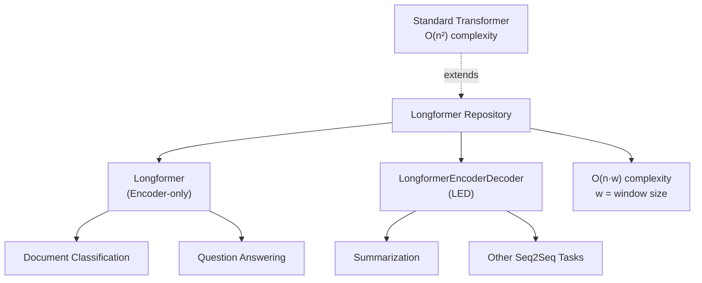
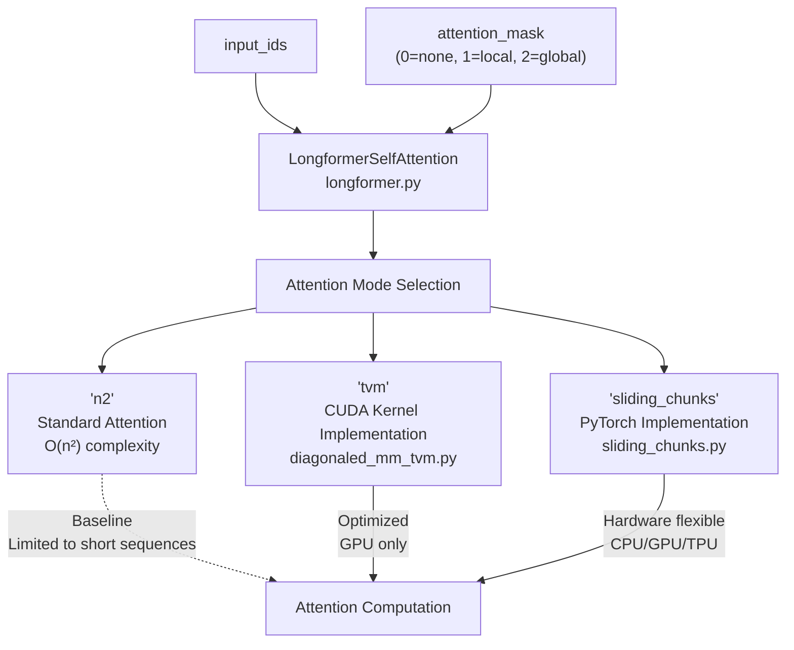
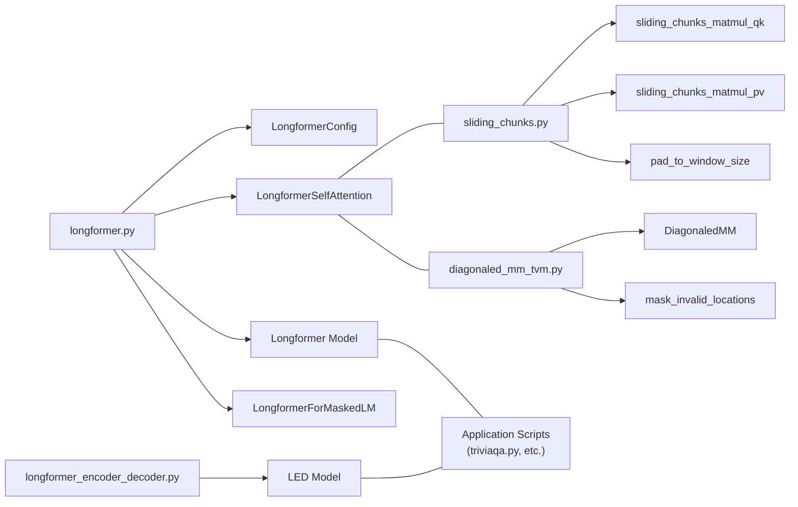

<!-- source: DeepWiki mcp.deepwiki.com · repo allenai/longformer · page 1 Overview · fetched 2026-10-26 -->

# Overview

<details>
<summary>Relevant source files</summary>

The following files were used as context for generating this wiki page:

- [README.md](README.md)
- [requirements.txt](requirements.txt)

</details>


This document provides a comprehensive introduction to the Longformer repository, a set of transformer models specifically designed to handle long documents. Longformer addresses a fundamental limitation of standard transformer models - their quadratic computational complexity with respect to sequence length - by introducing innovative attention mechanisms that enable processing thousands of tokens efficiently.

## What is Longformer?

Longformer is a transformer architecture that extends the capability of standard transformers to process long documents. It comes in two main variants:

1. **Longformer**: An encoder-only model for tasks like document classification and question answering
2. **LongformerEncoderDecoder (LED)**: An encoder-decoder model for sequence-to-sequence tasks like summarization



Sources: [README.md:1-10]()

## Key Innovations

Longformer introduces several technical innovations that make it possible to process documents with thousands of tokens:

| Innovation | Description | Implementation |
|------------|-------------|----------------|
| Sliding Window Attention | Limits attention to a fixed-size window, reducing complexity from O(n²) to O(n·w) | Multiple implementations (PyTorch, CUDA) |
| Global Attention | Allows specific tokens to attend to the entire sequence | Configurable per task |
| Memory Optimization | Gradient checkpointing reduces memory by ~5x | Enables processing 16K tokens on standard GPUs |

The most significant innovation is the combination of sliding window attention with global attention, allowing the model to capture both local context and document-level information efficiently.

Sources: [README.md:44-51](), [README.md:20-27]()

## Attention Mechanisms

Longformer implements multiple attention mechanisms that can be selected based on hardware and requirements:



The sliding window attention is implemented in two ways:
- A custom CUDA kernel (TVM-based) for maximum performance on GPUs
- A PyTorch implementation that supports CPU, TPU, and FP16 but uses more memory

Sources: [README.md:79-83](), [README.md:43-51]()

## Code Structure

The Longformer codebase is organized around several key components:



Sources: [README.md:57-107]()

## Usage Examples

Longformer can be used through Hugging Face's transformers library or directly:

```python
# Using Hugging Face
from transformers import LongformerModel
model = LongformerModel.from_pretrained('allenai/longformer-base-4096')

# Using with gradient checkpointing for memory efficiency
model = LongformerModel.from_pretrained('allenai/longformer-base-4096', 
                                        gradient_checkpointing=True)
```

The key to using Longformer effectively is setting the appropriate attention mask values:
- 0: No attention
- 1: Local attention (sliding window)
- 2: Global attention (attends to entire sequence)

Sources: [README.md:32-36](), [README.md:20-27](), [README.md:96-100]()

## Applications

Longformer has been successfully applied to several NLP tasks requiring long context:

| Task | Model | Description | Code |
|------|-------|-------------|------|
| Question Answering | LongformerForQuestionAnswering | State-of-the-art results on TriviaQA | scripts/triviaqa.py |
| Document Classification | Longformer | Used for hyperpartisan news detection | scripts/hp_preprocess.py |
| Summarization | LongformerEncoderDecoder | Supports inputs up to 16K tokens | scripts/summarization.py |

Sources: [README.md:114-117](), [README.md:4-12]()

## Related Wiki Pages

For more detailed information about specific components, see:
- Architecture details: [Architecture](#2)
- Attention mechanisms in depth: [Attention Mechanisms](#2.1)
- Implementation details: [Implementation Details](#3)
- Applications and training: [Training and Applications](#4)
- Getting started guide: [Getting Started](#5)

## Technical Requirements

Longformer requires:
- Python 3.7+
- PyTorch 1.6.0+
- A custom fork of transformers (for LED models and gradient checkpointing)
- CUDA 10.0+ (for TVM-based attention)

Sources: [requirements.txt:1-7](), [README.md:61-68]()

The Longformer repository represents a significant advancement in transformer model capabilities, extending their practical use to long-document processing while maintaining computational efficiency.

---

