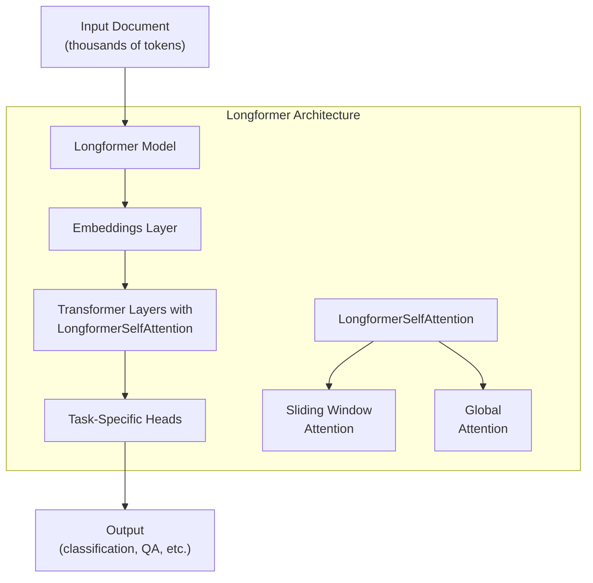
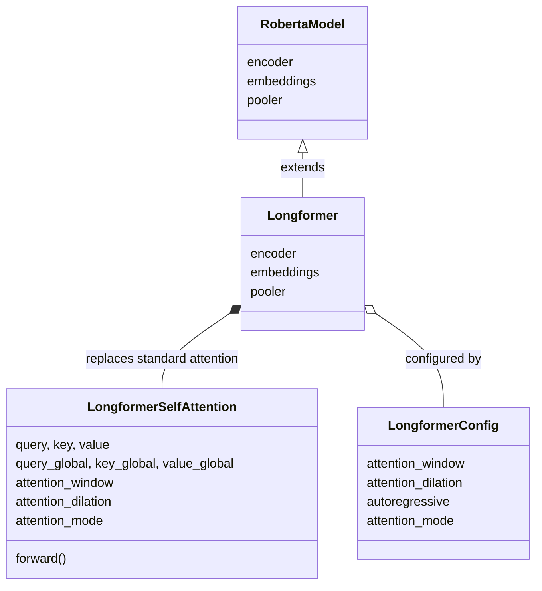
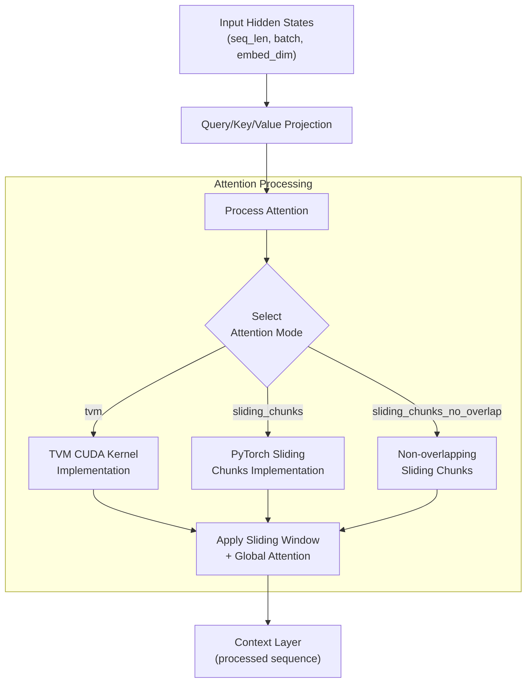
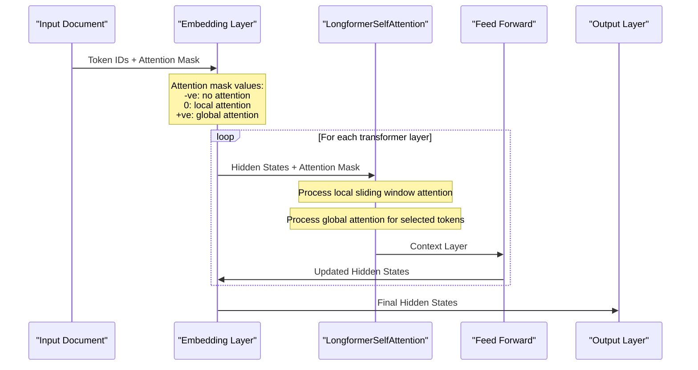
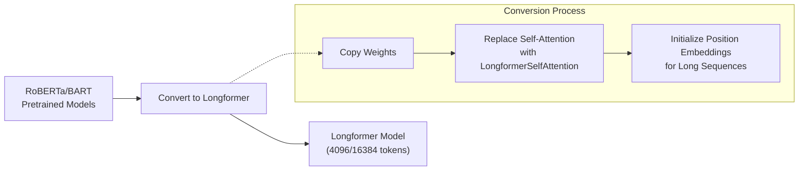
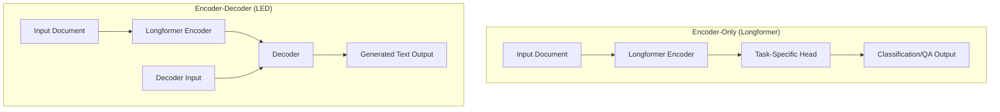

<!-- source: DeepWiki mcp.deepwiki.com · repo allenai/longformer · page 2 Architecture · fetched 2026-10-26 -->

# Architecture

Relevant source files

The following files were used as context for generating this wiki page:

- [README.md](README.md)
- [longformer/__init__.py](longformer/__init__.py)
- [longformer/longformer.py](longformer/longformer.py)

This document describes the high-level architecture of Longformer, explaining how it differs from standard transformers. For details about specific attention mechanisms, see [Attention Mechanisms](#2.1). For information about model implementations, see [Longformer Base Model](#2.2) and [LongformerEncoderDecoder (LED)](#2.3).

The Longformer architecture was designed to overcome the quadratic computational and memory complexity of standard transformer models, which limits them to processing sequences of only 512 tokens. Longformer enables efficient processing of documents with thousands of tokens (up to 4,096 or 16,384 tokens, depending on the model variant).

## Core Design Principles

Longformer is built on two key design principles that enable its efficient processing of long documents:

1. **Local windowed attention**: Most tokens only need to attend to neighboring tokens rather than the entire sequence
2. **Global attention**: Select tokens (like classification tokens or question tokens) attend to the full sequence to capture document-level context

By combining these two attention patterns, Longformer achieves linear scaling with sequence length while maintaining the ability to build global representations when needed.

Sources: [longformer/longformer.py:12-20](), [README.md:1-13]()

## Model Architecture Components

The Longformer architecture builds upon the RoBERTa model, extending it with specialized attention mechanisms. The main components include:

Sources: [longformer/longformer.py:12-52](), [longformer/__init__.py:1-3]()

### Configuration

The `LongformerConfig` class extends RoBERTa's configuration with additional parameters specific to Longformer's attention mechanisms:

- `attention_window`: List of window sizes for each layer, defining how many tokens each token can attend to on each side
- `attention_dilation`: List of dilation values for each layer, allowing for wider coverage with the same number of attention weights
- `autoregressive`: Boolean flag indicating whether to use autoregressive attention (only attending to previous tokens)
- `attention_mode`: The implementation to use for attention computation ('n2', 'tvm', 'sliding_chunks', or 'sliding_chunks_no_overlap')

Sources: [longformer/longformer.py:32-52]()

### Attention Mechanism

The core innovation of Longformer is its attention mechanism, implemented in the `LongformerSelfAttention` class. This replaces the standard self-attention in transformer layers with a combination of sliding window attention and global attention.

Sources: [longformer/longformer.py:55-269]()

The attention computation is highly efficient with a complexity of O(n × w) where n is the sequence length and w is the attention window size, compared to O(n²) in standard transformers.

### Attention Modes

Longformer supports several implementations of its attention mechanism:

1. **'n2'**: Standard full attention (quadratic complexity) - used for comparison or small sequences
2. **'tvm'**: A custom CUDA kernel implementation using TVM for maximum efficiency (GPU only)
3. **'sliding_chunks'**: A pure PyTorch implementation of sliding window attention (supports CPU, TPU, and fp16)
4. **'sliding_chunks_no_overlap'**: A variant of sliding chunks with non-overlapping windows

The 'tvm' mode provides the best performance but has hardware limitations. The 'sliding_chunks' implementations are more flexible but use more memory.

Sources: [longformer/longformer.py:146-173](), [README.md:43-51]()

## Data Flow

The following diagram illustrates how data flows through the Longformer architecture during forward processing:

Sources: [longformer/longformer.py:88-269]()

## Integration with Pretrained Models

Longformer models are typically initialized from pretrained RoBERTa or BART models and then adapted to support long sequences. This allows Longformer to leverage existing pretrained language models while extending their capabilities to long documents.

Sources: [README.md:38-108]()

## Memory Requirements and Optimizations

Longformer includes several optimizations to manage memory requirements when processing long sequences:

1. **Gradient checkpointing**: Reduces memory usage by approximately 5x by recomputing intermediate activations during the backward pass instead of storing them
2. **Attention implementation selection**: Different attention implementations offer different memory/speed tradeoffs
3. **Sliding window approach**: Significantly reduces memory requirements compared to full attention

These optimizations allow processing sequences of up to 4,096 tokens with the base model and up to 16,384 tokens with the LED model when using gradient checkpointing and mixed precision (fp16).

Sources: [README.md:4-12](), [README.md:20-26]()

## Model Variants

Two main model types are implemented in the Longformer architecture:

1. **Longformer**: An encoder-only model for tasks like document classification and question answering
2. **LongformerEncoderDecoder (LED)**: An encoder-decoder model for sequence-to-sequence tasks like summarization

Both variants use the same core attention mechanisms but are structured differently to accommodate different types of tasks.

Sources: [longformer/__init__.py:1-3](), [README.md:4-12]()

## Applications and Downstream Tasks

Longformer's architecture is designed to accommodate various downstream tasks that benefit from processing long documents:

1. **Question Answering**: Using global attention on question tokens to locate answers in long contexts
2. **Document Classification**: Using global attention on classification tokens to make document-level predictions
3. **Summarization**: Using the LED variant to summarize long documents

Each application utilizes the architecture slightly differently, particularly in how global attention is applied.

Sources: [README.md:109-117]()

## Technical Implementation Details

The implementation balances flexibility, performance, and memory efficiency:

- **Python/PyTorch implementation**: Core model logic implemented in PyTorch for flexibility
- **Custom CUDA kernel**: TVM-based optimized implementation for maximum performance on GPUs
- **Multi-modal attention**: Ability to switch between attention implementations based on hardware availability and needs
- **Integration with Hugging Face Transformers**: Compatible with the broader ecosystem of transformer models

Sources: [README.md:120-124](), [longformer/longformer.py:1-9]()

Longformer's architecture successfully addresses the quadratic complexity problem of standard transformers while maintaining or improving performance on downstream tasks involving long documents.

---

