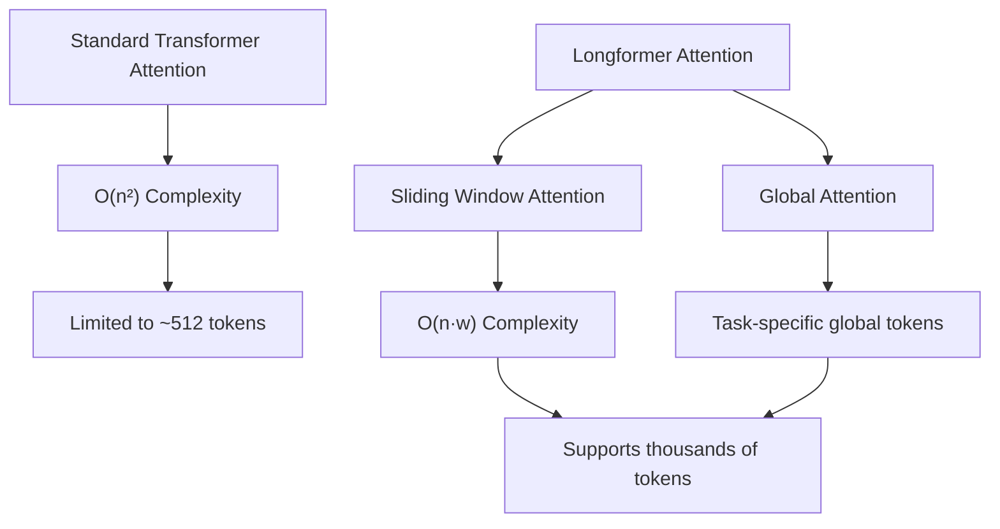
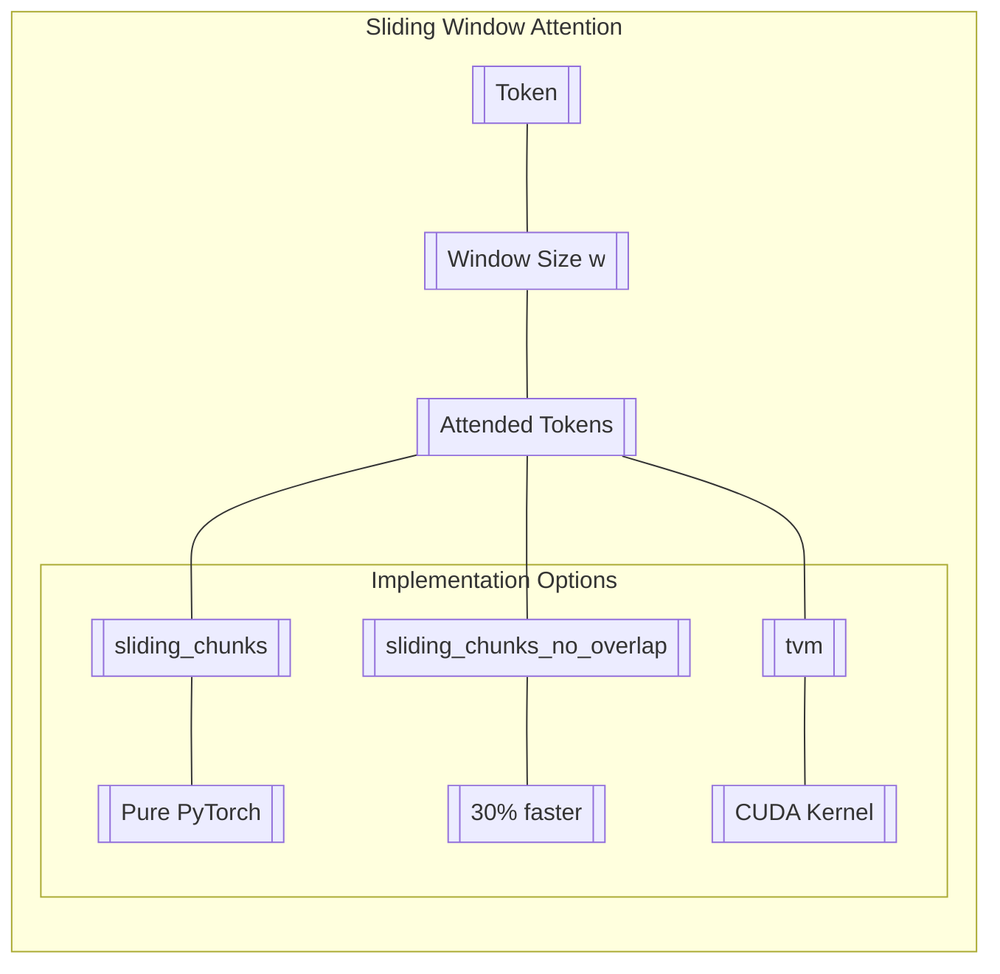
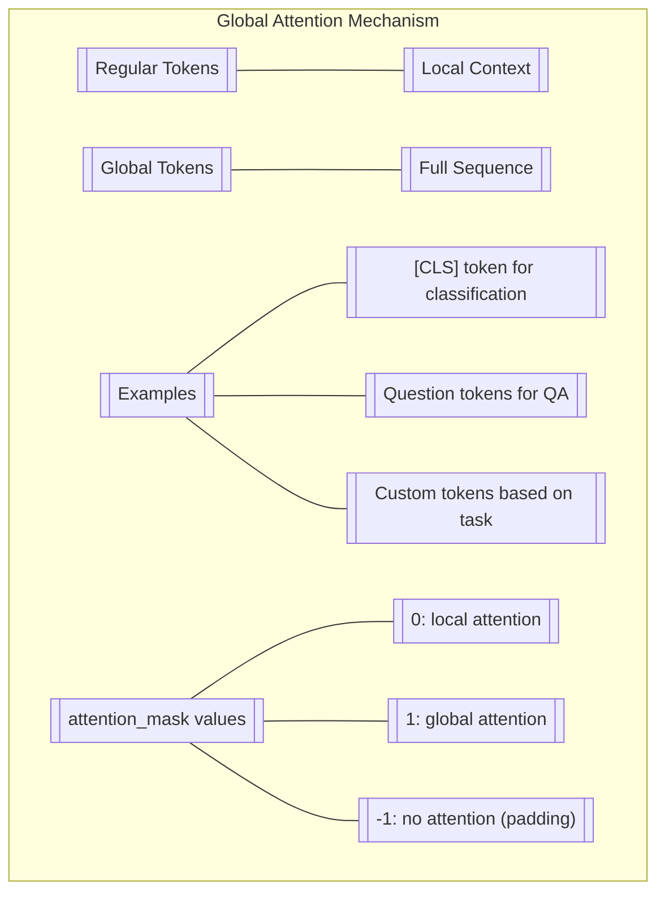
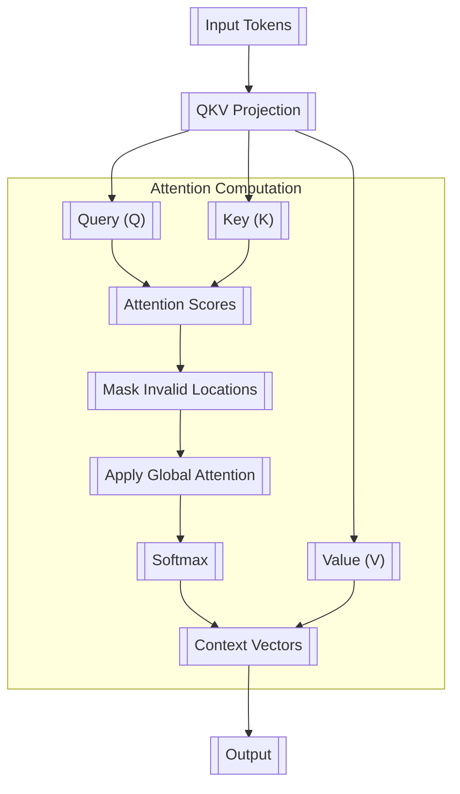
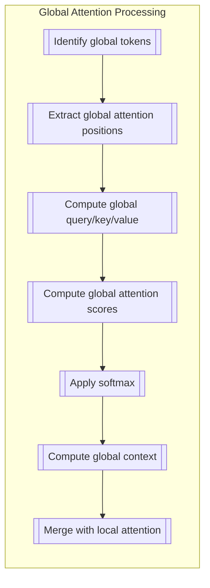
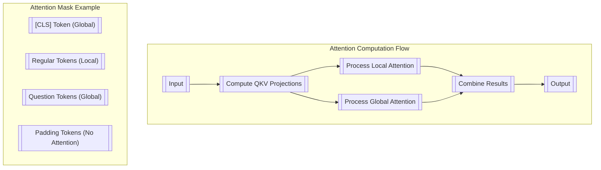

<!-- source: DeepWiki mcp.deepwiki.com · repo allenai/longformer · page 2.1 Attention Mechanisms · fetched 2026-10-26 -->

# Attention Mechanisms

<details>
<summary>Relevant source files</summary>

The following files were used as context for generating this wiki page:

- [README.md](README.md)
- [longformer/diagonaled_mm_tvm.py](longformer/diagonaled_mm_tvm.py)
- [longformer/longformer.py](longformer/longformer.py)
- [longformer/sliding_chunks.py](longformer/sliding_chunks.py)
- [tests/test_sliding_chunks.py](tests/test_sliding_chunks.py)
- [tests/test_var_global_attn.py](tests/test_var_global_attn.py)

</details>


This document details the core innovations in the Longformer architecture that overcome the quadratic complexity problem of standard transformer attention. It explains the sliding window attention and global attention mechanisms that enable efficient processing of long documents. For implementation details of these mechanisms, see [Sliding Window Attention Implementation](#3.1) and [TVM Optimized Kernel](#3.2).

## Overview of Longformer Attention

Standard transformer models compute attention between all pairs of tokens in a sequence, resulting in O(n²) computational complexity that limits practical sequence length to around 512 tokens. Longformer introduces innovative attention mechanisms that reduce this complexity while maintaining model effectiveness.



Longformer provides three implementation options for attention computation:
- `n2`: Standard full attention (for compatibility or small sequences)
- `sliding_chunks`: PyTorch implementation of sliding window attention
- `tvm`: CUDA-optimized implementation of sliding window attention

Sources: [longformer/longformer.py:32-52](). [README.md:79-83]()

## Sliding Window Attention

Sliding window attention restricts each token to attending only to a fixed-size window of surrounding tokens, rather than the entire sequence. This reduces computational complexity from O(n²) to O(n·w), where w is the window size.



The window size is configurable per layer through the `attention_window` parameter, with typical values of 256-512 (meaning 256-512 tokens on each side). The sliding window implementation efficiently handles long sequences by only computing attention within this local context.

### Key Characteristics:

- **Local context**: Each token attends only to neighboring tokens within distance w
- **Dilation support**: Attention can be dilated to expand the receptive field (only in `tvm` mode)
- **Autoregressive option**: Can be configured for autoregressive (left-only context) attention (only in `tvm` mode)

Sources: [longformer/longformer.py:55-87](). [longformer/sliding_chunks.py:40-85]()

## Global Attention

While sliding window attention efficiently handles local context, some tokens might need global information. Longformer's global attention mechanism allows specific tokens to attend to the entire sequence while also being attended by all other tokens.



Global attention tokens are specified using a special attention mask:
- 0: Use sliding window (local) attention
- 1: Use global attention
- -1: No attention (padding)

This hybrid approach maintains the efficiency of sliding window attention while providing the flexibility needed for various downstream tasks.

Sources: [longformer/longformer.py:88-105](). [longformer/longformer.py:178-252]()

## Attention Implementation Details

The Longformer provides three attention modes to balance performance and hardware compatibility:

| Attention Mode | Description | Advantages | Limitations |
|----------------|-------------|------------|-------------|
| `n2` | Standard quadratic attention | Compatible with any hardware | O(n²) complexity limits sequence length |
| `sliding_chunks` | PyTorch implementation of sliding window attention | Works on CPU/GPU/TPU, supports fp16 | Uses more memory than TVM |
| `tvm` | Custom CUDA kernel | Best performance on GPU | GPU-only, requires Linux, no fp16 support |
| `sliding_chunks_no_overlap` | Non-overlapping chunks version | 30% faster than `sliding_chunks` | Slightly higher memory usage |

### Attention Mode Selection

Attention mode is specified in the model configuration:

```python
config = LongformerConfig.from_pretrained('longformer-base-4096/') 
config.attention_mode = 'sliding_chunks'  # Choose mode here
```

The mode should be selected based on hardware environment and task requirements:
- For training language models: Use `tvm` for best performance on GPU
- For finetuning downstream tasks: Use `sliding_chunks` for greater compatibility
- For CPU/TPU inference: Use `sliding_chunks`

Sources: [README.md:43-51](). [longformer/longformer.py:79-86]()

## Attention Matrix Computation

The sliding window attention computation involves several key steps:



Different implementations of this process are available:

1. **sliding_chunks**: Divides the sequence into overlapping chunks and computes attention scores using PyTorch's `einsum` operation ([longformer/sliding_chunks.py:40-85]()).

2. **sliding_chunks_no_overlap**: Uses non-overlapping chunks for better performance ([longformer/sliding_chunks.py:150-176]()).

3. **tvm**: Uses a custom CUDA kernel to compute diagonaled matrix multiplication efficiently ([longformer/diagonaled_mm_tvm.py:156-262]()).

Sources: [longformer/longformer.py:146-214](). [longformer/sliding_chunks.py:40-85]()

## Handling Global Attention

When global attention tokens are present, the `LongformerSelfAttention` class processes them separately:



The implementation uses specialized query, key, and value projections for global tokens:

```python
query_global = nn.Linear(config.hidden_size, self.embed_dim)
key_global = nn.Linear(config.hidden_size, self.embed_dim)
value_global = nn.Linear(config.hidden_size, self.embed_dim)
```

This allows the model to learn different projection weights for global attention compared to local sliding window attention.

Sources: [longformer/longformer.py:70-72](). [longformer/longformer.py:178-252]()

## Combining Local and Global Attention

The power of Longformer's approach lies in effectively combining sliding window attention with selective global attention:



This hybrid approach provides the benefits of both worlds:
- Efficient processing with O(n·w) complexity for most tokens
- Full contextual information for task-specific tokens
- Flexibility to adapt to different downstream tasks

Sources: [longformer/longformer.py:195-203](). [longformer/longformer.py:219-252]()

## Performance Considerations

Attention mechanism selection has significant performance implications:

| Aspect | sliding_chunks | sliding_chunks_no_overlap | tvm |
|--------|----------------|---------------------------|-----|
| Speed | Baseline | ~30% faster | Fastest on GPU |
| Memory | 2x compared to TVM | 1.9x compared to TVM | Most efficient |
| Hardware | CPU/GPU/TPU | CPU/GPU/TPU | GPU only (Linux) |
| Precision | FP16/FP32 | FP16/FP32 | FP32 only |
| Features | Basic | Basic | Supports dilation and autoregressive |

For optimal performance:
- Use `tvm` when training on GPU
- Use `sliding_chunks` for greater compatibility and when working with fp16
- Use `sliding_chunks_no_overlap` for a speed boost when memory is not a concern

Sources: [README.md:43-51](). [longformer/sliding_chunks.py:137-147]()

## Practical Usage

When using the Longformer, attention mechanisms are specified through the configuration and attention mask:

1. **Configuring the attention mechanism**:
```python
config = LongformerConfig.from_pretrained('longformer-base-4096/')
config.attention_mode = 'sliding_chunks'  # or 'tvm' or 'sliding_chunks_no_overlap'
config.attention_window = [256] * num_layers  # Window size for each layer
```

2. **Setting the attention mask**:
```python
# Attention mask values:
# 0: local attention (default)
# 1: global attention
# -1: no attention (padding)
attention_mask = torch.ones(input_ids.shape, dtype=torch.long)
attention_mask[:, [1, 4, 21]] = 2  # Set global attention for specific tokens
```

3. **Padding to window size** (required for sliding_chunks):
```python
from longformer.sliding_chunks import pad_to_window_size
input_ids, attention_mask = pad_to_window_size(
    input_ids, attention_mask, config.attention_window[0], tokenizer.pad_token_id)
```

Sources: [README.md:72-106](). [longformer/sliding_chunks.py:117-133]()

## Summary

Longformer's attention mechanisms solve the quadratic complexity problem of standard transformers through an innovative combination of sliding window attention and global attention. This enables efficient processing of documents with thousands of tokens while maintaining the ability to capture both local and global context.

The multiple implementation options (`n2`, `sliding_chunks`, `sliding_chunks_no_overlap`, and `tvm`) provide flexibility to balance performance and hardware compatibility for different use cases.

---

