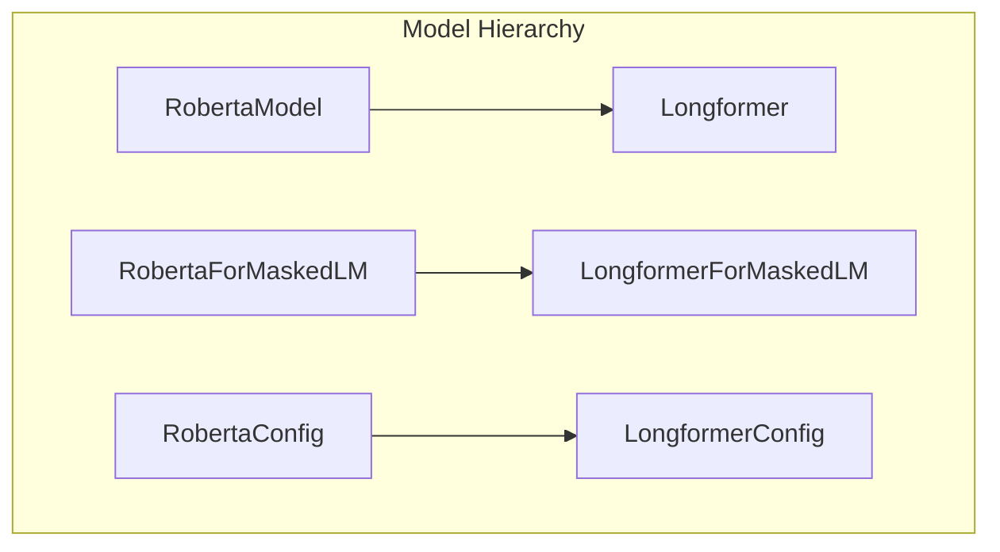
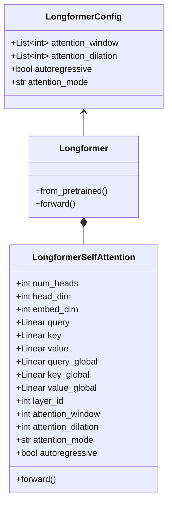
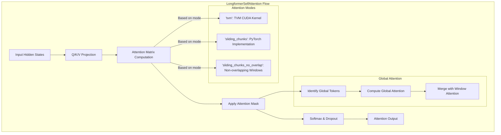
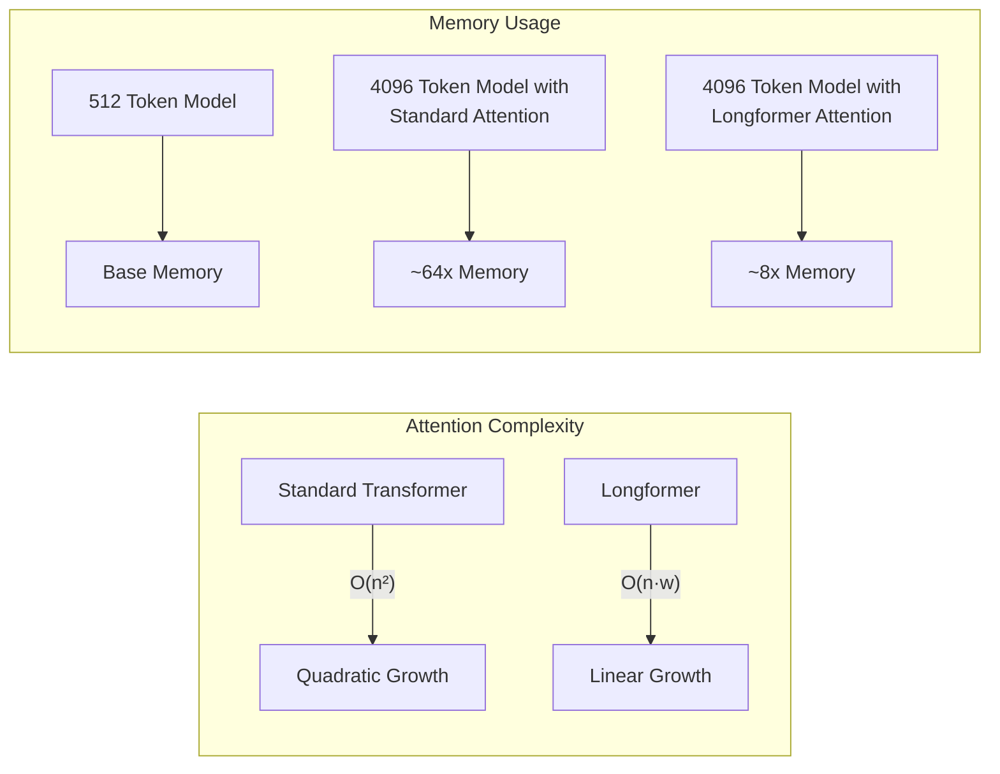

<!-- source: DeepWiki mcp.deepwiki.com · repo allenai/longformer · page 2.2 Longformer Base Model · fetched 2026-10-26 -->

# Longformer Base Model

<details>
<summary>Relevant source files</summary>

The following files were used as context for generating this wiki page:

- [README.md](README.md)
- [longformer/longformer.py](longformer/longformer.py)

</details>


This document describes the base Longformer model architecture, its configuration options, and implementation details. For information about the specific attention mechanisms used in Longformer, see [Attention Mechanisms](#2.1). For the encoder-decoder variant, see [LongformerEncoderDecoder (LED)](#2.3).

## Overview

The Longformer base model is the core encoder-only implementation of the Longformer architecture, designed to efficiently process long documents with thousands of tokens. It extends the RoBERTa model with specialized attention mechanisms that reduce the computational complexity from O(n²) to O(n), allowing it to handle sequences of up to 4,096 tokens in its base configuration (compared to 512 tokens in standard transformer models).


Sources: [longformer/longformer.py:12-32]()</file>

## Architecture

The Longformer base model inherits from RoBERTa while replacing the standard self-attention with a more efficient attention implementation. This architectural modification allows the model to process much longer sequences without the quadratic memory growth that limits traditional transformer models.

### Class Structure


Sources: [longformer/longformer.py:12-32](), [longformer/longformer.py:55-269]()

### Base Model Components

The base Longformer model consists of:

1. **Input Embeddings**: Token, position, and segment embeddings (inherited from RoBERTa)
2. **Transformer Encoder**: Multiple transformer layers, each with:
   - LongformerSelfAttention mechanism
   - Feed-forward neural network
   - Layer normalization components
3. **Output Representations**: Contextualized embeddings for each token

During initialization, the model replaces the standard self-attention in each transformer layer with `LongformerSelfAttention` unless configured to use the standard attention mechanism (`n2` mode).

Sources: [longformer/longformer.py:12-19]()

## Configuration Options

The `LongformerConfig` class extends `RobertaConfig` with several important parameters specific to Longformer:

| Parameter | Type | Description |
|-----------|------|-------------|
| `attention_window` | List[int] | List of attention window sizes (one per layer). Each value represents the number of tokens on each side that a token can attend to. |
| `attention_dilation` | List[int] | List of attention dilation values (one per layer). A dilation of 1 means no dilation. |
| `autoregressive` | bool | Whether to use autoregressive attention or bidirectional attention. |
| `attention_mode` | str | Attention implementation to use: 'n2' (standard attention), 'tvm' (optimized CUDA kernel), 'sliding_chunks' (PyTorch implementation), or 'sliding_chunks_no_overlap'. |

Example configuration for a model with 12 layers and window size 256:
```python
config = LongformerConfig(
    attention_window=[256] * 12,
    attention_dilation=[1] * 12,
    autoregressive=False,
    attention_mode='sliding_chunks'
)
```

Sources: [longformer/longformer.py:32-52]()

## Attention Implementation

The core innovation in Longformer is its attention mechanism, implemented in the `LongformerSelfAttention` class. This mechanism combines:

1. **Sliding Window Attention**: Each token attends to a window of surrounding tokens
2. **Global Attention**: Selected tokens can attend to the entire sequence


Sources: [longformer/longformer.py:55-269]()

### Attention Matrix Computation

The attention matrix is computed differently based on the configured `attention_mode`:

1. **'tvm'**: Uses a custom CUDA kernel for maximum efficiency on GPUs
2. **'sliding_chunks'**: A PyTorch implementation that supports CPU, TPU, and fp16 but uses more memory
3. **'sliding_chunks_no_overlap'**: Similar to 'sliding_chunks' but with non-overlapping attention windows
4. **'n2'**: Standard self-attention with quadratic complexity (for comparison or small inputs)

The 'sliding_chunks' and 'sliding_chunks_no_overlap' modes have some limitations:
- They don't support dilation (attention_dilation must be 1)
- They don't support autoregressive attention

Sources: [longformer/longformer.py:83-86](), [longformer/longformer.py:146-155]()

### Handling Global Attention

The Longformer base model uses an innovative approach to integrate global attention with sliding window attention:

1. Attention mask values indicate the attention type:
   - Negative values: no attention (padding)
   - 0: local attention (sliding window)
   - Positive values: global attention (token attends to entire sequence)

2. For tokens with global attention:
   - They attend to all other tokens
   - All tokens attend to them

This approach allows for task-specific adaptation of the attention pattern. For example:
- Question-answering: Set global attention on question tokens
- Classification: Set global attention on [CLS] token
- Entity extraction: Set global attention on entity tokens

Sources: [longformer/longformer.py:97-102](), [longformer/longformer.py:179-252]()

## Usage Example

Creating and using a Longformer base model:

```python
from longformer.longformer import Longformer, LongformerConfig
from longformer.sliding_chunks import pad_to_window_size
from transformers import RobertaTokenizer

# 1. Create configuration
config = LongformerConfig.from_pretrained('longformer-base-4096/') 
config.attention_mode = 'sliding_chunks'  # Choose attention implementation

# 2. Load model and tokenizer
model = Longformer.from_pretrained('longformer-base-4096/', config=config)
tokenizer = RobertaTokenizer.from_pretrained('roberta-base')
tokenizer.model_max_length = model.config.max_position_embeddings

# 3. Prepare input
text = "..." # Long document text
input_ids = torch.tensor(tokenizer.encode(text)).unsqueeze(0)  # batch of size 1

# 4. Create attention mask (0=local, 2=global)
attention_mask = torch.ones(input_ids.shape, dtype=torch.long)
attention_mask[:, [1, 4, 21]] = 2  # Set global attention on specific tokens

# 5. Pad sequence to window size if using sliding_chunks
input_ids, attention_mask = pad_to_window_size(
    input_ids, attention_mask, config.attention_window[0], tokenizer.pad_token_id)

# 6. Get model output
output = model(input_ids, attention_mask=attention_mask)[0]
```

Sources: [README.md:72-106]()

## Memory Efficiency

The Longformer base model achieves significant memory efficiency compared to standard transformers:



The sliding window attention reduces complexity from O(n²) to O(n·w), where:
- n = sequence length
- w = window size

This allows the Longformer base model to process documents up to 4,096 tokens in its standard configuration, with memory usage scaling linearly rather than quadratically with sequence length.

When combined with gradient checkpointing, the model can effectively handle even longer sequences (up to 16K tokens) on consumer-grade hardware.

Sources: [README.md:20-27]()

## Available Pretrained Models

Two versions of the pretrained Longformer base model are available:

| Model | Max Sequence Length | Parameters | Download Link |
|-------|---------------------|------------|--------------|
| longformer-base-4096 | 4,096 | ~125M | [download link mentioned in README] |
| longformer-large-4096 | 4,096 | ~355M | [download link mentioned in README] |

These models are pretrained by converting the corresponding RoBERTa checkpoints and extending their positional embeddings to support longer sequences.

Sources: [README.md:57-59]()

## Conversion from Existing Models

The Longformer base model can be created by converting other pretrained models like RoBERTa. The process involves:

1. Extending the positional embeddings to support longer sequences
2. Replacing the self-attention mechanism with LongformerSelfAttention
3. Initializing the new attention parameters appropriately

The repository includes a notebook that demonstrates this conversion process.

Sources: [README.md:38-40]()

---

