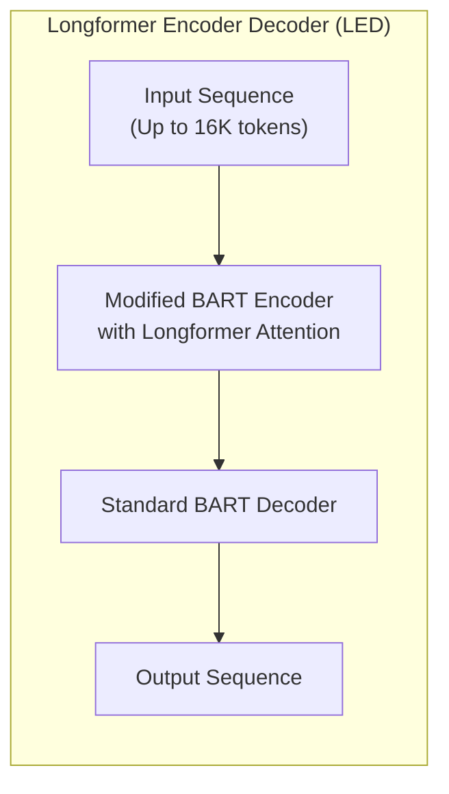
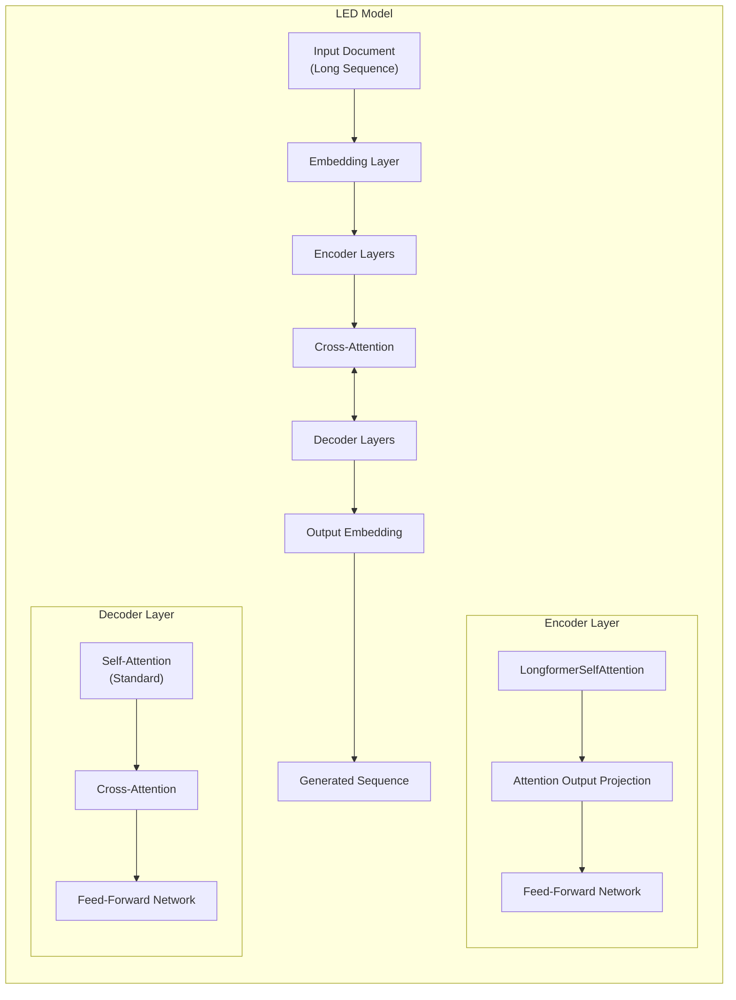
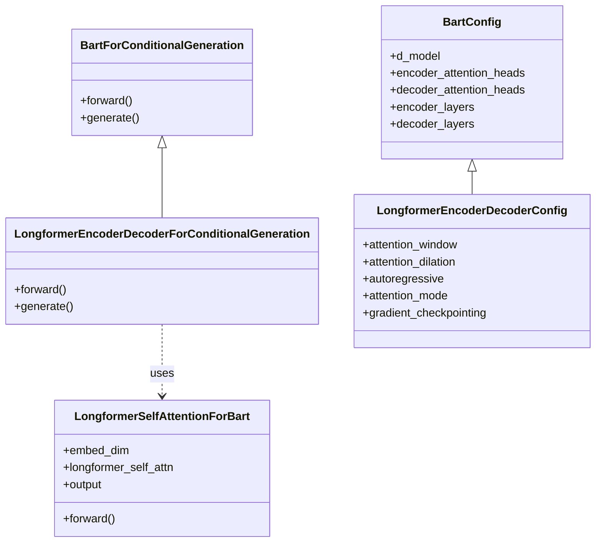
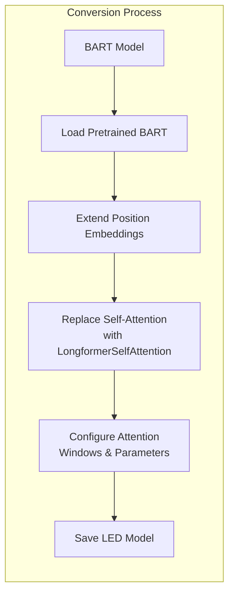
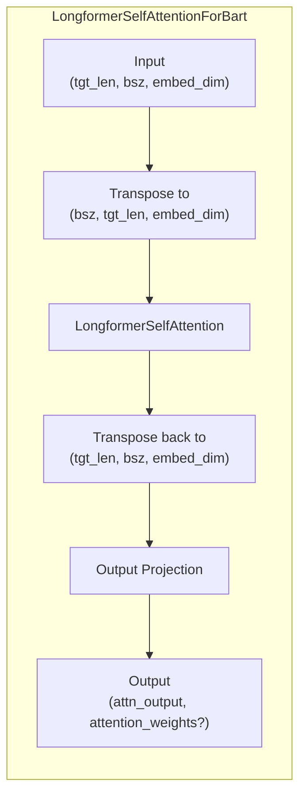
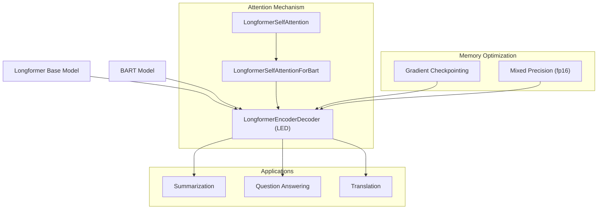

<!-- source: DeepWiki mcp.deepwiki.com · repo allenai/longformer · page 2.3 LongformerEncoderDecoder (LED) · fetched 2026-10-26 -->

# LongformerEncoderDecoder (LED)

<details>
<summary>Relevant source files</summary>

The following files were used as context for generating this wiki page:

- [README.md](README.md)
- [longformer/longformer_encoder_decoder.py](longformer/longformer_encoder_decoder.py)
- [scripts/convert_bart_to_longformerencoderdecoder.py](scripts/convert_bart_to_longformerencoderdecoder.py)

</details>


## Purpose and Scope

This document details the LongformerEncoderDecoder (LED) model, which extends sequence-to-sequence transformer architectures to support very long input documents (up to 16K tokens). LED combines the Longformer's efficient attention mechanisms (described in [Attention Mechanisms](#2.1)) with an encoder-decoder architecture for tasks like summarization, translation, and other sequence generation tasks involving lengthy inputs. For information about the core Longformer model, see [Longformer Base Model](#2.2).

## Overview

LED adapts the BART encoder-decoder architecture by replacing the encoder's standard self-attention with Longformer's efficient attention mechanisms while keeping the decoder's architecture unchanged. This design enables LED to:

1. Process documents up to 16K tokens (with gradient checkpointing and fp16 precision)
2. Maintain the benefits of pretrained encoder-decoder models like BART
3. Achieve efficiency in both computation and memory usage for long-document sequence-to-sequence tasks



Sources: [README.md:1-12](), [longformer/longformer_encoder_decoder.py:1-10]()

## Architecture

LED is fundamentally built upon the BART architecture, with the critical modification of replacing the encoder's self-attention layers with Longformer's efficient attention. This architectural design decision enables LED to handle much longer input sequences than standard encoder-decoder transformers.



Sources: [longformer/longformer_encoder_decoder.py:7-15](), [scripts/convert_bart_to_longformerencoderdecoder.py:17-87]()

### Key Components

LED consists of three main components:

1. **LongformerEncoderDecoderForConditionalGeneration**: The main model class that inherits from `BartForConditionalGeneration` and replaces the encoder's attention layers with Longformer attention.

2. **LongformerEncoderDecoderConfig**: Configuration class that extends `BartConfig` with Longformer-specific parameters.

3. **LongformerSelfAttentionForBart**: Adapter class that integrates `LongformerSelfAttention` into the BART encoder layers.



Sources: [longformer/longformer_encoder_decoder.py:7-42]()

## Configuration

The `LongformerEncoderDecoderConfig` class extends `BartConfig` with parameters specific to Longformer's attention mechanism:

| Parameter | Description |
|-----------|-------------|
| `attention_window` | List of attention window sizes (one for each layer). Window size represents the number of attention locations on each side. For an effective window size of 512, use `[256] * num_layers` (256 on each side). |
| `attention_dilation` | List of attention dilation values (one for each layer). A dilation of `1` means no dilation. |
| `autoregressive` | Boolean flag to enable autoregressive attention or allow attention from both sides. |
| `attention_mode` | Attention implementation to use: 'n2' for regular n² self-attention, 'tvm' for TVM implementation, or 'sliding_chunks' for PyTorch implementation. |
| `gradient_checkpointing` | Boolean flag to enable gradient checkpointing for memory efficiency. |

Sources: [longformer/longformer_encoder_decoder.py:17-39]()

## Converting BART to LED

LED models are created by converting pretrained BART models. The conversion process involves:

1. Extending the position embeddings to support longer sequences
2. Replacing the encoder's self-attention layers with Longformer's attention
3. Configuring the attention window, dilation, and other Longformer-specific parameters

The repository provides a script `convert_bart_to_longformerencoderdecoder.py` to automate this conversion.



Sources: [scripts/convert_bart_to_longformerencoderdecoder.py:17-87]()

### Key Steps in Conversion

1. **Loading the base model**:
   ```python
   model = BartForConditionalGeneration.from_pretrained(base_model)
   ```

2. **Extending position embeddings**:
   The conversion script extends position embeddings to support longer sequences by initializing new position embedding matrices with repeating patterns from the original embeddings.

3. **Replacing self-attention**:
   For each encoder layer, the standard self-attention is replaced with `LongformerSelfAttentionForBart`, transferring the weights from the original projection layers:
   
   ```python
   longformer_self_attn_for_bart = LongformerSelfAttentionForBart(config, layer_id=i)
   longformer_self_attn_for_bart.longformer_self_attn.query = layer.self_attn.q_proj
   longformer_self_attn_for_bart.longformer_self_attn.key = layer.self_attn.k_proj
   longformer_self_attn_for_bart.longformer_self_attn.value = layer.self_attn.v_proj
   ```

Sources: [scripts/convert_bart_to_longformerencoderdecoder.py:73-86]()

## LongformerSelfAttentionForBart

This adapter class integrates Longformer's self-attention into BART's encoder. It wraps `LongformerSelfAttention` and adapts it to match BART's attention interface:



The forward method of `LongformerSelfAttentionForBart`:
1. Takes query, key, and key_padding_mask inputs (BART format)
2. Transforms them to the format expected by `LongformerSelfAttention`
3. Runs the Longformer attention computation
4. Transforms the output back to BART's expected format

Sources: [longformer/longformer_encoder_decoder.py:42-76]()

## Memory Efficiency with Gradient Checkpointing

LED supports gradient checkpointing for memory-efficient training, which is crucial for handling very long sequences. With gradient checkpointing enabled, LED can process sequences up to 16K tokens on GPUs with 48GB of memory when combined with fp16 precision.

To enable gradient checkpointing when loading a model:

```python
model = LongformerEncoderDecoderForConditionalGeneration.from_pretrained("allenai/led-base-16384")
model.model.encoder.config.gradient_checkpointing = True
model.model.decoder.config.gradient_checkpointing = True
```

Sources: [README.md:6](), [scripts/convert_bart_to_longformerencoderdecoder.py:139-140]()

## Pretrained Models

The repository provides two pretrained LED models:

| Model | Description |
|-------|-------------|
| `led-base-16384` | Based on `bart-base` with support for up to 16K input tokens |
| `led-large-16384` | Based on `bart-large` with support for up to 16K input tokens |

Sources: [README.md:8]()

## Usage Example

Here's a simple example of using LED for a masked filling task:

```python
from transformers import BartTokenizer
from longformer.longformer_encoder_decoder import LongformerEncoderDecoderForConditionalGeneration
from transformers.modeling_bart import shift_tokens_right

# Load model and tokenizer
tokenizer = BartTokenizer.from_pretrained("allenai/led-base-16384")
model = LongformerEncoderDecoderForConditionalGeneration.from_pretrained("allenai/led-base-16384")

# Enable gradient checkpointing for memory efficiency
model.model.encoder.config.gradient_checkpointing = True
model.model.decoder.config.gradient_checkpointing = True

# Prepare input
text = "My friends are <mask> but they eat too many carbs."
data = tokenizer([text], return_tensors='pt', padding='max_length', max_length=2048)
input_ids = data['input_ids']
attention_mask = data['attention_mask']
decoder_input_ids = shift_tokens_right(input_ids[:, :5], tokenizer.pad_token_id)

# Generate output
logits = model(input_ids, attention_mask=attention_mask, 
               decoder_input_ids=decoder_input_ids, use_cache=False)[0]
               
# Get predictions for the masked token
masked_index = (input_ids[0] == tokenizer.mask_token_id).nonzero().item()
probs = logits[0, masked_index].softmax(dim=0)
values, predictions = probs.topk(5)
predicted_tokens = tokenizer.convert_ids_to_tokens(predictions)
```

Sources: [scripts/convert_bart_to_longformerencoderdecoder.py:136-149]()

## Relation to Other Components

LED is part of the Longformer ecosystem and relates to other components as follows:



Sources: [README.md:1-12](), [longformer/longformer_encoder_decoder.py:1-76]()

## Requirements and Dependencies

To use LED, you need:

1. Python 3.7+
2. PyTorch 1.2.0+
3. The Huggingface/transformers fork specified in `requirements.txt` (or install via `pip install git+https://github.com/allenai/longformer.git`)
4. Optional: CUDA 10.0+ for GPU acceleration

The specific transformers fork is required for gradient checkpointing and to allow different maximum sequence lengths for the input and output.

Sources: [README.md:10]()

---

