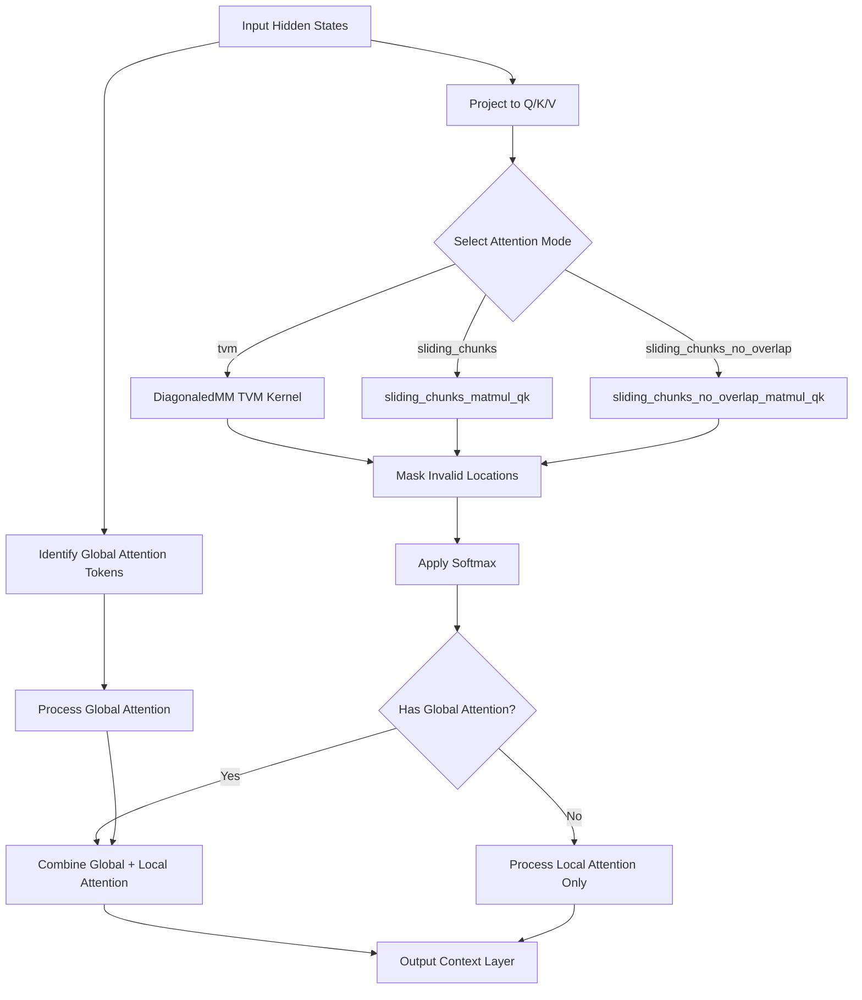
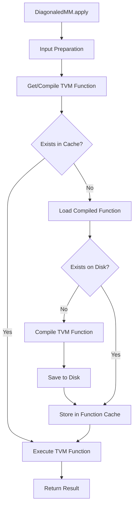
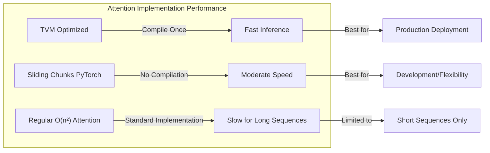
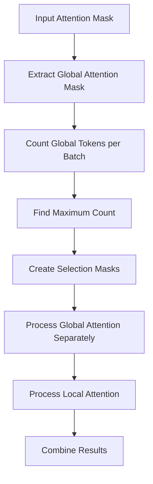

<!-- source: DeepWiki mcp.deepwiki.com · repo allenai/longformer · page 3 Implementation Details · fetched 2026-10-26 -->

# Implementation Details

<details>
<summary>Relevant source files</summary>

The following files were used as context for generating this wiki page:

- [longformer/diagonaled_mm_tvm.py](longformer/diagonaled_mm_tvm.py)
- [longformer/longformer.py](longformer/longformer.py)
- [tests/test_sliding_chunks.py](tests/test_sliding_chunks.py)
- [tests/test_var_global_attn.py](tests/test_var_global_attn.py)

</details>


This document provides technical details about the implementation choices and optimizations in the Longformer architecture. It focuses on the core implementation strategies, attention mechanism variants, and performance optimizations that enable efficient processing of long documents.

For architectural concepts and theoretical background, see [Architecture](#2). For usage examples and applications, see [Training and Applications](#4).

## Core Implementation Structure

Longformer extends the RoBERTa transformer model by replacing the standard self-attention layers with specialized attention layers that implement sliding window attention with optional global attention.

```mermaid
classDiagram
    class "RobertaModel" {
        +encoder
        +embeddings
        +forward()
    }
    class "Longformer" {
        +replace_attention_layers()
    }
    class "LongformerForMaskedLM" {
        +replace_attention_layers()
    }
    class "LongformerConfig" {
        +attention_window: List[int]
        +attention_dilation: List[int]
        +autoregressive: bool
        +attention_mode: str
    }
    class "LongformerSelfAttention" {
        +query, key, value
        +query_global, key_global, value_global
        +attention_window
        +attention_dilation
        +attention_mode
        +forward()
    }
    
    "RobertaModel" <|-- "Longformer"
    "RobertaForMaskedLM" <|-- "LongformerForMaskedLM"
    "RobertaConfig" <|-- "LongformerConfig"
    "Longformer" --> "LongformerSelfAttention" : replaces self-attention with
    "LongformerForMaskedLM" --> "LongformerSelfAttention" : replaces self-attention with
```

Sources: [longformer/longformer.py:12-29]()

The core implementation pattern involves:

1. Inheriting from the RoBERTa model classes
2. Extending the configuration with Longformer-specific parameters
3. Replacing the standard attention mechanism with custom sliding window attention

The `LongformerConfig` class adds the following crucial parameters:

| Parameter | Type | Description |
|-----------|------|-------------|
| `attention_window` | List[int] | Window sizes for each layer, defining how many tokens to attend to on each side |
| `attention_dilation` | List[int] | Dilation factors for each layer, creating gaps between attended tokens |
| `autoregressive` | bool | Whether to use autoregressive attention or bidirectional attention |
| `attention_mode` | str | The implementation to use: 'tvm', 'sliding_chunks', 'sliding_chunks_no_overlap', or 'n2' |

Sources: [longformer/longformer.py:32-52]()

## Attention Mechanism Implementation

The `LongformerSelfAttention` class is the heart of the implementation, providing both sliding window attention and global attention capabilities.



Sources: [longformer/longformer.py:55-269]()

### Attention Mask Interpretation

The attention mask uses a specialized coding scheme:

| Mask Value | Meaning |
|------------|---------|
| Negative (-1) | No attention (padding) |
| Zero (0) | Local attention |
| Positive (1) | Global attention |

This allows a flexible combination of local and global attention. The implementation processes the mask to identify tokens requiring global attention and handles them separately.

Sources: [longformer/longformer.py:97-102]()

### Attention Modes

The model supports three primary attention implementation strategies:

1. **TVM Optimized (tvm)**: Uses an optimized CUDA kernel for diagonal matrix multiplication
2. **Sliding Chunks (sliding_chunks)**: Pure PyTorch implementation using tensor manipulation
3. **Sliding Chunks No Overlap (sliding_chunks_no_overlap)**: Alternative PyTorch implementation

The choice between these modes depends on hardware compatibility, precision requirements, and performance considerations.

Sources: [longformer/longformer.py:146-155](), [longformer/longformer.py:205-212]()

## TVM-Optimized Diagonal Matrix Multiplication

The TVM-optimized kernel provides significant performance gains for the sliding window attention computation.



Sources: [longformer/diagonaled_mm_tvm.py:8-203]()

### Compilation and Caching

The implementation uses an intelligent compilation and caching strategy:

1. First, tries to retrieve a previously compiled function from memory
2. If not found, attempts to load from disk
3. If not available, compiles the TVM function and saves it for future use

This approach minimizes compilation overhead while ensuring optimal performance.

Sources: [longformer/diagonaled_mm_tvm.py:137-153]()

### Memory Optimization

The implementation includes careful memory management techniques:

1. **Tensor Stride Fixing**: Addresses inconsistencies in PyTorch's stride information for improved TVM compatibility
2. **Contiguous Tensors**: Ensures all tensors are contiguous before passing to TVM
3. **Result Memory Allocation**: Pre-allocates result tensors to avoid unnecessary memory operations

Sources: [longformer/diagonaled_mm_tvm.py:206-228]()

## Performance Comparison

The implementation includes benchmarking that demonstrates the performance difference between the TVM-optimized and PyTorch sliding chunks implementations.



Sources: [tests/test_sliding_chunks.py:16-81]()

The test suite includes comprehensive comparisons that verify numerical equivalence between these implementations while measuring their relative performance.

## Global Attention Handling

The model efficiently processes variable global attention scenarios, where different sequences in a batch may have different numbers of tokens with global attention.



Sources: [longformer/longformer.py:107-133](), [tests/test_var_global_attn.py:10-69]()

The implementation handles cases where global attention is applied to:
- The same positions across all sequences
- Different positions in different sequences
- Variable numbers of positions across the batch

This flexibility is crucial for tasks like question answering where specific tokens (like the question) require global context.

## Implementation Constraints and Limitations

Several implementation constraints exist to be aware of:

1. **Minimum Sequence Length**: A minimum sequence length of 16 is required to avoid splitting errors
2. **Autoregressive Limitations**: The autoregressive setting is only supported with the TVM implementation, not with sliding_chunks
3. **Dilation Support**: The sliding_chunks implementations do not support dilation (must be set to 1)

Sources: [longformer/diagonaled_mm_tvm.py:230-252](), [longformer/longformer.py:84-86]()

The code includes appropriate assertions to validate these constraints at runtime.

## Summary of Implementation Features

| Feature | Implementation | Benefits | Limitations |
|---------|----------------|----------|------------|
| Sliding Window Attention | Multiple modes (tvm, sliding_chunks) | Reduces complexity from O(n²) to O(n·w) | Limited context integration |
| Global Attention | Special token handling | Provides full context where needed | Increases complexity for global tokens |
| TVM-Optimized Kernel | Custom CUDA kernel | 5-10x faster than pure PyTorch | Requires compilation, limited flexibility |
| Variable Global Attention | Masked selection | Supports different global attention patterns | Adds computational overhead |

The Longformer implementation successfully addresses the quadratic complexity problem of transformers through a careful combination of implementation strategies that balance performance and flexibility.

---

