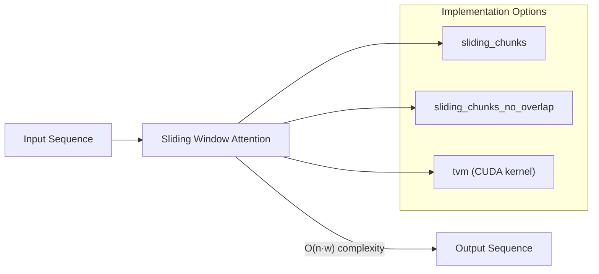
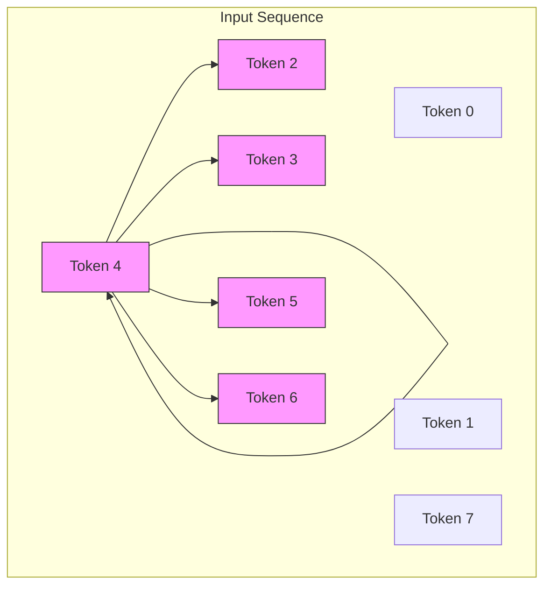
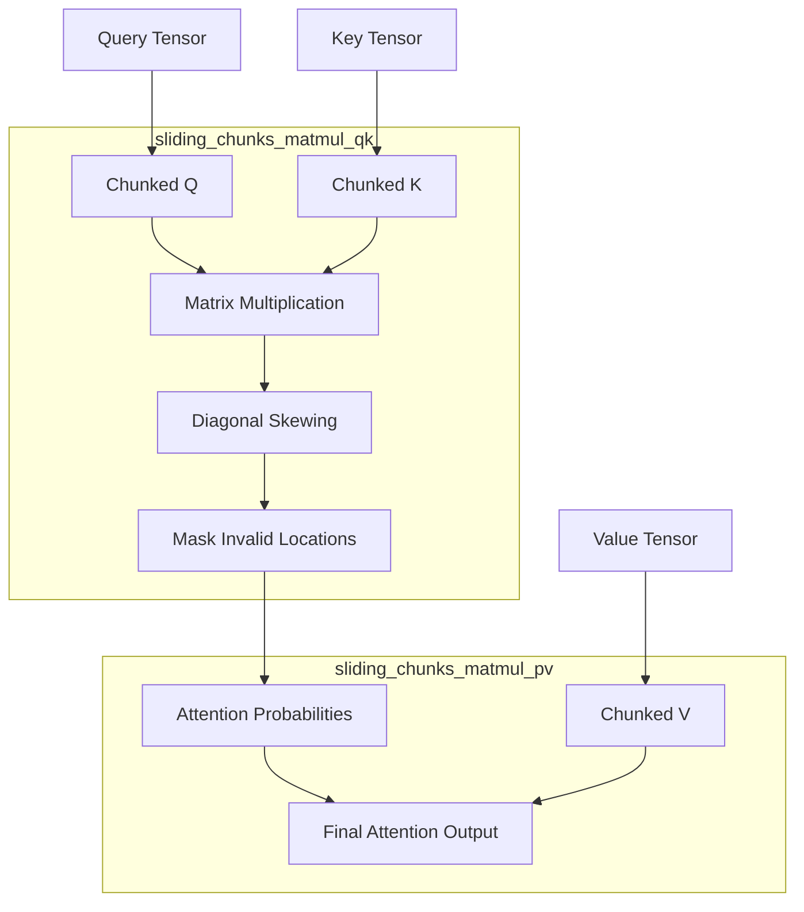
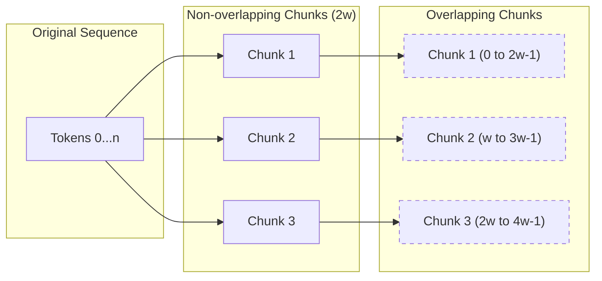
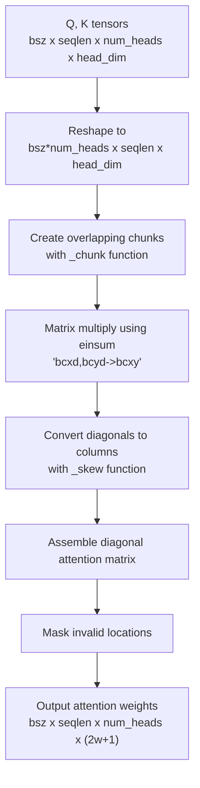
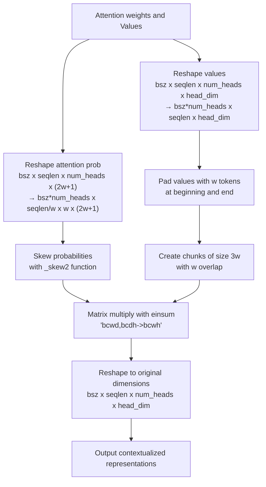
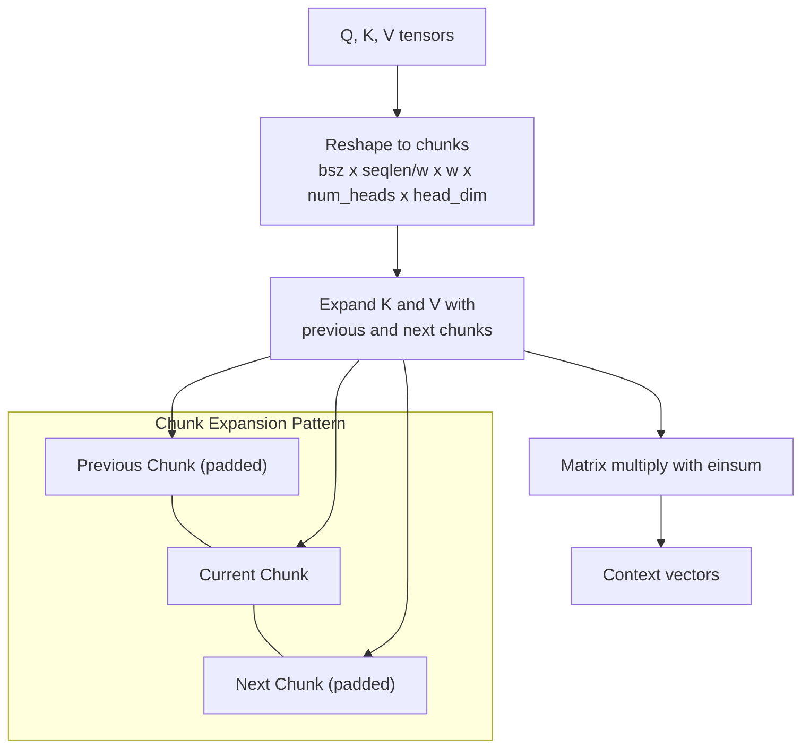
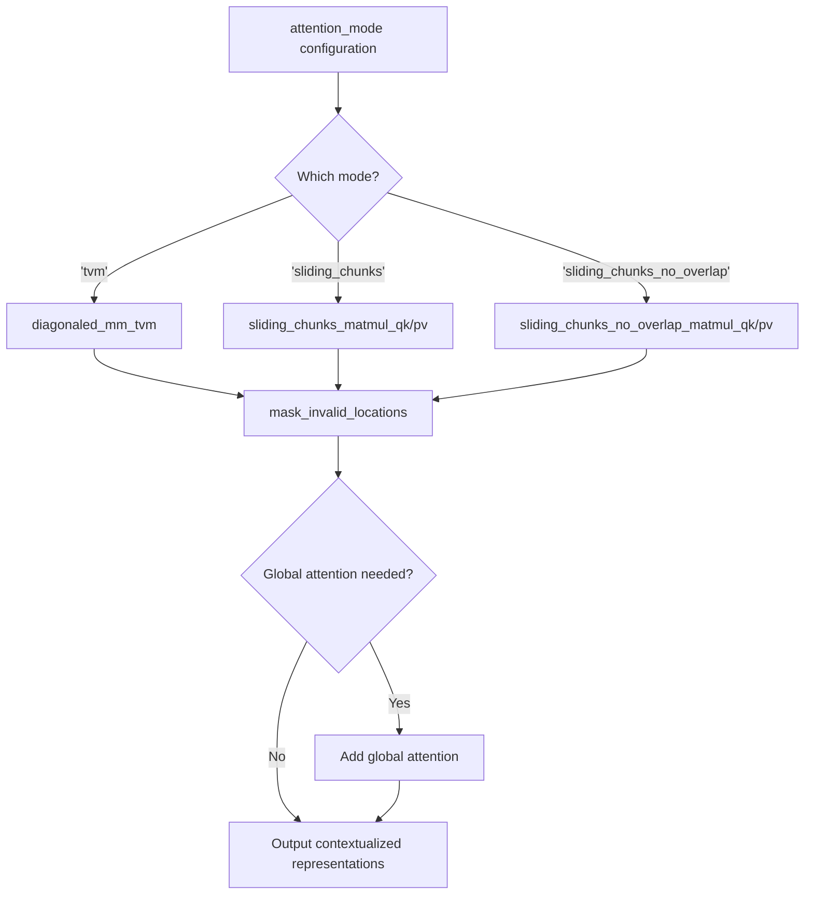
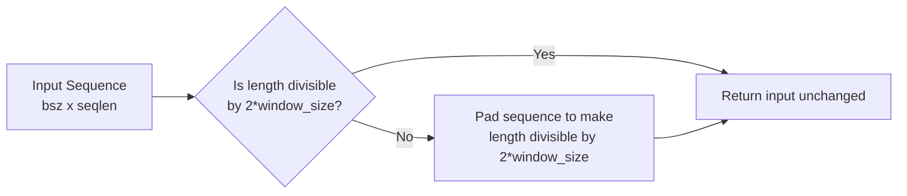

<!-- source: DeepWiki mcp.deepwiki.com · repo allenai/longformer · page 3.1 Sliding Window Attention Implementation · fetched 2026-10-26 -->

# Sliding Window Attention Implementation

Relevant source files

The following files were used as context for generating this wiki page:

- [longformer/longformer.py](longformer/longformer.py)
- [longformer/sliding_chunks.py](longformer/sliding_chunks.py)

This page documents the PyTorch implementations of sliding window attention in the Longformer architecture. Sliding window attention is a core innovation that enables Longformer to process long documents by reducing the quadratic complexity of standard transformer attention to linear complexity. For information about the TVM optimized attention implementation, see [TVM Optimized Kernel](#3.2).

## Overview

Sliding window attention restricts each token to attend only to a fixed window of surrounding tokens rather than the entire sequence. This reduces the computational complexity from O(n²) to O(n·w), where n is the sequence length and w is the window size.

The Longformer codebase provides two PyTorch implementations of sliding window attention:

1. **`sliding_chunks`**: Uses overlapping chunks with shared computation
2. **`sliding_chunks_no_overlap`**: Uses non-overlapping chunks for better efficiency

Sources: [longformer/longformer.py:32-52](). [longformer/sliding_chunks.py:40-86](), [longformer/sliding_chunks.py:150-163]()

## Attention Pattern

Sliding window attention restricts the attention computation to a fixed-size window around each token. The diagram below shows the attention pattern for a single token (position 4) with a window size of 2:

Sources: [longformer/longformer.py:75-87]()

## Sliding Chunks Implementation

The `sliding_chunks` implementation divides the input sequence into overlapping chunks and computes attention within these chunks. This approach enables efficient computation while maintaining the sliding window attention pattern.

### Key Functions

The implementation consists of several key functions:

1. **`_chunk`**: Converts the input tensor into overlapping chunks
2. **`_skew`**: Transforms diagonal elements in the attention matrix for proper computation
3. **`sliding_chunks_matmul_qk`**: Computes attention scores between query and key matrices
4. **`sliding_chunks_matmul_pv`**: Applies attention scores to value matrices

Sources: [longformer/sliding_chunks.py:25-38](), [longformer/sliding_chunks.py:6-10](), [longformer/sliding_chunks.py:40-86](), [longformer/sliding_chunks.py:88-114]()

### Chunking Process

The chunking process is a key component that enables efficient computation:

1. The input is first divided into non-overlapping chunks of size 2w
2. Then, using `as_strided`, these chunks are made to overlap with an overlap size of w
3. This allows sharing computation across adjacent chunks

Sources: [longformer/sliding_chunks.py:25-38]()

## Matrix Multiplication Algorithm

The core of the sliding window attention is the matrix multiplication between query and key tensors, followed by applying the resulting attention weights to the value tensor.

### Query-Key Matrix Multiplication

The `sliding_chunks_matmul_qk` function handles the multiplication between query and key tensors:

1. Reshape query and key tensors to group batch size and heads
2. Chunk the reshaped tensors
3. Perform batched matrix multiplication using `einsum`
4. Convert diagonal attention patterns to a format suitable for attention
5. Mask invalid attention positions

Sources: [longformer/sliding_chunks.py:40-86]()

### Attention Application to Values

The `sliding_chunks_matmul_pv` function applies the attention weights to value tensors:

1. Reshape probability and value tensors
2. Pad the value tensor and create chunks
3. Skew the probability tensor
4. Apply attention weights to values using `einsum`

Sources: [longformer/sliding_chunks.py:88-114]()

## No-Overlap Implementation

The `sliding_chunks_no_overlap` implementation offers a more efficient alternative by using non-overlapping chunks. This approach is approximately 30% faster and uses 5% less memory compared to the standard `sliding_chunks` implementation.

### Key Differences

1. Uses non-overlapping chunks of size `w` instead of overlapping chunks
2. Total attention window size is approximately 3w instead of 2w+1
3. The window is asymmetric, with attention on each side ranging from w to 2w tokens

Sources: [longformer/sliding_chunks.py:150-176]()

The `sliding_chunks_no_overlap` implementation accomplishes this by:

1. Dividing input into non-overlapping chunks of size `w`
2. Expanding each chunk to include the previous and next chunks
3. Computing attention across these expanded chunks
4. Assembling the final output efficiently

## Integration with Longformer

The sliding window attention implementations are integrated into the Longformer architecture through the `LongformerSelfAttention` class. This class selects the appropriate implementation based on the `attention_mode` configuration parameter.

### Attention Mode Selection

In the `forward` method of `LongformerSelfAttention`, the code selects the appropriate sliding window implementation:

Sources: [longformer/longformer.py:88-269]()

### Usage in the Forward Pass

The sliding window attention is used in the model's forward pass as follows:

1. Project the hidden states to query, key, and value representations
2. Reshape them to the appropriate format
3. Apply the selected sliding window attention implementation
4. If global attention is needed, compute and combine it with the local attention
5. Return the contextualized representations

## Padding Utility Function

To ensure that sequences work correctly with the sliding window implementation, Longformer provides a utility function `pad_to_window_size`:

Sources: [longformer/sliding_chunks.py:117-133]()

This function:
1. Calculates the padding length needed to make the sequence length divisible by 2 times the window size
2. Pads the input ids with the pad token id
3. Updates the attention mask accordingly to ignore the padding tokens

## Performance Considerations

When choosing between sliding window implementations, consider the following:

| Implementation | Speed | Memory Usage | Window Pattern | Best For |
|----------------|-------|--------------|----------------|----------|
| `sliding_chunks` | Base | Base | Symmetric (w tokens on each side) | Most use cases |
| `sliding_chunks_no_overlap` | 30% faster | 5% less | Asymmetric (w to 2w tokens on each side) | Performance-critical applications |
| `tvm` | Fastest | Lowest | Same as `sliding_chunks` | GPUs with TVM support |

Sources: [longformer/sliding_chunks.py:136-147]()

## Related Implementation Requirements

To use the sliding window attention:

1. Sequence length must be divisible by 2 times the window size for `sliding_chunks`
2. Sequence length must be divisible by the window size for `sliding_chunks_no_overlap`
3. The attention window size must be specified for each layer
4. Dilation is only supported in the `tvm` implementation

For details on the TVM optimized kernel implementation, which is more efficient on GPU hardware, see [TVM Optimized Kernel](#3.2).

---

