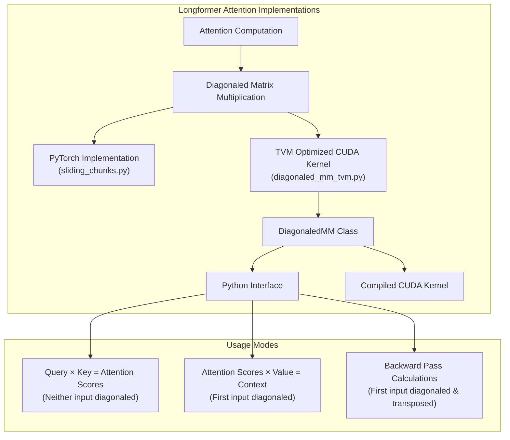
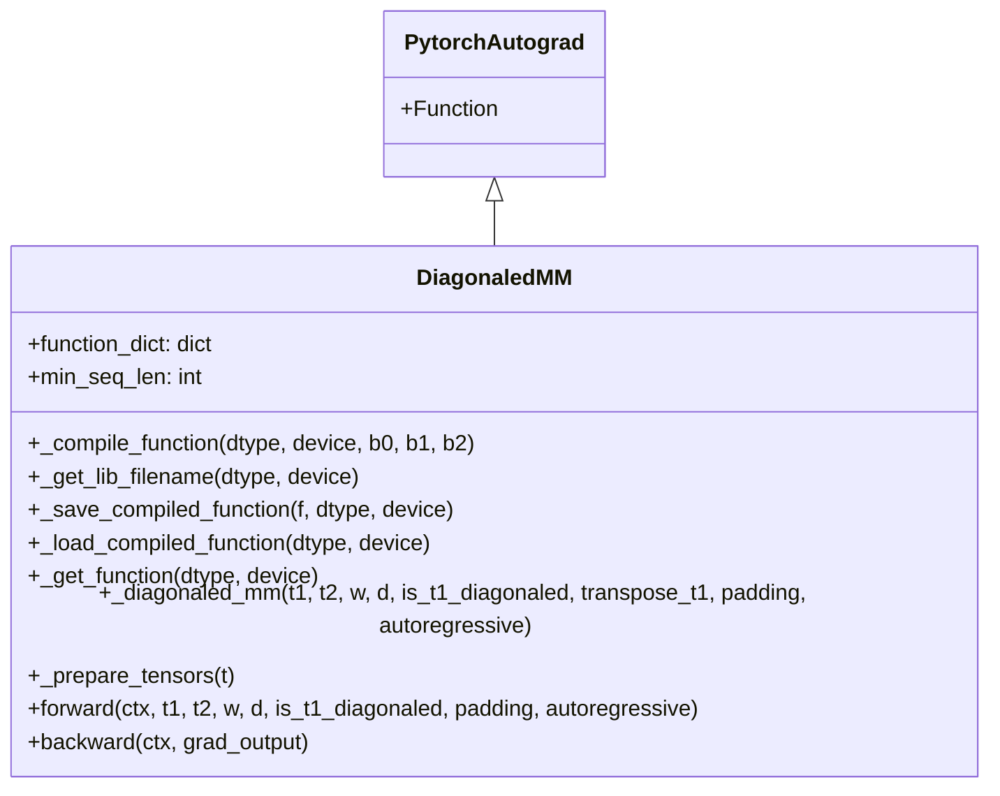
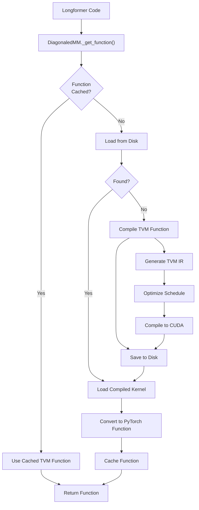
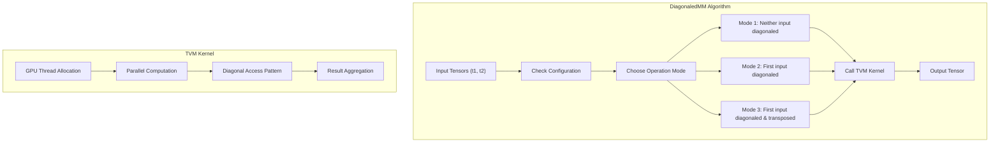
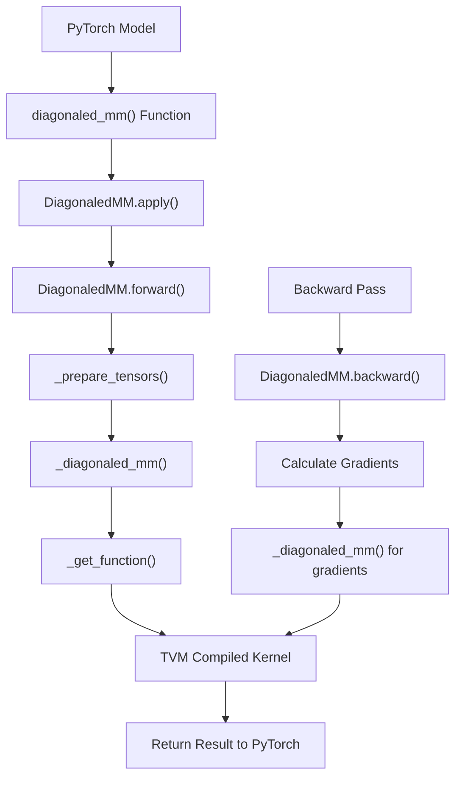

<!-- source: DeepWiki mcp.deepwiki.com · repo allenai/longformer · page 3.2 TVM Optimized Kernel · fetched 2026-10-26 -->

# TVM Optimized Kernel

<details>
<summary>Relevant source files</summary>

The following files were used as context for generating this wiki page:

- [longformer/diagonaled_mm_tvm.py](longformer/diagonaled_mm_tvm.py)
- [longformer/lib/lib_diagonaled_mm_float32_cuda.so](longformer/lib/lib_diagonaled_mm_float32_cuda.so)
- [scripts/cheatsheet.txt](scripts/cheatsheet.txt)
- [tests/test_sliding_chunks.py](tests/test_sliding_chunks.py)
- [tests/test_var_global_attn.py](tests/test_var_global_attn.py)

</details>


This page details the TVM (Tensor Virtual Machine) optimized CUDA kernel used in Longformer for efficient diagonaled matrix multiplication operations. The kernel is a critical performance optimization that enables Longformer to process long sequences efficiently. For information about the sliding window attention implementation that uses this kernel, see [Sliding Window Attention Implementation](#3.1).

## Overview

The TVM optimized kernel provides a highly efficient implementation of diagonaled matrix multiplication, which is a core operation in Longformer's sliding window attention mechanism. It leverages TVM—a compiler framework for deep learning systems—to generate optimized CUDA code that significantly accelerates attention computation for long sequences.



Sources: [longformer/diagonaled_mm_tvm.py:156-203]()

## DiagonaledMM Architecture

The DiagonaledMM class is the core component that provides the interface between PyTorch and the TVM-compiled CUDA kernel. It's implemented as a custom PyTorch autograd Function, enabling automatic differentiation for the diagonaled matrix multiplication operation.



Sources: [longformer/diagonaled_mm_tvm.py:8-286]()

### Key Components

1. **DiagonaledMM Class**: A PyTorch autograd Function that implements efficient diagonaled matrix multiplication for both forward and backward passes.

2. **Function Dictionary**: Caches compiled TVM functions to avoid recompilation.

3. **Compilation Interface**: Methods to compile, save, load, and manage TVM functions.

4. **Operation Modes**: Supports different modes of operation based on whether inputs or outputs are diagonaled.

## Compilation Process

The TVM kernel is compiled from Python to optimized CUDA code. This compilation process happens once, and the compiled kernel is then saved for future use.



Sources: [longformer/diagonaled_mm_tvm.py:114-153](), [scripts/cheatsheet.txt:1-21]()

### Compilation Instructions

To compile the TVM CUDA kernel:

1. Clone the Longformer repository
2. Clone TVM v0.6.0 inside the Longformer directory
3. Build Docker image for TVM
4. Run Docker container with GPU access
5. Compile the kernel using the provided Python command

```
python3 -c "from longformer.diagonaled_mm_tvm import *; DiagonaledMM._get_function('float32', 'cuda')"
```

Sources: [scripts/cheatsheet.txt:1-21]()

## Implementation Details

### Diagonaled Matrix Multiplication Algorithm

The core function implements a specialized matrix multiplication that operates on diagonals of input tensors. This is crucial for implementing sliding window attention efficiently.



Sources: [longformer/diagonaled_mm_tvm.py:156-203]()

The diagonaled matrix multiplication operation is used in three main scenarios:

1. **Query × Key → Attention Scores**: Neither input is diagonaled, but result is
2. **Attention Scores × Value → Context**: First input is diagonaled, second and result are not
3. **Backward Pass Calculations**: First input is diagonaled and transposed

### Integration with PyTorch

The implementation integrates with PyTorch's autograd system through:

1. **Forward method**: Performs the diagonaled matrix multiplication and saves inputs for backward pass
2. **Backward method**: Computes gradients for the inputs by using the diagonaled_mm function itself



Sources: [longformer/diagonaled_mm_tvm.py:232-286]()

## CUDA Kernel Structure

The compiled CUDA kernel (stored in `lib_diagonaled_mm_float32_cuda.so`) implements efficient parallel computation of diagonaled matrix multiplication on the GPU. The kernel is optimized for memory access patterns and GPU thread utilization.

### Input Parameters

The kernel accepts the following parameters:

| Parameter | Description |
|-----------|-------------|
| `t1` | First tensor (batch_size, seq_len, num_heads, hidden_size or num_diagonals) |
| `t2` | Second tensor (batch_size, seq_len, num_heads, hidden_size) |
| `w` | Window size (attention span on each side) |
| `d` | Dilation per attention head |
| `is_t1_diagonaled` | Whether t1 is a diagonaled tensor |
| `padding` | Value for invalid locations |
| `autoregressive` | Whether to use only the lower triangle |

Sources: [longformer/diagonaled_mm_tvm.py:156-203]()

## Performance Comparison

The TVM optimized kernel significantly outperforms the pure PyTorch implementation (`sliding_chunks.py`). The test code in `test_sliding_chunks.py` includes performance benchmarks comparing the two implementations.

Key performance advantages:

1. **GPU Optimized**: Directly compiled to efficient CUDA code
2. **Memory Access**: Optimized access patterns for diagonal elements
3. **Parallel Execution**: Efficiently utilizes GPU threads and blocks
4. **Memory Footprint**: Reduced intermediate memory requirements

Sources: [tests/test_sliding_chunks.py:77-80]()

## Usage Examples

The diagonaled matrix multiplication function can be used directly in PyTorch code:

```python
# Example usage
output = diagonaled_mm(t1, t2, w, d, is_t1_diagonaled=False, padding=0, autoregressive=False)
```

In Longformer, it's primarily used in the LongformerSelfAttention module to compute attention scores and context vectors.

### Function Signature

```python
diagonaled_mm(t1, t2, w, d, is_t1_diagonaled=False, padding=0, autoregressive=False)
```

| Argument | Description |
|----------|-------------|
| `t1` | First tensor (batch_size, seq_len, num_heads, hidden_size or num_diagonals) |
| `t2` | Second tensor (batch_size, seq_len, num_heads, hidden_size) |
| `w` | Window size (number of attention heads on each side) |
| `d` | Dilation factor (can be an integer or a tensor with per-head dilation) |
| `is_t1_diagonaled` | Whether t1 is already in diagonal format |
| `padding` | Value to use for invalid locations (important for softmax) |
| `autoregressive` | Whether to use only the lower triangle (for causal attention) |

Sources: [longformer/diagonaled_mm_tvm.py:232-250]()

## Helper Functions

The module also includes helper functions for working with diagonaled matrices:

1. **mask_invalid_locations**: Applies masking to ensure attention only considers valid positions based on window size and dilation.

2. **_get_invalid_locations_mask**: Creates a mask tensor identifying which locations in a diagonaled tensor should be considered invalid.

Sources: [longformer/diagonaled_mm_tvm.py:288-327]()

## Conclusion

The TVM optimized kernel for diagonaled matrix multiplication is a critical component of the Longformer architecture. By efficiently implementing the core operations needed for sliding window attention, it enables processing documents with thousands of tokens at reasonable computational cost. The integration with PyTorch's autograd system ensures that this optimization is transparent to the end user while providing significant performance benefits.

---

