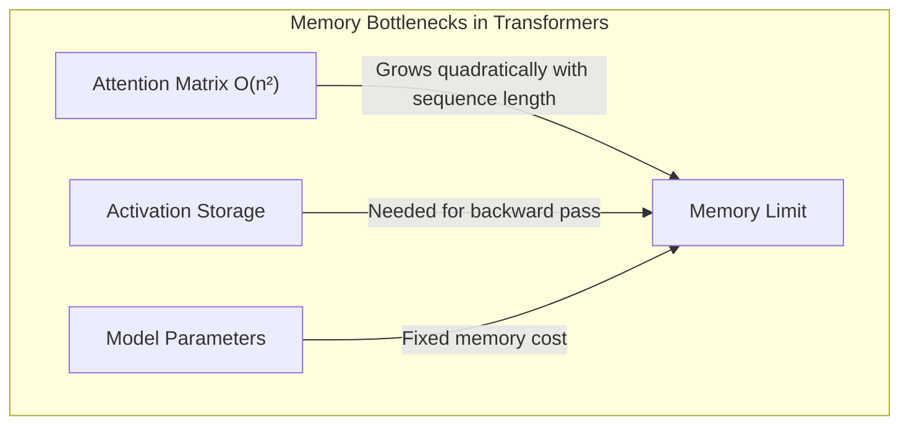
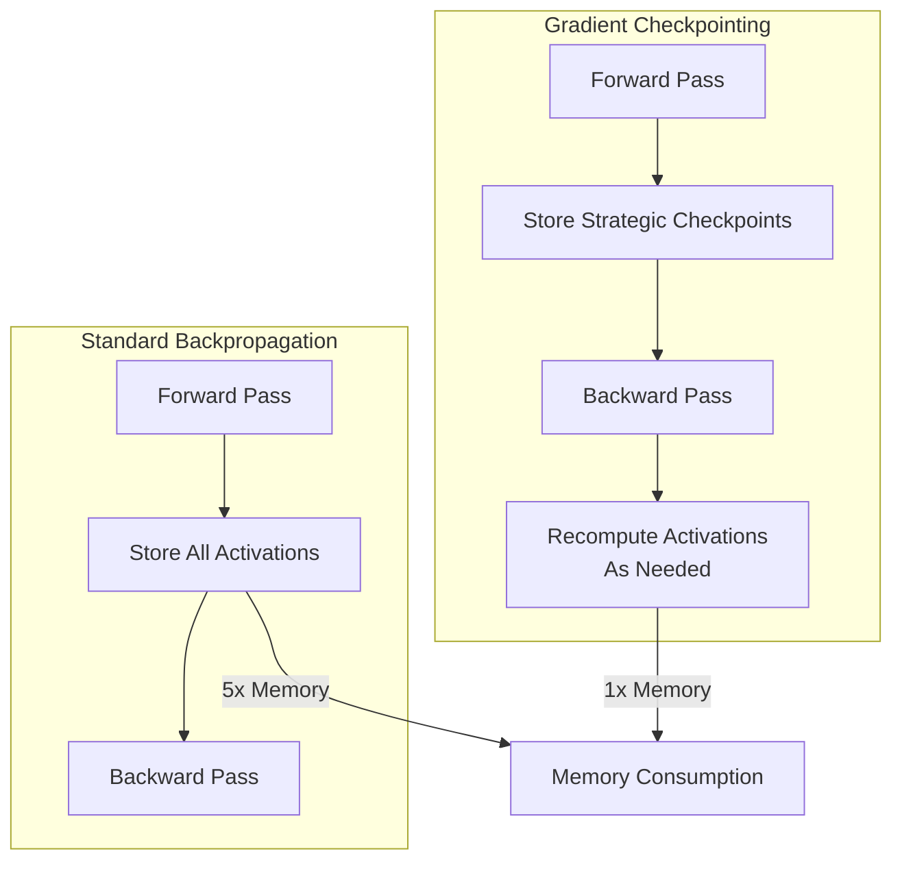
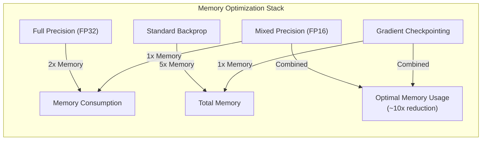
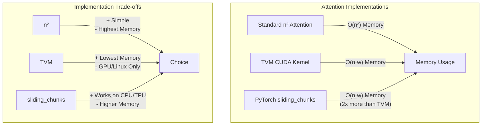
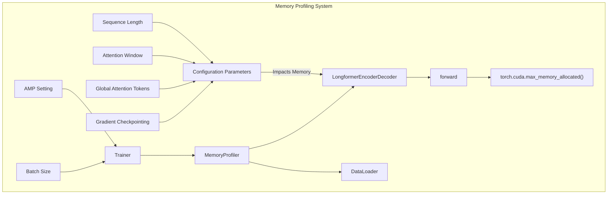
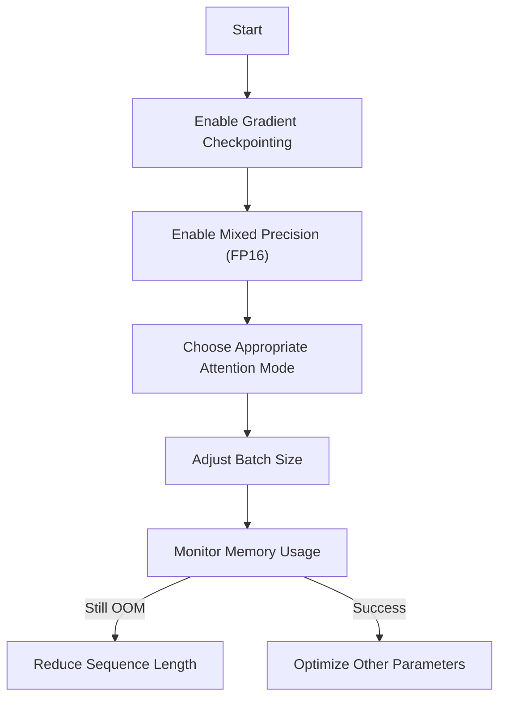

<!-- source: DeepWiki mcp.deepwiki.com · repo allenai/longformer · page 3.3 Memory Optimization · fetched 2026-10-26 -->

# Memory Optimization

<details>
<summary>Relevant source files</summary>

The following files were used as context for generating this wiki page:

- [README.md](README.md)
- [scripts/mem_profiler.py](scripts/mem_profiler.py)

</details>


## Purpose and Scope

This document details the memory optimization techniques implemented in the Longformer architecture to efficiently process long documents with thousands of tokens. Transformer models typically have high memory requirements that grow quadratically with sequence length, making them impractical for long documents. The techniques described here allow Longformer to handle sequences up to 16K tokens on standard GPU hardware. For information about the sliding window attention mechanism that reduces computational complexity, see [Attention Mechanisms](#2.1).

## Memory Challenges in Transformer Models

Processing long documents with transformer models presents significant memory challenges:



Key memory bottlenecks include:

1. **Attention matrices**: Standard transformers compute full attention, requiring O(n²) memory
2. **Activation storage**: Intermediate activations must be stored for the backward pass
3. **Model parameters and optimizer states**: Large models require significant memory even without inputs

Sources: [README.md:1-54]()

## Gradient Checkpointing

Gradient checkpointing is the primary memory optimization technique in Longformer, reducing memory usage by approximately 5x.

### How Gradient Checkpointing Works



Gradient checkpointing trades computation for memory by:

1. Storing only a subset of activations during the forward pass
2. Recomputing intermediate activations during the backward pass when needed
3. Resulting in significant memory savings at the cost of additional computation time

### Implementation and Usage

Gradient checkpointing is integrated into the Huggingface Transformers library and can be enabled when loading a Longformer model:

```python
from transformers import LongformerModel
model = LongformerModel.from_pretrained('allenai/longformer-base-4096', 
                                        gradient_checkpointing=True)
```

In model configuration:

```python
config = LongformerConfig.from_pretrained('roberta-large')
config.gradient_checkpointing = True
```

Sources: [README.md:20-27](), [scripts/mem_profiler.py:36-37]()

## Mixed Precision Training

Mixed precision training (FP16) complements gradient checkpointing to further reduce memory usage.



### Benefits and Implementation

- **Precision**: Most operations use FP16, with selective FP32 for numeric stability
- **Memory**: Reduces memory footprint by ~2x
- **Speed**: Often provides computation speedups on modern GPUs with tensor cores

Implementation in PyTorch Lightning:

```python
trainer = Trainer(gpus=[0], amp_level='O2', use_amp=True)
```

Sources: [scripts/mem_profiler.py:68-69]()

## Memory Usage in Different Attention Implementations

Longformer provides multiple attention implementations with different memory characteristics:



| Attention Mode | Memory Efficiency | Hardware Support | Use Case |
|----------------|-------------------|------------------|----------|
| `n2` | Low | All | Short sequences |
| `tvm` | Highest | GPU, Linux | Long sequences, training |
| `sliding_chunks` | Medium | All (CPU, GPU, TPU) | Fine-tuning, inference |

Selecting the appropriate attention mode:

```python
config.attention_mode = 'sliding_chunks'  # PyTorch implementation
# or
config.attention_mode = 'tvm'  # CUDA kernel implementation
# or
config.attention_mode = 'n2'  # Standard attention
```

Sources: [README.md:43-51]()

## Memory Profiling and Optimization

The repository includes a memory profiling utility to analyze memory usage with different configurations:



### Key Parameters Affecting Memory Usage

1. **Sequence length**: Linear impact with sliding window attention
2. **Attention window size**: Affects memory proportionally
3. **Number of global attention tokens**: Each adds memory overhead
4. **Batch size**: Linear impact on memory
5. **Gradient checkpointing**: ~5x memory reduction
6. **Mixed precision**: ~2x memory reduction

Sources: [scripts/mem_profiler.py:1-69]()

## Practical Guidelines

### Maximum Sequence Length by Configuration

| Configuration | Max Sequence Length |
|---------------|---------------------|
| Base model, no optimizations | ~2K tokens |
| Base model + gradient checkpointing | ~10K tokens |
| Base model + gradient checkpointing + fp16 | ~16K tokens |
| Large model + gradient checkpointing + fp16 | ~16K tokens |

### Memory Optimization Workflow



The combination of gradient checkpointing and mixed precision training allows Longformer to process documents with up to 16K tokens on 48GB GPUs, a significant improvement over the 512 token limit of standard transformer models.

Sources: [README.md:6-7]()

---

