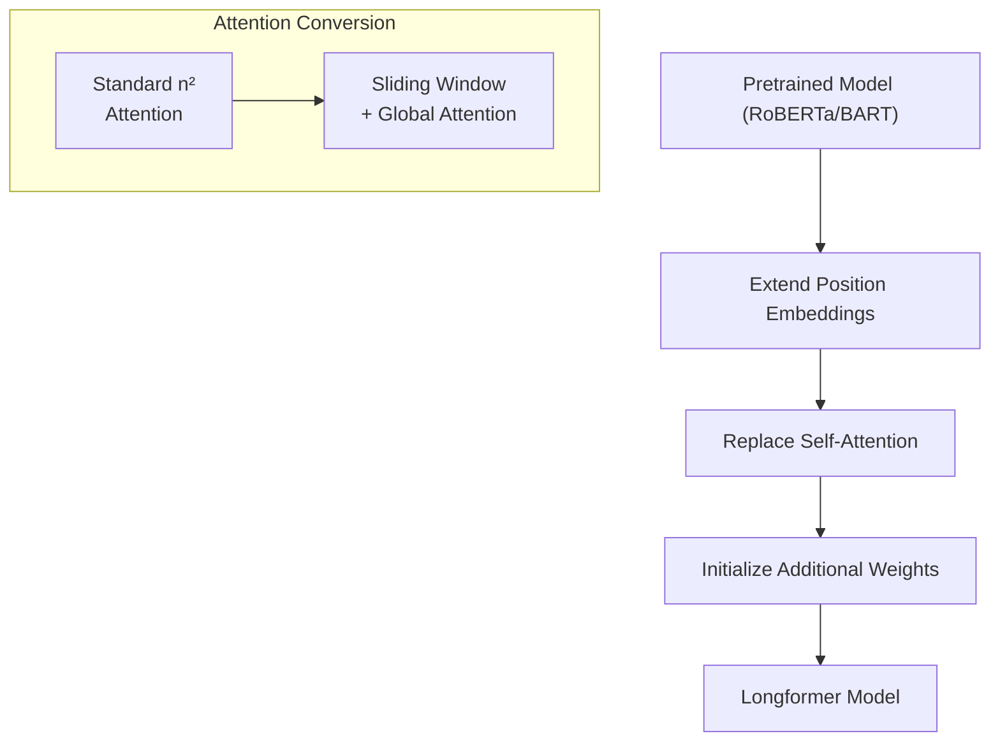
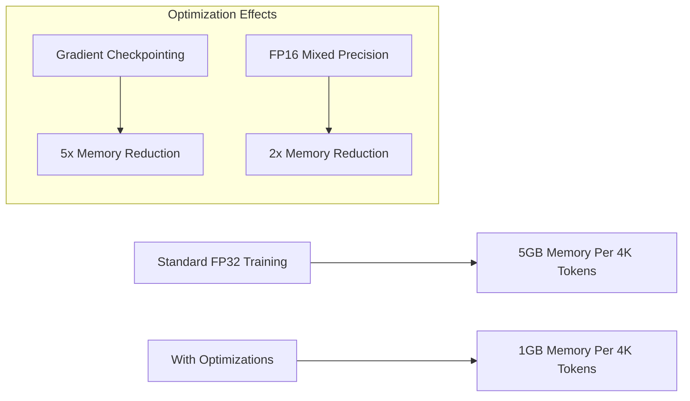
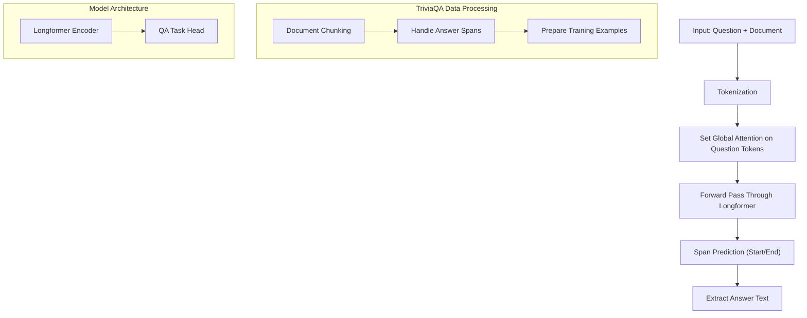
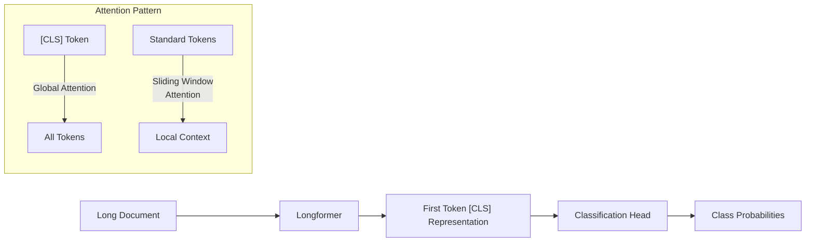
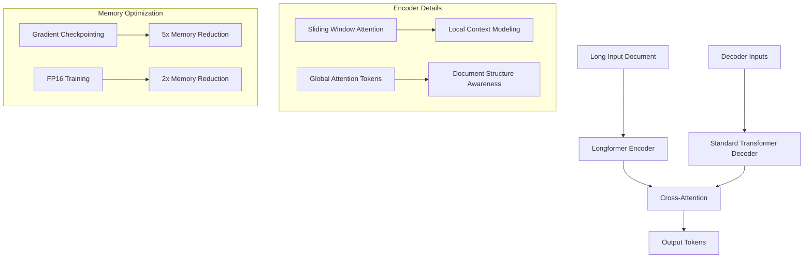
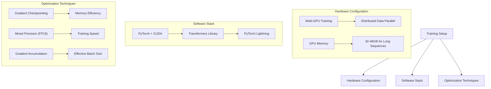

<!-- source: DeepWiki mcp.deepwiki.com · repo allenai/longformer · page 4 Training and Applications · fetched 2026-10-26 -->

# Training and Applications

<details>
<summary>Relevant source files</summary>

The following files were used as context for generating this wiki page:

- [README.md](README.md)
- [scripts/triviaqa.py](scripts/triviaqa.py)

</details>


This document provides a comprehensive overview of how to train Longformer models and the key applications they're designed for. It covers training strategies, optimization techniques, and implementation details for various downstream tasks like question answering, document classification, and summarization. For information about the architecture and implementation details of Longformer's attention mechanisms, see [Architecture](#2) and [Implementation Details](#3).

## Training Longformer Models

Longformer models can be created either by loading pretrained checkpoints or by converting existing transformer models to support longer sequences.

### Pretrained Models

Longformer provides several pretrained models that can be used directly:

- Base Longformer: `longformer-base-4096` (base model with 4096 sequence length)
- Large Longformer: `longformer-large-4096` (large model with 4096 sequence length)
- LED Base: `led-base-16384` (encoder-decoder model with 16384 input length)
- LED Large: `led-large-16384` (encoder-decoder model with 16384 input length)

These can be loaded using the Hugging Face Transformers library:

```python
from transformers import LongformerModel
model = LongformerModel.from_pretrained("allenai/longformer-base-4096")
```

Sources: [README.md:1-59]()

### Converting Existing Models

You can also convert standard transformer models (RoBERTa, BERT, etc.) to Longformer models to handle longer sequences. This involves:

1. Replacing the standard self-attention with sliding window attention
2. Extending position embeddings to support longer sequences
3. Initializing new position embeddings using interpolation

The team provides a conversion notebook to automate this process. The conversion allows you to leverage existing pretrained weights while gaining the ability to process much longer documents.



Sources: [README.md:31-42](), [README.md:108-112]()

### Memory Optimization Techniques

Training transformer models on long sequences requires significant memory. Longformer implements several techniques to reduce memory usage:

#### Gradient Checkpointing

Gradient checkpointing is a key technique that reduces memory usage by about 5x, allowing the processing of longer sequences at the cost of some computational overhead.

```python
# Enable gradient checkpointing when loading a model
from transformers import LongformerModel
model = LongformerModel.from_pretrained('allenai/longformer-base-4096', gradient_checkpointing=True)
```

#### Mixed Precision Training

Longformer supports FP16 (half-precision) training, which reduces memory usage and speeds up training, especially on newer GPU hardware.



Sources: [README.md:20-27](), [README.md:39-41]()

## Applications

Longformer was designed to excel at tasks that require processing long documents. The main applications include:

### Question Answering

Question answering systems find answers to questions within documents. Longformer is particularly effective for QA tasks involving long documents, with TriviaQA being a key benchmark.

#### TriviaQA Implementation

The repository includes a complete implementation for fine-tuning Longformer on TriviaQA:



The TriviaQA implementation uses PyTorch Lightning for training and includes several key components:

1. **Data processing** with document chunking and sliding windows to handle long contexts
2. **Global attention** applied to question tokens, allowing them to attend to the entire document
3. **Custom loss function** that handles multiple possible answers
4. **Evaluation metrics** including F1 and Exact Match scores

Key classes and components:
- `TriviaQADataset`: Handles data loading and preprocessing
- `TriviaQA`: Lightning module implementing the model and training loop

Sources: [scripts/triviaqa.py:24-279](), [scripts/triviaqa.py:282-441](), [README.md:114-117]()

#### Model Configuration for QA

For question answering, the attention mask is configured to use global attention for question tokens and local window attention for document tokens:

```python
# Attention mask values: 0=no attention, 1=local attention, 2=global attention
attention_mask = torch.ones(input_ids.shape, dtype=torch.long)  # local attention
attention_mask[:, :question_end_index] = 2  # global attention for question
```

This hybrid attention mechanism allows the model to create effective representations of both the question and relevant document parts.

Sources: [scripts/triviaqa.py:335-349]()

### Document Classification

Longformer can be used for document classification tasks on long texts, such as the Hyperpartisan News Detection task, which involves identifying extremely partisan news articles.

For document classification tasks, the typical approach is:

1. Use the first token (`<s>`) representation for classification
2. Apply global attention to the first token, allowing it to attend to the entire document
3. Fine-tune the model with a classification head



For document classification, it's often beneficial to include some domain adaptation through continued pretraining on domain-specific data before fine-tuning on the target task.

Sources: [README.md:96-101]()

### Summarization and Sequence-to-Sequence Tasks

The LongformerEncoderDecoder (LED) model is designed for sequence-to-sequence tasks, particularly summarization of long documents.

#### LED Architecture

LED combines a Longformer encoder with a standard transformer decoder. This allows it to process long input documents while generating concise summaries or other outputs.



With gradient checkpointing, FP16, and sufficient GPU memory (48GB), LED can process inputs of up to 16K tokens, making it suitable for summarizing very long documents.

Sources: [README.md:4-12]()

#### Training for Summarization

To train LED for summarization:

1. Load the pretrained LED model
2. Prepare the dataset with long documents and their summaries
3. Enable memory optimizations (gradient checkpointing, FP16)
4. Fine-tune the model using teacher forcing with summary tokens as targets

The repository includes a summarization script to demonstrate how to use LED for this purpose.

```python
# Example of using LED for summarization
from transformers import LEDForConditionalGeneration
model = LEDForConditionalGeneration.from_pretrained("allenai/led-base-16384")
# Enable gradient checkpointing
model.config.gradient_checkpointing = True
```

For summarization tasks, it's often beneficial to set global attention on key tokens such as sentence beginnings or special tokens to help the model identify important document sections.

Sources: [README.md:4-12]()

## Training Infrastructure and Optimization

### Training Setup

Training Longformer models requires careful consideration of hardware and software optimizations:

#### Hardware Requirements

- GPUs with sufficient memory (at least 16GB, 32GB+ recommended for large models)
- For LED with 16K tokens, 48GB GPUs are recommended

#### Software Stack

- PyTorch with CUDA support
- Transformers library (specific fork or version as indicated in requirements)
- PyTorch Lightning for training organization



The TriviaQA implementation serves as a good example of how to structure an efficient training pipeline for Longformer models, using PyTorch Lightning to organize the training code and handle distributed training.

Sources: [scripts/triviaqa.py:748-797](), [README.md:61-68]()

### Performance Considerations

When training Longformer models, consider these performance factors:

1. **Batch size**: Due to memory constraints, small batch sizes with gradient accumulation are often necessary
2. **Sequence length**: Longer sequences require more memory but allow processing of longer documents
3. **Attention implementation**: Choose between TVM (faster but less compatible) or PyTorch (more compatible but slower)
4. **Learning rate scheduling**: Typically uses linear warmup followed by linear decay

The training script for TriviaQA demonstrates these considerations:

```python
# Learning rate schedule for Longformer training
def lr_lambda(current_step):
    if current_step < args.warmup:
        return float(current_step) / float(max(1, args.warmup))
    return max(0.0, float(args.steps - current_step) / 
               float(max(1, args.steps - args.warmup)))
```

Sources: [scripts/triviaqa.py:632-639]()

## Summary

Longformer provides a flexible and efficient architecture for processing long documents. The training procedures leverage modern optimization techniques like gradient checkpointing and mixed precision to enable working with long sequences. The model has been successfully applied to various NLP tasks including question answering, document classification, and summarization, demonstrating its effectiveness across different applications that require long context understanding.

---

