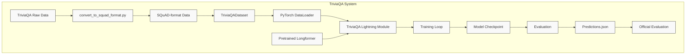
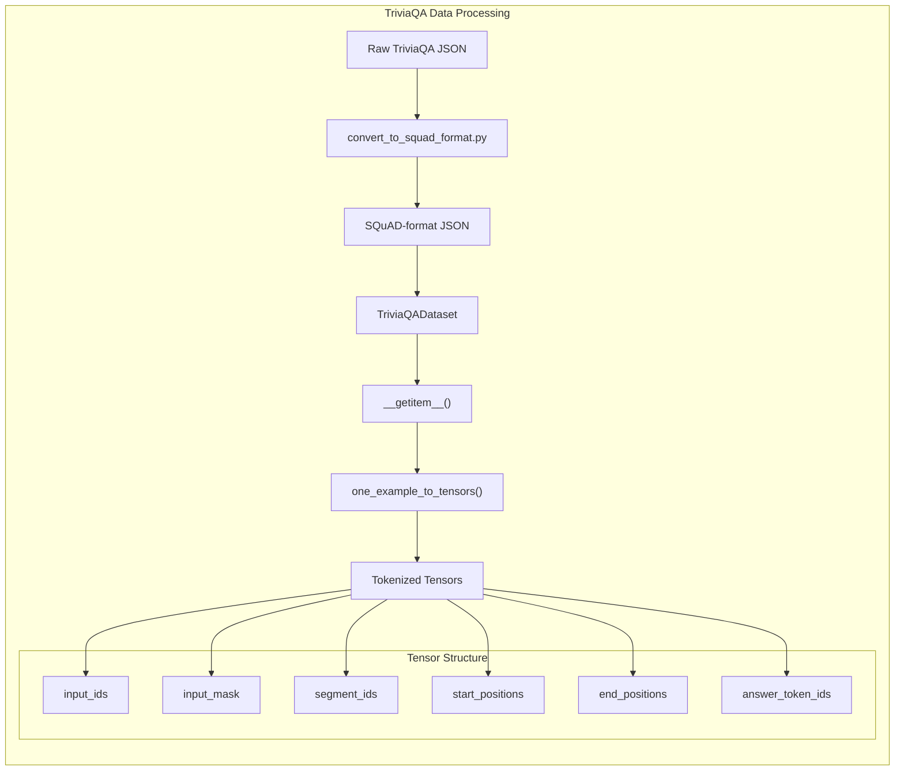
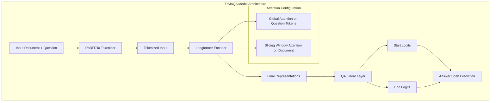
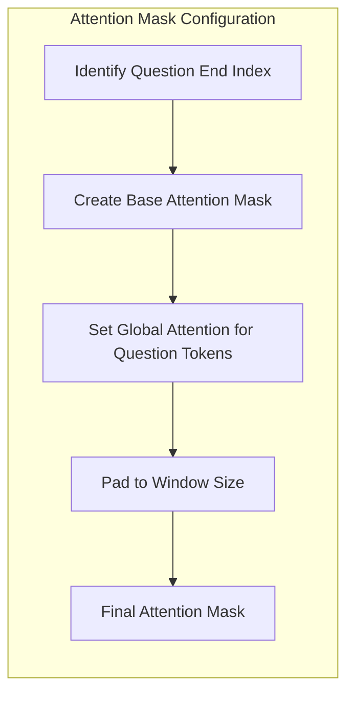
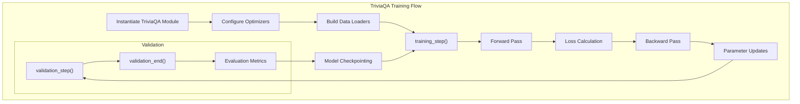
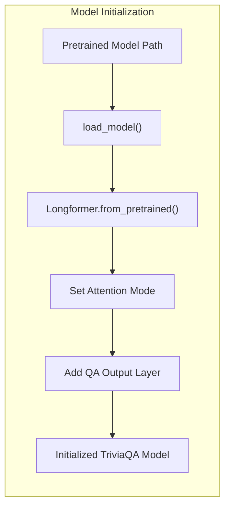
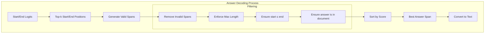
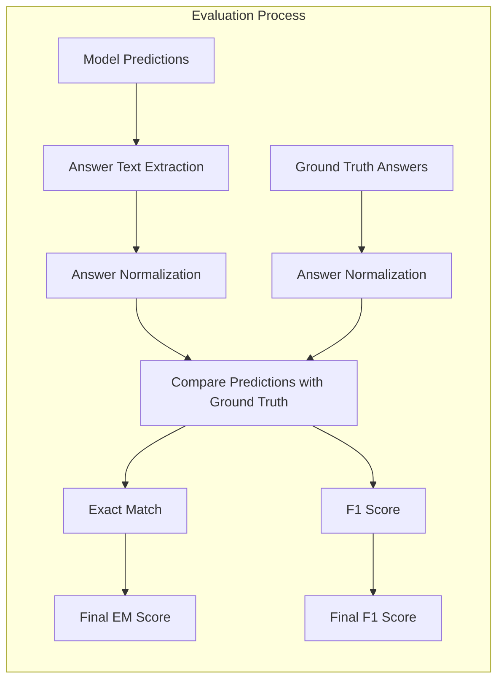
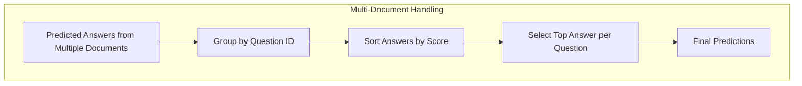

<!-- source: DeepWiki mcp.deepwiki.com · repo allenai/longformer · page 4.1 Question Answering with TriviaQA · fetched 2026-10-26 -->

# Question Answering with TriviaQA

<details>
<summary>Relevant source files</summary>

The following files were used as context for generating this wiki page:

- [scripts/cheatsheet.txt](scripts/cheatsheet.txt)
- [scripts/triviaqa.py](scripts/triviaqa.py)
- [scripts/triviaqa_utils/convert_to_squad_format.py](scripts/triviaqa_utils/convert_to_squad_format.py)
- [scripts/triviaqa_utils/evaluation_utils.py](scripts/triviaqa_utils/evaluation_utils.py)

</details>


## Purpose and Scope

This document details the implementation and usage of the Longformer model for question answering using the TriviaQA dataset. It covers the data processing pipeline, model architecture, training procedure, and evaluation methodology. The implementation leverages Longformer's ability to process long documents efficiently to achieve state-of-the-art performance on TriviaQA.

For general information about the Longformer architecture, see [Architecture](#2). For details about other applications like document classification, see [Document Classification](#4.2).

## System Overview

The TriviaQA implementation consists of several components that work together to train and evaluate a Longformer-based question answering system.



Sources: [scripts/triviaqa.py](), [scripts/cheatsheet.txt:24-72]()

## Data Processing

### TriviaQA Dataset Structure

The TriviaQA dataset provides question-answer pairs with supporting evidence documents. The implementation first converts this data to a SQuAD-like format for easier processing.



Sources: [scripts/triviaqa.py:24-279](), [scripts/triviaqa_utils/convert_to_squad_format.py]()

### Dataset Processing Details

The `TriviaQADataset` class handles the loading and preprocessing of data:

1. **Data Loading**: Reads the SQuAD-format JSON files
2. **Tokenization**: Uses RoBERTa tokenizer for both questions and documents
3. **Document Handling**: Processes long documents with optional sliding window
4. **Answer Annotation**: Converts answer spans to token indices for training
5. **Batching**: Special collation function to handle variable-length inputs

Key parameters for dataset processing include:

| Parameter | Description | Default Value |
|-----------|-------------|---------------|
| `max_seq_len` | Maximum sequence length for model input | 4096 |
| `max_doc_len` | Maximum document length in tokens | 4096 |
| `doc_stride` | Overlap between document chunks | -1 (no sliding window) |
| `max_num_answers` | Maximum number of answer spans per document | 64 |
| `max_question_len` | Maximum question length in tokens | 55 |

Sources: [scripts/triviaqa.py:24-279]()

## Model Architecture

The TriviaQA implementation uses a Longformer model with a question answering head.



Sources: [scripts/triviaqa.py:282-333](), [scripts/triviaqa.py:335-410]()

### Attention Mechanism Configuration

A key aspect of the implementation is how attention is configured in the Longformer model:

1. **Global Attention for Questions**: The model applies global attention to question tokens, allowing them to attend to the entire context
2. **Sliding Window Attention for Document**: Document tokens use sliding window attention, which is efficient for long documents

The attention mask is configured programmatically:



Sources: [scripts/triviaqa.py:335-359](), [scripts/triviaqa.py:509-514]()

## Training Process

The training process is implemented using PyTorch Lightning, which provides a clean structure for training and evaluation.



Sources: [scripts/triviaqa.py:447-455](), [scripts/triviaqa.py:457-507](), [scripts/triviaqa.py:560-597](), [scripts/triviaqa.py:632-639]()

### Model Initialization

The model is initialized with a pretrained Longformer model:



Sources: [scripts/triviaqa.py:297-333]()

### Loss Function

The implementation offers two loss function options:

1. **Regular Softmax Loss**: Standard cross-entropy loss
2. **OR-Softmax Loss**: A special loss function for multiple valid answer spans, as described in [this paper](https://arxiv.org/pdf/1710.10723.pdf)

The OR-Softmax loss handles multiple valid answers by calculating:
- Numerator: sum of exponentials of logits at valid answer positions
- Denominator: sum of exponentials of all logits

Sources: [scripts/triviaqa.py:394-407](), [scripts/triviaqa.py:412-445]()

## Answer Decoding

During inference, the model decodes answers from the predicted start and end logits:



Sources: [scripts/triviaqa.py:516-552]()

## Evaluation

The implementation uses the official TriviaQA evaluation metrics:

1. **Exact Match (EM)**: Percentage of predictions that exactly match any of the reference answers
2. **F1 Score**: Token overlap between prediction and reference answers



Sources: [scripts/triviaqa.py:457-507](), [scripts/triviaqa_utils/evaluation_utils.py]()

### Handling Multiple Documents

The TriviaQA dataset can have multiple documents per question. The implementation handles this by:

1. Predicting answers for each document independently
2. Selecting the answer with the highest confidence score across all documents for each question



Sources: [scripts/triviaqa.py:581-591]()

## Usage and Training

### Example Training Command

```
python -m scripts.triviaqa \
    --train_dataset squad-wikipedia-train-4096.json \
    --dev_dataset squad-wikipedia-dev-4096.json \
    --gpus 0,1,2,3,4,5,6,7 --batch_size 8 --num_workers 4 \
    --lr 0.00003 --warmup 1000 --epochs 4 --max_seq_len 4096 --doc_stride -1 \
    --save_prefix output_dir \
    --model_path path/to/pretrained/longformer-base-4096 \
    --seed 4321
```

Sources: [scripts/cheatsheet.txt:40-52]()

### Important Parameters

| Parameter | Description |
|-----------|-------------|
| `max_seq_len` | Maximum sequence length (4096) |
| `doc_stride` | Document stride (-1 = no sliding window) |
| `lr` | Learning rate (3e-5) |
| `warmup` | Warmup steps (1000) |
| `epochs` | Number of epochs (4) |
| `attention_mode` | Attention implementation ("sliding_chunks" or "tvm") |
| `model_path` | Path to pretrained Longformer model |

Sources: [scripts/triviaqa.py:701-742](), [scripts/cheatsheet.txt:40-52]()

## Performance Results

Using the Longformer-large-4096 model, the implementation achieves:

| Metric | Score |
|--------|-------|
| Exact Match | 73.08% |
| F1 Score | 77.79% |

This result is achieved on the TriviaQA Wikipedia development set.

Sources: [scripts/cheatsheet.txt:68-72]()

## Conclusion

The TriviaQA implementation in the Longformer repository demonstrates how the model's ability to process long documents can be leveraged for complex question answering tasks. The combination of global attention on question tokens and sliding window attention on document tokens allows the model to effectively capture relevant information across long contexts, while still maintaining computational efficiency.

The system architecture provides a complete pipeline from data preparation to evaluation, with a focus on handling the challenges specific to TriviaQA, such as long documents and multiple valid answers.

---

