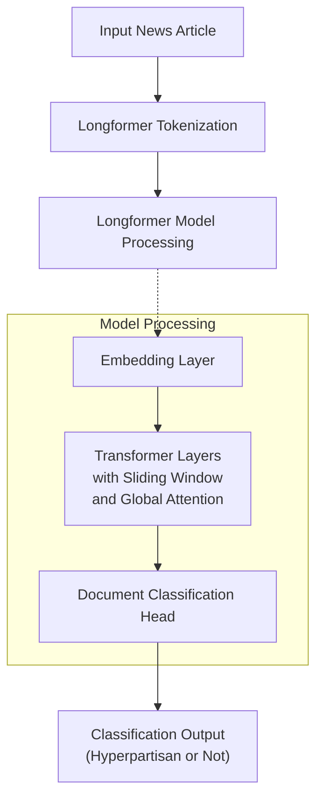
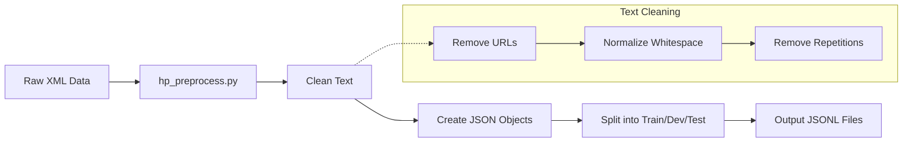
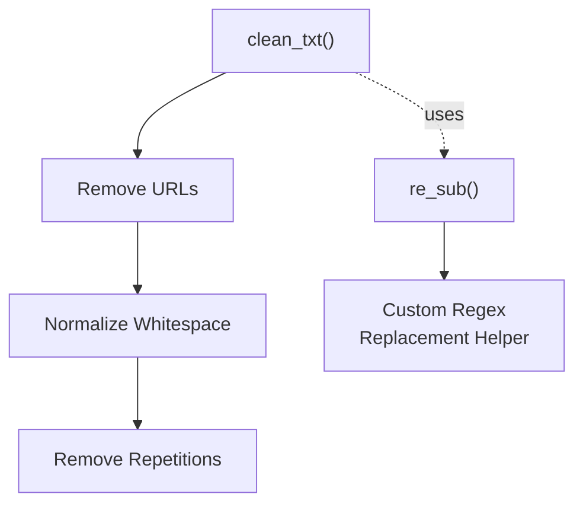
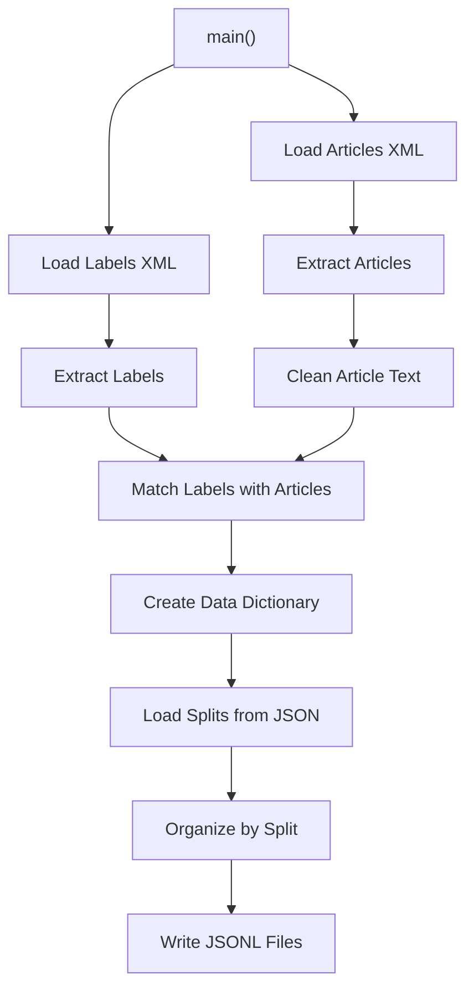
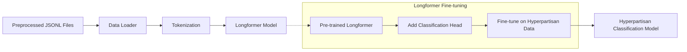

<!-- source: DeepWiki mcp.deepwiki.com · repo allenai/longformer · page 4.2 Document Classification · fetched 2026-10-26 -->

# Document Classification

<details>
<summary>Relevant source files</summary>

The following files were used as context for generating this wiki page:

- [scripts/hp-splits.json](scripts/hp-splits.json)
- [scripts/hp_preprocess.py](scripts/hp_preprocess.py)

</details>


## Purpose and Scope

This document details the implementation of document classification tasks within the Longformer architecture, specifically focusing on the hyperpartisan news classification task. The page covers dataset preprocessing, data organization, and the overall classification pipeline. For information about sequence-to-sequence tasks like summarization, see [Summarization and Sequence-to-Sequence Tasks](#4.3).

## Overview of Hyperpartisan News Classification

Longformer is well-suited for document classification tasks that involve long texts, such as detecting hyperpartisan news articles. Hyperpartisan news classification involves identifying news articles that display an extreme bias toward one side of the political spectrum.



Sources: [scripts/hp_preprocess.py:1-96]()

## Dataset Preparation

The hyperpartisan news classification implementation uses the dataset from PAN at SemEval 2019 Task 4. This dataset contains news articles labeled as hyperpartisan or not hyperpartisan.

### Preprocessing Pipeline

The repository includes a preprocessing script that handles the raw dataset and prepares it for training with Longformer models.



Sources: [scripts/hp_preprocess.py:34-51](), [scripts/hp_preprocess.py:69-92]()

### Data Organization

The data is organized into train, development, and test sets according to predefined splits specified in the `hp-splits.json` file. The preprocessing script loads these splits and organizes the processed articles accordingly.

| Split | Number of Examples | Purpose |
|-------|-------------------|---------|
| Train | 516 articles | Model training |
| Dev | 62 articles | Hyperparameter tuning |
| Test | 63 articles | Final evaluation |

Sources: [scripts/hp_preprocess.py:83-92](), [scripts/hp-splits.json:1]()

## Data Processing Implementation

The preprocessing pipeline is implemented in `hp_preprocess.py` and includes several key components:

### Text Cleaning Functions

The script contains functions for cleaning and normalizing the text data, removing irrelevant elements like URLs, and handling special characters.



Sources: [scripts/hp_preprocess.py:27-51]()

### Data Loading and Processing

The main processing workflow involves:

1. Loading XML files containing articles and their labels
2. Extracting and cleaning the text content
3. Matching articles with their labels based on IDs
4. Organizing data according to predefined splits
5. Writing processed data to JSONL files



Sources: [scripts/hp_preprocess.py:59-96]()

## Data Structure

Each processed article is represented as a JSON object with the following structure:

| Field | Type | Description |
|-------|------|-------------|
| `text` | string | The cleaned article text |
| `label` | string | "true" or "false" indicating whether the article is hyperpartisan |
| `id` | integer | Unique identifier for the article |

Sources: [scripts/hp_preprocess.py:77-81]()

## Integration with Longformer

The processed data is structured to be easily consumed by a Longformer model for training and evaluation. While the specific model implementation code is not provided, the typical approach would involve:

1. Loading the preprocessed JSONL files
2. Converting texts to Longformer input format (tokenization)
3. Fine-tuning the Longformer model with document classification head
4. Evaluating the model on development and test sets



Sources: [scripts/hp_preprocess.py:1-9]()

## Expected Usage

To use the hyperpartisan news classification implementation:

1. Download the original dataset from PAN at SemEval 2019 Task 4
2. Run the preprocessing script:
   ```
   python scripts/hp_preprocess.py --train-file articles-training-byarticle-20181122.xml --labels-file ground-truth-training-byarticle-20181122.xml --splits-file scripts/hp-splits.json --output-dir data/hyperpartisan/
   ```
3. Fine-tune a Longformer model using the preprocessed data
4. Evaluate the model on the test set

The Longformer's ability to process long documents makes it particularly suitable for this task, as news articles can be lengthy and require understanding of context across the entire document.

Sources: [scripts/hp_preprocess.py:1-9](), [scripts/hp_preprocess.py:59-67]()

## Performance Considerations

When using Longformer for document classification tasks like hyperpartisan news detection, several factors should be considered:

1. **Sequence Length**: News articles can vary greatly in length. Longformer's ability to handle up to 4,096 tokens (or more with gradient checkpointing) is beneficial for capturing the full context.

2. **Attention Configuration**: For document classification, a combination of sliding window attention and strategic global attention (e.g., on [CLS] token) typically works well.

3. **Memory Usage**: Longer documents require more memory. Using the TVM-optimized attention implementation or gradient checkpointing can help manage memory requirements during training.

The hyperpartisan classification task provides a practical application demonstrating Longformer's advantages over traditional transformers when dealing with long documents.

---

