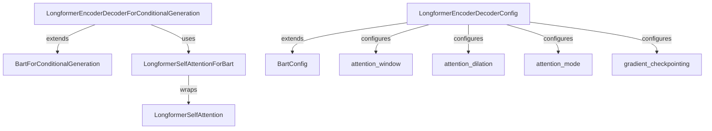
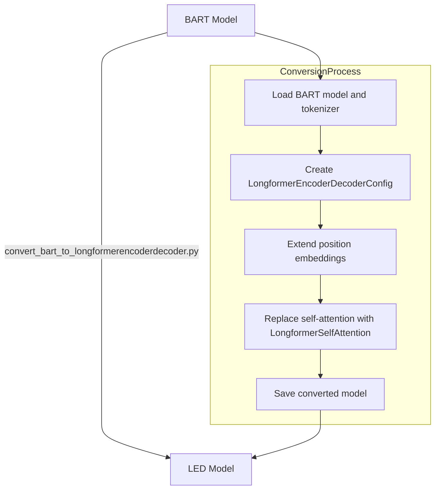
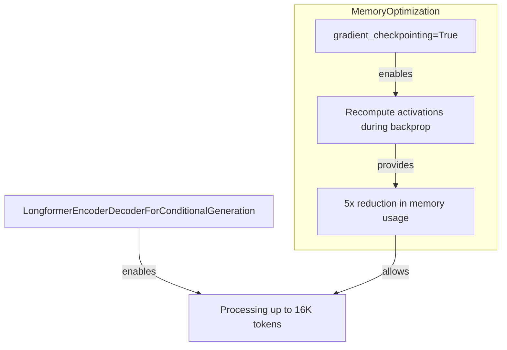
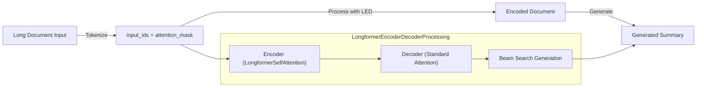
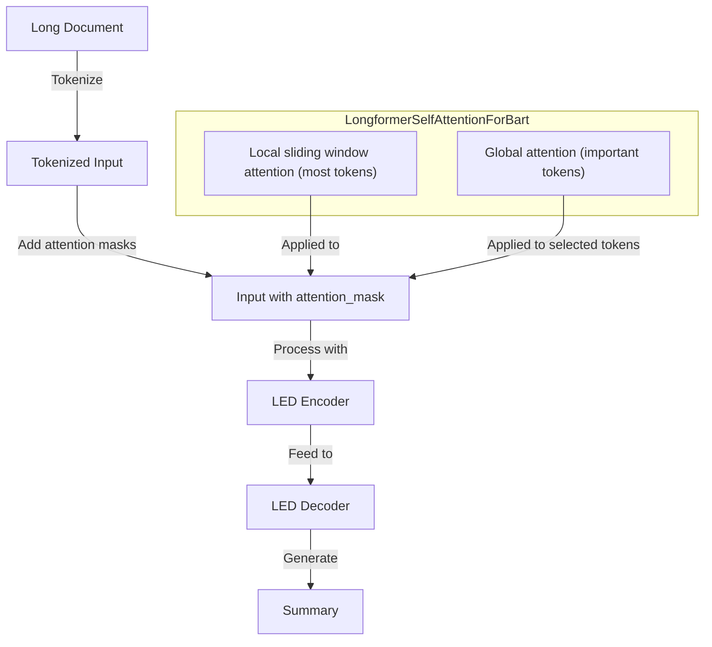
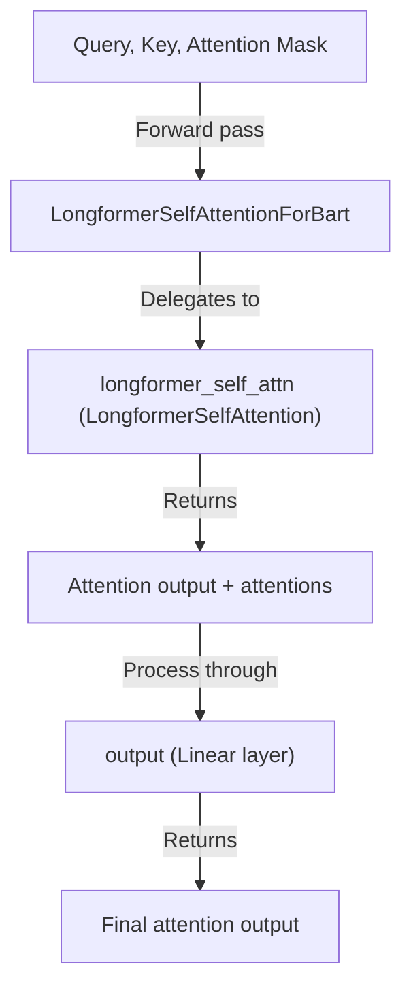

<!-- source: DeepWiki mcp.deepwiki.com · repo allenai/longformer · page 4.3 Summarization and Sequence-to-Sequence Tasks · fetched 2026-10-26 -->

# Summarization and Sequence-to-Sequence Tasks

<details>
<summary>Relevant source files</summary>

The following files were used as context for generating this wiki page:

- [README.md](README.md)
- [longformer/longformer_encoder_decoder.py](longformer/longformer_encoder_decoder.py)
- [scripts/convert_bart_to_longformerencoderdecoder.py](scripts/convert_bart_to_longformerencoderdecoder.py)

</details>


This document explains how to use the LongformerEncoderDecoder (LED) model for text summarization and other sequence-to-sequence tasks within the Longformer codebase. LED is specifically designed to handle long documents by combining Longformer's efficient attention mechanisms with an encoder-decoder architecture based on BART. For information about the core attention mechanisms, see [Attention Mechanisms](#2.1).

## Overview of LongformerEncoderDecoder

The LongformerEncoderDecoder (LED) model extends BART with Longformer's sliding window attention, enabling efficient processing of documents with up to 16K tokens (with gradient checkpointing and fp16).



Sources: [longformer/longformer_encoder_decoder.py:7-15](), [longformer/longformer_encoder_decoder.py:17-39](), [README.md:4-12]()

LED implements two primary classes:

1. `LongformerEncoderDecoderForConditionalGeneration`: Extends the BART conditional generation model but replaces the encoder's self-attention with Longformer's sliding window attention.

2. `LongformerEncoderDecoderConfig`: Extends BART's configuration with Longformer-specific parameters:
   - `attention_window`: Controls the window size for sliding window attention
   - `attention_dilation`: Specifies dilation factors for increased receptive field
   - `attention_mode`: Selects implementation ('n2', 'tvm', or 'sliding_chunks')
   - `gradient_checkpointing`: Enables memory-efficient training

Sources: [longformer/longformer_encoder_decoder.py:7-76]()

## Creating LED Models

LED models can be created by converting BART models using the utility script provided in the repository.



Sources: [scripts/convert_bart_to_longformerencoderdecoder.py:17-87]()

The conversion process involves:

1. Loading a pretrained BART model
2. Creating a `LongformerEncoderDecoderConfig` from the BART config
3. Extending position embeddings to support longer sequences
4. Replacing the encoder's self-attention layers with `LongformerSelfAttentionForBart`
5. Saving the converted model

Example command to convert a BART model to LED:

```bash
python convert_bart_to_longformerencoderdecoder.py \
  --base_model facebook/bart-large \
  --save_model_to ./led-large-16384 \
  --attention_window 512 \
  --max_pos 16384
```

Sources: [scripts/convert_bart_to_longformerencoderdecoder.py:90-134]()

## Memory Optimization for Long Sequences

Processing documents up to 16K tokens requires memory optimization techniques. LED implements gradient checkpointing to reduce memory usage.



Sources: [README.md:4-12](), [scripts/convert_bart_to_longformerencoderdecoder.py:139-140]()

To enable gradient checkpointing:

```python
model = LongformerEncoderDecoderForConditionalGeneration.from_pretrained("allenai/led-base-16384")
model.model.encoder.config.gradient_checkpointing = True
model.model.decoder.config.gradient_checkpointing = True
```

This reduces memory usage by approximately 5x by recomputing intermediate activations during the backward pass rather than storing them in memory.

Sources: [scripts/convert_bart_to_longformerencoderdecoder.py:139-140]()

## Using LED for Summarization Tasks

The summarization process involves tokenizing a long document, encoding it with sliding window attention, and generating a summary.



Sources: [README.md:12](), [scripts/convert_bart_to_longformerencoderdecoder.py:136-149]()

Basic example of using LED for summarization:

```python
from transformers import LongformerEncoderDecoderForConditionalGeneration, BartTokenizer

# Load model and tokenizer
model = LongformerEncoderDecoderForConditionalGeneration.from_pretrained("allenai/led-base-16384")
tokenizer = BartTokenizer.from_pretrained("allenai/led-base-16384")

# Enable gradient checkpointing
model.model.encoder.config.gradient_checkpointing = True
model.model.decoder.config.gradient_checkpointing = True

# Tokenize input document
inputs = tokenizer(long_document, return_tensors="pt", padding="max_length", max_length=16384)

# Generate summary
output_ids = model.generate(
    inputs["input_ids"],
    attention_mask=inputs["attention_mask"],
    max_length=512,
    num_beams=4,
    early_stopping=True
)

# Decode summary
summary = tokenizer.decode(output_ids[0], skip_special_tokens=True)
```

The repository includes a script `scripts/summarization.py` that provides more detailed examples of using LED for summarization tasks.

Sources: [README.md:12]()

## Available Pretrained Models

The repository provides two pretrained LED models:

| Model Name | Size | Max Input Length | Download Link |
|------------|------|------------------|--------------|
| led-base-16384 | Base | 16,384 tokens | Available in README |
| led-large-16384 | Large | 16,384 tokens | Available in README |

These models can be loaded directly using the Hugging Face Transformers library:

```python
from transformers import AutoModel, AutoTokenizer

model = AutoModel.from_pretrained("allenai/led-base-16384")
tokenizer = AutoTokenizer.from_pretrained("allenai/led-base-16384")
```

Sources: [README.md:8]()

## Using Global Attention for Important Tokens

Unlike standard encoder-only Longformer models, LED operates in two distinct phases:

1. **Encoding phase**: Uses Longformer's sliding window attention with optional global attention on important tokens
2. **Decoding phase**: Uses standard transformer attention

You can designate important tokens (like headers or key sentences) to receive global attention during encoding:



Sources: [longformer/longformer_encoder_decoder.py:42-76]()

To implement global attention, you would modify the standard attention mask for specific tokens:

```python
# Standard mask (1 = attend, 0 = don't attend)
attention_mask = torch.ones_like(input_ids)

# To add global attention: 
# 2 = global attention (token attends to all other tokens and all tokens attend to it)
attention_mask[:, 0] = 2  # Set global attention on first token (e.g., [CLS])
```

This approach is particularly useful for summarization tasks where certain tokens carry greater semantic importance.

Sources: [longformer/longformer_encoder_decoder.py:49-72]()

## Internal Implementation Details

The `LongformerSelfAttentionForBart` class adapts `LongformerSelfAttention` to work within BART's architecture:



Sources: [longformer/longformer_encoder_decoder.py:42-76]()

The implementation handles the necessary adaptation between BART's expected tensor shapes and Longformer's implementation:

1. It transposes the input from `[tgt_len, bsz, embed_dim]` to `[bsz, seqlen, embd_dim]`
2. Converts BART's key_padding_mask to Longformer's attention_mask format
3. Processes through the Longformer self-attention mechanism
4. Transposes the output back to BART's expected format

This adaptation allows LED to leverage Longformer's efficient attention implementation within BART's encoder-decoder architecture.

Sources: [longformer/longformer_encoder_decoder.py:49-76]()

---

