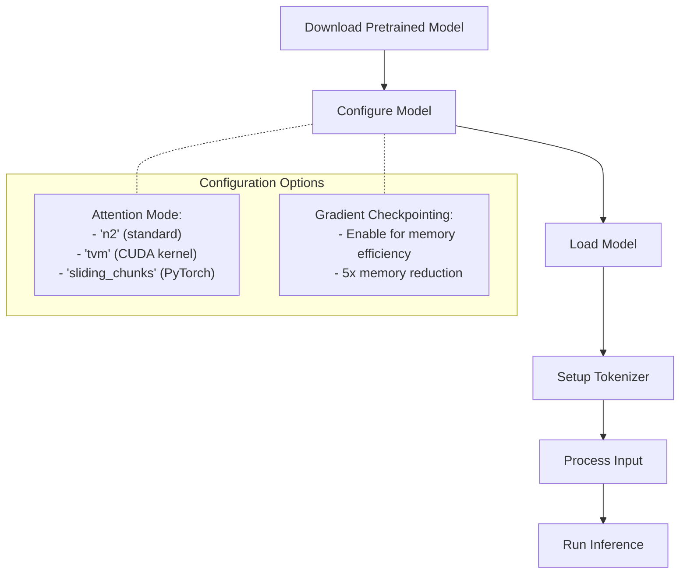
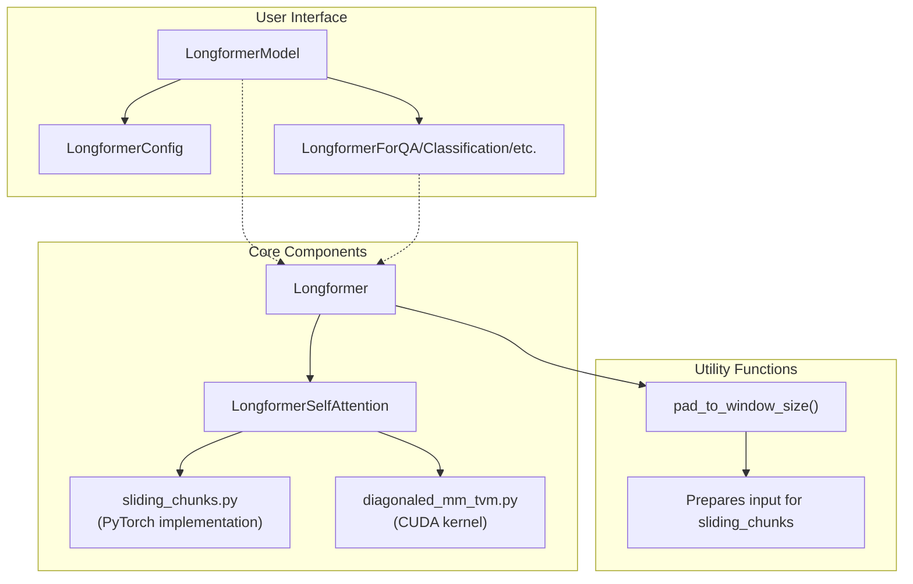
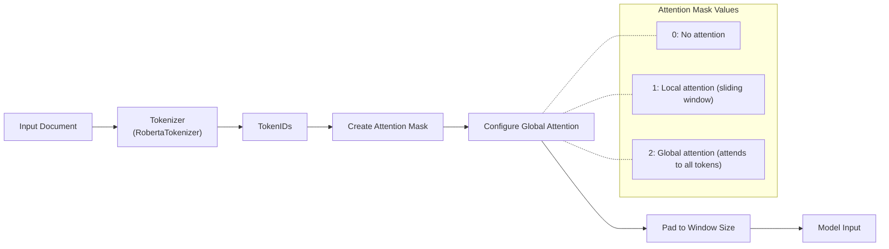
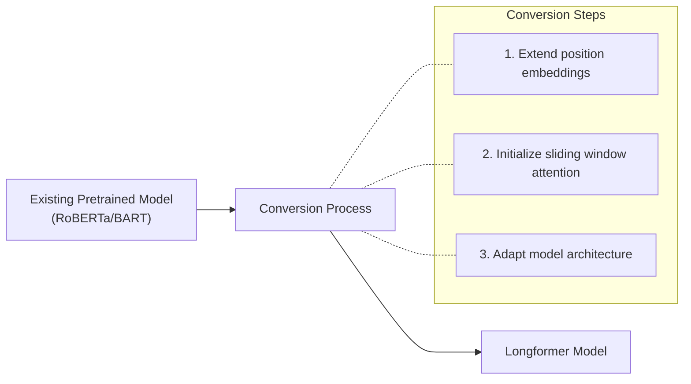
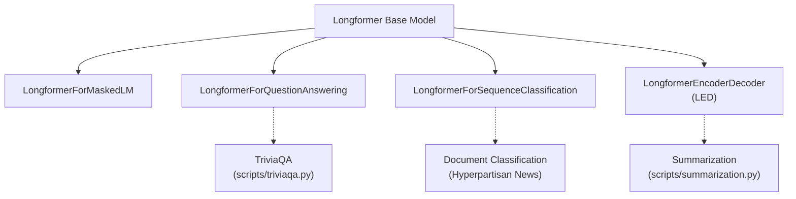

<!-- source: DeepWiki mcp.deepwiki.com · repo allenai/longformer · page 5 Getting Started · fetched 2026-10-26 -->

# Getting Started

<details>
<summary>Relevant source files</summary>

The following files were used as context for generating this wiki page:

- [README.md](README.md)
- [requirements.txt](requirements.txt)

</details>


This page provides a practical guide for getting started with Longformer, a transformer model for long documents. We'll cover installation, basic usage, and development setup - everything you need to begin working with Longformer models.

For detailed information about the Longformer architecture and its attention mechanisms, see [Architecture](#2) and [Attention Mechanisms](#2.1). For specific applications like question answering or document classification, see [Training and Applications](#4).

## Installation

Longformer can be installed in multiple ways depending on your needs.

### Prerequisites

- Python 3.7 or later
- PyTorch 1.6.0 or later
- CUDA 10.0 or later (for GPU acceleration)

### Quick Installation

For most users, the simplest way to install Longformer is directly from GitHub:

```bash
pip install git+https://github.com/allenai/longformer.git
```

### Conda Environment Setup

For a more controlled environment:

```bash
conda create --name longformer python=3.7
conda activate longformer
conda install cudatoolkit=10.0
pip install git+https://github.com/allenai/longformer.git
```

### Dependencies

Longformer relies on specific versions of certain packages for full functionality:

| Dependency | Version/Source | Purpose |
|------------|----------------|---------|
| transformers | Custom fork | Enables LongformerEncoderDecoder and gradient checkpointing |
| pytorch-lightning | Custom fork | For training infrastructure |
| torch | >=1.6.0 | Core deep learning framework |
| tensorboardX | Latest | Visualization during training |
| test-tube | ==0.7.5 | Experiment logging |
| nlp | Latest | Data processing |
| rouge_score | Latest | Evaluation for summarization tasks |

Sources: [requirements.txt:1-8](), [README.md:64-68]()

## Loading Pretrained Models

Longformer provides several pretrained models that you can use immediately.

### Available Pretrained Models

| Model | Description | Max Sequence Length |
|-------|-------------|---------------------|
| longformer-base-4096 | Base Longformer model | 4,096 tokens |
| longformer-large-4096 | Large Longformer model | 4,096 tokens |
| led-base-16384 | Base LED model (encoder-decoder) | 16,384 tokens |
| led-large-16384 | Large LED model (encoder-decoder) | 16,384 tokens |

Sources: [README.md:58-59](), [README.md:8]()

### Model Loading Workflow



Sources: [README.md:78-87](), [README.md:22-27]()

## Basic Usage

### Using with HuggingFace Transformers

The simplest way to use Longformer is through the HuggingFace Transformers library:

```python
from transformers import LongformerModel
model = LongformerModel.from_pretrained("allenai/longformer-base-4096")
```

To enable gradient checkpointing for processing longer sequences with less memory:

```python
model = LongformerModel.from_pretrained('allenai/longformer-base-4096', gradient_checkpointing=True)
```

Sources: [README.md:33-35](), [README.md:26]()

### Using the Core Implementation

For more control over the model configuration:

```python
import torch
from longformer.longformer import Longformer, LongformerConfig
from longformer.sliding_chunks import pad_to_window_size
from transformers import RobertaTokenizer

config = LongformerConfig.from_pretrained('longformer-base-4096/') 
config.attention_mode = 'sliding_chunks'  # Choose attention implementation

model = Longformer.from_pretrained('longformer-base-4096/', config=config)
tokenizer = RobertaTokenizer.from_pretrained('roberta-base')
tokenizer.model_max_length = model.config.max_position_embeddings
```

Sources: [README.md:73-87]()

### Longformer Code Structure



Sources: [README.md:73-104]()

## Working with Attention Masks

One of Longformer's key features is its flexible attention mechanism, which requires proper configuration of attention masks.

### Attention Mask Configuration



The attention mask determines how attention is applied:

```python
# Initialize with local attention (sliding window)
attention_mask = torch.ones(input_ids.shape, dtype=torch.long, device=input_ids.device)

# Set global attention for specific tokens
attention_mask[:, [1, 4, 21,]] = 2  # Example: tokens 1, 4, and 21 get global attention

# For classification tasks: typically set global attention on the <s> token
# For QA tasks: set global attention on question tokens
```

For the `sliding_chunks` attention implementation, inputs need padding:

```python
input_ids, attention_mask = pad_to_window_size(
        input_ids, attention_mask, config.attention_window[0], tokenizer.pad_token_id)
```

Sources: [README.md:96-104]()

## Complete Usage Example

Here's a complete example showing how to process a long document with Longformer:

```python
import torch
from longformer.longformer import Longformer, LongformerConfig
from longformer.sliding_chunks import pad_to_window_size
from transformers import RobertaTokenizer

# 1. Load model and tokenizer
config = LongformerConfig.from_pretrained('longformer-base-4096/') 
config.attention_mode = 'sliding_chunks'
model = Longformer.from_pretrained('longformer-base-4096/', config=config)
tokenizer = RobertaTokenizer.from_pretrained('roberta-base')
tokenizer.model_max_length = model.config.max_position_embeddings

# 2. Prepare input document
SAMPLE_TEXT = ' '.join(['Hello world! '] * 1000)  # long input document
input_ids = torch.tensor(tokenizer.encode(SAMPLE_TEXT)).unsqueeze(0)  # batch of size 1

# 3. Configure attention mask
# 0: no attention, 1: local attention, 2: global attention
attention_mask = torch.ones(input_ids.shape, dtype=torch.long, device=input_ids.device)
attention_mask[:, [1, 4, 21,]] = 2  # Set global attention on specific tokens

# 4. Pad for sliding chunks attention
input_ids, attention_mask = pad_to_window_size(
        input_ids, attention_mask, config.attention_window[0], tokenizer.pad_token_id)

# 5. Run the model
output = model(input_ids, attention_mask=attention_mask)[0]
```

Sources: [README.md:73-106]()

## Attention Modes

Longformer offers three different attention implementations, each with its own advantages:

| Attention Mode | Description | Advantages | Limitations |
|----------------|-------------|------------|-------------|
| `n2` | Standard transformer attention | - Complete attention implementation<br>- Familiar behavior | - O(n²) complexity<br>- Limited sequence length |
| `tvm` | Custom CUDA kernel implementation | - Highly optimized<br>- Supports all Longformer features | - GPU and Linux only<br>- Requires CUDA 10+ |
| `sliding_chunks` | PyTorch implementation | - Works on CPU, GPU, TPU<br>- Supports fp16<br>- More portable | - Uses 2x more memory<br>- No dilation or autoregressive attention |

The `sliding_chunks` implementation is recommended for most finetuning tasks, while `tvm` is better for language modeling or if you need maximum performance.

Sources: [README.md:46-51](), [README.md:79-83]()

## Development Setup

### Environment Setup for Development

For those who want to contribute to Longformer development:

1. Clone the repository:
   ```bash
   git clone https://github.com/allenai/longformer.git
   cd longformer
   ```

2. Install dependencies with specific versions:
   ```bash
   pip install -r requirements.txt
   ```

### CUDA Kernel Information

The custom CUDA kernel (used for the `tvm` attention mode) is implemented in TVM:

- It works only on Linux with GPUs
- Tested on: Ubuntu, Python 3.7, CUDA 10, PyTorch >= 1.2.0
- Compiled binaries are included in the repository

If you need to recompile the kernel, instructions can be found in `scripts/cheatsheet.txt`.

Sources: [README.md:120-124]()

## Converting Existing Models to Longformer

Longformer provides a notebook that demonstrates how to convert an existing pretrained transformer model (like RoBERTa) into a Longformer model:



The conversion notebook is available at `scripts/convert_model_to_long.ipynb` in the repository.

Sources: [README.md:38](), [README.md:109-111]()

## Task-Specific Models

Longformer provides specialized model classes for specific downstream tasks:



These specialized models handle task-specific requirements like automatically setting global attention for relevant tokens.

Sources: [README.md:36](), [README.md:12](), [README.md:115-116]()

## Next Steps

After getting comfortable with basic Longformer usage, you may want to explore:

- [Attention Mechanisms](#2.1) - Learn more about sliding window and global attention
- [Longformer Base Model](#2.2) - Understand the base model architecture in detail
- [LongformerEncoderDecoder (LED)](#2.3) - Explore the encoder-decoder variant for seq2seq tasks
- [Training and Applications](#4) - See how to train models for specific tasks

---

