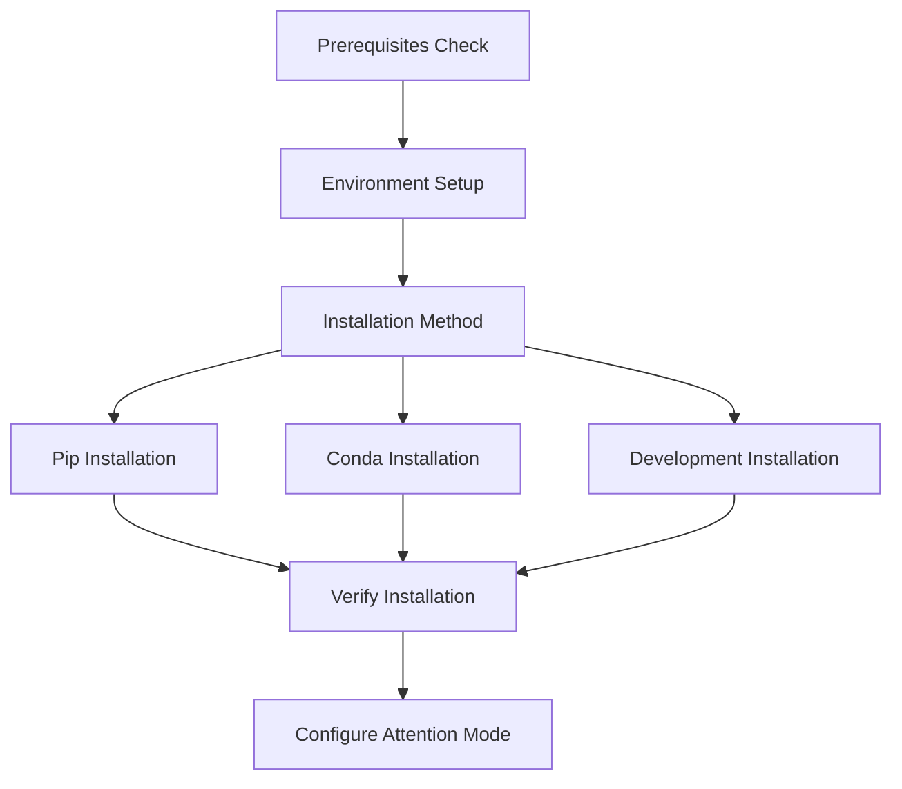
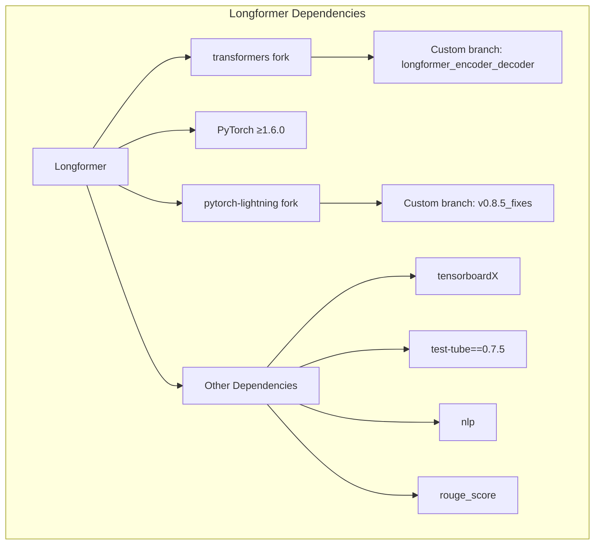

<!-- source: DeepWiki mcp.deepwiki.com · repo allenai/longformer · page 5.1 Installation · fetched 2026-10-26 -->

# Installation

<details>
<summary>Relevant source files</summary>

The following files were used as context for generating this wiki page:

- [README.md](README.md)
- [requirements.txt](requirements.txt)

</details>


This guide provides instructions for installing the Longformer library and its dependencies. It covers different installation methods, hardware and software requirements, and post-installation verification steps. For usage examples after installation, see [Usage Examples](#5.2).

## Installation Overview

Longformer requires specific dependencies and can be installed in multiple ways depending on your needs. The installation process involves setting up the Python environment, installing dependencies, and verifying the installation.



Sources: [README.md:61-68](). [requirements.txt:1-7]()

## Prerequisites

Before installing Longformer, ensure your system meets the following requirements:

| Component | Requirement | Notes |
|-----------|-------------|-------|
| Operating System | Linux (recommended) | The TVM CUDA kernel only works on Linux |
| Python | 3.7 | Tested with Python 3.7 |
| CUDA | 10.0 | Required for GPU acceleration |
| GPU | NVIDIA GPU with CUDA support | Required for TVM kernel |
| PyTorch | ≥1.6.0 | Required for base functionality |

Sources: [README.md:120-122](). [requirements.txt:3]()

## Installation Methods

### Method 1: Direct Pip Installation (Recommended)

The simplest way to install Longformer is directly from the GitHub repository:

```bash
pip install git+https://github.com/allenai/longformer.git
```

This method installs all necessary dependencies, including the required fork of Hugging Face Transformers.

Sources: [README.md:10](). [README.md:67]()

### Method 2: Conda Environment Setup

For a more controlled environment:

```bash
conda create --name longformer python=3.7
conda activate longformer
conda install cudatoolkit=10.0
pip install git+https://github.com/allenai/longformer.git
```

This creates an isolated environment specifically for Longformer.

Sources: [README.md:61-68]()

### Method 3: Manual Installation (For Development)

If you're planning to modify the code or need specific version control:

1. Clone the repository:
   ```bash
   git clone https://github.com/allenai/longformer.git
   cd longformer
   ```

2. Install dependencies from requirements.txt:
   ```bash
   pip install -r requirements.txt
   ```

Sources: [requirements.txt:1-7]()

## Dependencies

Longformer has several key dependencies that are automatically installed:



### Important Note on Transformers Version

Longformer requires a specific fork of the Hugging Face Transformers library. This fork adds support for:
- Gradient checkpointing (for memory efficiency)
- Different maximum sequence lengths for input and output
- Various Longformer-specific modifications

The required fork is automatically installed when using the pip installation command.

Sources: [requirements.txt:1-2](). [README.md:10]()

## Post-Installation Configuration

### Verifying Installation

After installation, you can verify that everything is working with a simple test:

```python
import torch
from longformer.longformer import Longformer, LongformerConfig
from transformers import RobertaTokenizer

# Should succeed if installation is correct
config = LongformerConfig.from_pretrained('allenai/longformer-base-4096')
tokenizer = RobertaTokenizer.from_pretrained('roberta-base')
```

### Selecting an Attention Mode

Longformer provides three attention modes, each with different hardware requirements:

| Attention Mode | Description | Hardware Support | Use Case |
|----------------|-------------|------------------|----------|
| `'n2'` | Regular N² attention | CPU, GPU | Baseline comparison |
| `'tvm'` | Custom CUDA kernel implementation | GPU only, Linux only | Best performance for training |
| `'sliding_chunks'` | PyTorch implementation | CPU, GPU, TPU | Finetuning, inference, non-Linux |

Configure the attention mode when loading the model:

```python
config = LongformerConfig.from_pretrained('allenai/longformer-base-4096/')
config.attention_mode = 'sliding_chunks'  # Choose appropriate mode
model = Longformer.from_pretrained('allenai/longformer-base-4096/', config=config)
```

Sources: [README.md:72-85](). [README.md:43-51]()

## Downloading Pretrained Models

Longformer provides several pretrained models:

### Encoder-only Models:
- [`longformer-base-4096`](https://ai2-s2-research.s3-us-west-2.amazonaws.com/longformer/longformer-base-4096.tar.gz)
- [`longformer-large-4096`](https://ai2-s2-research.s3-us-west-2.amazonaws.com/longformer/longformer-large-4096.tar.gz)

### Encoder-Decoder Models (LED):
- [`led-base-16384`](https://ai2-s2-research.s3-us-west-2.amazonaws.com/longformer/longformer-encdec-base-16384.tar.gz)
- [`led-large-16384`](https://ai2-s2-research.s3-us-west-2.amazonaws.com/longformer/longformer-encdec-large-16384.tar.gz)

Sources: [README.md:57-59](). [README.md:8]()

## CUDA Kernel Information

The custom TVM CUDA kernel provides optimized performance for the sliding window attention mechanism. Precompiled binaries are included in the repository, so most users won't need to compile it themselves.

### CUDA Kernel Compatibility:
- Operating System: Linux only
- Python: Tested with Python 3.7
- CUDA: Version 10.0
- PyTorch: Version ≥ 1.2.0

If you need to compile the kernel yourself, refer to the instructions in `scripts/cheatsheet.txt`.

Sources: [README.md:120-124]()

## Troubleshooting

### Common Issues

1. **Speed Degradation**: A speed degradation issue was identified in Hugging Face Transformers. Either use release v2.11.0 (without gradient checkpointing) or the master branch. This should be fixed in newer releases.

2. **Memory Issues**: For processing long sequences, enable gradient checkpointing:
   ```python
   from transformers import LongformerModel
   model = LongformerModel.from_pretrained('allenai/longformer-base-4096', gradient_checkpointing=True)
   ```
   This reduces memory usage by approximately 5x.

3. **CUDA Errors**: If you encounter CUDA errors with the TVM kernel, try switching to the `'sliding_chunks'` attention mode which is more broadly compatible.

Sources: [README.md:15-17](). [README.md:20-27]()

## Next Steps

After successful installation, you can:
- Use pretrained models for inference
- Finetune models on downstream tasks
- Convert existing models to "long" versions

For detailed usage examples, refer to [Usage Examples](#5.2).

Sources: [README.md:55-107]()

---

