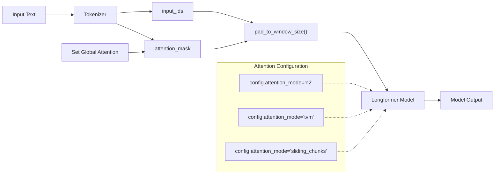
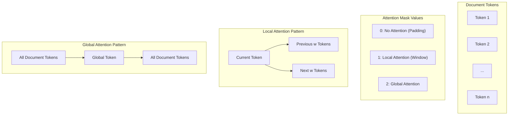
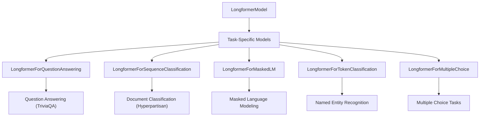
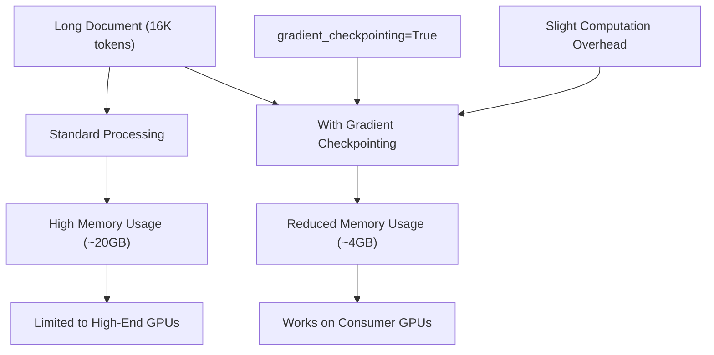
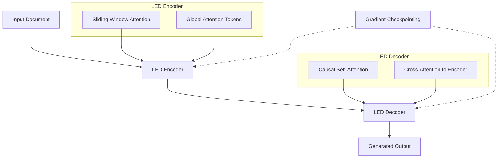
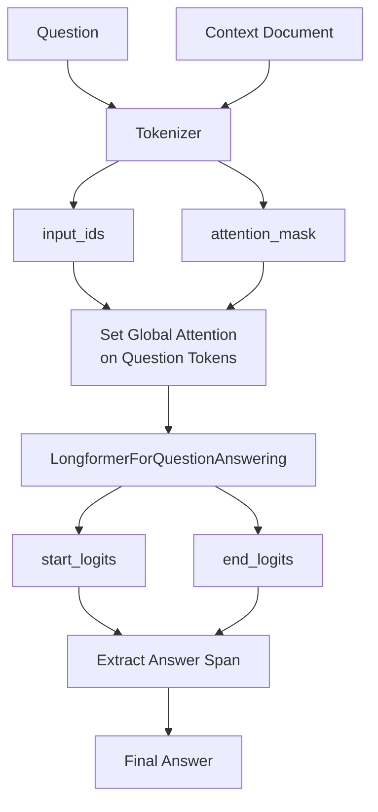
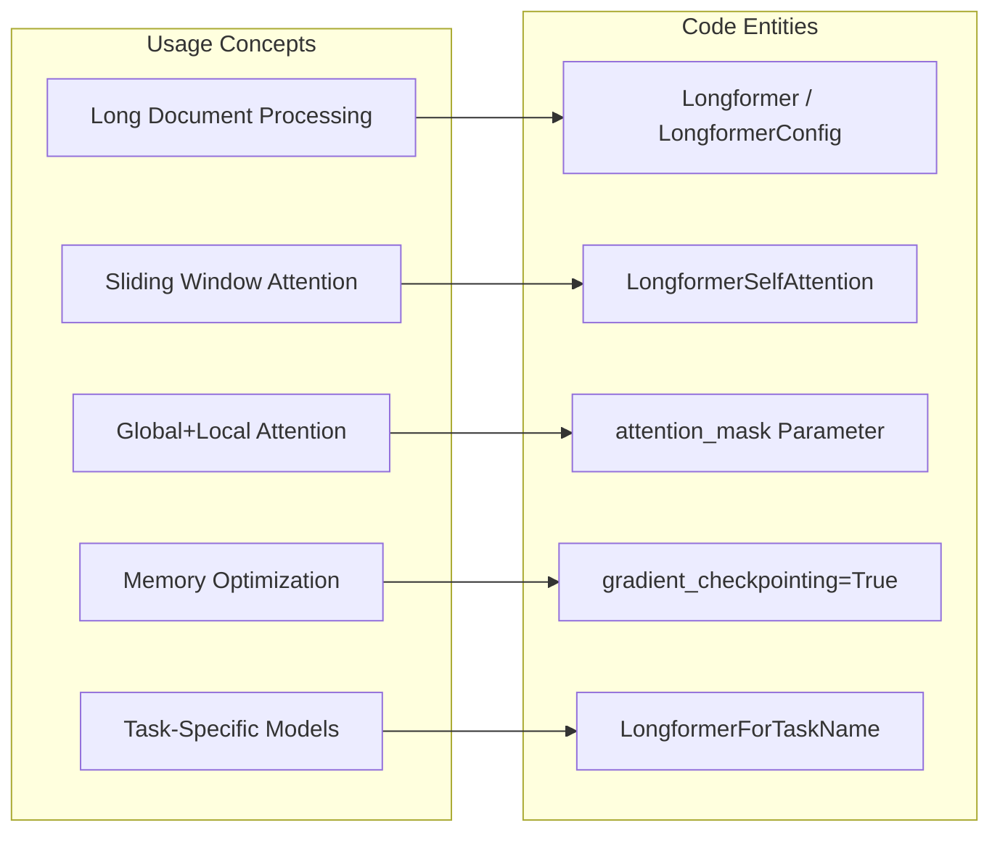
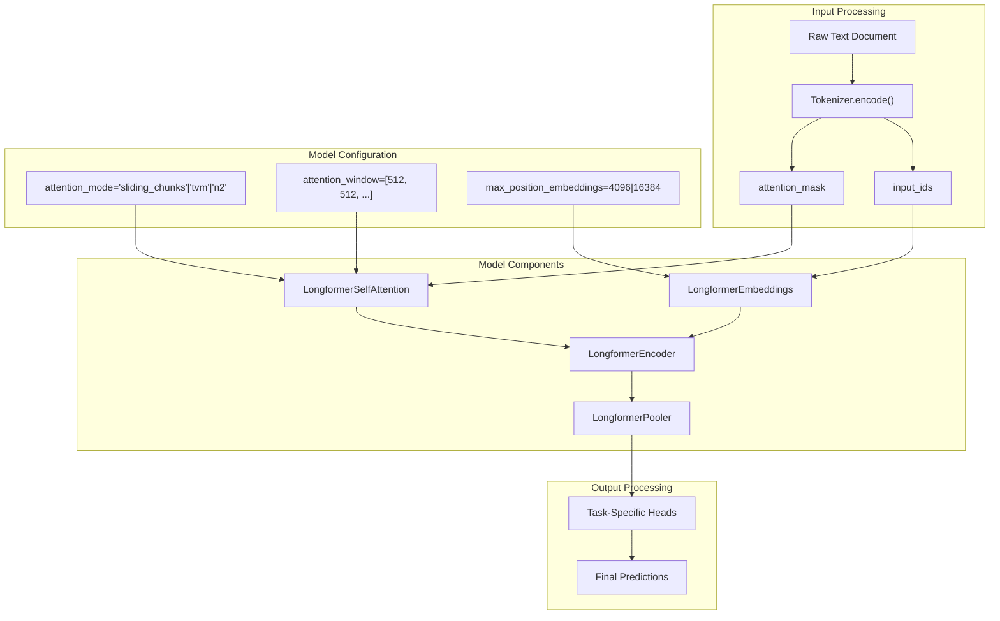

<!-- source: DeepWiki mcp.deepwiki.com · repo allenai/longformer · page 5.2 Usage Examples · fetched 2026-10-26 -->

# Usage Examples

<details>
<summary>Relevant source files</summary>

The following files were used as context for generating this wiki page:

- [README.md](README.md)
- [experiment.yml](experiment.yml)
- [longformer_on_beaker.sh](longformer_on_beaker.sh)

</details>


## Purpose
This page provides practical examples of how to use Longformer models in different scenarios. It demonstrates basic usage patterns, attention mechanism configurations, and task-specific implementations. For installation instructions, see [Installation](#5.1), and for development setup, see [Development Setup](#5.3).

## Basic Usage

### Loading and Running the Base Model

The following example demonstrates how to initialize a Longformer model from a pretrained checkpoint and run inference on a long document:

```python
import torch
from longformer.longformer import Longformer, LongformerConfig
from longformer.sliding_chunks import pad_to_window_size
from transformers import RobertaTokenizer

# Load configuration and set attention mode
config = LongformerConfig.from_pretrained('longformer-base-4096/') 
config.attention_mode = 'sliding_chunks'  # Choose from: 'n2', 'tvm', 'sliding_chunks'

# Initialize model and tokenizer
model = Longformer.from_pretrained('longformer-base-4096/', config=config)
tokenizer = RobertaTokenizer.from_pretrained('roberta-base')
tokenizer.model_max_length = model.config.max_position_embeddings

# Prepare input (a long document)
SAMPLE_TEXT = ' '.join(['Hello world! '] * 1000)
input_ids = torch.tensor(tokenizer.encode(SAMPLE_TEXT)).unsqueeze(0)

# Set attention mask (0: no attention, 1: local attention, 2: global attention)
attention_mask = torch.ones(input_ids.shape, dtype=torch.long, device=input_ids.device)
attention_mask[:, [1, 4, 21,]] = 2  # Set global attention on specific tokens

# Pad sequence length to window size (required for sliding_chunks attention)
input_ids, attention_mask = pad_to_window_size(
        input_ids, attention_mask, config.attention_window[0], tokenizer.pad_token_id)

# Run inference
output = model(input_ids, attention_mask=attention_mask)[0]
```

Sources: [README.md:72-107]()

### Basic Usage Flow

This diagram illustrates the standard flow for using Longformer:



Sources: [README.md:72-107](), [longformer/longformer.py](), [longformer/sliding_chunks.py]()

## Attention Mechanisms

### Attention Modes

Longformer provides three attention modes which can be configured through `LongformerConfig`:

1. **'n2'**: Standard full attention with O(n²) complexity - useful for short sequences
2. **'tvm'**: Custom CUDA kernel implementation of sliding window attention - fastest on GPU
3. **'sliding_chunks'**: PyTorch implementation of sliding window attention - supports CPU, TPU, and fp16

```python
# Choose attention mode when loading configuration
config = LongformerConfig.from_pretrained('longformer-base-4096/')
config.attention_mode = 'sliding_chunks'  # Choose from 'n2', 'tvm', or 'sliding_chunks'
```

Sources: [README.md:79-83]()

### Global vs. Local Attention

Longformer uses a mix of global and local attention to efficiently process long documents:



To set global attention on specific tokens:

```python
# Initialize with local attention (1) for all tokens
attention_mask = torch.ones(input_ids.shape, dtype=torch.long)

# Set global attention (2) based on the task
# For classification: the <s> token (first token)
attention_mask[:, 0] = 2

# For QA: all question tokens (example assumes first 10 tokens are question)
attention_mask[:, :10] = 2
```

Sources: [README.md:96-100]()

## Using Huggingface Integration

### Simplified Usage with Transformers Library

Since Longformer is integrated with Huggingface transformers, you can use it with a simplified API:

```python
from transformers import LongformerModel, LongformerTokenizer

# Load pretrained model and tokenizer
model = LongformerModel.from_pretrained("allenai/longformer-base-4096")
tokenizer = LongformerTokenizer.from_pretrained("allenai/longformer-base-4096")

# For task-specific models:
from transformers import LongformerForQuestionAnswering
qa_model = LongformerForQuestionAnswering.from_pretrained("allenai/longformer-base-4096")
```

Sources: [README.md:30-36]()

### Available Task-Specific Models



Sources: [README.md:36]()

## Memory Optimization with Gradient Checkpointing

### Reducing Memory Usage

Gradient checkpointing reduces memory usage by approximately 5x, enabling the processing of longer sequences on smaller GPUs:

```python
# Enable gradient checkpointing when loading model
from transformers import LongformerModel
model = LongformerModel.from_pretrained("allenai/longformer-base-4096", gradient_checkpointing=True)
```

Sources: [README.md:21-27]()

### Memory-Sequence Length Tradeoff



Sources: [README.md:21-23]()

## LongformerEncoderDecoder (LED) for Sequence-to-Sequence Tasks

### Using LED for Summarization

LED extends Longformer for sequence-to-sequence tasks like summarization:

```python
from transformers import LEDForConditionalGeneration, LEDTokenizer

# Load pretrained model and tokenizer
model = LEDForConditionalGeneration.from_pretrained("allenai/led-base-16384")
tokenizer = LEDTokenizer.from_pretrained("allenai/led-base-16384")

# Enable gradient checkpointing for memory efficiency
model = LEDForConditionalGeneration.from_pretrained(
    "allenai/led-base-16384", 
    gradient_checkpointing=True,
    use_cache=False  # Required with gradient_checkpointing=True
)

# Example for summarization
text = "your long document here..." * 100
inputs = tokenizer(text, return_tensors="pt", max_length=16384, truncation=True)

# Generate summary
summary_ids = model.generate(
    inputs["input_ids"],
    attention_mask=inputs["attention_mask"],
    max_length=512,
    num_beams=4,
    length_penalty=2.0,
)
summary = tokenizer.decode(summary_ids[0], skip_special_tokens=True)
```

Sources: [README.md:4-12](), [scripts/summarization.py]()

### LED Architecture



Sources: [README.md:6-8]()

## Converting Models to Long Versions

You can convert existing pretrained models (like BERT or RoBERTa) to their "long" versions:

```python
# This is a simplified example - see the conversion notebook for details
from transformers import RobertaModel
from longformer.longformer import LongformerSelfAttention, LongformerConfig

# Load the original model
roberta = RobertaModel.from_pretrained("roberta-base")

# Create Longformer configuration
config = LongformerConfig.from_pretrained("roberta-base")
config.attention_window = [512] * 12  # 12 layers with window size 512

# Initialize Longformer with the original model's weights
# (See conversion notebook for implementation details)
```

Sources: [README.md:38-39]()

## Task-Specific Examples

### Question Answering with TriviaQA

```python
from transformers import LongformerForQuestionAnswering, LongformerTokenizer
import torch

# Load pretrained model and tokenizer
model = LongformerForQuestionAnswering.from_pretrained("allenai/longformer-large-4096-finetuned-triviaqa")
tokenizer = LongformerTokenizer.from_pretrained("allenai/longformer-large-4096-finetuned-triviaqa")

# Example input
question = "Who won the 2020 US Presidential election?"
context = "After a contentious election process and the January 6th events, Joe Biden was certified as the winner of the 2020 US Presidential election."

# Tokenize input
encoding = tokenizer(question, context, return_tensors="pt")
input_ids = encoding["input_ids"]
attention_mask = encoding["attention_mask"]

# Set global attention on question tokens
# Find question tokens based on special token
sep_positions = (input_ids == tokenizer.sep_token_id).nonzero()
question_end_position = sep_positions[0, 1].item()
attention_mask[0, :question_end_position] = 2  # Set global attention on question tokens

# Get predictions
outputs = model(input_ids, attention_mask=attention_mask)
start_logits = outputs.start_logits
end_logits = outputs.end_logits

# Get answer span
start_idx = torch.argmax(start_logits)
end_idx = torch.argmax(end_logits) + 1
answer = tokenizer.decode(input_ids[0][start_idx:end_idx])
```

Sources: [README.md:114-117](), [scripts/triviaqa.py]()

### QA Data Flow



Sources: [scripts/triviaqa.py]()

### Document Classification

```python
from transformers import LongformerForSequenceClassification, LongformerTokenizer
import torch

# Load model and tokenizer
model = LongformerForSequenceClassification.from_pretrained(
    "allenai/longformer-base-4096", 
    num_labels=2  # Binary classification
)
tokenizer = LongformerTokenizer.from_pretrained("allenai/longformer-base-4096")

# Example document
document = "Long document text for classification..." * 100

# Tokenize with truncation
inputs = tokenizer(
    document, 
    max_length=4096, 
    truncation=True, 
    return_tensors="pt"
)

# Set global attention on the CLS token (first token)
inputs["attention_mask"][:, 0] = 2

# Get classification prediction
outputs = model(**inputs)
logits = outputs.logits
predicted_class = torch.argmax(logits, dim=1).item()
```

Sources: [README.md:98-99]()

## Code to Model Relationship

This diagram maps the high-level concepts to specific code entities:



Sources: [longformer/longformer.py](), [README.md:21-27](), [README.md:96-100]()

## Data Flow in Longformer Processing



Sources: [longformer/longformer.py](), [longformer/sliding_chunks.py](), [README.md:72-107]()

---

